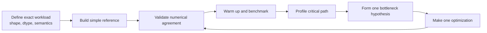

# Learning CUDA and AI kernel optimization

This guide is designed around the experiments in this repository and an A100
cluster. It progresses from measurement fundamentals to custom kernels and
distributed LLM training.

## Learning objective

By the end, you should be able to:

- Classify a workload as compute-, bandwidth-, communication-, or launch-bound
- Build a measured roofline and explain where a kernel sits on it
- Read GPU shapes, strides, layouts, and memory traffic from model code
- Benchmark correctly with warm-up, CUDA events, repeated samples, and
  numerical checks
- Use PyTorch optimized dispatch and `torch.compile`
- Write and tune Triton pointwise, reduction, and GEMM kernels
- Write a native CUDA extension for SM80
- Explain and reproduce FlashAttention's IO advantage
- Evaluate quantization kernels separately from quantization algorithms
- Measure NCCL and distributed scaling rather than assuming it
- Choose DP/FSDP/TP/PP/CP/EP from model and topology constraints

## The loop to practice every time

Never start by writing CUDA. Start by proving what is slow and why.

## Phase 1 — GPU execution fundamentals

### Week 1: CUDA mental model

**Learn**

- Grid, block, warp, and thread hierarchy
- SIMT execution and divergence
- Coalesced global memory access
- Registers, shared memory, L1, L2, and HBM
- Occupancy, latency hiding, and tail waves
- Asynchronous execution and synchronization

**Read**

- [CUDA Programming Guide](https://docs.nvidia.com/cuda/cuda-c-programming-guide/index.html)
- [CUDA Best Practices](https://docs.nvidia.com/cuda/cuda-c-best-practices-guide/index.html)
- [Ampere tuning guide](https://docs.nvidia.com/cuda/ampere-tuning-guide/index.html)

**Exercise**

1. Write vector add in PyTorch, Triton, and CUDA.
2. Sweep element counts from 1K to 128M.
3. Record launch-dominated and bandwidth-dominated regions.
4. Calculate useful GB/s.

**Exit criterion**

You can explain why a 10-microsecond launch matters for a tiny tensor but is
irrelevant for a multi-millisecond GEMM.

### Week 2: Benchmarking and roofline

**Learn**

- CUDA events versus CPU wall-clock
- Cold start, JIT, autotune, and steady-state timing
- Median, variance, p95/p99
- Arithmetic intensity and the Roofline model
- Useful versus physical FLOPs/bytes

**Use**

- `code/common.py`
- `results/benchmark_report.md`

**Exercise**

1. Measure copy, scale, add, and triad bandwidth.
2. Measure BF16 GEMM over square and rectangular shapes.
3. Plot arithmetic intensity versus achieved performance.
4. Compare measured roofs with A100 specifications.

**Exit criterion**

You can predict whether another arithmetic operation will be nearly free in a
memory-bound fused kernel.

## Phase 2 — Framework and compiler optimization

### Week 3: PyTorch dispatch and `torch.compile`

**Learn**

- Eager dispatch to cuBLAS/cuDNN/SDPA
- Dynamo graph capture, AOTAutograd, and Inductor
- Graph breaks, recompiles, dynamic shapes, and compile caches
- `default`, `reduce-overhead`, and `max-autotune` modes
- CUDA Graph interaction

**Read**

- [PyTorch `torch.compile`](https://docs.pytorch.org/docs/2.13/generated/torch.compile.html)
- [PyTorch compiler profiling](https://docs.pytorch.org/docs/2.13/user_guide/torch_compiler/torch.compiler_profiling_torch_compile.html)

**Use**

- `code/bench_transformer_training.py`
- `code/bench_transformer_compile_diagnosis.py`
- `code/bench_decode_graphs.py`

**Exercise**

1. Reproduce eager versus compiled transformer training.
2. Record compilation time and NVML SM-clock state separately; verify how a
   short 3-step warmup creates a false 1.26-1.31x cross-clock speedup when
   A100 DVFS boosts from 1140 MHz to 1410 MHz mid-benchmark.
3. Compare `default`, `max-autotune-no-cudagraphs`, module-only
   `reduce-overhead`, and a full-step CUDA Graph across launch-bound (1x512)
   and compute-bound (4x1024, 1x4096) shapes.
4. Sweep static and dynamic sequence lengths.

**Measured anchor**

At hardware-locked 1410 MHz on A100, `torch.compile(mode="default")` improved
the 4,096-token transformer block by 1.07-1.09x with ~10% less incremental
memory (because 75-80% of device time is already inside cuBLAS GEMMs and
FlashAttention-2), `max-autotune-no-cudagraphs` reached 1.12-1.14x via fused
Triton GEMM epilogues, and on launch-bound 1x512 a full-step compiled CUDA
Graph reached 3.36x versus 1.63x for module-only `reduce-overhead`.

### Week 4: Fusion with Triton

**Learn**

- Program instances rather than CUDA threads
- Block pointers, masks, and `tl.arange`
- Reductions in FP32
- Warps, stages, block sizes, and autotuning
- Debugging with small shapes and interpreter mode

**Read**

- [Triton tutorials](https://triton-lang.org/main/getting-started/tutorials/index.html)
- [Triton paper](https://doi.org/10.1145/3315508.3329973)

**Use**

- `code/bench_fused_ops.py`
- `code/bench_fused_linear_cross_entropy.py`
- `code/bench_matmul.py`

**Exercise**

1. Implement fused SwiGLU.
2. Implement one-row-per-program RMSNorm.
3. Implement token-tiled Linear + in-place online-softmax Cross-Entropy for
   `V = 128,256`, keeping dense projections on cuBLAS Tensor Cores while
   avoiding `[BT, V]` logit materialization and 4th-GEMM recomputation.
4. Sweep `num_warps`, `BLOCK_V`, token chunk size `C`, and BF16 versus
   `out_dtype=torch.float32` weight-gradient accumulation.

**Measured anchor**

The Triton RMSNorm reached 1.57 TB/s useful bandwidth and 12.5x the unfused
eager reference on 4096x8192, while token-tiled cuBLAS + in-place Triton
Linear + Cross-Entropy (`C = 1024`, `V = 128,256`) cut 16K-token SLM transient
logit memory 94.8x (`23,765.5 -> 250.6 MiB`, 16.0x below `torch.compile`) at
1.76x eager FP32 speed.

### Week 5: Native CUDA

**Learn**

- CUDA extension build path
- `__global__`, grid-stride loops, and device functions
- BF16 conversion and packed `__nv_bfloat162`
- Current streams and device guards
- Compiler architecture flags and line information

**Use**

- `code/cuda/swiglu_ext.cu`
- `code/cuda/swiglu_ext.cpp`
- `code/bench_cuda_extension.py`

**Exercise**

1. Compare scalar BF16 and BF16x2.
2. Add a BF16x4 or wider load path where alignment permits.
3. Inspect generated SASS if the disassembler is available.
4. Test odd element counts and noncontiguous inputs.

**Measured anchor**

The BF16x2 kernel reached 1.52 TB/s and essentially tied the Triton kernel at
large size.

## Phase 3 — Tensor Cores and attention

### Week 6: GEMM

**Learn**

- \(M,N,K\) shape effects
- Tensor Core alignment
- Shared-memory tiling and register blocking
- Grouped program ordering for L2 reuse
- Wave quantization and persistent scheduling
- Epilogue fusion

**Use**

- `code/bench_matmul.py`

**Exercise**

1. Add the full Triton tutorial autotune set.
2. Compare square, MLP-up, MLP-down, and decode shapes.
3. Explain every case where cuBLAS wins.
4. Add bias+activation epilogue and compare against two vendor calls.

**Measured anchor**

The current Triton kernel reached 141-215 TFLOP/s but remained 12-23% behind
cuBLAS. Treat that as a correct result, not a failure.

### Week 7: FlashAttention

**Learn**

- Online softmax
- Tiling Q/K/V and avoiding the score matrix
- Causal triangular work
- Forward versus backward
- PyTorch SDPA backend dispatch
- FA2 versus Hopper-only FA3 mechanisms

**Read**

- [FlashAttention-1](https://arxiv.org/abs/2205.14135)
- [FlashAttention-2](https://arxiv.org/abs/2307.08691)
- [FlexAttention](https://arxiv.org/abs/2412.05496)
- [PyTorch SDPA](https://docs.pytorch.org/docs/2.13/generated/torch.nn.functional.scaled_dot_product_attention.html)

**Use**

- `code/bench_attention.py`
- `code/bench_attention_backward.py`
- `code/bench_flex_attention_training.py`

**Exercise**

1. Sweep sequence 512 to 16K, head dimension 64/128, and batch.
2. Force math and Flash backends; verify how `enable_gqa=True` + a 2D
   `attn_mask` silently triggers a `33.2 GiB` math fallback at `S = 8192`.
3. Compare `FlexAttention` (`BlockMask` + `torch.compile(create_block_mask)`)
   against `flash_attn_varlen_func` (`cu_seqlens`) across 1 to 64 packed
   documents.
4. Implement Gemma-2 `tanh` logit soft-capping and a custom non-linear
   `score_mod` (`-slope_h * log2(1 + dist)`), comparing `FlexAttention` with
   materialized `torch.compile` and native `flash_attn_func`.

**Measured anchor**

At sequence 2048, Flash SDPA was 27.6x faster than math SDPA (80x less forward
memory) and 13.1x faster in forward+backward (12.3x less memory). On packed
16-document GQA (`1x8192`, `32Q/8KV`, E113), `FlexAttention` + `BlockMask`
was 15.8x faster than Cutlass dense-mask SDPA and 71.5x faster than auto SDPA
(`705` vs `33,152 MiB`), converged within 7.7% of `flash_attn_varlen_func` on
64 short SFT documents, and beat materialized `torch.compile` by 5.26x speed
and 11.7x memory on custom logarithmic-decay attention.

## Phase 4 — Inference

### Week 8: Decode and CUDA Graphs

**Learn**

- Why decode is GEMV/small-GEMM and KV-bandwidth heavy
- CPU launch gaps
- Static-shape capture and replay
- Graph memory pools
- Shape buckets and padding tradeoffs

**Use**

- `code/bench_decode_graphs.py`
- `code/bench_decode_kv.py`

**Exercise**

1. Sweep hidden size and batch.
2. Compare eager, compiled, and explicit graph capture.
3. Reproduce contiguous versus paged MHA/GQA/MQA attention.
4. Sweep context, batch, page size, CUDA-core versus tensor-core dispatch, and
   graph replay.
5. Measure p50 and p99 over a mixed request distribution in a full serving
   engine.

**Measured anchor**

Graph replay was transformative for the small smoke MLP but only about 3%
faster for the full 4096→11008 MLP. Launch optimization matters only when
launches are a meaningful part of latency.

For isolated paged attention, MQA was 6.45x faster than GQA at batch
64/context 8192, and large GQA batches sustained 1.5-1.7 TB/s of effective KV
bandwidth. Paging added 1.45x at batch 1 but was mostly hidden at batch.
Graph replay improved a tiny paged shape by 2.02x and did nothing measurable
once the KV kernel saturated the GPU. The CUDA-core backend did not support
group-size-32 MQA in the installed build; the tensor-core planner also needed
a 512 MiB workspace for the largest MQA batches.

### Week 9: Quantization and serving kernels

**Learn**

- Quantization algorithm versus runtime kernel
- Per-tensor, per-channel, and groupwise scales
- W8A8 versus W4A16
- Packed weight layouts and fused dequantization
- Prefill versus decode quantization regimes
- KV-cache quantization

**Read**

- [SmoothQuant](https://arxiv.org/abs/2211.10438)
- [GPTQ](https://arxiv.org/abs/2210.17323)
- [AWQ](https://arxiv.org/abs/2306.00978)
- [Marlin](https://github.com/IST-DASLab/marlin)

**Use**

- `code/bench_int8_gemm.py`
- `code/bench_marlin_w4a16.py`

**Exercise**

1. Reproduce the generic W8A8 negative control.
2. Reproduce vLLM Marlin W4A16 on square, MLP, and vocabulary projections.
3. Compare channelwise and group-128 quantization.
4. Compare prefill and decode shapes.
5. Report quality, memory, offline packing cost, and speed together.

**Measured anchor**

The generic INT8 path retained 0.99988 cosine similarity but was much slower
than BF16 cuBLAS. Lower precision is not a speedup without the right kernel.

With the production Marlin kernel, the 4096→32000 vocabulary projection was
2.10x faster at M=1 and 2.36x at M=32, but only 0.70x BF16 speed at M=512.
Square and MLP-down shapes did not win. Group-128 compressed weights by 3.88x
and improved synthetic cosine similarity to about 0.9938. The lesson is to
benchmark the exact projection and batch regime rather than quote one global
"INT4 speedup."

## Phase 5 — Distributed LLM training

### Week 10: NCCL and topology

**Learn**

- All-reduce, all-gather, reduce-scatter, all-to-all
- Algorithm bandwidth versus bus bandwidth
- NVLink/NVSwitch versus inter-node fabric
- Rank mapping, NIC affinity, and GPUDirect RDMA
- Message-size effects

**Use**

- `code/distributed_allreduce.py`
- `code/bench_symmetric_memory_async_tp.py`

**Exercise**

1. Reproduce 8-GPU and 24-GPU all-reduce.
2. Compare NCCL `all_reduce` with NVSwitch `SymmetricMemory` `one_shot` and
   `two_shot` all-reduce across `64 KiB` to `64 MiB` on `TP = 2, 4, 8`; derive
   why `(TP - 1)` versus `2*(TP - 1)/TP` P2P read amplification makes 2-shot
   `4.23x` faster than 1-shot at `64 MiB` on `TP = 8`.
3. Add all-gather and reduce-scatter.
4. Record rank variance and p99.
5. Use `nvidia-smi topo -m` and NIC topology to explain the gap.

**Measured anchor**

At 256 MiB, NCCL bus bandwidth was 197 GB/s intra-node and 139 GB/s across 24
GPUs. Inside the 8xA100 NV12 NVSwitch domain (E114), `SymmetricMemory` 2-shot
all-reduce cut `64 KiB` latency from `251.4 us` (NCCL) to `22.2 us` (**11.4x**
faster on `TP = 8`) and `1 MiB` from `284.1 us` to `32.9 us` (**8.83x**), while
still sustaining **196.4-209.6 GB/s** bus bandwidth at `64 MiB` (**1.15-1.48x**
over NCCL).

### Week 11: DDP, FSDP, and model parallelism

**Learn**

- DDP bucketization and overlap
- FSDP/ZeRO all-gather and reduce-scatter
- Tensor, sequence, context, pipeline, and expert parallelism
- `SymmetricMemory` copy-engine `Async-TP` (`_micro_pipeline_tp`) and `M_shard`
  wave quantization
- Weak versus strong scaling
- Scaling efficiency and MFU

**Read**

- [ZeRO](https://arxiv.org/abs/1910.02054)
- [FSDP](https://arxiv.org/abs/2304.11277)
- [Megatron-LM](https://arxiv.org/abs/1909.08053)
- [Megatron scaling](https://arxiv.org/abs/2104.04473)
- [Sequence parallelism](https://arxiv.org/abs/2205.05198)
- [Ring Attention](https://arxiv.org/abs/2310.01889)
- [DeepSpeed-Ulysses](https://arxiv.org/abs/2309.14509)
- [Unified Sequence Parallelism (USP)](https://arxiv.org/abs/2405.07719)
- [GPipe](https://arxiv.org/abs/1811.06965)
- [Zero Bubble Pipeline Parallelism](https://arxiv.org/abs/2401.10241)
- [DeepSeek-V3 DualPipe](https://arxiv.org/abs/2412.19437)
- [PyTorch `torch.distributed.pipelining`](https://docs.pytorch.org/docs/2.13/distributed.pipelining.html)

**Use**

- `code/distributed_training.py`
- `code/fsdp2_training.py`
- `code/bench_symmetric_memory_async_tp.py`
- `code/bench_context_parallel_attention.py`
- `code/bench_pipeline_parallel_zero_bubble.py`

**Exercise**

1. Reproduce 1/8/24-GPU DDP weak scaling.
2. Change DDP bucket size.
3. Measure exposed communication with compute-heavy and communication-heavy
   model sizes.
4. Reproduce root-only, layerwise re-shard, and layerwise no-reshard FSDP2.
5. Reproduce Megatron TP versus TP + Sequence Parallelism (`[B, S, H]`
   `Shard(1)` vs `[S, B, H]` `Shard(0)`) and TorchInductor `Async-TP` across
   `TP = 2, 4, 8`; verify both the `M_shard >= 1024` overlap threshold and
   PyTorch 2.13's `enable_symm_mem_for_group` + FX-cache-poisoning trap.
6. Reproduce long-context Context Parallelism (`CP = 2, 4, 8`, `S = 8K..128K`)
   across Contiguous vs `2*CP` Zig-Zag Ring FlashAttention-2 (with a fused
   Triton online-softmax LSE merger and double-buffered `(K, V, dK, dV)` P2P
   overlap), GQA-native vs 32-head KV-expanded DeepSpeed-Ulysses, Hybrid 2D
   `USP (Ulysses x Zig-Zag Ring)` across `H_kv = 8, 4, 2, 1`, and PyTorch 2.13
   experimental `context_parallel`.
7. Reproduce 16-layer Llama-3-8B-width Pipeline Parallelism (`PP = 4, 8`,
   `M = 8, 16, 32`, `S = 1K..8K`) across `GPipe`, `1F1B`, `Interleaved 1F1B`,
   `ZB1P`, `ZB-V`, and `DualPipeV`; implement a zero-copy `SplitDWLinear` +
   in-place cuBLAS `addmm_` `dw_builder`, measure how weightless
   FlashAttention-2 backward skews `t_F : t_Bx : t_Bw` with sequence length,
   and compare naive `MUST_SAVE(all mm)` SAC against SwiGLU-MLP selective
   recomputation.

**Measured anchor**

The 102.8M-parameter workload achieved 89.4% weak-scaling efficiency on 8 GPUs
and 78.8% on 24. On the 607M-parameter AdamW workload:

- Root-only FSDP2 was 1.66x faster than DDP on 8 GPUs and 1.77x on 24.
- Layerwise re-sharding reduced peak allocated memory by 7.06x and 11.40x,
  respectively, but repeated parameter all-gathers reduced throughput.
- Layerwise no-reshard halved the all-gather count and recovered most of the
  root-only throughput while retaining large memory savings.
- On the Llama-3-8B GQA Transformer block (`TP = 8`, E114), sequence-first
  `Shard(0)` (`[S/TP, B, H]`) eliminated `cat_split` reassembly kernels, beat
  `Shard(1)` by **1.61x** at `1x4096` (`6.35` vs `10.26 ms`), cut `8x4096`
  incremental step memory **1.99x** (`2,576.8 -> 1,295.0 MiB`), and unlocked a
  **1.06-1.08x** `Async-TP` overlap speedup (**1.22x** over Megatron TP eager)
  once `M_shard >= 2048` (after regressing **0.63x** at `M_shard = 512`), while
  batch-first `Shard(1)` compiled SP reached **1.32x** over Megatron TP eager
  (`31.71 ms`, `1,504.5 MiB`) at `8x4096` via contiguous per-sequence
  FlashAttention-2 strides.
- In long-context causal GQA training (`CP = 2, 4, 8`, `S = 8K..128K`, E115),
  contiguous Ring Attention lost **1.77x** at `128K` (`595.3` vs `337.2 ms` on
  `CP = 8`) due to `(2*CP - 1)/CP = 1.875x` causal triangle imbalance; `2*CP`
  Zig-Zag Ring + fused Triton online-softmax LSE merger + native 2-stream
  `ProcessGroupNCCL` async `(K, V, dK, dV)` P2P overlap reached **1,460.9
  TFLOP/s** (**91.5%** strong-scaling efficiency vs 1 GPU, with **1.30x** P2P
  overlap speedup at `16K`), Hybrid 2D `USP (U4xR2)` cut 8-step Ring launch
  cost **2.27x** at `8K` and hit **1,501.8 TFLOP/s** (**94.1%** efficiency) at
  `128K` while handling `CP > H_kv` (`H_kv = 4, 2, 1`) with zero KV head
  replication, and GQA-native DeepSpeed-Ulysses reached **1,531.3 TFLOP/s**
  (**7.67x** over 1 GPU = **95.9%** efficiency at `128K`), cutting 32-layer
  Llama-3-8B `64K` activation memory from **387.8 GiB** to **40.5 GiB**/GPU and
  sustaining **1,607.8 TFLOP/s** on full RoPE blocks at `128K`.
- In 16-layer Llama-3-8B-width (`3.49B`-parameter) Pipeline Parallelism across
  `PP = 4, 8` and `M = 8, 16, 32` (`S = 1,024..8,192`, E116), replacing PyTorch
  2.13's `stage_backward_input` Python `grad_fn` walker (`dw_builder=None`)
  with zero-copy `SplitDWLinear` + in-place cuBLAS `addmm_` `dw_builder` +
  functional `@torch.compile` fusions accelerated `ZB-V` by **1.21x** (`578.1
  -> 478.0 ms`, **1,500.0 TFLOP/s**) and cut peak rank activation memory
  **1.72x** (`9,344.0 -> 5,420.3 MiB`) while bypassing PyTorch 2.13's
  `OptimizedModule` rejection and fixing `_prepare_backward_infra`'s phantom
  `dw_builder` shape-inference queue corruption (`dw_rel_l2 = 15.16 -> 0.0`).
  On `PP = 8, M = 16`, `ZB1P`, `ZB-V`, and DeepSeek-V3 `DualPipeV` beat `1F1B`
  by **1.19x**, **1.28x**, and **1.18x** (reaching **93.0%** and **84.9%**
  strong-scaling efficiency at `M = 32`, with `ZB-V` ahead intra-node because
  PyTorch 2.13 runs `DualPipeV`'s `OVERLAP_F_B` sub-actions sequentially on one
  compute stream); V-shaped `(stage r, stage 2*PP - 1 - r)` placement collapsed
  `1F1B`'s **3.89x** `max/min` rank memory cliff (`5,388.3` vs `1,385.1 MiB`,
  and `GPipe`'s **21,401.0 MiB** wall) to **1.27x-1.28x**, isolated `t_Bx /
  t_Bw` grew from **1.40x** (`S = 1,024`) to **1.75x** (`S = 8,192`) from
  weightless FlashAttention-2 backward (`ZB-V` speedup tapering **1.34x ->
  1.23x**), and selective `28,672`-wide SwiGLU-MLP recomputation
  (`sac_mlp_recomp`) cut peak activations **2.04x** on `1F1B` and **2.18x** on
  `GPipe` where naive `MUST_SAVE(all mm)` saved **1.00x** (`0%`).

Do not treat root-only as universally best. The result means that this model
fit comfortably and favored a few large collectives. Layerwise grouping is the
capacity-oriented design and creates the granularity needed for overlap.

### Week 12: MoE and capstone

**Learn**

- Routing, histogram/prefix sum, permutation, grouped GEMM, combine
- Expert imbalance and padding
- Expert-parallel all-to-all
- Communication overlap

**Read**

- [MegaBlocks](https://arxiv.org/abs/2211.15841)
- [CUTLASS grouped scheduler](https://docs.nvidia.com/cutlass/latest/media/docs/cpp/grouped_scheduler.html)

**Use**

- `code/bench_fused_moe.py`
- `code/distributed_alltoall.py`
- `code/distributed_ep_overlap.py`
- `code/distributed_ep_roundtrip.py`
- `code/distributed_variable_alltoall.py`
- `code/bench_moe_router.py`
- `code/distributed_moe_end_to_end.py`
- `code/distributed_moe_capacity.py`
- `code/distributed_moe_skew_sweep.py`
- `code/distributed_moe_temporal_skew.py`
- `code/distributed_moe_packed_dispatch.py`
- `code/distributed_moe_int8_dispatch.py`
- `code/distributed_moe_int8_fused_dispatch.py`
- `code/distributed_moe_int8_roundtrip.py`
- `code/distributed_moe_int8_alignment_sweep.py`
- `code/distributed_ep_int8_return_overlap.py`
- `code/distributed_moe_variable_int8_overlap.py`
- `code/distributed_moe_route_prep_overlap.py`
- `code/distributed_moe_padded_capacity.py`
- `code/distributed_moe_capacity_frontier.py`
- `code/distributed_moe_sparse_padding.py`
- `code/bench_moe_training_grouped_gemm.py`
- `code/analyze_moe_training_grouped_gemm.py`

**Exercise**

1. Reproduce the 8- and 32-expert SLM sweeps with uniform and hot routing.
2. Explain how expert count, token count, top-k, assignment padding, and
   routing coefficient of variation change the result.
3. Replace the per-expert loop with a second production grouped or
   block-sparse baseline.
4. Reproduce 8- and 24-GPU token-sized all-to-all, then overlap dispatch with
   expert computation.
5. Hold total work fixed and sweep one, two, four, and eight microbatches.
6. Explain why the largest overlap speedup can lose in absolute latency.
7. Explain why overlap is neutral on one NVLink node but useful across nodes.
8. Add the combine all-to-all and compare one-way versus full round-trip
   overlap.
9. Reproduce balanced, globally hot, and locality-preserving rotated-hot
   variable-split dispatch.
10. Add capacity factors and report dropped assignments together with
    latency.
11. Compare PyTorch and fused router top-k, then measure expert-assignment
    sorting/padding.
12. Reproduce the integrated router→permutation→variable-dispatch→expert→
    weighted-combine layer and explain its placement sensitivity.
13. Sweep destination capacity and report dropped assignments, retained
    router weight, fully dropped tokens, latency, and output quality together.
14. Sweep a continuous router bias and identify the first 1.25x and 2x
    topology-specific latency thresholds.
15. Compare steady, rotating-hot, and persistent-hot microbatch cycles; show
    why aggregate balance can hide per-step tails.
16. Compare split metadata, all-in-one packets, and metadata-only packets;
    preserve downstream contiguity and use order-balanced crossover timing.
17. Compress routed activations to INT8, report bytes, conversion overhead,
    receiver skew, and numerical drift, then identify the topology crossover.
18. Fuse reduction, scale generation, quantization, metadata packing,
    dequantization, and metadata unpacking; compare stage and full-layer gains.
19. Compress expert outputs before the return all-to-all; compare BF16,
    forward-only INT8, and bidirectional INT8, including the cost of a
    separate scale collective.
20. Pack INT8 values and the BF16 scale into one return packet, then compare
    minimal and aligned row sizes to isolate launch-count and alignment
    effects.
21. Pair naturally aligned `H-2` widths with standard transformer widths and
    sweep 2/4/8/16/32/64-byte packet rounding on one and three nodes.
22. Integrate aligned packet return into the fixed-work three-stage pipeline;
    separate packetization, overlap, and combined speedups.
23. Replace equal splits with router-derived variable counts; compare BF16,
    two-collective INT8, and aligned packet pipelines under balanced,
    moderate, and extreme receiver skew.
24. Move router, packing, count exchange, and split extraction into the timed
    path; compare precomputed, online-staged, and double-buffered schedules.
25. Replace variable splits with static-capacity equal all-to-all; report
    synchronization savings together with padding, dense expert work, drops,
    and quality.
26. Derive the exact lossless source-destination slot threshold, sweep nearby
    capacities in both orders, and distinguish minimum size from fastest
    fused-expert shape.
27. Mark static padding with invalid expert IDs, compare GPU compaction and
    output-zero strategies, and report global versus critical-rank padding.
28. Replace the synthetic router with learned outputs and add model-level
    quality checks.
29. Implement full differentiable fine-grained MoE training (`E = 64, top-8`,
    `Fwd + dX + dW + dRouter` + Switch/z-loss): audit PyTorch 2.13's SM80
    `torch._grouped_mm` (`6` `DtoH` syncs + `384` launches), build device-resident
    Triton Grouped GEMMs (`Fwd`, `dX`, `dW`) and fused `Permute + SwiGLU +
    WeightedCombine (dy_perm + d_probs)` kernels, capture the dynamic-routing
    training step in a `CUDAGraph`, and overlap 8-GPU `EP = 8` backward
    `AllToAll` behind local `dW` GEMMs (`Split-dW`).

**Measured anchor**

For the 32-expert SLM shape at 512 tokens/top-2, vLLM's fused path was 19.1x
faster than the explicit per-expert PyTorch loop. At 2048 tokens, hot routing
reduced useful throughput by 17.3%. The 4096-hidden LLM shape reached
110.7 useful TFLOP/s with uniform routing at 512 tokens/top-2, versus
85.6 TFLOP/s under hot routing.

The equal-split BF16 all-to-all floor was about 0.096 ms on 8 GPUs and
0.251 ms on 24 GPUs. At 4096 tokens per peer, logical per-rank injection was
210.1 GB/s intra-node and 30.6 GB/s across three nodes. Treat this as a
payload-throughput metric, not physical network bus bandwidth.

With four microbatches, overlapping dispatch of the next chunk with fused
expert compute was effectively neutral on 8 GPUs (best 1.026x), but reached
1.225x across 24 GPUs at 256 tokens per peer. That reduced critical path by
18.3% and achieved 93.9% of the simple pipeline ideal. The smallest 8-GPU
case slowed slightly, which is an important reminder that overlap has
bookkeeping and resource-contention costs.

At fixed total work, four chunks were best for 1024 tokens per peer:
6.525 ms and 1.294x faster than unchunked sequential. Eight chunks had the
larger same-chunk speedup but was 1.7% slower in absolute time. For 4096
tokens per peer, eight chunks reached 24.452 ms, only 0.5% ahead of four.
Always choose chunking by fixed-work end-to-end latency, not a speedup ratio.

With the combine all-to-all included, the 24-GPU pipeline improved by 1.522x
at 1024 total tokens per peer and 1.488x at 4096. Pipelined latency finished
only 5.3% and 14.4% above isolated compute time, respectively. On 8 GPUs, the
same full round trip improved by about 1.07x, showing that the return path can
make overlap worthwhile even when dispatch-only overlap is nearly neutral.

Variable splits reveal why routing and placement matter. At 24 GPUs/4096
tokens per rank, one global 80%-hot destination received 19.2x the mean load
and ran 13.96x slower than rotated-hot placement. Rotated-hot kept 80% of
traffic local and was 1.68x faster than balanced routing. Capacity 1.25 made
the global-hot dispatch 7.87x faster only by dropping 74.8% of assignments;
always report capacity loss beside latency.

Locally, vLLM fused top-k was 2.36-2.60x faster than the PyTorch reference.
Router projection, top-k, and assignment alignment are fixed costs: together
they occupied about 30% of the 32-token path, 20.9% at E=32/T=512, and only
2.8% at E=32/T=8192. Optimize routing aggressively for decode/small batches,
but do not expect it to matter as much once expert GEMMs dominate.

The integrated synthetic layer makes those stages interact. At 24 GPUs and
2048 tokens/rank, balanced routing took 2.855 ms, global-biased routing took
18.707 ms, and a route with 95.0% local assignments took 2.630 ms. The global
route sent 95.1% of assignments to rank 0, creating 22.8x mean receive load
and a 6.55x end-to-end slowdown versus balanced routing. Router plus packing
still occupied about 21.5% of the balanced path, while the hot rank's expert
compute dominated the globally biased path. All distributed outputs matched
the global-expert reference exactly in BF16.

Capacity can remove that hotspot only by changing the model output. In the
capacity-capable 24-GPU path at 2048 tokens/rank, factor 1.25 improved latency
from 19.429 ms to 3.705 ms (5.24x), but dropped 89.9% of assignments, retained
12.0% of router weight, fully dropped both experts for 82.1% of tokens, and
reduced cosine similarity to 0.393. Factor 8 still dropped 61.8% of
assignments and reached only 0.825 cosine while giving 2.29x speedup. On
8 GPUs, factor 8 dropped nothing and was slightly slower than uncapped because
selection overhead remained. Never report capacity latency without its
assignment, router-weight, token-coverage, and quality losses.

The continuous bias sweep shows that waiting for an extreme 95%-hot route is
too late. At 24 GPUs/2048 tokens, bias 0.5 sent only 10.4% of assignments to
rank 0 yet raised latency 1.38x; bias 1 sent 20.9% and raised latency 2.06x.
The same bias 1 produced 1.51x on one 8-GPU node. Cross-node latency first
exceeded 1.25x at bias 0.5 and 2x at bias 1, versus bias 1 and 2 intra-node.
At 24-GPU bias 1, traffic still covered 19.9 effective destinations, so a
single overloaded receiver can dominate long before routing globally
collapses. Route-set match had already fallen to 68.0% and synthetic output
cosine to 0.843, underscoring that load balance and routing semantics must be
optimized together.

Temporal balancing does not fix a synchronized hotspot. At 24 GPUs/2048
tokens per rank per microbatch, rotating bias 1 returned aggregate receiver
max/mean to 1.06x over a 24-step cycle, yet cycle time rose from 74.334 ms to
126.720 ms (1.70x) and step p95 reached 8.196 ms. Rotating bias 2 remained
1.05x aggregate-balanced but reached 255.202 ms (3.43x) and 12.194 ms p95.
Those cycle costs were within about 3% and 1% of persistent bias-1/bias-2
hotspots. Every step still synchronizes on the current hot receiver, so
rotating which rank is slow changes long-run fairness, not the critical path.
On 8 GPUs the corresponding 2048-token ratios were 1.55x and 2.14x.

Packing fewer collectives is useful only when the next kernel can consume the
layout. Appending ID and weight to each hidden row reduced three payload
all-to-alls to one, but forced a full hidden-state copy before fused experts.
In a 24-GPU Latin-square crossover it was about 4-5% slower in dispatch and
neutral end to end. Packing only ID and weight preserved contiguous hidden
activations, reduced payload collectives from three to two, and reproduced
1.027-1.036x dispatch plus 1.014-1.022x full-layer speedup. The same method
lost intra-node, where packing overhead exceeded the saved launch.

Low-precision communication has a second crossover. Per-token INT8 reduced
forward-dispatch bytes by 49.8% with output cosine above 0.99991, but generic
PyTorch conversion cost about 0.24 ms to quantize and 0.10 ms to dequantize.
It therefore fell to 0.605x dispatch and 0.876x layer speed on 8 GPUs, and
0.913x/0.915x for balanced 24-GPU traffic. Under moderate 24-GPU skew it
reached 1.094x dispatch and 1.022x layer speed; extreme skew reached
1.249x and 1.061x. The lesson is to fuse conversion with transport and target
network-bound routes, not to assume half the bytes means twice the speed.

Fusing conversion changes the result substantially. The Triton send/receive
kernels made quantize/pack about 2.87x faster and dequantize/unpack about 1.79x
faster than eager tensor composition. Balanced 24-GPU dispatch crossed over
to 1.121x BF16, but the full layer remained 0.999x because expert compute,
return communication, and other fixed work dominated. Moderate and extreme
skew reached 1.109x and 1.149x full-layer speed. Always distinguish a faster
communication stage from a faster model layer.

Return compression adds a collective-design lesson. Per-row INT8 cut the
expert-output return payload by 49.9%, but sending the BF16 scale separately
made the 8-GPU return path only 0.489x BF16. In four 24-GPU crossovers,
moderate skew was also a negative result: bidirectional compression reached
1.096x BF16 versus 1.116x for forward-only. Extreme skew amortized the extra
launch: return communication reached 1.474x and the full layer 1.187x BF16,
1.034x faster than forward-only. Maximum output NRMSE was 0.01556 and minimum
cosine 0.999879. Optimize the packet and collective count together; halving
the large payload is not sufficient when it creates another synchronization.

The obvious one-collective fix first failed. A minimal 1026-byte packet was
only 0.909x, 0.779x, and 0.517x the two-collective 24-GPU return speed for
balanced, moderate, and extreme skew. Its two-byte row offset misaligned
successive Triton rows and NCCL destination segments. Padding to 1040 bytes
retained 49.2% byte reduction and changed the result to 1.112x, 1.097x, and
1.046x return speed. Full-layer gains versus two collectives were 1.039x,
1.023x, and 1.005x. On 8 GPUs the layer remained neutral at about 1.003x.
Packet alignment can matter more than the 14 bytes saved by a minimal format.

The paired-width sweep turns that observation into a rule with boundaries.
On 24 GPUs, standard 512/1024/4096-width packets rounded to 2 bytes reached
only 0.862x the two-collective path in aggregate and 0.454x in the worst
case. Eight-byte rounding reached 1.022x in aggregate but still lost at
0.885x. Sixteen bytes was the smallest alignment that won every tested
width/load case: 1.096x median and 1.017x worst case. The naturally aligned
H-2 controls clustered near 1.42x because their physical packet was unchanged
across alignment labels. On 8 GPUs, 16-byte rounding was 1.004x in aggregate
and 0.948x in the worst case. Always state the topology beside an alignment
recommendation.

Aligned return compression remains useful after overlap, but overlap is the
larger lever. On 24 GPUs, BF16 pipelining reached 1.422x and 1.513x for
1024/4096 tokens per peer. The aligned packet pipeline reached 1.448x and
1.551x unpipelined BF16, only about 1.022x beyond already-pipelined BF16.
However, it was 1.117x and 1.145x faster than two-collective INT8 pipelining,
which was slower than the BF16 pipeline. On 8 GPUs, packet pipelining remained
below BF16 pipelining. Report the composition of optimizations; do not
attribute the complete 1.55x gain to compression.

Router-derived variable splits reveal that even this composition is
workload-dependent. At 24 GPUs/2048 tokens per rank, balanced, bias-1, and
bias-4 routes produced 1.08x, 5.00x, and 22.82x maximum per-step receiver
imbalance. The aligned packet pipeline reached only 0.854x and 0.744x
pipelined BF16 for the first two routes; it reached parity at 1.004x only
under extreme skew. Bias-1 is the key negative result: sequential packet
compression was near break-even, but BF16 pipelining improved by 1.272x, so
compression removed communication the BF16 schedule was already hiding while
leaving conversion exposed. Under bias-4, the packet reached 1.394x
sequential BF16 and 1.072x two-collective INT8. Always benchmark the
integrated route-dependent critical path rather than adding isolated
compression and overlap speedups.

Online preparation is a separate systems boundary. Four chunks of router,
packing, count exchange, and host split extraction took about 4.0 ms on
24 GPUs and 3.4 ms on 8 GPUs. On 24 GPUs, staged BF16 latency became
2.004x/1.952x/1.300x the precomputed payload-only path for
balanced/bias-1/bias-4 routing. A second CUDA stream did not hide that tax:
staged-to-overlapped BF16 speed was 0.915x/0.931x/0.995x, and packet overlap
was 1.024x/0.910x/0.992x. The host split list required by variable-split
all-to-all remains a scheduling barrier, while concurrent router kernels can
contend with the active expert pipeline. The lesson is not "use more
streams"; first remove or redesign the CPU-visible dependency.

Static capacity is one redesign, but it changes the cost model. On 24 GPUs,
balanced factor 2 removed count exchange and Python split lists, remained
lossless, and reached 1.141x variable-split speed despite 50.4% padding and
2.02x fixed rows. The same method was only 0.947x on one 8-GPU node.
Moderate skew needed factor 8 to remain lossless and fell to 0.773x; factor 4
reached 1.068x only by dropping 3.6% of assignments. Extreme skew needed
factor 24 and fell to 0.753x; a 1.208x result at factor 2 discarded 86.1% of
assignments and reduced cosine to 0.484. Always distinguish a lossless static
systems win from a faster capacity-clipped model.

Coarse factors are not the final design point. The exact router-derived
24-GPU thresholds were factor 1.594 for balanced routing and 5.391 for
bias-1, not 2 and 8. They reached 1.246x and 1.121x variable-split speed
while remaining lossless. Bias-1 improved further to 1.188x with 12.5% slot
headroom even though padding rose from 81.4% to 83.5%; the larger tensor
landed on a better fused-expert shape. On 8 GPUs, exact balanced/bias-1
thresholds remained near parity at 0.997x/0.985x. Capacity design must
therefore tune both the lossless router bound and the downstream kernel
schedule rather than minimizing rows blindly.

Skipping padded expert work is not sufficient by itself. On 24 GPUs,
invalid-expert alignment removed 34.2%/79.7%/94.8% of aggregate aligned rows
for exact balanced/bias-1/bias-4 capacities, but only
28.6%/11.1%/1.1% on the critical rank. Identity-map compaction slowed the
balanced and bias-1 expert paths to 0.962x/0.955x dense speed and reduced
end-to-end static speed to 0.983x/0.962x dense. Bias-4 headroom improved the
expert and static layer by 1.072x/1.030x, yet remained only 0.766x the
variable path because transport still moved the padded tensor. A custom
row-selective Triton cleanup never beat vLLM's mapped zeroing. Optimize the
work on the slowest rank and the bytes on the wire, not aggregate skipped
rows.

Fixed-profile sparse transport removes the remaining uniform-byte penalty
without returning dynamic counts to Python. Calibrate a full
source-destination split matrix before execution, retain fixed asymmetric
split lists, and transmit only profiled entries. On 24 GPUs, an additive
+16-row profile was lossless and reached 1.180x/1.197x/1.124x dynamic
variable-split speed for balanced/bias-1/bias-4 routing. Uniform static
transport fell to 0.796x under bias-4, so profile shape—not just fixed versus
dynamic execution—determines the extreme-skew crossover.

Calibration policy is part of correctness. Multiplying each observed cell by
1.125 still dropped 0.110%/0.151%/0.090% of assignments because rare
low-count cells receive almost no absolute reserve. Adding sixteen rows per
cell was lossless in the final matrix. An oracle held-out matrix reached
1.183x/1.178x/1.174x, but zero padding was not always fastest; regular
collective schedules and count-exchange removal have value beyond byte
reduction.

Separate payload and route-building costs. On one 8-GPU node, +16 accelerated
the payload by 1.161x/1.174x/1.161x yet slowed the full layer to
0.952x/0.961x/0.959x because the general static packer performs two sorts.
Across nodes, communication savings were large enough to survive that tax.

The follow-up implements that kernel exercise. A destination-only stable sort
removes weight ordering when the profile is known lossless. A fused Triton
alternative removes both sorts: one program per top-k assignment atomically
reserves a destination-local slot, gathers the token hidden row, and writes
hidden state, local expert ID, router weight, and return token index.

At 512 hidden dimensions and 1024 assignments per rank, Triton packing was
3.36-3.55x the two-sort baseline on 8 GPUs and 3.48-3.52x on 24 GPUs.
Router-plus-pack improved by roughly 2.4-2.6x. The complete calibrated static
layer reached 1.500x/1.479x/1.501x dynamic speed intra-node and
1.704x/1.686x/1.453x cross-node for balanced/bias-1/bias-4 routing. This is a
useful example of a local kernel changing a distributed-systems conclusion:
the fixed profile did not need a different transport design; it needed the
packing path removed from the critical path.

Do not generalize the atomic path to overflow. Arrival order is not
highest-weight selection. Use it only with a verified lossless profile, add a
device overflow signal, and fall back or rebuild on a miss. Wider production
hidden states also need a tiled kernel rather than one program loading the
complete row.

The tiled follow-up separates the concerns. Kernel one assigns a fixed index
with one atomic per route. Kernel two launches an assignment-by-tile grid and
copies 128/256/512 hidden values per program. Across hidden 512/1024/4096 and
1024-16384 assignments per rank, the measured policy was:

1. Use one-pass atomic packing through hidden 1024. The extra reservation
   launch made tiling 1.12-1.17x slower at hidden 512.
2. Use tiled scatter at hidden 4096. With 256-wide tiles it remained
   3.1-3.3x faster than sorting and 1.16-1.22x faster than dynamic
   router-plus-pack.
3. Increase the tile to 512 once row traffic is large. At 8192 tokens and
   hidden 4096, tile 512 was 1.26-1.30x faster than tile 256 and
   1.88-1.97x faster than tile 128.

The tuned wide-row packer reached 4.11-4.19x sorting speed and
1.35-1.43x dynamic router-plus-pack speed across 8/24 GPUs. Route skew changed
packing latency by only 1.066x intra-node and 1.006x cross-node at the
largest shape, so the bottleneck was tile geometry and row traffic rather
than destination atomic contention.

The end-to-end integration is the important next lesson. At hidden 4096 and
512 tokens/rank, tile-512 still accelerated route-plus-pack by about
1.16-1.20x versus dynamic routing. That did **not** imply a faster layer:

1. The smallest held-out lossless margin was +18 rows per matrix cell on
   8 GPUs and +16 on 24 GPUs. Calibration headroom is topology-specific.
2. On 8 GPUs, fixed transport padded 14-20% of rows. The complete layer was
   0.990x/1.035x/1.015x dynamic speed for balanced/bias-1/bias-4 routing.
3. On 24 GPUs, padding rose to 30-37%. Prebuilt payload speed fell to
   0.814x/0.889x/0.987x and complete-layer speed to
   0.873x/0.917x/0.996x.
4. Tile-512 still beat the fixed two-sort layer by
   1.209x/1.107x/1.032x on 24 GPUs. The kernel optimization worked; the
   padded transport policy remained the bottleneck.

This is an Amdahl-law exercise with an algorithmic twist. Always measure the
optimized kernel inside the real communication and expert path, and track
physical padded work rather than only useful assignments. An additive reserve
on every source-destination cell scales poorly as world size grows; production
profiles need risk-aware capacity allocation, adaptation, and a correct miss
fallback.

The trained-router trace is the final check on that idea. The
[OLMoE-1B-7B-0924](https://huggingface.co/allenai/OLMoE-1B-7B-0924)
experiment uses 480 generated samples, 16 trained router layers, 64 experts,
and top-8 routing. Four domains calibrate profiles and six create controlled
drift.

1. The synthetic +18/+16 margins spilled on 32.6%/67.7% of 8-/24-rank
   layer-steps. "Lossless in one held-out batch" is not a deployment
   guarantee.
2. Sliding risk allocation can trade padding for overflow. At 24 ranks, the
   zero-extra-budget profile reduced fixed-plus-spill rows from 1.651x to
   1.197x dynamic, but every evaluated layer-step overflowed.
3. Correctness requires preserving overflow assignments. The measured design
   keeps accepted rows in fixed tile-512 slots and sends excess rows through a
   metadata-packed variable side channel. Partitioning was exact and the
   largest BF16 difference was 0.00390625.
4. The fallback architecture lost decisively: additive spill reached
   0.734x/0.612x dynamic speed on 8/24 GPUs, and risk-0 reached
   0.536x/0.515x. Smaller payload is not enough when a miss adds another
   guard, count exchange, dispatch, expert launch, and return collective.

The design lesson is to preserve one collective sequence. Do not bolt a full
variable pipeline onto a static fast path when misses are common. Explore a
single base-plus-overflow packet, receiver overprovisioning, or a transport
that accepts device-resident split counts.

The follow-up found an even simpler conditional policy:

1. Use fixed tile-512 all-to-all only when every source-destination count fits.
2. On any miss, execute the original full dynamic path instead of splitting
   the layer into base and overflow work.
3. Tune the profile for hit rate, not minimum packet size alone. The adaptive
   policy used 1.270x/1.412x average served rows but hit 88.9%/63.9% of
   8-/24-rank steps.
4. The resulting path reached 1.297x/1.159x dynamic speed. The lower-row
   additive profile missed more often and reached 1.176x/1.092x.
5. Do not assume point-to-point is cheaper than all-to-all. Grouped fixed-size
   P2P reached only 0.766x/0.554x dynamic and 0.591x/0.478x the matching
   fixed all-to-all policy.

An oversized-receive gate also matters: posting an eight-row NCCL receive for
a three- or five-row send timed out. In this PyTorch path, receiver
overprovisioning does not discover variable message length.

The device-side follow-up completes that exercise and reveals the next
boundary:

1. Reuse the tiled packer's overflow scalar, all-reduce it functionally, and
   pass the device boolean directly to `torch.cond`. A two-rank semantic gate
   selected distinct NCCL all-to-all signatures without `Tensor.item()`.
2. Use a fixed-signature exact miss path when Python split lists are forbidden:
   all-gather each token once, filter local-expert assignments on device, and
   reduce-scatter weighted token contributions. Its hidden-row ratio is
   `world_size / top_k`, or 1x at 8 ranks and 3x at 24 ranks for top-8.
3. The mechanism is correct but slower. Order-balanced expected speed was
   0.582x dynamic on 8 GPUs and 0.616x on 24 GPUs. BF16 accumulation kept the
   maximum difference at 0.015625 and cosine above 0.999993.
4. The global decision is not free. Speculative packing plus the scalar
   collective increased hit latency by about 1.98x/1.52x versus a precomputed
   8-/24-GPU branch. Structured device control flow added further overhead.
5. Compilation belongs in the design. Each profile/case specialization took
   about 0.36/0.70 seconds on 8/24 GPUs because functional all-to-all split
   sizes remain Python constants.

The lesson is precise: device-side branching works, but it does not create a
device-count transport. Production needs a collective/runtime that consumes
device-resident variable sizes, or a persistent scheduler that amortizes the
global decision and graph specialization. Otherwise the design chooses
between a synchronization barrier and fixed-signature overcommunication.

The persistent-controller follow-up tests the second option. Instead of one
overflow reduction and CPU synchronization per layer-step, it queues several
independent ready microbatches, retains their fixed routes, reduces one vector
of fit flags, and then launches the eager fixed or dynamic path:

1. Controller overhead amortizes almost linearly. At queue depth 8, vector
   decisions cost 18.9 microseconds per case on 8 GPUs and 22.5 microseconds
   on 24 GPUs, versus 123 and 156 microseconds for scalar decisions.
2. Queue depth alone is insufficient. The additive policy crossed break-even
   around 49%/43% hits on 8/24 GPUs. Its 68.5% intra-node hit rate reached
   1.111x dynamic, but its 33.3% cross-node hit rate reached only 0.954x.
3. Adaptive profiles clear the hit-rate boundary. At 88.9%/63.9% observed
   hits, depth-8 batching reached 1.234x/1.088x dynamic on 8/24 GPUs and
   1.242x/1.162x per-microbatch scalar control.
4. Amortization consumes memory and queueing budget. Eight retained routes
   added about 36/46 MiB per rank, and dispatch waits for the queue-level
   decision. This applies to ready microbatches, not sequential MoE layers
   whose hidden states depend on earlier layers.
5. Correctness stayed exact at the controller boundary: every decision
   matched the precomputed label, maximum BF16 difference was 0.0009765625,
   and minimum cosine was 0.99999976.

This is the scheduler version of Amdahl's law: a costly global decision can be
made cheap per item, but only if enough independent work is available and the
fast-path hit rate remains above the topology-specific break-even threshold.

Queueing changes the operating recommendation. A Poisson single-server model
driven by the measured scalar/vector service times tested immediate execution
against a full-batch-of-eight policy with timeout fallback:

1. Keep batching disabled at light load. At 50% scalar utilization, a 0.5 ms
   timeout forms almost no full batches and simply raises p99 by about 0.5 ms.
2. Do not claim a tail win from optimistic streaming alone. At 75%, streaming
   p99 improved, but the conservative batch-fence bound was still 6-7% worse
   than immediate service.
3. Enable a short batching window near saturation. At 90% load, 0.5 ms
   timeout reduced fenced p99 by 40.6% on 8 GPUs and 33.2% on 24 GPUs.
4. Capacity can improve latency under overload. At 110% scalar load, adaptive
   batching improved throughput by about 11.5% and bounded fenced p99 at
   73.7/90.0 ms instead of 4.0/6.5 seconds on 8/24 GPUs.
5. Admission control is still required. Depth-8 capacity was 1.242x/1.162x
   scalar. At 120% load, tails returned to seconds; 24 GPUs were beyond the
   measured batching capacity and 8 GPUs were too close to saturation.
6. Release results as soon as each sequential branch finishes. The difference
   between streaming and batch-fenced completion was another 5-9 ms near
   saturation.

The practical policy has two gates: profile hit probability determines whether
batching raises service capacity, and current utilization determines whether
waiting for a batch helps or hurts latency.

Continuous decode adds a different queueing problem: each active request
contributes one token per iteration, while prompt length and generated length
change the kernel cost and slot-release time. A measured-service simulation
composed the A100 paged-GQA and CUDA-Graph MLP results into a 32-layer
Llama-class decode stage:

1. Ragged work is a kernel property, not merely a memory-management feature.
   The mixed workload inflated padded-to-longest context work by about 3.26x.
   At 0.8x ragged capacity, the measured-fit ragged model sustained about
   1.92x the padded control's output-token throughput.
2. Homogeneous batches are a necessary negative control. They had only about
   3% position-induced padding, and ragged versus padded throughput stayed
   nearly equal below saturation. The large mixed-workload gain therefore
   comes from avoiding useless KV reads.
3. TPOT can remain stable while TTFT collapses. At 1.1x capacity, unbounded
   ragged FCFS held p99 TPOT near 19.5 ms once requests were active, but p99
   decode-stage TTFT grew to 10.1 seconds because new requests could not get a
   slot.
4. Admission control protects latency by converting overload into explicit
   rejection. A 250 ms predicted-TTFT guard admitted 88.5% of arrivals at
   1.1x load, retained 98.1% of output-token throughput, and held p99 TTFT at
   248 ms. At 1.25x load it admitted about 78.7%; capacity did not disappear.
5. Reserve memory and service work separately. The simulator reserves the
   full prompt-plus-output KV footprint against a 32 GiB budget, while each
   ragged step charges only live context. Production allocators grow pages
   incrementally and can preempt, but they still need an explicit overload
   policy.

The reported TTFT starts at the decode scheduler. It is not end-to-end TTFT:
prefill, prefix-cache lookup, tokenization, ingress, and sampling remain to be
measured on a live serving engine.

Static graph shapes do not imply static context padding. A follow-up tested
the deliberately restrictive alternative anyway: round a heterogeneous batch
to one global context shape or split it into sequential 2/4/8 context buckets,
then round batch sizes to powers of two.

1. Graph replay helps launch-bound work, not arbitrary padding. The measured
   batch-2/context-257 paged kernel improved 2.022x under replay, while the
   batch-64/context-2048 result changed by only 1.001x.
2. One global static bucket retained only 36.0% of ragged mixed-workload
   capacity because it charged 4.34x context work.
3. Splitting context shapes has a launch frontier. Four exact-batch buckets
   reduced work to 1.52x but launched about 2.98 groups per step and reached
   only 46.2% of ragged capacity.
4. Finer is not monotonically better. Eight power-of-two buckets reduced
   context work from 2.22x to 1.83x relative to four buckets, but nearly four
   sequential groups per step reduced capacity by another 7.1%.
5. Batch-bucket reuse has a cache/capacity exchange. Exact batches improved
   four-context capacity by 1.176x, but observed graph signatures increased
   3.38x.
6. The conclusion survives an optimistic bound. Granting every static
   attention group the full measured tiny-shape graph saving raised the best
   mixed policy only from 46.2% to 50.4% of ragged capacity.
7. Homogeneous traffic is less severe: fine buckets retained 79.5% of ragged
   capacity, or 83.2% under the optimistic bound. Heterogeneous context work,
   not CUDA Graph replay itself, causes the large loss.

Production engines can capture paged/ragged kernels with fixed metadata
buffers or piecewise graphs. Use graph buckets for launch and allocator
stability, but keep the attention kernel's useful work ragged whenever
possible.

Admission control also needs a fairness objective. The 250 ms TTFT guard was
audited over all nine prompt/output classes and compared with a dual policy
that also requires a predicted completion below 10 seconds.

1. The TTFT-only guard was almost class-neutral at 1.1x load: its Jain
   acceptance index was 0.9996, long-output acceptance was 99.3% of
   short-output acceptance, and long-prompt acceptance was 102.0% of
   short-prompt acceptance.
2. The dual guard admitted more requests, 90.3% versus 88.5%, because it
   filtered some expensive generations and freed slots for shorter requests.
3. Request count hid the tradeoff. Accepted output-token fraction fell from
   88.5% to 87.8%, mean accepted output length fell from 133.6 to 130.9
   tokens, and long-output acceptance fell to 95.1% of short-output
   acceptance.
4. Aggregate benefit was small: output throughput retained 99.8% of the
   TTFT-only result and p99 completion improved from 9.49 to 9.37 seconds.
5. At 1.25x load, the dual guard accepted 81.0% rather than 78.7% of requests,
   but long-output acceptance fell further to 94.1%.
6. The TTFT-only and unguarded paths reproduced v37 exactly, so the disparity
   comes from the new completion objective rather than simulator drift.

An SLO predictor is an implicit scheduling policy. If long generations are
allowed less access, make that choice explicit through token budgets, weighted
tenant quotas, or reservation classes; do not report a larger accepted-request
count as unconditional fairness.

Prefill adds a second source of head-of-line blocking. A measured-service
model fit FlashAttention latency to causal attention pairs, fit cuBLAS launch
and FLOP cost for Q/K/V/O plus gate/up/down, and composed both across 32 layers
with the ragged decode model.

1. The calibration was tight enough for a bounded scheduler study:
   FlashAttention fit error was at most 4.33%, and the dense model predicted
   the measured up/down projections within 0.65%.
2. Chunking preserves useful attention work but repeats launches. Relative to
   monolithic prefill, 2048/1024/512/256-token chunks added about
   2.5%/9.0%/21.8%/52.2% prefill service without a prefix cache.
3. Monolithic prefill maximized no-cache capacity at 7.36 requests/s but
   created a 348 ms p99 maximum token gap at 0.2x decode-only load.
4. A 1024-token chunk retained 93.4% of monolithic capacity, cut maximum-gap
   p99 by 75.4% to 85.6 ms, and reduced p99 TPOT from 108.4 to 70.2 ms.
   P99 TTFT increased from 1.20 to 2.23 seconds.
5. A 512-token chunk further reduced maximum-gap p99 to 54.9 ms, but its
   system load reached 0.92 and p99 TTFT reached 4.96 seconds. Smaller is not
   automatically better near capacity.
6. Decode priority can starve prefill. The 512-token 2:1 policy reached
   28.7 ms p99 TPOT but exceeded its own capacity and grew p99 TTFT to
   21.0 seconds. The 256-token 4:1 policy was overloaded even at 0.1x
   decode-only load.
7. Prefix reuse shifted the frontier. Giving half the requests a 75%-cached
   prompt removed 33.7% of prefill service and raised monolithic capacity by
   30.0%, from 7.36 to 9.57 requests/s.
8. Reuse did not remove the scheduler tradeoff. At 0.3x decode-only load,
   cached 1024-token chunks cut maximum-gap p99 from 351 to 88 ms versus
   monolithic, while p99 TTFT rose from 2.03 to 3.20 seconds.

The scheduler should adapt both chunk size and decode priority to prefill
queue load. Prefix-cache hits create capacity headroom; they do not justify an
aggressive decode-priority ratio after the prefill queue crosses capacity.

The next controller selected chunks by predicted kernel service instead of a
fixed token count. With active decode, a 50 or 100 ms base budget chooses the
largest fitting chunk; the budget increases when the oldest prefill request
waits too long. When no decode work is ready, the remaining prompt runs
monolithically.

1. The extension reproduced all 192 matching fixed-policy v40 scenarios
   exactly before evaluating adaptive behavior.
2. The 100 ms controller retained 98.9% of no-cache monolithic capacity,
   compared with 93.4% for fixed 1024 and 80.5% for fixed 512.
3. At no-cache 0.2x decode-only load, adaptive 100 ms interpolated between
   fixed 2048 and fixed 1024: p99 TTFT 1.72 seconds and p99 TPOT 84.6 ms.
4. Capacity recovery did not guarantee a stall tail. Only 5.9% of slices
   escalated at that load, but p99 maximum token gap reached 143 ms, nearly
   fixed-2048 behavior. Rare queue-relief slices control p99.
5. Prefix reuse made the central metrics attractive. At cached 0.2x load,
   adaptive 100 ms improved fixed-1024 TTFT from 904 to 868 ms and TPOT from
   55.5 to 55.1 ms while lowering system load.
6. Yet only 0.26% escalation raised cached p99 maximum token gap from 82 to
   136 ms. An infrequent long slice can be invisible in average or p95
   controller diagnostics and still dominate the user-visible tail.
7. Under overload the feedback intentionally relaxed. At no-cache 0.3x load,
   85.6% of adaptive-100 slices escalated and the policy converged toward
   large chunks to drain prefill. Both TTFT and token-gap SLOs could not be
   satisfied simultaneously beyond combined capacity.

An adaptive scheduler therefore needs two independent controls: admission or
queue-age protection for prefill, and a hard maximum decode-stall budget.
Escalating one time budget is a useful compromise but not a simultaneous SLO
guarantee.

The final local serving control separated those mechanisms. Active prefill
slices stayed under a non-escalating 100 ms model budget, while optional
admission rejected arrivals whose queued prefill GPU service exceeded two or
four seconds.

1. The hard slice worked: every scenario kept p99 maximum token gap below
   120 ms, including overload. Queue-age escalation was the cause of the
   larger v41 stall tails.
2. Hard slicing alone did not prevent queue collapse. At no-cache 0.3x
   decode-only load, p99 TTFT still reached 41.8 seconds.
3. The two-second backlog guard reduced that tail by 70.7% to 12.3 seconds,
   accepted 94.5% of requests and 94.1% of output tokens, and increased
   completed output throughput from 861 to 950 tokens/s by shedding work.
4. The predictor was not an end-to-end SLO. Accepted predicted prefill backlog
   p99 stayed at 1.98 seconds, while actual p99 TTFT was 6.2x larger because
   decode occupancy and future arrivals were omitted.
5. A looser four-second guard admitted slightly more at 0.3x load but worsened
   p99 TTFT from 12.3 to 15.5 seconds. More admission was not better.
6. At no-cache 0.4x load, the two-second guard accepted 85.9% and reduced
   p99 TTFT from 99.1 to 15.2 seconds while holding the maximum-gap p99 at
   86 ms.
7. Admission was strongly prompt-length biased. Rejected prompts were 3.11x
   longer than accepted prompts at 0.3x and 3.46x longer at 0.4x. Accepted
   and rejected output lengths were similar, so the policy selected prefill
   cost.
8. Prefix reuse reduced rejection: the cached 0.4x two-second policy accepted
   94.8%, versus 85.9% without cache, but long-prompt bias remained.

A production design needs a hard decode-stall cap, an end-to-end load
predictor that includes decode and future-arrival uncertainty, and explicit
prompt-token or tenant fairness. A queued-prefill-service threshold solves
neither TTFT prediction nor neutral admission by itself.

The final safety-factor audit asked whether a fixed structural margin can
repair that underprediction without a richer model. It multiplied predicted
prefill service by 2x/4x/8x before applying the same two-second threshold and
tested an 8x control whose allowance grew with the square root of prompt
length.

1. All 96 matching v42 scenarios reproduced exactly, so the new frontier is
   attributable to the safety and fairness controls.
2. At no-cache 0.3x load, 4x safety cut p99 TTFT from 12.25 seconds to
   636 ms while accepting 90.5% of requests and 90.4% of output tokens.
3. An 8x margin reached 293 ms p99 TTFT at 0.3x and 318 ms at 0.4x, but
   accepted no 6144-token prompts. Prompt-class Jain fairness fell to 0.666.
4. The exclusion was structural rather than an overload accident: at 0.3x,
   512/2048/6144-token acceptance was 99.6%/95.4%/0%.
5. Square-root prompt credit reversed that bias. At 0.3x, long/short prompt
   acceptance moved from 0 to 1.718x and Jain fairness rose to 0.956.
6. Credit did not make the policy free or neutral. It accepted only 64.6% of
   requests, reduced throughput from 884 to 668 output tokens/s, and worsened
   p99 TTFT from 293 ms to 1.03 seconds.
7. At no-cache 0.4x, credit overcompensated further: long/short acceptance
   reached 2.541x while aggregate acceptance fell to 46.6%.
8. Prefix reuse softened the tradeoff. Cached 0.4x 8x safety accepted 91.0%
   with 317 ms p99 TTFT, but long/short prompt acceptance was still 0.505x.
9. One scalar cost threshold cannot simultaneously calibrate TTFT, maximize
   throughput, and provide prompt fairness. Fairness must be an explicit
   objective—such as weighted token budgets or tenant reservations—not a
   hidden prompt-length multiplier.

The next controller made that objective explicit. It kept the hard 100 ms
slice and 8x safety baseline, but tracked smoothed acceptance for each prompt
class. Underaccepted classes received a bounded exponential credit and
overrepresented classes received a tighter limit. Gains 2/4/8 control how
aggressively the policy equalizes class acceptance.

1. Both static controls reproduced all 96 matching E52 scenarios exactly.
2. At no-cache 0.3x load, gain 2/4/8 raised prompt-class Jain fairness from
   0.666 to 0.946/0.979/0.993. P99 TTFT was 462/510/548 ms and output
   throughput was 797/761/728 tokens/s.
3. Gain 4 dominated the square-root control at that load: 1.139x output
   throughput, 0.494x p99 TTFT, and higher Jain fairness (0.979 versus
   0.956).
4. At no-cache 0.4x, gain 4 accepted 64.6%, delivered 878 tokens/s, reached
   547 ms p99 TTFT, and achieved 0.969 Jain fairness. Square-root credit
   accepted 46.6%, delivered 634 tokens/s, reached 1.12 seconds, and achieved
   0.892 fairness.
5. Prefix reuse shifted the frontier again. Cached 0.4x gain 4 accepted 83.8%,
   delivered 1,151 tokens/s, reached 462 ms, and achieved 0.991 fairness.
6. The controller learned moderate rather than extreme credits. At no-cache
   0.3x, gain 4 assigned mean credits 0.675/0.884/1.692 to
   512/2048/6144-token prompts; no evaluated policy hit the 0.5x/4x bounds.
7. More gain improved fairness but shed more work. Gain 8 reached 0.993 Jain
   at 0.3x, but throughput fell to 728 tokens/s and p99 TTFT rose to 548 ms.
8. Static credit remained competitive at light load. At no-cache 0.1x it
   accepted 94.6% and delivered 348 tokens/s with 0.999 fairness; gain 4
   accepted 89.9% and delivered 332 tokens/s, but reduced TTFT from 754 to
   445 ms.
9. Explicit feedback is better behaved than one fixed prompt formula under
   load, but cumulative class statistics assume stationarity. A production
   design must test rolling windows, abrupt traffic shifts, tenant weights,
   and retry or multi-replica routing.

The nonstationary audit then rotated four exact 500-request phases:
80%-short, 65%-long, 70%-medium, and 80%-short again. Gain 4 cumulative state
was compared with 128/256/512-request rolling histories.

1. All 144 matching stationary scenarios reproduced E53 exactly.
2. One aggregate fairness score was unsafe. At no-cache 0.4x load,
   square-root credit reported 0.956 overall Jain fairness but only 0.841 mean
   phase fairness and 0.660 worst-phase fairness. With prefix reuse, its
   0.990 aggregate score hid a 0.555 worst phase.
3. At no-cache 0.3x, cumulative feedback achieved 0.981 mean and 0.954 worst
   phase Jain, 656 tokens/s, and 721 ms p99 TTFT. The returning short-heavy
   phase still received 0.207 less credit than the initial short-heavy phase.
4. A 128-request window nearly removed return-phase hysteresis (+0.016 credit
   delta), improved throughput to 724 tokens/s, and reduced TTFT to 577 ms,
   but mean/worst phase fairness fell to 0.903/0.868.
5. A 256-request window was the middle point at 0.3x:
   0.941/0.911 mean/worst phase Jain, 698 tokens/s, 598 ms TTFT, and only
   -0.018 return credit drift.
6. A 512-request window retained most cumulative fairness
   (0.970/0.940) while improving throughput to 675 tokens/s and TTFT to
   642 ms.
7. Under greater pressure, rolling memory helped more. At no-cache 0.4x,
   window 512 improved cumulative mean/worst phase Jain from 0.942/0.862 to
   0.958/0.922, raised throughput 750→803 tokens/s, and reduced TTFT
   783→678 ms.
8. Prefix reuse strengthened that result. At cached 0.4x, window 512 improved
   cumulative mean/worst phase Jain from 0.981/0.954 to 0.983/0.966, raised
   throughput 1,047→1,094 tokens/s, and cut TTFT 1.14 s→670 ms.
9. No request-count window is universal. Short histories adapt quickly but
   are noisy; long histories preserve fairness but retain hysteresis. Their
   wall-time horizon also changes with arrival rate. The next controller
   should decay state by time or predicted GPU service and target tenants or
   service classes rather than synthetic prompt labels.

The decay study then replaced hard windows with exponential state. Observed
class counts used 20/40-second half-lives measured either in scheduler wall
time or in offered predicted prefill GPU service.

1. All 96 published cumulative/512-request controls reproduced E54 exactly.
2. Service time made the memory horizon invariant to arrival rate for the same
   no-cache prompt sequence. The 20/40-second policies retained
   204.0/333.3 effective requests at both 0.3x and 0.4x load.
3. Wall-time memory changed with load. The 20-second effective history grew
   220.9→282.5 requests and the 40-second history 386.8→469.2 as arrivals
   accelerated from 0.3x to 0.4x.
4. At no-cache 0.3x, service-40 improved window-512 mean/worst phase Jain
   from 0.970/0.940 to 0.981/0.964, while throughput changed
   675→678 tokens/s and p99 TTFT remained about 642 ms.
5. At no-cache 0.4x, service-20 maximized throughput at 825 tokens/s and
   reduced TTFT to 627 ms, but worst-phase fairness fell to 0.869.
6. Service-40 was the balanced no-cache 0.4x point:
   0.964/0.927 mean/worst phase Jain, 799 tokens/s, and 687 ms TTFT.
   Wall-40 reached a stronger 0.936 worst phase but only 761 tokens/s and
   726 ms TTFT.
7. Prefix reuse reduced candidate service, so service-clock memory expanded
   in request units. At cached 0.4x, service-40 retained 440.2 effective
   requests and achieved 0.989/0.980 phase Jain, 1,074 tokens/s, and
   859 ms TTFT.
8. Cached service-20 was the lower-latency compromise:
   0.985/0.966 phase Jain, 1,086 tokens/s, and 740 ms TTFT.
9. Predicted-service decay is more load-invariant than request or wall-time
   memory, but it is still an estimate. A production clock should advance on
   measured end-to-end GPU service and group requests by tenants or
   reservation classes, not prompt length.

The calibration audit then perturbed only the fairness clock while keeping
admission and execution correct. Uniform ±25%, long-prompt-only ±25%, and a
cache-blind no-cache-cost clock were compared with service-40 and window-512.

1. All 48 E55 controls reproduced exactly, and cache-blind no-cache execution
   reproduced exact service-40 across 12 additional scenarios.
2. Uniform scale error mostly retuned the half-life. At no-cache 0.4x,
   0.75x service retained 402.6 effective requests and raised worst-phase Jain
   from 0.927 to 0.944, but reduced throughput 799→767 tokens/s.
3. A 1.25x clock retained 285.9 requests, lowered worst-phase Jain to 0.911,
   and reduced p99 TTFT from 687 to 646 ms.
4. Long-only ±25% error changed the trace-average clock by only
   0.936x/1.064x because long prompts were a minority. At 0.4x,
   undercounting long service reached 0.937 worst-phase Jain and 783 tokens/s;
   overcounting reached 0.924 and 801 tokens/s.
5. At no-cache 0.3x, uniform undercounting improved worst-phase Jain
   0.964→0.971 with nearly unchanged throughput, while overcounting lowered
   it to 0.951.
6. Cache blindness was the largest structured error. At cached 0.4x, it
   charged 1.973x mean and 2.394x long-prompt service.
7. That shortened effective history 440.2→333.1 requests and lowered
   worst-phase Jain 0.979→0.971.
8. Throughput and TTFT barely changed under cache blindness
   (1,073→1,076 tokens/s, 859→841 ms) because admission still used the correct
   cached cost. A fairness-only measurement bug can therefore evade ordinary
   latency/throughput monitoring.
9. Global scale can be absorbed by half-life tuning; class-correlated error
   cannot. A live clock must observe prefix reuse and other tenant-correlated
   work even when its aggregate error appears small.

The tenant audit then replaced prompt length with three exact identities:
interactive (50%), long-context (25%), and generation-heavy (25%). Their
prompt, output, and cache mixes differed, and weighted reservations used
1.0/0.85/0.70 acceptance multipliers. End-to-end clocks added measured
batch-1 decode service to predicted prefill service.

1. All 24 rotating E55 controls reproduced exactly.
2. Prompt fairness was not tenant fairness. At no-cache 0.4x, prompt control
   reported 0.940 prompt Jain and 0.979 tenant Jain, yet
   interactive/long/generation acceptance was 65.2%/45.5%/59.4%.
3. Gain-4 tenant identity improved throughput 944→1,097 tokens/s and TTFT
   550→479 ms, but tenant Jain was only 0.973; long-context acceptance
   remained 50.1% because admission was still prefill-cost based.
4. The end-to-end clock used about 1.30 seconds of candidate service per
   request and retained 313.8 effective requests, versus a 129.7 ms
   prefill-only clock and 372.1 requests.
5. Gain 8 overcame more structural bias. At no-cache 0.4x it reached
   0.990 tenant and 0.987 service Jain, with acceptance
   70.2%/54.6%/64.6%, 1,044 tokens/s, and 515 ms TTFT.
6. Stronger fairness was not free: gain 8 reduced throughput versus gain 4
   (1,044 versus 1,097 tokens/s) and raised TTFT (515 versus 479 ms).
7. Weighted reservations reached 0.978 normalized Jain with acceptance
   82.6%/50.5%/59.9%, 1,029 tokens/s, and 477 ms TTFT.
8. The reservation policy shifted accepted GPU service intentionally:
   interactive share rose 26.9%→31.2%, while generation-heavy share fell
   56.0%→52.3%.
9. Prefix reuse was tenant-correlated: exact hit counts were 700/250/50.
   At cached 0.4x, gain-8 equal fairness reached 0.996 tenant Jain and
   1,321 tokens/s; weighted reservations reached 0.989 normalized Jain,
   1,311 tokens/s, and 438 ms TTFT.
10. Identity, service clock, admission cost, and reservation target are
    separate. Live systems need real tenant labels and causal allocation of
    shared batched decode work rather than standalone batch-1 estimates.

The attribution audit then instrumented every decode step without changing the
scheduler. The fitted step was split exactly into per-request batch,
context-token, intercept, and MLP contributions and compared with batch-1
standalone service and equal step sharing.

1. All 96 selected E57 policy scenarios reproduced exactly, and v40 defaults
   remained byte-identical.
2. Standalone batch-1 decode overcharged causal shared service by
   12.7–15.1x at no-cache 0.3x, 19.4–21.0x at no-cache 0.4x, and
   20.1–22.0x at cached 0.4x.
3. Prefill plus standalone decode still overestimated total accepted service
   by about 6.9–11.2x.
4. The error was structured. At no-cache 0.4x gain-8 fairness, standalone
   accounting assigned generation-heavy traffic 55.9% of accepted total
   service versus 36.2% causally—a 20.3-point L1 tenant-share error.
5. Under weighted reservations at the same load, generation-heavy share was
   52.3% standalone versus 34.6% causal; interactive share was much closer,
   31.2% versus 31.7%.
6. Simple equal sharing of each observed step was surprisingly accurate:
   total tenant-share L1 error stayed around 1.7–3.8 points.
7. Mean batch occupancy explained the scale error. Batches grew from roughly
   16–21 at 0.3x to 27–32 at no-cache 0.4x and 31–38 with prefix reuse.
8. Tenant-specific standalone/causal ratios differed because output length
   changed how long requests remained in later, smaller batches.
9. Batch-1 service is still useful as a monotone offered-work proxy, but not
   as causal accepted GPU service or a tenant-billing share.
10. Live tenant control should observe real batched steps and explicitly
    allocate common kernel work. Retuning a standalone half-life cannot repair
    structured service-share distortion.

The closed-loop follow-up then used those observed prefill and decode charges
to update the tenant ledger itself. The ledger decayed after 40 seconds of
actual fitted GPU service and targeted either equal shares or weighted
1.0/0.85/0.70 reservations.

1. All 48 selected E57 control scenarios reproduced exactly with zero metric
   drift, while prefill/decode observers covered their busy times and every
   decode allocation summed exactly to its step.
2. High request fairness did not imply equal GPU service. At no-cache 0.4x,
   the E57 gain-8 proxy control had 0.990 tenant-acceptance Jain but only
   0.969 causal-service Jain; interactive/long/generation service shares were
   25.2%/38.4%/36.2%.
3. Causal feedback needed enough gain. Equal gains 4/8/16 produced
   service Jain 0.948/0.984/0.995 and target L1 errors
   10.0/5.3/2.9 percentage points. A causal clock alone was not a guarantee:
   gain 4 was worse than the proxy control.
4. Gain 16 rebalanced service to 33.1%/30.5%/36.2%. It accepted 69.4% of
   requests, delivered 1,030 output tokens/s, and had 478 ms p99 TTFT.
   Relative to causal gain 4, stronger fairness reduced throughput
   1,128→1,030 tokens/s and raised TTFT 451→478 ms.
5. Relative to the E57 proxy control, gain 16 retained 98.6% of throughput,
   improved acceptance 65.0%→69.4%, and reduced TTFT 515→478 ms. Correct
   accounting can therefore improve admission decisions even when its
   strongest setting costs throughput versus weaker causal control.
6. Weighted reservations showed the same threshold effect. At no-cache 0.4x,
   normalized causal Jain was 0.917/0.966/0.989 for gains 4/8/16, with target
   L1 error 12.1/7.8/4.4 points. The E57 weighted proxy control was already
   0.969/7.7 points, so only gain 16 clearly improved the actual contract.
7. Tenant-correlated prefix reuse changed the residual. Cached weighted
   gain 16 reached 0.969 normalized Jain and 7.7-point target error, versus
   0.989 and 4.4 points without cache. The controller needs enough authority
   to counter both work mix and cache mix.
8. Request acceptance, token acceptance, causal GPU-service share, and
   reservation-normalized share are distinct objectives. A production
   controller should charge observed shared work causally and tune feedback
   against the service contract rather than a proxy request metric.

The commitment audit then asked whether E59 reacts too late when several
requests are admitted before any GPU work executes. It compared actual-only
feedback with pending prefill, fixed-batch-32 decode, and batch-1 decode
commitments under Poisson, 4-request, and 16-request arrivals.

1. All 24 no-commitment Poisson controls reproduced E59 exactly. Every
   commitment drained, prediction residuals reconciled at stage completion,
   and the inherited token, causal-pair, batch, KV, observer, slice, and
   admission invariants remained active.
2. The micro-lag was real. Actual-only feedback left 100% of consecutive
   decisions at one scheduler timestamp on the same ledger. Batch-32
   commitments reduced stale transitions to 36.1% under no-cache Poisson
   arrivals and 70.2% for 16-request bursts.
3. Removing staleness barely fixed local outcomes with a moderate predictor.
   At no-cache burst 16, mean actual target error within one multi-request
   admission batch improved only 44.8→43.4 points with batch-32 commitments.
4. Batch-1 commitments moved the controller strongly enough to reduce that
   local error to 36.2 points and aggregate target error 2.8→1.9 points, but
   they reserved 3.3x actual service and raised p99 TTFT 549→723 ms.
5. Prediction calibration was regime-dependent. Batch-32 commitment was
   close under no-cache Poisson load—0.95x actual total service with only
   1.2-point tenant-share error—but fell to 0.35x actual service under
   16-request bursts.
6. Batch-1 was a useful negative control. Under Poisson arrivals it reserved
   7.2x actual service, reduced throughput 1,030→844 output tokens/s, raised
   TTFT 478→806 ms, and worsened aggregate target error 2.9→9.4 points.
7. Pending prefill alone was too small and structurally biased: it covered
   only 0.56x total accepted service in no-cache Poisson traffic and its
   tenant-share prediction differed from actual by 14.4 points.
8. Arrival shape dominated the fairness micro-lag. At the same mean no-cache
   arrival rate, actual-only throughput fell 1,030→924→382 output tokens/s
   for Poisson, burst-4, and burst-16 traffic; acceptance fell
   69.4%→62.7%→29.2%.
9. Prefix reuse raised the frontier but did not change the conclusion.
   Actual-only throughput was 1,224/1,095/559 tokens/s for the same three
   arrival modes. Batch-1 improved burst-16 equal-target error to 1.0 point
   but raised TTFT from 465 to 656 ms.
10. A production controller needs two separate mechanisms: calibrated
    pending-work prediction for within-batch decisions and explicit burst
    backpressure/admission shaping. Commitments cannot repair queueing losses,
    while backpressure alone does not define tenant service contracts.

The pacing frontier then implemented that backpressure without hiding its
cost. It spread each burst over a fraction of its natural period, but measured
TTFT from the original simultaneous client arrival.

1. All 48 zero-pacing E60 controls reproduced exactly. The new latency-origin
   hook leaves existing scheduler output unchanged when disabled.
2. No-cache burst-16 10% pacing raised acceptance 29.2%→38.4% and throughput
   382→510 output tokens/s. P99 client TTFT rose only 549→622 ms, while
   server-only TTFT improved 549→545 ms.
3. At 25% pacing, acceptance reached 48.2% and throughput 686 tokens/s.
   Server TTFT improved to 539 ms, but client TTFT rose to 772 ms because
   p99 ingress delay reached 366 ms.
4. At 50% pacing, throughput reached 949 tokens/s and acceptance 64.0%, but
   client TTFT exceeded 1.07 seconds. At 90%, throughput reached
   1,144 tokens/s but p99 ingress delay was 1.32 seconds and TTFT 1.68 seconds.
5. Smaller bursts needed less smoothing. No-cache burst-4 10% pacing raised
   throughput 924→1,016 tokens/s for 37 ms p99 ingress delay and only
   24 ms more client TTFT.
6. Prefix reuse shifted the frontier upward. Cached burst-16 10% pacing raised
   throughput 559→739 tokens/s and acceptance 42.4%→56.6%, with client TTFT
   465→571 ms.
7. Pacing primarily changed admission efficiency, not aggregate equal-service
   fairness. No-cache burst-16 target error stayed near 2.8–3.4 points across
   the actual-only frontier.
8. Batch-32 commitments added little after shaping. At no-cache burst-16
   25% pacing, actual-only/batch-32 throughput was 686/665 tokens/s and target
   error 3.0/2.9 points. Mean admission batches had already fallen to about
   1.6 requests.
9. Heavy pacing can look like recovered capacity only if latency is measured
   after the ingress queue. Keeping the original arrival clock exposed the
   real user-visible tradeoff.
10. Choose pacing from an end-to-end latency budget. A modest token bucket can
    recover burst losses cheaply; smoothing nearly the entire burst period is
    deliberate waiting, not a kernel or scheduler efficiency gain.

The absolute-window follow-up converted that qualitative rule into robust
650/800/1000 ms client-TTFT contracts across 0.3x/0.4x load.

1. The matrix contains 64 aggregate records and 384 scenarios. All 24
   matching zero-window E61 scenarios reproduced exactly.
2. SLO feasibility is strict: the maximum p99 TTFT across both measured
   service replicates and all three seeds must pass. The chosen candidate
   then maximizes median output-token throughput.
3. There was no universal 650 ms window. At no-cache 0.4x, burst 4 selected
   100 ms and reached 1,087 tokens/s, while burst 16 selected only 50 ms and
   reached 443 tokens/s.
4. Prefix reuse changed the safe budget. At cached 0.4x, both burst 4 and
   burst 16 selected 200 ms under the 650 ms SLO. Burst-16 throughput reached
   795 tokens/s, 1.42x unpaced, with worst-scenario p99 620 ms.
5. Lower load did not always justify pacing. No-cache burst 16 at 0.3x already
   had 635 ms worst-scenario p99, so the 650 ms optimizer selected zero delay.
   At 0.4x it selected 50 ms because the throughput gain fit inside the SLO.
6. The 800 ms contract was more stable. No-cache/cached burst 16 at 0.4x both
   selected 300 ms, reaching 628/890 tokens/s and 1.64x/1.59x unpaced
   throughput.
7. Four-request bursts saturated earlier. No-cache burst 4 at 0.4x requested
   400 ms for the 800 ms SLO, but the 90%-period cap reduced the effective
   window to about 330 ms. The 1000 ms SLO selected the same point.
8. A 1000 ms contract allowed larger long-burst windows. Cached burst 16 at
   0.4x selected 600 ms, delivered 1,076 tokens/s—1.93x unpaced—and kept the
   maximum p99 at 963 ms.
9. Absolute budgets partially generalize: roughly 200–300 ms is a useful
   starting region for an 800 ms SLO, but strict 650 ms operation requires
   burst-, load-, and cache-aware selection.
10. Production pacing should use a client-clock token bucket with online
    estimates of burst size, offered load, and service/cache regime. Never
    optimize against server-only TTFT or a median replicate.

The compression audit then asked how much of that state a deployable policy
actually needs and whether median tuning is a safe simplification.

1. All 24 robust E62 oracle windows reproduced exactly. The analysis compared
   universal, burst-, load-, cache-, burst+load-, burst+cache-, load+cache-,
   and full-state policies under robust and median selection.
2. At 650 ms, one universal robust key selected zero delay and retained only
   84.0% mean and 70.3% worst-state oracle throughput.
3. Cache-only two-key control improved retention to 91.3%/78.2%. Four
   burst+cache keys reached 95.8% mean and 86.2% worst-state throughput.
4. Load+cache had slightly higher 96.3% mean retention at 650 ms but only
   78.2% worst-state retention. Optimize policy compression for the intended
   mean-versus-tail utility, not only average throughput.
5. At 800 ms, four keys were a strong compromise. Burst+load retained
   98.5% mean/88.3% worst-state throughput; burst+cache retained
   98.0%/90.4%. A universal policy retained only 90.9%/81.6%.
6. At 1000 ms, cache-only two-key control retained 99.8% mean and 98.9%
   worst-state oracle throughput. Burst+cache reproduced the oracle exactly
   with four keys. Looser SLOs need less state.
7. Median tuning can report more than 100% of robust-oracle throughput only
   because it leaves the robust feasible set. At 800 ms, median full-state
   lookup reported 105.0% but violated 16.7% of scenarios across five states.
8. The worst 800 ms median violation exceeded the SLO by 797 ms. At 650 ms,
   median burst+cache tuning exceeded it by 397 ms; at 1000 ms, median
   full-state tuning exceeded it by 597 ms.
9. More keys made unsafe median tuning worse rather than safer because each
   state could overfit its own median and choose a more aggressive window.
10. Use a robust lookup table. Four burst+cache or burst+load keys recover
    about 98% of the 800 ms oracle without violations; a 1000 ms contract can
    often use only cache state. Strict 650 ms service needs more state or
    accepts substantial worst-state regret.

The uncertainty audit then removed E63's perfect-state assumption.

1. All 24 zero-error family/SLO metrics reproduced E63 exactly.
2. At 800 ms with 10% independent burst/load/cache error, naive full-state
   lookup retained an apparent 100.4% of oracle throughput but violated 3.36%
   of scenario probability; unsafe-key probability was 9.04%.
3. The apparent gain was unsafe aggression: wrong keys selected windows
   outside the true state's robust feasible set.
4. A Hamming-1 envelope reduced full-state violation probability to 0.13% and
   unsafe-path probability to 0.58%, while retaining 94.9% mean oracle
   throughput. Perfect-classification throughput fell from 100% to 95.0%,
   quantifying the safety tax.
5. Every isolated 10% burst, load, or cache error had zero envelope
   violations. Residual joint-error risk required two or more simultaneous
   keyed-feature mistakes.
6. Simpler policies were naturally less exposed. At 800 ms and 10% joint
   error, naive cache-only control retained 96.5% throughput with 0.63%
   violation probability. Its one-feature envelope became the universal safe
   policy: zero violations but only 90.9% throughput.
7. Burst+cache was a middle point: its envelope retained 92.2% throughput
   with 0.02% violation probability under 10% joint error.
8. Feature sensitivity matched the lookup key. At 800 ms, load error had no
   effect on burst+cache. Naive full-state violation probability was
   1.87% for load error, 1.25% for burst error, and 0.63% for cache error.
9. Risk scaled with estimator error. At 650 ms, naive full-state violations
   rose 2.71%→5.23%→9.65% for 5/10/20% joint error; the envelope reduced them
   to 0.06%→0.24%→0.90%.
10. Use confidence-aware fallback. High-confidence states can use the robust
    lookup; one uncertain feature should use a Hamming-1 envelope; multiple
    uncertain features need an all-state safe window or rejection/defer
    path. A robust table is safe only when its key is correct.

The confidence-set audit made that fallback explicit.

1. A low-confidence flag expands only its own keyed dimension. The policy
   then selects a window feasible for every state in the resulting
   confidence set.
2. All 144 matching E64 naive/Hamming-1 baselines reproduced exactly. Empty
   flag sets reproduced E63 lookup windows; all-feature flags reproduced the
   universal robust window.
3. At 800 ms with 10% joint error, oracle confidence retained 99.3% mean
   oracle throughput with zero violations, versus 94.9% and 0.13% violation
   probability for static Hamming-1.
4. A 95%-recall/5%-false-alarm full-state signal retained 99.0% throughput
   and reduced naive violation probability from 3.36% to 0.17%. It recovered
   4.16 throughput percentage points over static Hamming-1.
5. Raising false alarms to 20% at the same 95% recall reduced throughput to
   98.0% but barely changed residual risk. False alarms pay a conservative
   throughput tax; missed mistakes set the safety floor.
6. Lower recall can look faster only because it misses more unsafe states.
   At 800 ms/10% error, 80% recall retained 99.2% throughput but violated
   0.69% of scenarios; 60% recall violated 1.26%.
7. Compact policies need fewer confidence bits. At 800 ms/10% error, the
   95%/5% burst+cache policy retained 97.2% throughput with 0.04% violations;
   cache-only retained 95.7% with 0.03%.
8. Always flag is deterministically safe but collapses to universal control:
   90.9% throughput at 800 ms. Confidence is useful only when it narrows the
   uncertainty set without missing mistakes.
9. Enforce the runtime invariant: scenario violation probability must not
   exceed unsafe-path probability, which must not exceed confidence-miss
   probability. Monitor confidence misses, not only classifier accuracy.

The detector-frontier audit then converted calibration quality into explicit
risk budgets.

1. The full sweep evaluated 7,128 confidence operating points and reproduced
   all 432 E65 profiles exactly.
2. The unconstrained recall/false-alarm surface is only an upper bound. Real
   threshold selection must use a measured ROC curve, a fixed false-alarm
   slice, or a known deployable profile.
3. At 800 ms, 10% joint state error, and 5% false alarms, a 0.1% scenario
   violation budget required at least 97.5% mistake recall; 0.25% required
   95%; 0.5% required 90%; and 1% required 80%.
4. The service SLO changes the detector requirement. For a 0.1% risk budget,
   10% error, and 5% false alarms, 650/800/1000 ms contracts required
   99%/97.5%/92.5% recall.
5. Distribution shift changes it too. At 800 ms, 5% false alarms, and a
   0.25% budget, 5%/10%/20% state error required 90%/95%/97.5% recall.
6. False alarms trade throughput for conservatism. Under zero expected
   violations at 800 ms/10% error, 0%/5%/20% false alarms retained
   99.32%/98.99%/97.90% throughput.
7. Named deployable profiles created a cliff. The full policy needed
   always-flag universal control for a 0.1% budget, retaining 90.9%; a 0.25%
   budget admitted the 95%/5% profile and jumped to 99.0%.
8. Compact policies crossed the strict budget sooner. At 800 ms/10% error,
   cache and burst+cache could use 95%/5% under a 0.1% budget, while the full
   policy could not.
9. Treat confidence calibration as a serving SLO. Monitor the measured ROC
   and state-error rate online, then switch to a safer point when the current
   recall no longer satisfies the configured risk budget.

The finite-sample audit then asked whether those rates can be certified.

1. One-sided Wilson bounds were Bonferroni-corrected across state error,
   mistake recall, and false alarms for every keyed feature.
2. At 800 ms/10% error, the full-policy 0.1% risk point required 97.5%
   recall. With actual 99% recall, joint-95% certification required 8,731
   labeled requests; joint-99% required 12,670.
3. Relaxing to 0.25% risk reduced the recall floor to 95% and the joint-95%
   sample to 2,393. At 0.5% and 1% risk, the state-error upper bound became
   limiting at 1,451 requests.
4. The strict 650 ms/0.1% point required 99% recall. Actual 99% recall cannot
   prove a lower bound strictly above 99% from finite data; actual 99.5%
   recall still needed 31,915 labeled requests.
5. The 1000 ms/0.1% point required only 92.5% recall, so state-error
   certification limited the balanced case at 1,451 requests.
6. More keyed dimensions raised both the required recall and simultaneous
   confidence penalty. At 800 ms/10% error/0.1% risk, cache-only required
   1,019 requests, burst+cache 1,290, and full state 8,731.
7. Small margins dominate. Near the error cap or false-alarm cap, the
   800 ms full-policy 0.25% point needed 23,211 or 13,316 requests instead of
   2,393.
8. Moving from joint 95% to joint 99% confidence raised highlighted finite
   samples by about 45%.
9. Policy feasibility is not a monitoring certificate. Keep a structural
   safe fallback active until enough labeled mistakes and correct decisions
   have accumulated, and use time-uniform sequential bounds under drift.

The anytime audit quantified that final recommendation.

1. Reusing a one-shot interval after every batch silently inflates false
   alarms. Under an independence illustration, 24 nominal 95% looks produce
   70.8% probability of at least one false alarm; 168 looks reach 99.98%.
2. E68 used a transparent summable-alpha Hoeffding sequence. It is valid at
   every integer monitoring time but intentionally more conservative than
   modern mixture or empirical-Bernstein boundaries.
3. Across finite matching cases, anytime certification cost a median 41.65x
   the one-shot Wilson plan and 75.41x at p90.
4. At 800 ms/10% error, the full-policy 0.1% risk point grew from 8,731 to
   770,825 labels; 0.25% grew from 2,393 to 91,775; 0.5% grew from 1,451 to
   33,135.
5. The strict 650 ms/0.1% point with actual 99.5% recall grew from 31,915 to
   8,114,375 labels. This is a conservative-bound warning, not a practical
   recommendation to collect eight million labels before researching tighter
   confidence sequences.
6. Recall monitoring is label-starved. Detecting a 97.5%→95% recall breach
   required 255,413 requests because only about 20,433 mistakes generated
   recall trials.
7. State-error and false-alarm breaches were much faster: 10%→12.5% state
   error required 20,433 fresh requests and 5%→7.5% false alarms 22,210.
8. Historical data must not hide a change. E68 resets a fresh post-change
   audit; production needs rolling windows, change-point detection, or
   martingale-safe discounting.
9. Use the simple anytime sequence as a correctness baseline. Then evaluate
   tighter mixture/empirical-Bernstein boundaries against the same E68 gates
   before reducing the structural safe-lane duty cycle.

The checkpoint audit showed that monitoring cadence itself is an optimization
surface.

1. Spending alpha over geometric look index instead of every request reduced
   median certification labels to 53.3%/51.3%/51.5%/47.1% of E68 for
   1.10x/1.25x/1.50x/2.00x schedules.
2. The gain is valid only at declared checkpoints. Peeking or acting between
   them spends unaccounted alpha and breaks the guarantee.
3. Lower statistical cost creates action delay. Median within-look delay was
   4,705 requests at 1.10x, 11,345 at 1.25x, 24,373 at 1.50x, and 13,662 at
   2.00x; p90 delay increased monotonically to 244,155 at 2.00x.
4. The 800 ms full-policy 0.1% point fell from 770,825 E68 labels to 431,323
   at 1.10x. The 0.25% point fell from 91,775 to 58,280.
5. Coarser was not always better. The strict 650 ms point favored 1.50x at
   3,543,305 labels, while the 800 ms tight-recall case favored 1.10x.
6. Drift had a different optimum. 1.50x won 780 of 1,890 finite detection
   cases; 2.00x won 720 but had much larger tail delay.
7. For the 800 ms full policy, recall-breach detection fell from 255,413 E68
   requests to 151,172/150,623/138,254/131,072 across the four schedules.
   The 2.00x result included 16,347 requests of pure checkpoint delay.
8. Checkpointing roughly halved E68's cost but retained about 22x median
   overhead versus E67 one-shot Wilson plans. Tighter statistical boundaries
   remain necessary.
9. Treat the schedule as part of the controller contract. Choose 1.10x when
   reaction time matters; consider 1.25–1.50x when label efficiency matters;
   never add an ad hoc intermediate look without reallocating alpha.

The KL audit showed that bound tightness mattered more than cadence tuning.

1. E70 inverted Bernoulli relative entropy at the same E69 checkpoints and
   alpha budget. Every finite KL interval was contained in the matching
   Hoeffding interval, and every crossing occurred no later.
2. Median certification samples fell to 18.0%/21.0%/19.8%/25.0% of E69 for
   the four schedules.
3. Median overhead versus one-shot Wilson fell from about 22x to
   4.35x/4.17x/4.17x/4.75x. Checkpointing helped, but the distribution-aware
   interval removed most of the remaining tax.
4. The 800 ms full-policy 0.1% point needed
   32,895/31,587/27,309/32,768 labels rather than E69's
   431k–524k. The 1.50x schedule won this case at 3.13x the one-shot plan.
5. At the 0.25% budget, the best schedule needed 6,623 labels, 2.77x the
   one-shot plan and 10.7% of E69's matching checkpoint sample.
6. The strict 650 ms point fell from 3.54–4.28M E69 labels to
   120k–138k, but still cost about 3.8–4.3x one-shot Wilson.
7. State-error, recall, and false-alarm drift at 1.10x fell to
   4,441/18,566/2,756 requests from E69's 12,680/151,172/12,680.
8. The highlighted recall breach required only 16,384 requests at 2.00x,
   versus 131,072 under checkpoint Hoeffding.
9. Tighter bounds changed the best cadence: 1.50x won most certification
   cases, while 2.00x won most drift cases. Re-optimize cadence whenever the
   statistical boundary changes.

The alpha-allocation audit optimized the remaining simultaneous-confidence
budget.

1. E71 swept 171 positive 5%-grid allocations plus exact equal alpha across
   state error, mistake recall, and false alarms.
2. At 1.10x, per-case preregistered allocation reduced median certification
   to 90.9% of equal-alpha KL and improved 1,369 of 1,918 finite cases.
3. The 800 ms full-policy 0.1% point shifted to 15% state / 55% recall /
   30% false alarms and fell from 32,895 to 29,904 labels.
4. The 0.25% point used 30%/40%/30% and fell from 7,872 to 7,156.
5. Boundary-specific cases concentrated alpha where information was scarce:
   50% state alpha near the error cap and 90% false-alarm alpha near that cap.
6. No non-equal split improved every 1.10x workload. Equal alpha remained the
   global minimax choice; the median-optimized split worsened 8.9% of cases
   by one checkpoint.
7. Coarser checkpoint grids admitted safe global improvements. A
   35%/35%/30% split was non-worsening at 1.25x/1.50x, while an
   80%/15%/5% state-heavy split improved 14.29% of 2.00x cases without
   worsening any.
8. Certification optimization can slow drift. At 1.10x, 20.24% of active
   drift checks became slower; the highlighted state-error breach rose from
   4,441 to 4,886 requests after recall received more alpha.
9. Alpha weights must be chosen from separate data or preregistered
   assumptions. Adapting them from the monitored outcomes spends hidden
   multiplicity and invalidates the reported guarantee.

The joint alpha-frontier audit converted that warning into a deployable
selection rule.

1. E72 evaluated all 172 allocations across all 1,918 finite certification
   cases and 1,890 active drift checks per cadence.
2. Equal alpha reproduced all 7,560 finite E70 drift crossings exactly.
3. At 1.10x, equal alpha was the only jointly nonworsening allocation and
   the only split satisfying a strict 1.10x maximum drift cap.
4. The 1.10x certification-first 60%/10%/30% split improved certification
   geometric mean by 1.61%, but some certification and drift cases slowed by
   1.1002x and 1.1058x. Average savings hid one-checkpoint regressions.
5. At 1.25x, 35%/35%/30% improved certification geometric mean by 0.99%
   without worsening any certification case, but one drift check consumed
   the full 1.25x cap.
6. At 1.50x, integer checkpoint rounding pushed that split to 1.5002x worst
   drift, so equal alpha remained the strict-cap choice despite slightly
   better averages.
7. At 2.00x, 35%/35%/30% became jointly nonworsening: certification
   geometric mean improved 2.00%, drift geometric mean improved 0.04%, and
   neither domain had a ratio above one.
8. The 80%/15%/5% 2.00x certification optimum improved certification
   geometric mean 9.43% but worsened drift geometric mean 14.16% and could
   delay fallback by one full 2.00x checkpoint.
9. Choose alpha with an explicit worst-drift cap. A symmetric average
   objective can still select a configuration with unacceptable tail delay.

The checkpoint-grid sensitivity audit tested whether E72's only robust
exception survived implementation details.

1. E73 perturbed the 2.00x schedule across eight logarithmic phases and
   ceil/nearest/floor integer rounding, yielding 22 unique grids.
2. The phase-0 power-of-two grid reproduced every E72 candidate summary
   exactly.
3. Equal alpha remained jointly nonworsening on all 22 grids.
4. The 35%/35%/30% split was nonworsening on only 11/22 grids. Its aggregate
   certification/drift geometric means were 1.00067x/0.99907x equal, but its
   worst certification and drift ratios were 2.00003x/2.00045x.
5. The 30%/35%/35% split also passed 11/22 grids; 30%/40%/30% passed only
   4/22.
6. The 80%/15%/5% certification optimum and 55%/15%/30% joint-average split
   passed no grid and reached 2.0122x worst drift.
7. Small phase and rounding changes can put equal and weighted alpha on
   adjacent 2.00x looks. An apparent no-regression allocation can therefore
   become one full checkpoint slower.
8. Treat cadence, exact checkpoint sequence, integer rounding, and alpha
   weights as one preregistered certificate. Equal alpha is the robust global
   default when the grid can vary.

The exhaustive cross-grid sweep closed E73's candidate-selection limitation.

1. E74 evaluated all 172 positive 5%-grid allocations on all 22 unique
   checkpoint sequences.
2. Equal alpha was the only allocation jointly nonworsening on every grid
   and was the unique robust minimax choice.
3. 160/172 allocations passed no grid. Only 12 passed even one grid; the
   best non-equal survival count was 11/22.
4. Equal alpha was the only allocation satisfying cross-grid drift caps from
   1.00x through 1.50x. At 2.00x, one non-equal split became drift-eligible
   but still had 2.00010x worst certification.
5. Eleven allocations improved both certification and drift geometric means,
   yet every one had roughly 2x tail regressions. The best balanced average,
   55%/20%/25%, reached 0.98448x/0.99740x means but
   2.00041x/2.01220x worst ratios and passed no grid.
6. The 13-allocation robust Pareto front did not change the deployment
   result: every non-equal point exchanged a small average gain for a full
   checkpoint tail.
7. Robust monitoring optimization must rank worst activation/fallback delay
   before aggregate sample efficiency. Equal alpha is the only robust choice
   on the tested full simplex.

The cadence-robustness audit then revisited E70's schedule choice with equal
alpha fixed.

1. E75 combined the original recursive-ceil E70 grid with eight direct
   logarithmic phases and ceil/nearest/floor rounding for each cadence.
2. All 7,672 finite certification and 7,560 finite drift E70 base crossings
   reproduced exactly.
3. Nominal winners were 1.50x for 1,146 certification cases and 2.00x for
   781 drift cases. Worst-over-grid selection reversed this: 1.10x uniquely
   won 1,773/1,918 certification and 1,663/1,890 drift cases.
4. The nominal winner remained robust in only 5.53% of certification and
   9.21% of drift cases.
5. 1.10x was global robust minimax for both domains. Its worst regret versus
   the per-case robust cadence oracle was 1.00882x certification and
   1.01796x drift; p90 was 1.00000x/1.00339x.
6. 1.25x remained close at 1.03699x/1.08029x worst regret. Coarser cadences
   were much less portable: 1.50x reached 1.15114x/1.16058x and 2.00x
   reached 1.41075x/1.44689x.
7. Robust schedule uncertainty imposed a median 1.202x certification and
   1.232x drift cost over the nominal per-case oracle, with 1.447x/1.455x
   maxima.
8. Use 1.10x unless the exact checkpoint sequence is frozen. Nominal coarse
   cadence savings are not robust to phase and rounding changes.

The look-cost audit made that conclusion conditional on monitoring overhead.

1. E76 priced each statistical checkpoint in request-equivalent units and
   used worst composite cost over E75's valid grids.
2. Zero cost reproduced all E75 robust schedule costs and winner counts.
3. Certification minimax was 1.10x for cost 0–2, 1.25x for 3–44,
   1.50x for 45–344, and 2.00x from 345 through the 500-unit exact scan.
4. Drift was more sensitive: 1.10x only at zero, 1.25x at 1–3,
   1.50x at 4–43, and 2.00x from 44 onward.
5. At overhead 10, certification/drift minimax was 1.25x/1.50x and median
   oracle cost was 1.0185x/1.1117x request-only.
6. At overhead 100, minimax was 1.50x/2.00x and median cost was
   1.1176x/1.6724x. At overhead 500, both used 2.00x and median cost was
   1.3924x/3.2470x.
7. Map real synchronous check time into request-equivalents using traffic
   rate. Asynchronous or batched monitoring may remain near the zero-cost
   regime.
8. Select cadence from both request delay and checkpoint-processing cost.
   There is no overhead-independent best cadence.

The asynchronous worker audit separated service cost from request-path
blocking.

1. E77 replayed every checkpoint through FIFO monitor pools with
   1/2/4/8/unlimited workers.
2. Zero service reproduced E75; unlimited workers added exactly one service
   time and retained 1.10x through the exact 0–500 scan.
3. One-worker certification used 1.10x through service 41, then
   1.25x/1.50x/2.00x at 42/101/260. Eight workers extended 1.10x through
   service 352.
4. Drift queued earlier. One worker switched at 4/8/19; two at 8/16/39;
   four at 15/35/84; eight at 31/72/334.
5. At service 10, drift needed four workers to preserve 1.10x. At service
   100, even four workers selected 2.00x; eight selected 1.50x and unlimited
   retained 1.10x.
6. Queueing was tail-heavy. At service 500, one-worker drift median/p90
   action delay was 2,999/3,928 requests; eight workers reduced it to
   513/562 and unlimited parallelism to exactly 500.
7. Every asynchronous policy was no slower than E76's synchronous upper
   bound, but finite pools can still accumulate backlog at dense early looks.
8. Size monitor concurrency from service time and the sparse-label drift
   path, not certification averages alone.

The latest-pending audit then removed stale queued work without preempting a
running check.

1. E78 keeps at most the newest pending checkpoint whenever all workers are
   busy. The policy depends only on look arrival and worker state, so skipped
   looks leave their alpha unspent.
2. A confidence-threshold monotonicity gate passed 558,138 certification and
   183,330 drift metric-grid checks. Under E68's fixed expected empirical
   rates, the next processed look after a dropped crossing was at least as
   strong.
3. Coalescing was no slower than FIFO for every schedule, case, worker count,
   and integer service cost from 0 through 500. All 7,631,232 per-case oracle
   comparisons were equal or faster.
4. At service 500, one-worker drift median/p90 delay fell from E77's
   2,999/3,928 requests to 546/852 and minimax changed from 2.00x to 1.25x.
   Two workers reached 500/551 and four or eight workers reached 500/500.
5. Coalescing often discarded 20-30% of selected-cadence jobs at service 500,
   while saving up to 4,000 requests on the drift action path.
6. The exact cadence frontier became nonmonotone. Certification changed winner
   11/7/0/0 times for 1/2/4/8 workers; drift changed 53/19/10/1 times.
7. This was not a lexical tie artifact. Forty-nine of the 53 one-worker drift
   changes were decided by worst-case regret and four by p90 regret.
   Integer arrivals, completion times, and dropped-look patterns create the
   lattice effect.
8. Use sampled operating points or the raw exact segment list rather than
   assuming that increasing service cost always implies a coarser cadence.
   Production estimates can fluctuate, so the fixed-rate sufficiency gate
   still needs an online-data counterpart.

E79 supplied that counterpart with realized Bernoulli paths.

1. The audit selected 24 certification and 18 drift parameter profiles across
   confidence levels, calibration scenarios or breach metrics, and low/median/
   high expected request cost.
2. Each profile/cadence used 4,096 cumulative paths. Certification jointly
   sampled state error, conditional mistake recall, and conditional false
   alarms; drift sampled random eligible labels and outcomes.
3. Certification retained the E78 result in this matrix: zero regressions
   across 4,718,592 path/config comparisons and 7.05% faster actions.
4. Drift did not. Coalescing was faster in 22.25% of 3,538,944 comparisons
   but slower in 0.0328% because a skipped crossing sometimes reversed before
   the next processed look. No eventual action was missed.
5. Reversal sensitivity was metric-specific: false-alarm drift regressed
   0.0633%, state-error drift 0.0347%, and mistake-recall drift 0.00034%.
6. The worst aggregate queue used eight workers, service 500, and 1.50x
   cadence: 4.30% faster, 0.137% slower, and only 95.38% persistence after a
   dropped first crossing.
7. The worst individual profile was low-margin 95% false-alarm drift with one
   worker, service 100, and 2.00x cadence. Regression reached 0.830%; positive
   delay had median 1,947 and p90/maximum 3,995 requests.
8. Statistical validity and latency dominance are different contracts.
   Outcome-independent coalescing remains alpha-safe; every coalesced null
   alert was also a FIFO alert. Strict pathwise latency dominance requires a
   retained-look or confirmation design.

E80 tested the simplest retained-look design: keep the newest K pending looks.

1. Depth 1 reproduced E78 exactly. Increasing K processed monotonically more
   work; depth 64 processed every look in the tested grids and reproduced FIFO.
2. Drift aggregate regression fell from 0.0328% at depth 1 to 0.0268%,
   0.0211%, 0.0137%, 0.00746%, and 0.00314% at depths 2/4/8/16/32.
3. That reduction consumed most of the saved work. Processed-look fraction
   rose from 86.27% to 94.83% at depth 16 and 98.03% at depth 32. Faster
   drift actions fell from 22.25% to 14.47% and 8.63%.
4. Depth 16 was the smallest tested policy below a 0.01% aggregate drift-risk
   target. It did not meet a 0.1% worst-profile target: the worst profile still
   regressed 0.708%.
5. Lower frequency did not mean lower severity. At depth 32, the worst profile
   regressed 0.684%, with median 15,750 and maximum 19,500 requests of positive
   delay.
6. More retention was not uniformly safer. Depths 2 and 4 each introduced one
   certification slowdown—0.000021% of repeated comparisons—with 21,980
   requests of delay because an older retained job ran before a newer crossing.
7. Any outcome-independent queue that drops a declared look has an adversarial
   path where only that look crosses. Strict FIFO action dominance therefore
   requires no drops; depth 64 was FIFO-equivalent and accelerated nothing.
8. Choose a bounded depth only against an explicit aggregate risk budget.
   Worst-profile or strict guarantees need FIFO or a different monitoring
   contract, not simply a larger freshest-K queue.

E81 changed the contract from dropping looks to batching their exact
sufficient statistics.

1. Every pending declared checkpoint was assigned to one merged monitor job.
   All 26,208 alternative comparisons retained every eventual action and all
   11,232 null comparisons had exactly FIFO's alert membership.
2. With zero marginal cost per extra snapshot, the merged batches reproduced
   E78's launch completions, saved 13.73% of launches and 20.86% of modeled
   service work, accelerated 22.27% of drift actions, and had zero regressions.
3. This is the clean systems target: make extra historical snapshots nearly
   free inside one query or kernel. Then batching strictly improves the
   dropping policy without changing statistical semantics.
4. Any positive marginal work can lose strict timing dominance. At 0.01%
   marginal cost, aggregate drift regression was 0.0361%, but weighted
   mean/maximum positive delay was only 1.16/3 requests.
5. A 0.2% marginal cost was the largest tested value below a 0.1% aggregate
   risk budget. It regressed 0.0985%, with mean/max delay 6.84/45 requests,
   while its worst profile regressed 10.42%.
6. Worst-profile risk is again the limiting deployment criterion. Only zero
   marginal cost met 0.1% and 1% worst-profile caps; 0.1% marginal cost already
   reached 6.67% worst-profile regression.
7. Large marginal work creates batch-fence tails. At 50%, service work was
   still 12.31% below FIFO, but maximum positive delay reached 11,250
   requests. At 100%, total work equaled FIFO and 8.21% of drift comparisons
   were slower.
8. A production implementation should stream partial results from within a
   merged query or fuse snapshot evaluation so incremental cost is negligible.
   Exact batching preserves decisions; the remaining problem is service
   scheduling, not optional stopping.

E82 implemented that partial-release model.

1. Queue batches, launches, and total service work were identical to E81.
   Every member look completed no later than its batch fence, every eventual
   FIFO action remained present, and null alert membership stayed exact.
2. Streaming widened the zero-observed-regression region from zero marginal
   cost to 0.2%. At 0.2%, it saved 13.84% of launches and 20.88% of modeled
   work while accelerating 22.22% of drift actions.
3. The first sampled regression occurred at 0.25% marginal cost: 0.0339%
   aggregate and 5.13% worst-profile, with only 1.05/2-request mean/maximum
   positive delay.
4. A 0.4% marginal cost remained below a 0.1% aggregate target at 0.0734%,
   but worst-profile regression reached 15.06%. Profile concentration remains
   the hard deployment gate.
5. Streaming dominated E81's fence at every marginal cost. At 50%, aggregate
   drift regression fell from 0.286% to 0.202% and maximum delay from 11,250
   to 2,992 requests.
6. At 100%, total work equaled FIFO. Streaming still improved 10.77% of
   actions versus the fence and reduced aggregate regression from 8.21% to
   0.264%.
7. Chronological partial release is the preferred exact design in this model:
   preserve every checkpoint, fuse incremental snapshot evaluation, and emit
   results before the batch finishes.
8. The next systems question is ordering and partitioning. Newest-first or
   cross-worker batch partitioning may improve freshness but can delay older
   crossings; any production change needs the same aggregate and worst-profile
   audit.

E83 held batch formation and work fixed while changing member order.

1. Oldest-first reproduced E82. Newest-first, oldest-newest, and
   newest-oldest preserved every look, alert, launch, and unit of modeled work.
2. At zero marginal cost all orders were identical. Positive cost made order
   a frequency/severity choice.
3. At 0.25%, newest-oldest cut drift aggregate regression from 0.0339% to
   0.0138% and worst-profile regression from 5.13% to 0.732%. Maximum delay
   rose modestly from two to nine requests.
4. At 1%, newest-first minimized aggregate regression at 0.0151%.
   Newest-oldest was nearly equal at 0.0162% but limited maximum delay to 64
   rather than 225 requests.
5. At 10%, newest-oldest minimized aggregate regression at 0.0186% and kept
   worst-profile regression at 0.732%. It was the delay-aware choice.
6. At 50%, newest-first had slightly lower aggregate regression, 0.0259%
   versus 0.0282%, but newest-oldest cut maximum delay from 11,250 to 3,726
   requests.
7. At 100%, newest-first best protected drift frequency and worst profile,
   0.0440% and 0.952%, but maximum delay reached 22,500 requests.
8. Certification favored chronology: all orders were regression-free through
   50%, while at 100% oldest-first minimized aggregate regression. Use
   newest-oldest as a balanced drift default at low-to-moderate cost, and
   choose newest-first only when regression frequency dominates delay severity.

E84 converted that frontier into deployable, outcome-independent policies.

1. Robust fixed-order choice depends on the objective. Certification
   aggregate-risk and maximum-delay minimax choose oldest-first, while
   certification worst-profile minimax chooses newest-first. Drift
   aggregate-risk and worst-profile minimax choose newest-first, while
   maximum-delay minimax chooses oldest-first.
2. A two-key domain-aware aggregate-risk policy therefore uses oldest-first
   for certification and newest-first for drift.
3. Metric-only robust selection collapsed to newest-first for state error,
   mistake recall, and false alarms. Its three configured keys produced
   exactly the same 4,220 regressions as one fixed newest-first key.
4. Cost-aware aggregate selection removed only 66 regressions, from 4,220 to
   4,154, a 1.56% relative reduction.
5. Joint metric+cost conditioning selected 18 preregistered cells and reduced
   regressions to 3,027, a 28.27% relative reduction with zero excess
   regressions versus the per-cell oracle.
6. The aggregate gain did not shrink the tail envelope. Worst-cost regression
   remained 0.04402%, worst metric-cost regression 0.07587%, and maximum
   positive delay 22,500 requests because every metric selected newest-first
   at 100% marginal cost.
7. There is no universal winner. Oldest-first minimizes maximum delay,
   newest-first is the simplest low-regression policy, newest-oldest offers a
   smaller delay tail, and metric+cost adaptation buys the lowest observed
   aggregate regression at the highest configuration complexity.

E85 separated policy-table complexity from delay protection by requiring
contiguous cost buckets and sweeping every observed feasible hard delay cap.

1. The 18 metric-cost cells compress to eight rules with no loss: the
   eight-key policy exactly reproduced E84's 3,027-regression oracle.
2. Four, five, and seven rules retained 92.54%, 97.82%, and 99.33% of the
   oracle improvement. Rule-table complexity is not the main obstacle.
3. A three-key aggregate policy—newest-first for state error and recall,
   oldest-newest for false alarms—retained 75.61% of the improvement with
   3,318 regressions, but still allowed a 19,500-request maximum delay.
4. Hard delay caps changed the conclusion. At 4,999 requests, the best
   compressed policy had 4,547 regressions, worse than fixed newest-first's
   4,220. Caps of 10,000 and 10,500 requests retained only 39.06% and 54.48%
   of the oracle gain.
5. Even a 19,500-request cap retained only 83.07% of the gain. Full recovery
   required the original 22,500-request tail.
6. The lowest-delay policy that beat fixed newest-first used five rules and
   an 8,000-request cap, but removed only 53 regressions. It retained 4.44%
   of the available oracle improvement.
7. The practical choice is therefore two-dimensional: compress the rule table
   aggressively if operational simplicity is the concern, but treat the delay
   cap as a separate SLO decision with a large measurable risk cost.

E86 then removed E85's exact-cost assumption by allowing the estimated cost
bucket to differ from the actual bucket by zero, one, or two grid cells.

1. Radius zero reproduced E84, and E85's eight-rule mapping had identical
   exact-cost outcomes.
2. With one-cell error, the E84 nominal mapping had 5,088 adversarial
   regressions, 20.57% more than fixed newest-first. The E85 compressed
   mapping reduced this to 3,940; compression removed exact-cost ties that
   were brittle under neighboring costs.
3. A nine-rule radius-one minimax policy reduced all-pair regression by
   25.02% and adversarial regression by 15.92% versus fixed newest-first,
   while matching fixed's 0.07587% worst-cell envelope.
4. With two-cell error, the E84 exact-cost oracle failed sharply: 19,299
   all-pair and 10,333 adversarial regressions, 16.44% and 144.86% worse than
   fixed.
5. The concrete failure was recall at actual 1% cost estimated as zero:
   oldest-first produced 4,481 regressions, a 0.3799% cell rate.
6. E85's eight-rule mapping remained 17.52% better than fixed in all-pair
   risk, but its adversarial envelope was 11.49% worse.
7. A six-rule radius-two minimax mapping retained a 16.31% all-pair
   improvement and matched fixed's worst-cell rate; its adversarial aggregate
   was only 0.40% worse than fixed.
8. The robust mapping still accepted a 22,500-request delay tail. Cost
   calibration, compression, aggregate risk, adversarial risk, and delay must
   be versioned and certified together.

E87 imposed hard delay caps inside the radius-one and radius-two uncertainty
sets instead of auditing delay after selection.

1. Radius one first improved all-pair risk at 8,000 requests, but adversarial
   risk remained 10.66% worse than fixed. Radius two first improved all-pair
   risk at 10,000 requests, with adversarial risk still 0.31% worse.
2. The first cap improving both all-pair and adversarial risk was 10,500
   requests for both radii. It retained 19.51–20.21% all-pair and 11.97%
   adversarial improvement while reducing the fixed maximum delay by 53.33%.
3. Aggregate and adversarial counts were best at 19,500 requests, not at the
   loosest cap. Radius-one gains were 26.92%/20.97%; radius-two gains were
   26.27%/20.97%.
4. The 19,500 cap improved on the uncapped robust selector because it removed
   high-delay choices that minimized a worst cell but harmed aggregate
   frequency. The cap acted as regularization.
5. No cap below 22,500 matched fixed newest-first's 0.07587% worst-cell rate.
   At 19,500 the worst cell was 0.09299%, 22.57% higher.
6. Only the 22,500 cap restored the fixed worst-cell envelope; under
   radius-two uncertainty its adversarial aggregate was still 0.40% worse
   than fixed.
7. Deployment therefore has three distinct thresholds: 10,500 for improving
   both aggregate envelopes, 19,500 for the best counts, and 22,500 for the
   fixed worst-cell guarantee. No tested policy achieved all three below the
   original tail.

E88 converted cost-estimator quality from a set radius into a continuous
exact-classification accuracy.

1. Under symmetric adjacent-cell errors, the radius-one 19,500-cap policy
   minimized expected regression below 42.804% exact accuracy; E85's
   compressed eight-rule mapping won at and above that point.
2. With symmetric one-/two-cell errors, the radius-two 19,500-cap policy won
   below 56.313% accuracy; E85 won above it.
3. Under downward-biased errors, the uncapped radius-two minimax mapping won
   below 32.381%, the radius-two 19,500-cap mapping won from 32.381% to
   68.649%, and E85 won above 68.649%.
4. Under upward-biased errors, the radius-one 19,500-cap mapping won through
   14.754%, radius-two 19,500-cap won until 27.969%, and E85 won thereafter.
5. E84's raw ten-segment exact-cost mapping never became the unique winner.
   At 100% accuracy it tied E85 in outcomes, while E85 won the complexity
   tie with eight segments. Compression weakly dominated the nominal mapping
   throughout these kernels.
6. Low-accuracy capped winners had roughly half E85's expected positive-delay
   burden and a 19,500 rather than 22,500 support maximum. Above the crossover,
   E85's lower expected regression justified the larger tail.
7. These are sensitivity thresholds, not field requirements. Production
   selection needs a measured confusion matrix and actual cost prevalence.

E89 then swept all 3,003 prevalence vectors on the six-cell 10% simplex.

1. Prevalence shifted the E88 uniform thresholds. E85 became the majority
   winner at 48% symmetric-adjacent accuracy, 63% symmetric one-/two-cell
   accuracy, and 70% under underestimation, versus uniform thresholds of
   42.804%, 56.313%, and 68.649%.
2. Under overestimation, E85 became the majority winner by 4%, far earlier
   than the 27.969% uniform crossover.
3. Broad coverage required substantially higher accuracy. E85 needed
   65%/83%/95% symmetric-adjacent accuracy to win 50%/75%/90% of prevalence
   profiles; the corresponding thresholds were 71%/86%/96% for symmetric
   radius two, 82%/92%/98% under underestimation, and 38%/76%/94% under
   overestimation.
4. Even at perfect classification, E85 was selected for only 94.14% of
   prevalence profiles, although it was regression-optimal for all 3,003.
   Concentrated profiles tied regression and selected lower delay or
   complexity.
5. Distribution-free minimax regret switched to E85 earlier than prevalence
   majority: at 32% symmetric-adjacent accuracy, 30% symmetric radius-two
   accuracy, and 64% underestimation accuracy. Under overestimation, E85
   minimized maximum per-cost regret throughout.
6. Use uniform thresholds only for roughly balanced cost prevalence. With
   unknown prevalence, use minimax-regret intervals; with measured traffic,
   calculate the weighted policy directly.

E90 converted that prevalence choice into a finite-sample certification
problem by measuring the exact L1 distance to every competing policy boundary.

1. At 50% estimator accuracy, median/p90 95%-confidence sample requirements
   were 1,346/95,789 for symmetric adjacent errors, 1,216/67,374 for
   symmetric radius two, 1,339/85,441 under underestimation, and 498/25,415
   under overestimation.
2. A 100K-request sample certified 88.51%, 90.94%, 88.28%, and 94.11% of
   prevalence profiles in those four kernels.
3. Reaching 90% certification coverage with 100K samples required sustained
   cost-estimator accuracy of 59%/58%/71%/34%; 10K samples required
   94%/96%/97%/86%, and 1K required 98%/99%/99%/97%.
4. At perfect cost classification, 2,827 profiles (94.14%) had infinite
   radius because no tested competitor could beat E85 anywhere on the
   simplex. The remaining 176 profiles (5.86%) had zero radius because policy
   identity was tied exactly.
5. More prevalence samples cannot resolve a zero-radius identity tie. Return
   the tied policy set, apply an explicit delay/complexity rule, or certify a
   tolerated regret rather than exact identity.
6. The multinomial L1 bound is deliberately conservative. Exact confidence
   regions can reduce sample requirements without changing the boundary
   geometry.

E91 changed the target from exact policy identity to bounded outcome regret.
One ppm means at most one extra delayed-action regression per million path
comparisons relative to the true prevalence winner.

1. Zero-regret certification accepts any regression-optimal policy and uses
   tie-safe pairwise boundaries. At 50% estimator accuracy, 100K-request
   95%-confidence coverage became 90.44%/91.58%/90.98%/94.64% for symmetric
   radius one, symmetric radius two, underestimation, and overestimation.
2. A one-ppm tolerance reduced the worst p90 finite requirement across those
   kernels to 8,987 requests. Five ppm reduced it to 881, ten ppm to 533,
   and 50 ppm to 50.
3. Across every tested estimator accuracy and error kernel, 90% of prevalence
   profiles were certifiable at 95% confidence with 10K samples at one ppm,
   1K samples at ten ppm, and 100 samples at 50 ppm.
4. Exact zero-regret remained harder: worst-kernel 90% coverage required 46%
   sustained estimator accuracy at 100K samples and 97% at 10K.
5. At perfect classification, zero-regret certification resolved all 176
   E90 identity-boundary profiles into finite or distribution-free
   certificates. Exact policy naming was the obstacle, not outcome quality.
6. Sample savings are nonlinear because the concentration requirement scales
   as inverse radius squared. A small, explicitly justified regret budget can
   be more valuable than a much larger logging campaign.
7. The pairwise-safe radius is conservative: an over-tolerance policy tying
   the true winner need not become the global empirical winner. It is still a
   valid deployment gate, but not the tightest possible one.

E92 calibrated that conservatism by simulating the actual lexicographic policy
selector in 192 representative cases with 20,000 multinomial draws per tested
sample point.

1. At the full E91 sample bound, the maximum observed over-tolerance selection
   rate was only 0.030%; its one-sided 95% Monte Carlo upper bound was 0.0592%,
   versus the guaranteed 5% target.
2. 170 of 192 cases observed no bad selection at the bound.
3. The actual probability of leaving the certified L1 ball was only 0.030% at
   the median, 0.095% at p90, and 0.220% at maximum. Most conservatism came
   from the distribution-free multinomial inequality, before policy geometry.
4. The first tested sample size whose one-sided upper failure bound was below
   5% used 10.53% of E91 samples at the median and 40% at p90. The
   corresponding median and p90 tested reductions were 9.5x and 33.33x.
5. Hard p90-requirement profiles showed the largest tail slack: median tested
   reduction was 10x and p90 reduction 331.83x.
6. This is calibration, not permission to divide every deployment budget by a
   fixed constant. The 192 cases are representative, the sample grid is
   coarse, and traffic nonstationarity is outside the model.

E93 recovered most of the E92 gap analytically. For each policy whose true
regret exceeds the tolerance, it computes the exact categorical Chernoff rate
of that policy becoming empirically non-worse than the true winner and unions
only those bad-policy events.

1. At 50% estimator accuracy, worst-kernel p90 95%-confidence requirements
   became 4,796 samples for zero regret, 772 for one ppm, 109 for five ppm,
   and 52 for ten ppm.
2. Relative to E91 at the same operating point, median sample reductions were
   roughly 8.4x–11.5x for zero regret, 7.7x–12.3x for one ppm, and
   7.0x–9.5x for five ppm across the four kernels.
3. Across every tested kernel and accuracy, one ppm reached 90% coverage with
   1K samples once estimator accuracy was at least 95%; five ppm needed at
   most 77%; ten ppm reached 90% coverage with 100 samples at every accuracy.
4. Exact zero regret still had a pathological near-boundary maximum of
   112.69 billion samples across the full grid, despite a worst p90 of 6,881.
   One ppm capped the maximum at 18,077, five ppm at 943, and ten ppm at 256.
5. On E92's 192 representative cases, E93 reduced E91 samples by 4.87x at the
   median and 22.33x at p90. It matched or beat E92's first passing tested
   point in 95 cases.
6. The remaining E93/E92 ratio was 1.02x at the median and 3x at p90. The
   largest residual was 912 analytic samples versus 55 at E92's first passing
   tested point.
7. The residual is explainable: bad competitors' pairwise events overlap, and
   becoming non-worse than the true winner is necessary but not sufficient to
   become the global lexicographic winner.
8. E93 is a finite-sample guarantee, unlike calibration alone. Use it when
   the categorical traffic model is trusted; retain E91 when only an L1
   stability radius and distribution-free category bound are acceptable.

E94 tightened the analytic event from pairwise non-worse to global empirical
regression minimality on the same 192 representative cases.

1. E94 strictly improved E93 in 62 cases. The p90 E93/E94 reduction was 2x
   and the maximum was 6x.
2. It reached or beat E92's first passing tested point in 113 cases, versus 95
   for E93.
3. The residual E94/E92 ratio became 1x at the median, 2.4x at p90, and 6x
   at maximum.
4. The largest overlap gain reduced a symmetric-radius-two, 90%-accuracy,
   ten-ppm hard-profile case from 30 E93 samples to 5 E94 samples; E92's
   first passing tested point used 4.
5. 124 of 1,004 bad-policy global-minimizer events were impossible on the
   true prevalence support and contributed exactly zero failure probability.
6. Zero-regret cases changed little—p90 E93/E94 was only 1.05x—because the
   true winner constraint already controlled their rare-event exponent.
   Ten- and 50-ppm cases had p90 gains of 2.67x.
7. E94 remains conservative because a policy can be a regression minimizer
   without winning delay/complexity tie-breaking, and the union across bad
   policies still ignores event overlap.

E95 computed exact multinomial selection probabilities wherever the complete
count lattice was tractable.

1. Full scans covered 159 of 192 representative cases and enumerated
   13,634,855 count states.
2. The exact sustained 5%-failure threshold was 4 samples at the median,
   17 at p90, and 142 at maximum.
3. E94 remained only 1.33x above exact at the median and 2.75x at p90.
   E93 was 1.5x/4.67x, E92's first passing tested point 1.33x/2.5x, and E91
   9.07x/40x.
4. Every scanned exact threshold was no larger than E92's first passing grid
   point. All 174 tractable E92, 167 E93, and 170 E94 point checks were truly
   below 5% failure.
5. Fourteen cases were nonmonotone in sample size; the largest one-step
   increase was 28.35 percentage points. Discrete multinomial support and
   lexicographic ties can make a larger sample temporarily worse.
6. Therefore an exact fixed-confidence threshold must be one plus the last
   failing sample, not the first passing sample. E94's monotone analytic bound
   certifies all samples beyond its endpoint.
7. Exact enumeration is the preferred local oracle for sparse, small-sample
   regimes; E94 remains the scalable guarantee for dense or large-sample
   cases.

E96 removed the final implicit assumption in E91–E95: that E83's measured
path-regression fractions were exact.

1. E83 contains 72 base cells with 1,179,648 comparisons each; 15 cells
   observed zero regressions. A simultaneous 95% Bonferroni
   Clopper-Pearson envelope had 99.39-ppm median width, 233.40-ppm p90 width,
   and a 6.752-ppm upper bound even for zero-success cells.
2. Propagating the rectangular interval exactly through every policy yielded
   worst-over-accuracy 95%-family robust regret of 14.67 ppm median,
   25.20 ppm p90, and 52.03 ppm maximum. At 99%, these became
   17.48/29.42/58.46 ppm.
3. In the worst kernel/accuracy, current 95% evidence certified only 16.92%
   of profiles within 10 ppm, 89.68% within 25 ppm, and 99.967% within
   50 ppm.
4. For 90% coverage over every kernel and accuracy, unchanged-rate planning
   required 2x path evidence at 25 ppm, 8x at 10 ppm, 16x at 5 ppm, and
   128x at 1 ppm.
5. Full profile coverage required 8x/32x/128x at 25/10/5 ppm. One ppm was
   not fully certifiable even at 256x, and exact zero regret cannot be
   certified from a finite nondegenerate rectangular interval.
6. The worst current case placed all traffic on the two highest cost cells at
   zero estimator accuracy. Fixed newest-first was the point winner, but the
   radius-one 19,500-cap policy could improve true regression by 52.03 ppm
   within the simultaneous interval.
7. E96 changes the experimental priority: after prevalence certification
   becomes cheap, the finite measured risk surface is the bottleneck. More
   traffic-prevalence samples cannot resolve uncertainty in E83's path
   outcomes.
8. The Clopper-Pearson model treats each aggregate cell as binomial and the
   rectangular set ignores dependence. The reported replication factors are
   conservative planning sensitivity, not new measured paths.

E97 asked whether familywise alpha should be spent equally across E83 cells.
The allocation scores use only policy mappings and declared estimator
kernels—not observed slower-event outcomes.

1. A mean-absolute policy-contrast allocation concentrated 35.78% of alpha in
   ten cells and had an effective cell count of 36.94 rather than 72.
2. At current 95%-family evidence, worst-over-accuracy p50/p90/max robust
   regret fell from 14.67/25.20/52.03 ppm to 13.20/22.68/47.65 ppm.
3. Ten-ppm coverage rose from 16.92% to 25.21%; 25-ppm coverage rose from
   89.68% to 92.84%.
4. Mean-absolute weighting was the best individual candidate in 4,039 of
   4,040 kernel/accuracy/confidence/evidence conditions.
5. For 95%-family 90% coverage, it halved the unchanged-rate path multiplier
   from 8x to 4x at 10 ppm and from 2x to 1x at 25 ppm. It did not improve the
   16x requirement at 5 ppm.
6. This targeted gain widens low-priority cells: p90/max cell-interval widths
   increased from 233.40/457.87 ppm under equal allocation to
   273.63/536.90 ppm.
7. Post-hoc choice among four allocations was not worthwhile. A valid
   best-of-four split alpha across candidates, worsening current p90 regret
   to 26.35 ppm and ten-ppm coverage to 11.22%.
8. The lesson mirrors hyperparameter selection: preregister a geometry-based
   confidence allocation or pay the multiple-candidate tax. Do not tune alpha
   weights on the same risk outcomes without correction.

E98 moved policy geometry from alpha allocation to the future measurement
budget. The allocation remains outcome-independent; observed E83 rates are
used only to project unchanged-rate integer success counts.

1. Geometry-aware paths beat uniform paths in all 7,272 nontrivial
   kernel/accuracy/confidence/budget p90 comparisons, both with equal alpha
   and with E97 mean-contrast alpha.
2. At 2x total paths, targeted paths plus mean alpha reduced worst-case p90
   robust regret from 14.44 ppm under uniform paths/mean alpha to 10.40 ppm.
   Maximum regret fell from 33.55 to 24.47 ppm.
3. Ten-ppm worst-regime coverage at 2x rose from 70.40% to 88.31%; 25-ppm
   coverage reached 100%.
4. With equal alpha, 90%-coverage path requirements fell from 12x to 6x at
   5 ppm and from 6x to 3x at 10 ppm. Mean alpha retained the 3x ten-ppm
   requirement but reduced 99%-coverage evidence from 12x under
   uniform/equal to 4x.
5. At 25 ppm, combined targeted paths and alpha needed 1.5x for 99% coverage
   and 2x for full coverage, versus 3x and 6x for uniform/equal.
6. The 2x targeted plan kept every existing comparison but assigned future
   work unevenly: 1,297,613–4,559,561 total comparisons per cell versus
   2,359,296 uniformly. The top ten cells received 35.78% of new paths.
7. Projected rates are rounded to integer successes; the maximum point-rate
   perturbation was 0.402 ppm and p90 regret decreased monotonically across
   every tested budget.
8. The deployment lesson is experimental design, not retrospective tuning:
   preregister the mean-contrast path and alpha budgets, then replace the
   unchanged-rate projections with newly measured counts.

E99 derived a lower-bounded water-fill rule instead of assigning additional
paths linearly by contrast. With 95%-family mean-contrast alpha, it minimizes
`sum_i c_i sqrt(log(2/(alpha w_i)) / (2 n_i))`.

1. KKT conditions make active final counts proportional to the two-thirds
   power of confidence-adjusted contrast; cells below the water line retain
   their existing E83 counts.
2. The exact integer allocation reduced the surrogate by 1.80% at 2x and
   2.40% at 16x versus E98's linear contrast weights. No one-comparison
   transfer improved the integer objective.
3. At 2x, p90/max robust regret improved from 10.40/24.47 ppm to
   10.02/23.82 ppm and ten-ppm coverage rose from 88.31% to 89.88%.
4. Water filling won all 808 local p90 conditions through 2x and 6,853 of
   7,272 nontrivial conditions overall.
5. The proxy was not an exact dominance theorem. At high budgets, 419 local
   p90 conditions lost; global maximum regret became worse from 4x onward
   and was 3.94% higher at 16x.
6. Global p90 regret still improved at every tested budget. The design is
   therefore p90-oriented rather than minimax-tail-oriented.
7. Scarce evidence produced sparse allocation: at 1.25x only 31 of 72 cells
   received new paths and the top ten received 46.84%. At 2x, 37 cells were
   active.
8. Use water filling when confirmatory evidence is scarce and broad p90
   certification matters; retain E98's linear design when maximum-regret
   protection at large budgets is the primary objective.

E100 tested whether a partial E98 linear-allocation floor could blend those
objectives. It reserved 0/10/25/50/75/100% of each additional budget before
water-filling the residual.

1. Through 3x total evidence, zero floor was the sole global Pareto point: it
   had both lower p90 and lower maximum regret than every positive floor.
2. From 4x onward, the global p90/maximum-regret frontier contained exactly
   two endpoints—zero floor and 100% floor. Every partial floor was globally
   dominated.
3. Endpoint-only Pareto structure held in 6,805 of 7,272 local conditions
   (93.58%).
4. The 25%, 50%, and 75% floors were endpoint-dominated in
   7,194/7,186/7,197 conditions. Smooth regularization did not produce a
   useful smooth risk tradeoff.
5. At 4x, zero floor gave 5.793 ppm p90 and 15.649 ppm maximum regret; full
   floor gave 5.894 ppm p90 and 15.471 ppm maximum regret.
6. Intermediate floors did not improve evidence requirements. The 50% and
   75% floors worsened 99%-coverage ten-ppm evidence from 4x to 6x.
7. This is a negative-control lesson: do not hide objective choice in a
   blended allocation. Choose the p90 or maximum-regret endpoint explicitly.
8. Each floor remains a preregistered alternative. Choosing among them after
   observing the same outcomes is not a jointly valid confidence family.

E101 tested a stronger notion of robustness: minimize the maximum symmetric
confidence width over every policy pair, kernel, accuracy, and cost vertex.

1. The design has 87,264 nonzero geometry constraints and uses no observed
   slower-event outcomes.
2. A cutting-plane epigraph solver converged in 6–10 iterations. Full
   separation gaps were below `1e-7` ppm, so active-problem lower bounds and
   full-problem upper bounds matched.
3. The minimax surrogate fell 34–44% below E99 across nontrivial budgets and
   integer rounding changed it by less than one part per million.
4. Exact deployment regret moved in the opposite direction. At 2x, p90/max
   regret was 17.39/39.60 ppm versus E99's 10.02/23.82 ppm.
5. Minimax beat neither E98 nor E99 in any of 7,272 local p90 or maximum-
   regret comparisons.
6. Ten-ppm 90%-coverage evidence rose to 6x, versus 3x for the E98/E99
   endpoint frontier. Five-ppm evidence rose from 6x to 12x.
7. Active constraints centered on zero-accuracy, underestimate-radius-two,
   geometrically extreme policy pairs. They were valid possibilities but did
   not control the measured winner/prevalence problem.
8. The lesson is that outcome independence is not enough: a robust objective
   must still match the deployment decision. Over-broad uncertainty sets can
   waste evidence while producing an excellent certificate for the wrong
   target.

E102 allowed task awareness safely by splitting design from certification.
E83 fixes policies and future sampling; only new holdout counts enter the
final intervals.

1. The pilot-selected score averages each selected policy's contrast to all
   competitors, weighted by pilot prevalence profiles. It correlates 0.970
   with outcome-independent geometry but concentrates more score in relevant
   cells.
2. At 1x future evidence, p90/max regret was 13.54/30.00 ppm versus
   13.69/30.61 ppm for geometry and 22.68/47.65 ppm for uniform holdout.
3. Pilot-selected scoring beat geometry in 6,740 of 7,272 local p90
   comparisons and 5,872 maximum-regret comparisons.
4. Current-worst-only scoring overfocused: its effective cell count fell to
   23.63 and its top ten cells held 52.04% of score. It was worse than the
   broader selected-policy score at practical budgets.
5. Validity has a price. At 1x new evidence, holdout-only p90 was 35.1%
   higher and maximum regret 26.0% higher than E99's combined pilot+future
   2x plan.
6. The reuse penalty shrank with more holdout data: at 15x future evidence,
   p90 was only 2.9% above the combined 16x plan.
7. Pilot-selected holdout needed 2x future evidence for 90% ten-ppm
   coverage, 5x for 99%, and 11x for full coverage. At 25 ppm, the
   corresponding factors were 0.5x/1x/2x.
8. The operational rule is clean: if E83 informs policy or allocation,
   certify on independent future paths—or use an adaptive-valid method.
   Ordinary fixed-sample intervals cannot silently reuse the pilot.

E103 supplied that adaptive-valid method for one pilot and one future stage.
It combines exact directional binomial p-values rather than pooling counts
under a fixed-sample assumption.

1. Fisher product uses the exact product-of-two-independent-uniforms
   calibration. Weighted Stouffer uses pilot weight 1 and future weight
   `sqrt(future_factor)`, fixed from the preregistered global budget.
2. Exact enumeration of 768 small adaptive designs found no one-sided type-I
   excess for either method.
3. At 1x future evidence, weighted Stouffer reduced p90/max regret from
   13.54/30.00 ppm under future-only CP to 10.89/26.01 ppm.
4. It recovered 88.2% of the invalid pooled-CP oracle's p90 advantage and
   84.4% of its maximum-regret advantage at 1x.
5. Stouffer beat future-only CP in 7,239 of 7,272 local p90 comparisons and
   7,268 maximum-regret comparisons. It beat unweighted Fisher in every
   comparison.
6. Its remaining p90 gap to the invalid pooled oracle was 3.37% at 1x,
   2.41% at 2x, and 1.15% at 15x.
7. Fisher helped only through about 2x future evidence. At larger budgets it
   became worse than future-only CP because it continued to weight the
   smaller pilot stage equally.
8. The guarantee is two-stage, not anytime-valid. Repeated peeking or
   pilot-dependent Stouffer weights require a confidence sequence or a new
   validity proof.

E104 tested those weights explicitly.

1. Fixed future weights were multiplier times `sqrt(global_future_factor)`
   for `1/sqrt(2)`, `1`, `sqrt(2)`, `2`, and `3`.
2. Preregistered `sqrt(2)` won 7,073 of 7,272 p90 conditions and 7,213
   maximum-regret conditions.
3. At 1x future evidence, it improved p90/max regret from E103's
   10.89/26.01 ppm to 10.63/25.39 ppm and raised ten-ppm coverage from
   86.28% to 87.11%.
4. All five fixed rules passed 2,880 exact small adaptive-design checks with
   no type-I excess.
5. The gain cannot be selected retrospectively from the same pilot at full
   alpha. A selection-safe best-of-five worsened 1x p90/max regret to
   12.56/29.07 ppm and raised five-ppm 90%-coverage evidence from 5x to 7x.
6. A realized per-cell sample-size weight depending on pilot outcomes was
   genuinely invalid. The stress grid found 5.218% rejection at nominal 5%.
7. The counterexample used ten pilot trials and a pilot-dependent branch
   choosing one or 100 future trials. The weight itself leaked pilot
   information into the test.
8. For a fresh independent design, `sqrt(2)` is a strong preregistration
   candidate. For the existing E83 pilot, E103's multiplier 1 remains the
   justified full-alpha rule unless alpha is split or a new pilot is used.

E105 tested whether that recommendation was a coarse-grid accident.

1. The dense grid contained 21 fixed multipliers: a coarse 0.5-3.0 sweep, a
   fine 1.0-2.0 sweep, and exact `1/sqrt(2)` and `sqrt(2)` anchors.
2. The exact global p90 optimum varied with confidence and future budget,
   ranging from 1.25 to 1.6. The global maximum-regret optimum was 1.6
   throughout.
3. `sqrt(2)` nevertheless minimized worst global relative regret across both
   metrics, confidence levels, and all budgets. Its worst excess was only
   0.154%, and its geometric-mean excess was 0.057%.
4. `sqrt(2)` was inside every tested 0.5% global p90 and maximum-regret
   plateau. The practical signal is a broad flat region, not a sharp
   numerically fragile optimum.
5. Multiplier 1.5 won more local p90 conditions and had slightly lower
   average regret, while 1.6 dominated local maximum-regret wins. A robust
   preregistration rule need not be the most frequent local winner.
6. All 4,032 exact fixed-weight adaptive checks retained type-I control,
   E104 anchors reproduced exactly, global p90 frontiers were monotone, and
   interval-root residuals stayed below `1.659e-10`.
7. This remains post-hoc planning. Use `sqrt(2)` only as a preregistered rule
   for a new independent pilot; do not use E105 to retune the already
   observed E83 pilot at full alpha.
8. The grid is finite. It establishes a robust tested plateau, not a proof
   of the continuous optimum.

E106 resolved the practical numerical limit without changing the validity
boundary.

1. A vectorized bisection solver reproduced E105's global anchors within
   `3.89e-12` and selected scalar interval roots within `1.38e-17`.
2. Nested meshes converged to a robust neighborhood near 1.43. Direct
   minimax-envelope intersection refinement gave 1.428317.
3. The continuous estimate reduced worst relative-regret excess from
   `sqrt(2)`'s 0.1557% to 0.1292%. The gain is real but operationally tiny.
4. The active minimax balance was between 95%-confidence maximum regret at
   0.5x future evidence and 99%-confidence p90 regret at 7x.
5. Condition-specific numerical optima still ranged from 1.26 to 1.636681.
   There is no single pointwise-optimal weight across objectives.
6. The common 0.25%, 0.5%, and 1% relative-regret intervals were
   [1.372817, 1.528723], [1.294982, 1.697741], and
   [1.192165, 1.851465]. Every interval contains `sqrt(2)`.
7. All 1,536 exact fixed-weight adaptive checks retained type-I control.
   Maximum interval-root residual was `5.29e-8`, and plateau roots closed
   within `6.24e-13`.
8. The engineering recommendation remains simple: `sqrt(2)` is easier to
   preregister and is already deep inside the flat optimum region. Use
   1.428317 only when the minimax objective and numerical specification are
   worth the extra precision.
9. Both choices are post-hoc for E83. They apply only to a new independent
   pilot unless selection adjustment is paid.

E107 tested whether the extra decimal precision survives future outcomes.

1. The audit compared five fixed candidates under four integer projections,
   32 point-rate binomial datasets, and 32 independent Jeffreys
   posterior-predictive datasets.
2. `sqrt(2)` was the overall candidate-set robust choice. It won 787 of
   2,448 scenario/condition comparisons and 34 of 68 scenario-level minimax
   contests.
3. The 1.428317 candidate won 247 comparisons and 11 scenario contests. It
   was lower-regret than `sqrt(2)` 915 times, but `sqrt(2)` was lower 1,533
   times.
4. The raw difference was tiny: median 1.428317-minus-`sqrt(2)` regret was
   only 0.000456 ppm, and the p90 difference was 0.009418 ppm.
5. Point-binomial outcomes were nearly balanced: `sqrt(2)` won ten scenario
   minimax contests, 1.428317 won nine, and 1.5 won thirteen.
6. Posterior-predictive uncertainty was decisive: `sqrt(2)` won 24 of 32
   scenario contests, while 1.428317 won two.
7. Multiplier one often won individual posterior-predictive conditions, but
   it was less robust in the tail. Frequency of pointwise wins is not the
   same as minimax stability.
8. The engineering recommendation is now stronger: preregister `sqrt(2)`.
   It is simple, already inside every E106 plateau, and less sensitive to
   future outcomes than the numerically optimized decimal.
9. E107 is fixed-seed planning simulation, not a coverage proof. The
   Jeffreys model treats risk cells independently and all choices remain
   post-hoc for E83.

E108 checked Monte Carlo convergence.

1. Four independent 32-dataset seed blocks all favored `sqrt(2)`, with 27,
   26, 26, and 23 scenario wins.
2. Across 128 posterior-predictive datasets, `sqrt(2)` won 102 scenario-level
   minimax contests versus 26 for 1.428317.
3. The estimated `sqrt(2)` win rate was 79.69%; its exact 95% simulation-
   frequency interval was 71.67%-86.28%.
4. `sqrt(2)` had lower regret in 3,788 of 4,608 condition comparisons. The
   continuous candidate was lower in 820.
5. Prefix estimates were 84.38%, 82.81%, 82.29%, and 79.69% at 32, 64, 96,
   and 128 datasets. The conclusion did not depend on one favorable prefix.
6. This resolves the practical decision: preregister `sqrt(2)` for a future
   independent pilot. Do not spend complexity on 1.428317.
7. The exact interval is for simulation wins, not inferential coverage, and
   the independent-cell posterior remains a modeling assumption.

E109 stressed that independence assumption.

1. Five Gaussian-copula profiles introduced 50% global, cost, order, or
   metric shared latent variance, plus a mixed profile with 75% total shared
   variance.
2. Every profile favored `sqrt(2)`. Scenario-level wins were 18/32 under
   global correlation, 23/32 under cost correlation, 27/32 under order
   correlation, 22/32 under metric correlation, and 25/32 under mixed
   correlation.
3. The global profile was the weakest and individually inconclusive: its
   exact 95% interval was 37.66%-73.64%.
4. Combined across correlated profiles, `sqrt(2)` won 115 of 160 scenarios.
   The exact 95% simulation-frequency interval was 64.23%-78.69%.
5. It also had lower regret in 4,432 of 5,760 correlated condition
   comparisons, with lower geometric-mean, p90, p99, and maximum relative
   regret.
6. The dependence result reinforces the plateau rule: use the simple
   interior point `sqrt(2)` rather than the benchmark-optimized decimal.
7. These copulas are designed stresses, not a learned production
   correlation model. Negative and non-Gaussian dependence remain open.

E110 returned to hardware and reproduced the early kernel panel on a fresh
8xA100 allocation.

1. The software and hardware stack matched exactly: A100-SXM4-80GB,
   compute capability 8.0, PyTorch 2.13.0+cu129, CUDA 12.9, Triton 3.7.1,
   FlashAttention 2.8.3.post1, and the same driver.
2. Native CUDA SwiGLU reproduced at 1,511.75 GB/s median versus 1,515.05
   originally. Triton RMSNorm reproduced at 1,565.52 versus 1,570.77 GB/s.
3. Triton SwiGLU was 1.5% lower at 1,496.06 GB/s, still near the A100 HBM
   roof. The two-run spread was 1.65%.
4. Sequence-2048 Flash SDPA reproduced a 27.33x math speedup versus 27.58x
   originally, with the same 79.75x memory reduction.
5. cuBLAS beat the educational Triton GEMM in every shape and both
   repetitions. The original negative control is robust.
6. 256 MiB all-reduce reached 188.24 GB/s median versus 197.35 GB/s
   originally, a 4.6% allocation-level reduction with only 0.62% repeat
   spread.
7. Correctness reproduced: fused and attention mean absolute errors stayed
   below 0.0005, training loss drift below `5.5e-6`, and gradient-relative
   drift below 0.015%.
8. The `torch.compile` ratio was not stable. Six-run median speedups were
   1.08x at 4x1024 and 1.06x at 1x4096, versus 1.26-1.27x originally.
9. At 1x4096, compiled latency itself reproduced within 0.3%; the eager
   baseline became 16.6% faster. At 4x1024, eager reproduced within 1.1%,
   while compiled process runs spanned 2.38-2.90 ms.
10. Report absolute latency, process repetitions, and setup/cache state.
    A single speedup ratio can overstate compiler reproducibility even when
    kernel-level conclusions are stable.

E111 diagnosed and resolved that exact `torch.compile` gap across three
independent process repetitions with NVML clock/power telemetry and
hardware-locked SM clocks.

1. Cold- versus warm-cached `torch.compile(mode="default")` artifacts differed
   by only 0.01% (4x1024) and 0.11% (1x4096) at locked 1410 MHz, ruling out
   Inductor persistent-cache codegen drift.
2. On A100-SXM4-80GB, the default application SM clock is 1140 MHz and max
   boost is 1410 MHz (a 1.237x frequency ratio). Under 3-step warmup from idle,
   the first implementation ran at 1140 MHz while the second caught 1410 MHz
   auto-boost, yielding a 1.30-1.31x cross-clock illusion (E7's 1.26-1.27x and
   E110's high outliers); reversing the order caught `compile` at 1140 MHz
   (2.89 ms on 4x1024, matching E110's warm-run cluster, and inverting 1x4096
   to as low as 0.88x when eager boosted second).
3. At locked 1410 MHz, true order-balanced `default` speedups are **1.090x**
   (4x1024: 2.554 to 2.344 ms) and **1.070x** (1x4096: 3.202 to 2.993 ms), and
   at locked 1140 MHz they are **1.082x** and **1.063x**.
4. `torch.profiler` explained those ratios from Amdahl's law to within 0.5%:
   cuBLAS BF16 GEMMs plus FlashAttention-2 already consume 75.5% (4x1024) and
   80.4% (1x4096) of eager device kernel time, and PyTorch 2.13's `nn.RMSNorm`
   already dispatches a fused vectorized CUDA kernel. `compile(default)` cuts
   the remaining ~610 us SwiGLU/view/loss slice by 36.3% (-222 us).
5. `max-autotune-no-cudagraphs` reaches **1.143x** (4x1024: 2.238 ms) and
   **1.121x** (1x4096: 2.859 ms) by replacing selected cuBLAS projections with
   fused Triton GEMM-epilogue templates (`triton_tem_fused_*`), trading 6-34 s
   of autotune setup for an additional 4.5-4.9% steady-state gain.
6. On launch-bound 1x512 (452 us GPU kernel sum vs 1,598 us eager wall clock;
   71.7% host/autograd overhead), module-only `reduce-overhead` reaches 1.634x
   (0.978 ms) because `zero_grad`, loss, and C++ autograd remain outside
   CUDAGraphTrees, whereas capturing the full step (`zero_grad(False)` +
   `compile(default)` + loss + backward) in one `CUDAGraph` reaches **3.358x**
   (0.476 ms). On compute-bound 4,096-token shapes, CUDA Graphs give 0.99x over
   their ungraphed counterparts because launches are already hidden.

E112 measured large-vocabulary (`V = 128,256`) LM-head projection plus
cross-entropy across 1B/3B SLM (`H = 1024, 2048`) and 8B LLM (`H = 4096`)
shapes in three independent process repetitions.

1. Direct BF16 cross-entropy (`eager_bf16_logits_ce`) drifted by `0.0147` to
   `0.0280` nats in forward loss (>1,000x worse than FP32 log-sum-exp's
   `<= 1.98e-5`), confirming that online FP32 `max` + `sum_exp` is required.
2. Unchunked `torch.compile` fused `.float() + log_softmax + nll_loss` (saving
   `19.3 GiB` at `16384x1024`), yet still materialized the exact `[BT, V]`
   BF16 `mm` output (`1,002`, `2,004`, and `4,008 MiB` at `BT = 4096, 8192,
   16384`).
3. Pairing 3 token-tiled cuBLAS Tensor Core GEMMs with an in-place two-pass
   Triton online-softmax gradient kernel (`triton_fused_linear_ce_bf16_dw`,
   `chunk_size = 1024`) cut `16384x1024` transient workspace **94.8x**
   (`23,765.5 -> 250.6 MiB`, **45.1x** total step incremental reduction, and
   **16.0x** below `torch.compile`) while running **1.760x** faster (`62.86`
   vs `110.64 ms`).
4. Naive activation-checkpointed chunking (`checkpointed_chunked_compile_ce`)
   paid a 4th recomputed GEMM (`1.30-1.32x` measured GEMM kernel time),
   crossing from **1.150x** eager speed at `H = 1024` to **0.930x** at
   `H = 2048` and **0.808x** at `H = 4096`, whereas 3-GEMM terminal-loss
   Triton fusion beat eager at every width (**1.733x**, **1.349x**, **1.147x**).
5. Across `C = 128..8192`, `C = 1024` and `C = 2048` retained **94.3-95.1%**
   and **96.9-98.1%** of unchunked throughput, while PyTorch 2.13's
   `torch.addmm(..., out_dtype=torch.float32)` kept `dW` relative L2 error
   completely invariant from 1 to 64 chunks (`0.00112` at `H = 1024`,
   `0.00128` at `H = 4096`).

E113 evaluated programmable `FlexAttention` (`BlockMask` + `score_mod` +
`enable_gqa=True`) against `SDPA`, materialized `torch.compile`, and
hand-specialized `FlashAttention-2` across three independent process
repetitions.

1. Passing an explicit 2D boolean document mask with `enable_gqa=True` to
   `F.scaled_dot_product_attention` (`1x8192`, `32Q/8KV`, `D = 128`) silently
   fell back to `SDPBackend.MATH` (**33,152.0 MiB**, `269.5 ms`), while
   expanding K/V into Cutlass `EFFICIENT_ATTENTION` (`961.0 MiB`) remained
   stuck at `59.5-59.8 ms` across 1 to 64 documents and `FlexAttention` without
   `BlockMask` stayed flat at `36.5 ms`.
2. Supplying `BlockMask` (`705.0 MiB`) scaled `FlexAttention` from `19.81 ms`
   (1 doc, `49.2%` tile sparsity) to `6.75 ms` (4 docs, `86.1%`), **3.77 ms**
   (16 non-128-aligned docs, `94.5%`, **15.8x** faster than Cutlass), and
   **2.66 ms** (64 short SFT docs, `97.3%`, **22.5x** faster than Cutlass and
   within **7.7%** of hand-written `flash_attn_varlen_func`'s `2.47 ms`).
3. `torch.compile(create_block_mask)` cut `S = 8192` mask construction
   **9.5-11.0x** (`5.92-6.28 -> 0.54-0.66 ms`), amortizing to `<21 us` per
   layer across a 32-layer transformer.
4. On score-modified GQA (`2x4096`, `32Q/8KV`, `D = 128`), `torch.compile` over
   materialized PyTorch (`matmul + score_mod + softmax`) halved memory from
   `16.5-20.6 GiB` to `8.27-10.32 GiB` (`27.7-28.4 ms`) yet could not remove
   `O(S^2)` backward state.
5. Where hand-written CUDA C++ exists (`sw512_softcap30`), `flash_attn_func`
   led `FlexAttention` (`max-autotune`) by `1.48x` (`3.69` vs `5.46 ms`, both
   `705.0 MiB`). Where no fixed kernel exists (`sw512_log_decay_bias`),
   `FlexAttention` (`max-autotune`) ran **17.58x** faster than eager and
   **5.26x** faster than materialized `torch.compile` (`5.40` vs `28.40 ms`),
   cut memory **11.7x** (`8,274 -> 705 MiB`), and reduced `dK` relative L2
   error **2.70x** (`0.00247` vs `0.00666`) via FP32 online-softmax
   accumulation.

E117 extended the MoE track from forward-only inference to full differentiable
fine-grained MoE training (`Router + Switch/z-loss + Permute + GateUp + SwiGLU +
Down + WeightedUnpermute`, `Fwd + dX + dW + dRouter`) across `E = 8, 32, 64` and
8-GPU `EP = 8` on 8xA100 NV12 NVSwitch across three independent process
repetitions.

1. Auditing PyTorch 2.13's `torch._grouped_mm` on SM80 (`A100`) uncovered three
   concrete training pitfalls: zero-strided backward `grad_output` rejection
   (`Invalid strides/sizes, got [0, 0]`), `6` synchronous unpinned `offs.cpu()`
   `Memcpy DtoH` stalls per SwiGLU layer that prevent `torch.cuda.CUDAGraph`
   capture, and `384` host-loop cuBLAS/CUTLASS GEMM launches (`64` active
   experts) untouched by `torch.compile(max-autotune-no-cudagraphs)`.
2. Replacing `aten::_grouped_mm` with L2-swizzled GPU-resident Triton Grouped
   GEMMs (`Fwd`, `dX`, `dW` reading `offs` in SRAM with `0` `DtoH` syncs) sped
   up fine-grained `E = 64, top-8` training (`H = 2048, I = 768`) by **3.13x**
   at `T = 256` (`8.94 -> 2.85 ms`), **3.03x** at `T = 512` (`9.02 -> 2.97 ms`),
   and **2.42x** at `T = 1024` (`9.06 -> 3.74 ms`, while `padded_bmm_3d`
   suffered `7.24x-8.00x` skew padding blowup), while honestly crossing back to
   `0.91x` on coarse `E = 8, T = 4096` (`M_e = 1024`) where cuBLAS's large-tile
   SM80 SASS GEMMs dominate.
3. Because every token selects `top_k` experts, `[T * K, H]` and `offs[E]` have
   100% static shapes: GPU radix `argsort` + `scatter_add_` + `cumsum` +
   SRAM-offset Triton Grouped GEMMs captured the full dropless dynamic-routing
   training step into a single `CUDAGraph` with `0.0` dynamic-routing gradient
   drift, accelerating `E = 8, T = 256` to **1.69 ms** (**2.32x** over
   `pytorch_grouped_mm`, **1.72x** over eager Triton), while on `64`-expert
   `H = 4096` (`2.25 GiB` expert weights) pre-allocated `.grad.zero_()` +
   Autograd `AccumulateGrad` `add_()` streamed `6.75 GiB` (`3x` weight size) of
   extra HBM traffic (`+4.8 ms`).
4. Fusing `K`-way FP32 register accumulation in `Permute` backward,
   single-buffer `SwiGLU`, and single-pass `dout`-reuse `WeightedCombine`
   backward (`dy_perm` + `d_probs` dot-product) accelerated the `H = 4096, T =
   4096` layer **1.46x** (`40.11 -> 27.47 ms`, `135.3 TFLOP/s`) and cut isolated
   permute+combine memory **2.58x** (`2,144.1 -> 832.1 MiB`, **5.72x** faster at
   **594.5 GB/s**).
5. On 8-GPU `EP = 8` (`64` global experts, `H = 4096, I = 1536, K = 8`),
   matching a single-GPU 64-expert reference within `max_dx_rel_l2 = 0.00024`
   and `max_dw_rel_l2 = 0.00039`, `Split-dW` backward `AllToAll` overlap led at
   `T_local = 512..1024` (**1.30x** and **1.25x** over sequential PyTorch
   `_grouped_mm`, `208.8-222.1 TFLOP/s`) and dual-microbatch ping-pong crossed
   over to win at `T_local = 2048` (**1.26x** over PyTorch seq / **1.33x** over
   Triton seq, `233.9 TFLOP/s`), whereas static `CF = 1.0` clipping under
   `hot_rank0_60pct` dropped `60.6%` of assignments and degraded `dX` cosine to
   `0.804`.

E118 investigated fused multi-tensor optimizer kernels, in-register global
gradient-norm clipping, low-precision optimizer states (`128`-block `INT8 m` +
square-root `UINT8 sqrt(v)` and Philox stochastic-rounding `SR-BF16`), and
8-GPU `FSDP2` owner-sharded batched Tensor-Core `Muon` across three independent
process repetitions on 8xA100 NV12 NVSwitch.

1. Auditing PyTorch 2.13 uncovered that setting `p.grad_dtype = torch.bfloat16`
   on `FP32` master parameters raises `RuntimeError` across all three
   `torch.optim.AdamW` backends (`single-tensor`, `foreach=True`,
   `fused=True`), while `_foreach` `clip_grad_norm_` adds an extra in-place
   `grad *= clip_coef` HBM read+write pass (`40 B/param` total with
   `_fused_adamw_`). Using a binary-searched GPU pointer-table Triton kernel
   that reduces `sum(g^2)` once and applies `clip_coef` in registers achieved
   `0.0` relative L2 error vs `FP32` `AdamW` and accelerated `1.07B`-parameter
   updates (`27.54 ms`, `38.99 GParams/s`) by **1.33x** (`20.74 ms`, `FP32`
   moments), **1.78x** (`15.51 ms`, `69.21 GParams/s`, `BF16` moments),
   **1.69x** (`16.27 ms`, `66.00 GParams/s`, `128`-block `INT8 m` + `UINT8
   sqrt(v)` at `2.0625 B/param` = **3.88x** moment compression), and **1.65x**
   (`16.70 ms`, `64.29 GParams/s`, `SR-BF16` at **8.0 B/param** total resident).
2. Under `1,000` sub-ULP steps (`lr = 1e-4` = `1/78` of `ulp_bf16(1.0) =
   0.0078125`, target `|w| = 0.900`), `BF16` round-to-nearest froze `100%` of
   weights at `1.000`, whereas IEEE-754 sign-magnitude Philox bit-addition
   (`(w_bits + u16) & 0xFFFF0000`) converged unbiasedly on both `+1.0`
   (`+0.900176`) and `-1.0` (`-0.900162`, `0.17%` drift error). Over `120`
   causal SLM training steps (`lr = 1.1e-4 -> 4.0e-5`), `BF16-RTN` stalled
   **8.6x** above `FP32` loss (`0.006473` vs `0.000759`), while `SR-BF16`
   (`0.000755`) and `INT8-mv` (`0.000770`) matched `FP32` and batched `Muon +
   AdamW` reached `0.000100` (**52,508x** loss reduction).
3. On 8-GPU `FSDP2` (`DTensor` `Shard(0)`), shard-local Newton-Schulz-5 without
   communication corrupted the orthogonalized update by `39.3%`, while PyTorch
   2.13's `torch.optim.Muon` triggered **`1,952`** NCCL collectives (`849.59 ms`
   on `3.49B`; `804.87 ms` = `83.4%` of end-to-end `0.97B` step time).
   Exchanging `BF16` Nesterov buffers via 2-stream pipelined owner-sharded
   `AllToAll` (`1/8`th of matrices owned per rank) + batched `BF16` `torch.bmm`
   NS5 collapsed collectives to **`7`** (`279x` fewer), matched 1-GPU `Muon`
   within `rel_l2 = 6.8e-5`, sped up the `3.49B` step **3.94x** (`215.55 ms`),
   and accelerated the `0.97B` end-to-end `FSDP2` training step **5.08x**
   (`965.55 -> 190.18 ms`, **25.2x** faster optimizer phase `804.87 ->
   31.95 ms`).

E119 investigated sub-quadratic linear-attention (`Mamba-2 SSD` / `GLA`) and
chunkwise WY `Gated DeltaNet` (`GDN`) training kernels (`Fwd + Analytical Bwd`)
plus 8-GPU Context Parallelism (`CP = 8` up to `S = 262,144`) across three
independent process repetitions on 8xA100 NV12 NVSwitch.

1. Formulating chunkwise WY (`C = 64`) in effective corrected values `u_i =
   beta_i (v_i - exp(g_i) S_i^T k_i)` kept every exponent non-positive
   (`gamma_i <= 0`, `gamma_i - gamma_j <= 0` for `i >= j`, `gamma_{63} -
   gamma_j <= 0`), eliminating global `exp(-gamma)` `FP32` overflow (`min
   gamma = -590.91` at `S = 1,024`), matching `FP64` recurrent autograd to
   `1.331e-15`, and yielding `3.9999x-4.0015x` Richardson central-difference
   (`h` vs `h/2`) ratios across all five inputs (`q, k, v, beta, g`).
   Partitioning each `64`-token chunk into four `16 × 16` SM80 Tensor-Core MMA
   tiles inverted `(I + A)^{-1}` via `(I - A)(I + A^2)(I + A^4)(I + A^8)` +
   `4`-step block substitution in registers (`0.296 ms`, `0.0 MiB` HBM scratch
   on `4,096` chunks — **15.08x** faster than `torch.linalg.solve_triangular`
   `4.456 ms` / `769.0 MiB` and **51.61x** faster than IEEE SIMT `15.252 ms`),
   collapsing `S = 2,048` `Fwd + Bwd` from `90,128` recurrent launches
   (`3,652.0 ms`) to **`3`** Triton launches (`2.45 ms`, **1,492x** faster than
   recurrent eager and **7.05x** faster than `@torch.compile` WY `17.27 ms`).
2. Comparing 1-GPU `Fwd + Bwd` (`B = 1, H = 16, D = 128`) against `16Q/4KV`
   `FlashAttention-2` GQA pinpointed the exact hardware crossover: `FA2` won
   short contexts (`0.95` vs `2.45 ms` at `2K`, `5.62` vs `8.46 ms` at `8K`)
   because chunkwise `GDN` streams `O(S H D^2)` `[128, 128]` chunk checkpoints
   (`2,825` vs `1,288 MiB` training activation memory at `65K`, trading higher
   training state-checkpoint traffic for `O(D^2)` constant inference state),
   then lost above `S ~ 12K` — reaching **4.69x** (`WY GDN`, `64.63` vs
   `302.94 ms`) and **5.13x** (`SSD/GLA`, `59.09 ms`) at `S = 65,536`. WY
   Householder erasure cost only `+9.4%` over `SSD` while raising crowded
   state-reassignment MQAR (`96` keys in `H = 1, D = 64`) from `7.45%` to
   **99.68%** (both reached `100.0%` on uncrowded orthogonal keys), and a
   `3:1` Hybrid (`3 GDN + 1 FA2`) 4-layer `H = 2,048` stack ran **1.71x** faster
   than `4 × FA2` at `65K` (`899.71` vs `1,542.24 ms`; **2.25x** for `4 × GDN`).
3. Under 8-GPU `CP = 8`, scanning augmented `[U_wy | 0]` from `[0 | I_D]`
   (`[B, H, D, 2D]`) in parallel across all 8 GPUs with one `3 MiB/rank`
   `AllGather` and adjoint transposition `P_bwd == P^T` matched 1-GPU `GDN`
   bitwise (`0.0` `Fwd + Bwd` `rel_l2`), outran serial P2P state-passing
   **1.46x** at `S = 262,144` (`37.94` vs `55.38 ms`), cut communication
   **256x** vs DeepSpeed-Ulysses `FA2` (`3` vs `768 MiB/rank`), outran Ulysses
   `FA2` (`640.11 ms`) by **16.87x** (`GDN`, `6.91 M tok/s`) and **18.26x**
   (`SSD`, `35.05 ms`, `7.48 M tok/s`), and accelerated a 4-mixer `3:1` `CP = 8`
   hybrid stack **2.32x** at `65K` and **2.93x** at `131K`.

E120 investigated Multi-Head Latent Attention (`MLA`: `H = 4,096, n_h = 32,
d_c = 512, d'_c = 1,536`) training kernels, `128+64 -> 128` vs `512+64 -> 512`
weight-absorption duality, zero-attention-recompute `Latent-SAC`, and 8-GPU
Context Parallelism (`CP = 8` up to `S = 131,072`) across three process
repetitions on 8xA100 NV12 NVSwitch.

1. Auditing `SM80` attention backends exposed why standard kernels struggle on
   both MLA forms: decompressed `192 -> 128` is rejected by direct
   `flash_attn_func`, `SDPA FLASH`, and `SDPA CUDNN` (requiring `+50%` `V ->
   192` zero-padding and `32x` `[B, S, H, 192]` `K_{rope}` expansion for `FA2`),
   while weight-absorbed `576 -> 512` MQA fails across `FA2` and all fused
   `SDPA` backends, **crashes `FlexAttention` on SM80 by exceeding A100's `163
   KiB` shared-memory limit (`196,608 > 166,912 B`)**, and fails on `FlashInfer`
   `backend="fa3"` (`sm90` WGMMA) while succeeding on `backend="fa2"`. Our
   Split-Dim Triton `Flash-MLA` (`128+64 -> 128`) and SM80 SRAM-safe `4 × 128`
   strip-streamed Weight-Absorbed Triton MLA (`512+64 -> 512`, `<48 KiB` SRAM)
   achieved `min = 3.9995x` `FP64` Richardson central-difference (`h` vs `h/2`)
   ratios across all split and merged `dC_{kv}` gradients, ran `S = 4,096`
   backward in **`4.40 ms`** (**44.61x** faster than 1-pass global `dQ` atomics
   `196.19 ms` and **45.82x** faster than `num_stages=1` `201.48 ms`), cut
   attention autograd memory **5.58x** vs `FA2 V-padded` (`66.0` vs `368.5
   MiB`), and beat CUTLASS `SDPA EFFICIENT` by **2.82x-3.09x** at `S = 16K-32K`.
2. Sweeping query length `S_q = 1..4,096` against `L_{kv} = 16,384, B = 8`
   (**14.33x** KV-cache compression: `2,064 -> 144 MiB`) proved why production
   systems switch representations between prefill/training and decode: weight
   absorption sped up `S_q = 1` decode **8.92x** (Triton Split-KV, `0.289` vs
   `2.580 ms`) and **9.16x** (`FlashInfer FA2`, `0.282 ms`), crossed over before
   `S_q = 16` (`0.70x`), and ran **45.58x slower** in `S = 8,192` training
   (`1,498.00` vs `32.86 ms`) because attention Tensor-Core FLOPs expand `4x`
   (`512` vs `128`). Meanwhile, discarding `14,336` BF16/token of decompressed
   `(Q, K_{nope}, V)` and saving only `(c_Q, c_{KV}, k_R)` + `(O, LSE_2)`
   (`Latent-SAC`) cut 4-layer `16K` memory **2.45x** (`10,221 -> 4,171 MiB`)
   while running **1.14x** faster than full-layer checkpointing (`687.92` vs
   `781.52 ms`) with **`0.0` `rel_l2` drift** because `O(S^2)` attention is
   never recomputed.
3. Under 8-GPU `CP = 8` up to `S = 131,072`, `Compressed-Latent Zig-Zag Ring`
   (`576` BF16/tok) required pre-allocated ping-pong buffers to prevent PyTorch
   CUDA caching-allocator stream aliasing with `ncclStream` (fixing a `124%`
   `dW_{ukv}` corruption down to `0.00447` `rel_l2`), cut P2P ring traffic
   **14.33x** (`396` vs `5,676 MiB/rank`) and per-rank peak HBM **2.19x**
   (`2,507` vs `5,500 MiB`) vs `Decompressed Ring` (`1.17x` faster at `16K` and
   `1.05x` at `131K` on NVSwitch), while intra-node `Split-Dim Ulysses +
   Shared-K_rope AllGather` achieved the lowest peak HBM (`2,334` vs `3,358
   MiB`, **1.44x** less memory and **1.30x** less collective volume than `FA2
   V-padded Ulysses`).

E121 investigated Reasoning Post-Training (`RLVR` via `GRPO` / `DAPO` and `DPO`)
fused terminal vocabulary kernels (`V = 128,256`), Two-Slice Ragged
Group-Prefix-Tree `FlashAttention` (`32Q/8KV, D = 128`), and 8-GPU `FSDP2`
Long-CoT straggler balancing (`1.40B`-param stack, `16 × G=8 = 128` skewed
rollouts) across three process repetitions on 8xA100 NV12 NVSwitch.

1. Auditing online vocabulary Shannon entropy (`V = 128,256`) on peaked CoT
   steps (`H ~ 0.000263` nats) proved that uncentered `FP32` online entropy
   `H = (m + ln d) - (sum z_v e^{z_v - m}) / d` suffers catastrophic mantissa
   cancellation (`rel_l2 = 0.3032` and **2 physically impossible negative
   entropies** at `shift = 4,096`), whereas our centered online 3-statistic
   monoid `(m, d, e)` (`e = sum (z_v - m) e^{z_v - m} <= 0`, `H = ln d - e / d`,
   using finite `-1.0e30` SIMD sentinels to avoid IEEE-754 `0.0 * (-inf) = NaN`)
   maintained `rel_l2 = 0.00059` (`0` negatives) across all shifts and `min =
   3.9997x` `FP64` Richardson central-difference (`h` vs `h/2`) convergence. At
   `N = 8,192, H = 4,096, V = 128,256`, our `3`-GEMM token-tiled in-place Triton
   `FusedLinearGRPO/DAPO` (`Clip-Higher` + Schulman `k3` KL + Entropy + `1/tau`)
   reached **239.1 TFLOP/s** (`BF16 dW`, `107.99 ms`) and **229.6 TFLOP/s**
   (`FP32 dW`, `112.47 ms`, **1.62x** faster than eager `FP32` `181.67 ms` and
   **1.74x** faster than chunked PyTorch) while cutting `[N, V]` transient
   workspace **75.71x** (`18,974.0 -> 250.6 MiB`). Conversely, sequence-coupled
   `DPO` requires a `4`-GEMM Two-Pass `Saved-LSE` kernel (`4 B/tok` `lse[t]`),
   cutting `8K` workspace **43.73x** (`10,958.0 -> 250.6 MiB`) while exposing
   DPO's intrinsic `4/3` GEMM count tax (`141.59` vs `110.17 ms` `torch.compile`).
2. Across a 4-layer `H = 4,096` (`32Q/8KV, D = 128`) `GRPO` stack (`L_{prompt} =
   1,536`), causal induction keeps `Prompt_b` hidden states identical across all
   `G` rollouts (`<= 0.0098` 4-layer `BF16` parity). Our Two-Slice Ragged
   Group-Prefix-Tree Triton `GQA` (two-slice response Q loop + single flat
   contiguous `[t_{start}, doc_{end})` prompt-KV `dK/dV` sweep across all `G`
   responses with `0` atomics) compressed `G = 16` backbone tokens **3.38x**
   (`65,418 -> 19,338`), running **4.67x** faster than padded `FA2` (`748.63` vs
   `3,498.64 ms`), **2.41x** faster (**3.18x** less HBM) than `veRL`-style
   duplicated-prompt ragged `FA2` (`1,802.35 ms`), and **1.06x** faster than
   `FlexAttention` `BlockMask` (`790.81 ms`) without its `1.37 s` dynamic mask
   recompilation.
3. Under 8-GPU `FSDP2`, rank-local `1 / N_{resp,r}` loss normalization combined
   with `FSDP2`'s `1 / world_size` `ReduceScatter` caused **`rel_l2 = 1.0090 /
   0.9255`** parameter gradient bias on `W_q / W_{lm\_head}` under skewed CoT
   lengths. Global `world_size / N_{resp,global}` token weighting + Adaptive
   Tree Split + Quadratic-Cost LPT Prefix-Tree `GQA` restored exact global
   `DAPO` parity (`<= 0.00685` cross-layout `FSDP2` `rel_l2`) and accelerated
   `1.40B`-param Long-CoT `FSDP2` steps **5.11x** vs padded (`687.65` vs
   `3,515.80 ms`), **2.48x** (**2.29x** less HBM) vs prompt-sharded ragged
   (`1,708.27 ms`), and **1.49x** (**1.62x** less HBM: `16,210` vs `26,320
   MiB/rank`) vs token-greedy ragged `FA2` (`1,027.04 ms`).

E122 investigated SLM Knowledge Distillation coupled-monoid terminal kernels
(`Forward KL`, `MiniLLM Reverse KL`, and `GKD JSD_0.5` over `V = 128,256`),
DeepSeek-V3 Multi-Token Prediction (`MTP` Fused Dual-`RMSNorm` + shared-head
batched `FP32-dW` CE), `EAGLE-3` Training-Time Test (`TTT`) GQA-Packed
Two-Region Attention (`K = 4` draft steps), and 8-GPU Vocabulary-Parallel
(`TP = 8, V_{shard} = 16,032`) Teacher-Student distillation (`1.40B` Teacher ->
`0.44B` Student SLM) across three process repetitions on 8xA100 NV12 NVSwitch.

1. Opposing Teacher/Student baseline logit shifts `(shift_S, shift_T) = (+4096,
   -4096)` and `(+32768, -32768)` on near-converged distillation steps (`true
   RKL ~ 0.000103` nats) broke naive uncentered `FP32` online Reverse-KL
   (`rel_l2 = 7.25` and `50.56`, with **30–32 out of 64 physically impossible
   negative KLs**), whereas our 6-statistic coupled centered monoid `(m_S, d_S,
   e_S, m_T, d_T, c_{ST})` held `rel_l2 = 0.00136..0.00144` (`0` negatives) and
   `min = 3.9999x` `FP64` Richardson central-difference convergence across all
   9 derivatives, while eliminating `Top-128` logit truncation's **1,706%–1,844%
   `dW_S` gradient bias** at `tau = 2.0`. Because `ln p_S - ln p_T` is linear in
   `ln d_S, ln d_T`, Coupled-Monoid `Reverse KL` matched `Forward KL` in **2
   streaming HBM passes** (**80.43 ms / 227.4 TFLOP/s** vs `80.77 ms` at `8K`
   tokens — **2.13x** faster and **269.1x** less transient workspace than eager
   `FP32` `171.11 ms` / `27,256.5 MiB`, scaling to `16K` at **326.0x** less
   workspace than chunked PyTorch), whereas `JSD_0.5`'s non-linear mixture
   `ln(0.5 p_T + 0.5 p_S)` provably added a 3rd scalar HBM pass (`87.66 ms`).
   DeepSeek-V3 `4`-head shared-`W_{unembed}` `MTP` with Fused Dual-`RMSNorm` +
   batched `FP32-dW` CE ran **1.37x** faster with **16.46x** less workspace
   (`118.84` vs `163.14 ms`, `693.1` vs `11,406.0 MiB`).
2. In `EAGLE-3` `K = 4` `TTT`, packing `[Ctx (S) | Step_0..3 (4S)]` creates
   `99.22%`-zero diagonal `128x128` tiles inside `FlexAttention` `BlockMask`,
   while `SDPA` boolean staircase masks with `enable_gqa=True` fall back to
   `MATH` (`41,174 MiB`, `351.83 ms` at `S = 2,048`, OOM at `S = 4,096`).
   Eliminating `[5S]` KV concatenation and co-packing `(4 anchors x 4 steps x
   4 GQA heads = 64)` query rows per CTA loaded `K_ctx, V_ctx` once per KV head,
   accelerating isolated `dQ` **1.92x** (`5.71 -> 2.98 ms`) over unpacked `4x`
   KV reloads and beating `FlexAttention` `BlockMask` by **1.08–1.11x** across
   `S = 1,024..4,096` (**10.91x** faster and **41.05x** less workspace than
   `SDPA` at `S = 2,048`).
3. On 8 GPUs (`16,384` global tokens), exchanging `[N, 6]` `24 B/tok`
   Coupled-Monoid scalars (`0.375` vs `4,008 MiB` logits, **10,688x**
   communication reduction) required `FP32` `ReduceScatter(dH_S)` before casting
   to `BF16` (`dw_lm_head rel_l2 <= 0.0035`, cutting 8-shard zero-sum `BF16`
   backbone `dW` truncation drift nearly `2x`). Full `TP = 8` teacher (`95.33
   ms`, **1.18x** faster and **5.59x** less HBM than materialized `FSDP2`) paid
   `12` blocking `O(N_{global} H_T)` activation `AllReduce`s along the backbone,
   whereas **Hybrid `FSDP2` Backbone + `TP = 8` Vocab-Parallel `LM_head`**
   reached **79.56 ms (`205,928 tok/s`)** — **1.41x** faster (**5.53x** less
   HBM: `1,560` vs `8,631 MiB/rank`) than materialized `FSDP2`, **1.14x** faster
   (**3.29x** less HBM) than colocated `FSDP2` Triton, **1.20x** faster than
   full `TP = 8` teacher, and **1.13x** faster (**1.81x** less HBM) than even
   biased `Top-128` truncation.

E123 investigated Block-Hadamard `INT8` Tensor-Core training (`SwitchBack` /
`Jetfire` / `COAT` / `Halo`), SM80 inner-K promotion vs orthogonal Hadamard
rooflines, `COAT` `1 B/elem` `INT8` saved activations, and 8-GPU
Quantized-`AllGather` `FSDP2` training (`H = 4,096, I = 14,336`) across three
process repetitions on 8xA100 NV12 NVSwitch.

1. Auditing SM80 `INT8` Tensor Cores (`mma.sync.m16n8k32.row.col.s32.s8.s8.s32`,
   **624 TOP/s** hardware peak vs **312 TFLOP/s** `BF16`) on `[4096, 4096] x
   [14336, 4096]^T` resolved E6's negative control (`torch._int_mm` on a
   contiguous copy + HBM `int32->bf16` cast ran at **58.74 TOP/s**, `0.21x`
   `BF16` cuBLAS `276.81 TFLOP/s`) and exposed SM80's inner-K promotion cliff:
   `Jetfire`/`DeepSeek-V3` `1x128 x 128x128` in-loop `int32->fp32` promotion
   dropped to **199.29 TOP/s** (`0.72x` `BF16`) behind SM80's `19.5 TFLOP/s`
   `FP32` SIMT pipe, whereas epilogue-only coalesced `INT8` GEMMs hit **417.97
   TOP/s** (pure Triton, **1.51x** `BF16`) and **482.15 TOP/s** (`CUTLASS SM80`,
   **1.74x** `BF16`). Replacing `FP32 atomicCAS` + 10-round Philox + `>255`-reg
   dual-output spills (`29.51 ms`) with `s32`-bitcast native `RED.MAX.S32` +
   3-op SplitMix32 stochastic rounding in zero-spill `64x128`/`128x64` tiles
   sped up dual-axis Hadamard quantization **33.89x** (`0.87 ms`), cut `65x`
   outlier `dW` error **5.34x** (`0.0207` vs `0.1105` unrotated; **0.00224** vs
   `0.00783` `Jetfire` under single-CTA 2D Kronecker `H_64 x H_64`), eliminated
   `RTN-INT8`'s `100%` sub-LSB underflow bias (`0.0866` vs `1.00` over `256`
   steps), and propelled complete `3-GEMM` (`Fwd+dX+dW`) Linear training to
   **322.45–342.34 effective TFLOP/s** (`G_acc = 1`) and **336.92–350.99
   effective TFLOP/s** (`G_acc = 4`, **1.29–1.32x** over `BF16` cuBLAS —
   physically breaking past A100's `312 TFLOP/s` `BF16` hardware ceiling!).
2. Factoring `rstd_m` out of `(x_m * gamma * sign) @ H_128` (`RMSNorm` backward
   reconstructs `x_hat` directly from `1 B/elem` `qx_norm` with zero saved
   `BF16` `x`!) and compressing `(gate, up, mid)` in zero-spill `32x128` `COAT`
   `INT8` tiles sped up a 4-layer Llama-3-8B `SwiGLU` stack (`N = 8,192`) by
   **1.28x** vs `BF16` eager (`122.24` vs `156.67 ms`), **1.14x** vs `BF16`
   `torch.compile` (`139.57 ms`), and **1.59x** vs full checkpointing (`193.77
   ms`) while cutting saved activations **3.10x** (`1,486.4` vs `4,608.1 MiB`,
   with lower peak HBM `1,355` vs `1,440 MiB` than full checkpointing!).
3. On 8 GPUs (`6` Llama-3-8B layers, `1.31B` params, `65,536` global tok/step),
   shard-local `[N/8, K]` Hadamard rotation (`8.0x` less quantization work per
   GPU) + `16 KiB` `MAX` `AllReduce` + `1 B/param` `INT8` `AllGather` (`4,992 ->
   2,498.5 MiB/step`) + `COAT` `INT8` activations + `FP32` `ReduceScatter`
   reached **211,759 tok/s (`309.48 ms`)** — **1.23x** faster (**2.46x** less
   HBM: `4,242` vs `10,430 MiB/rank`) than `BF16` `FSDP2` eager, **1.15x**
   faster (**1.96x** less HBM) than compiled `BF16` `FSDP2` (`355.40 ms`, `8,318
   MiB`), and **1.52x** faster than checkpointed `BF16` `FSDP2` (`471.00 ms`)
   with `dw rel_l2 <= 0.0366` vs 1-GPU global gradients.

E124 investigated SM80 `2:4` Semi-Structured Sparse `BF16` Tensor-Core training
(`cuSPARSELt 0.8.1` / `Exact-90` Bipartite DP / `KKT-Exact Madow MVUE` /
`Grad-SR-STE`), layout-aware `Sparse-SwiGLU`, and 8-GPU NVSwitch `9 bits/param`
Compressed-`AllGather` `FSDP2` training (`H = 4,096, I = 14,336`) across three
process repetitions on 8xA100 NV12 NVSwitch.

1. Auditing PyTorch `2.13` `torch.sparse.semi_structured` on `[8192, 4096] x
   [14336, 4096]^T` uncovered three production training pitfalls: (a)
   `SparseSemiStructuredTensorCUTLASS` regressed to **224.76 effective TFLOP/s**
   (`4.28 ms`, **0.82x** dense `BF16` cuBLAS `274.53 TFLOP/s`), whereas
   `cuSPARSELt 0.8.1` reached **431.06 effective TFLOP/s** (`alg_id=0`) and
   **448.21 effective TFLOP/s** (`2.15 ms`, **1.63x** dense) at `alg_id=3`; (b)
   default `prune_dense_static_sort("")` sorted signed `W_ij` rather than
   `|W_ij|` (**74.22% positive** kept bias, **54.02%** L1 retained), while
   `largest_abs_values_greedy` deadlocked **15.79%** of `4x4` bipartite tiles at
   `nnz = 7 < 8`; and (c) `torch._C._cusparselt.mm_search` returned non-divisible
   `split_k > 1` plans that crashed `cusparseLtMatmul` under
   `transpose_result=True`. Evaluating all `90` `2`-regular `4x4` masks via our
   `0`-spill (`67`-reg) **`Exact-90` factored bipartite DP dual packer** reached
   **100.00% of the 90-mask L1 oracle** (`70.24%` L1 retained, `0` structural
   deadlocks) in **0.271 ms** (**1.64x** faster than PyTorch's greedy C++
   kernel, **23.6x** faster than dual `_cslt_compress`).
2. Coupling `Exact-90` dual packing with fused `[M, N] -> [N, M]` **`KKT-Exact
   Madow-Systematic MVUE 2:4`** gradient packing (`1,024`-step `dW rel_l2 =
   0.0148` vs `0.2164` permanent Greedy Top-2 bias, **2.14x** lower single-step
   error than uniform unbiased) propelled complete `3-GEMM` (`Fwd+dX+dW`) Linear
   training (`4,096 -> 14,336`) to **393.0–394.4 effective TFLOP/s** (**1.50–1.51x**
   dense `BF16` cuBLAS at `M = 8,192`, `+26.4%` above SM80's `312 TFLOP/s` dense
   `BF16` hardware ceiling without weight quantization!). Fusing zero-spill
   (`63`-reg) `SwiGLU-Bwd + KKT-MVUE 2:4 Pack` (`1.65 ms` vs `9.22 ms`
   column-major strided `SwiGLU`, **7.58x** coalescing speedup on isolated
   column-major gated activations) and `16`-bit-bitmask **`Grad-SR-STE`**
   (**62.5x** lower tail mask flip rate than `Naive STE` / `Weight-SR-STE`) sped
   up a 4-layer Llama-3-8B `Sparse-SwiGLU` + optimizer step (`N = 8,192`) by
   **1.45x** over dense eager (`112.37` vs `163.28 ms`) and **1.30x** over
   `torch.compile` (`146.00 ms`).
3. On 8 GPUs (`6` layers, `1.31B` params, `65,536` global tok/step), exploiting
   `cuSPARSELt 0.8.1`'s `[K // 64, N // 128, 1024]` metadata swizzle (`N_shard %
   128 == 0`) for shard-local `Exact-90` packing (`8.0x` less pruning compute) +
   `9 bits/param` block-flat `AllGather` (`4,992 -> 2,808 MiB/step`, `1.78x`
   traffic cut, overlapped via `comm_stream` prefetching + intra-block MLP
   `ReduceScatter` overlap) reached **251,994 tok/s (`260.07 ms`)** — **1.41x**
   faster than dense `BF16` `FSDP2` eager (`365.70 ms`), **1.31x** faster than
   compiled `BF16` `FSDP2` (`339.80 ms`), and **1.09x** faster (`1,390 MiB/rank`
   lower HBM) than overlapped post-`AllGather` redundant `2:4` pruning (`282.62
   ms`).

E125 investigated natively trainable dynamic sparse attention (`DeepSeek NSA`
3-branch strided compression / GQA block selection / isolated sliding window &
`Moonshot Kimi MoBA` varlen block routing), 100% lock-free Split-Reduce `CSC`
backward, Zero-Selection-Recompute `NSA-SAC`, and 8-GPU NVSwitch
Group-Preserving `2D USP-NSA` Context Parallelism (`CP = 8 > H_kv = 4`,
`S = 16,384..131,072`) across three process repetitions on 8xA100 NV12 NVSwitch.

1. Auditing PyTorch `2.13` `FlexAttention` on `64Q/4KV, D = 128` dynamic sparse
   masks exposed four production failures: uncompiled `create_block_mask` at
   `S = 16,384` OOMed requesting **128.0 GiB**, `BlockMask.from_kv_blocks`
   crashed inside `_transpose_ordered` (`IndexError`) whenever `K_sel < N_blocks`,
   fine-grained `BLOCK_SIZE = 64` (`l' = 64`) failed TorchInductor lowering, and
   compiled `flex_attention` backward (`enable_gqa=True`) triggered sticky
   **`cudaErrorIllegalAddress`** at `S = 65,536` (`S^2 = 2^32` signed `int32`
   index overflow). Meanwhile, per-head `Quest` (`M = 1` row per `m16n8k16` MMA)
   stalled at **3.87 sparse TFLOP/s** (`284.25 ms` at `S = 32,768`), whereas
   packing `[B_q_sub = 4, G = 16]` (`64` MMA rows) hit **106.52 sparse TFLOP/s**
   (`10.32 ms`, **27.54x** faster than `Quest`) and Stride-`16` `[B_q_sub = 16,
   G = 4]` (`32Q/8KV`) hit **100.70 sparse TFLOP/s** (`5.46 ms`, **6.27x** over
   padded `G = 4`).
2. Because attention sinks (`kb = 0..2`) attract nearly all `S` queries,
   query-parallel `FP32` `tl.atomic_add` on `dK/dV` collapsed to **1,016.28 ms**
   (`16K`) and **2,094.37 ms** (`32K`), while Triton `3.7.1` also exhibited a
   `5–10%` non-deterministic warp-layout race when issuing `tl.atomic_add`
   directly on `[64, 128]` `num_warps=4` `mma` accumulators. Our **100%
   Lock-Free Compacted Work-Tile Split-`256` `CSC` backward** (`Part_dK/Part_dV`
   `tl.store` + sequential register reduction) cut `32K` backward time **56.44x**
   to **37.11 ms** (`1.81x` faster than unsplit `CSC`, `dk/dv rel_l2 <= 2.5e-4`).
   Combined with Folded-Staircase `FlashAttention-2` compression (`1,024` virtual
   Q heads) and LSE-guided Eq. (8)-(10) score induction (`FP64` Richardson
   `min_ratio = 3.87x`), 1-GPU `Fwd + Bwd` at `S = 65,536` beat C++
   `FlashAttention-2` (`1,216.62 ms`) by **4.84x** (`251.48 ms`, `DeepSeek NSA`)
   and **8.66x** (`140.53 ms`, GQA-group fused-Triton-LSE `MoBA`, **2.87x** over
   per-head `MoBA`), while 4-layer **`NSA-SAC`** (`S = 32,768`) beat `Full-Layer
   AC` by **1.19x** (`884.02` vs `1,052.62 ms`, **1.82x** over dense `FA2`) and
   cut peak activations **1.30x**.
3. On 8 GPUs (`CP = 8 > H_kv = 4`), empirical Coupon-Collector auditing showed
   that `2,048` tail-rank queries touch **92.38% of all KV blocks** across
   **100.0% of all 8 ranks** (inflating sequence-sharded KV-`AllGather` to
   `10,367 MiB/rank` at `131K`), while `1D Ulysses-8` suffered `2x` KV head
   replication plus a `256 MiB` `O(S^2)` `FP32` score-consensus `AllReduce`.
   Group-Preserving **`2D USP-NSA (Ulysses-4 x Causal-Asymmetric-ZigZag-2)`**
   (`0.000000` forward `rel_l2` vs 1-GPU NSA) reached **1,283,636 tok/s (`102.11
   ms`)** at `S = 131,072` — beating dense `FA2` by **6.24x**, sequence-sharded
   KV-`AllGather` by **1.39x** (**1.88x** less HBM), and `1D Ulysses-8` by
   **1.07x** (`-34.2%` communication).

E126 investigated native-resolution multimodal vision-language & omni-modal
training kernels (`Qwen2.5-VL` / `Qwen3-VL` / `NaViT` / `Transfusion` / `VeOmni`)
and 8-GPU NVSwitch modality-decoupled `FSDP2` training across three process
repetitions on 8xA100 NV12 NVSwitch.

1. Auditing `cuDNN 9.20.0` on `32,768` `[3, 2, 14, 14]` video/image tubelets
   exposed a **19.4–19.5x `nn.Conv3d` implicit-GEMM pathology** (`32.94 ms` HF
   pre-extracted / `32.65 ms` 5D video = **8.98–9.06 TFLOP/s**). Packing ragged
   tubelets directly in hierarchical **`Window-Morton-2x2`** order (`Frame > 8x8
   Window > 2x2 Merger Quad > Patch`, `16`-aligned `K_pad = 1,184`, `dx rel_l2 =
   0.0`) + `cuBLAS` cut `Fwd + Bwd` time to **1.69 ms (175.6 TFLOP/s, 19.54x
   speedup)**, turned `2x2` `PatchMerger` into a zero-copy Triton `RMSNorm` +
   `view` (**1.41x** speedup, **2.87x** lower HBM), and propelled `P = 32,768`
   heterogeneous native-resolution ViT training to **116.97 ms (280,153
   patches/s)** — **3.89x** faster (**3.10x** less HBM) than padded 2D `FA2` ViT,
   **1.25x** faster than eager `window_index` gather, and **1.09x** faster than
   `NaViT` full-varlen ViT.
2. Single-launch Triton `Q+K` `3D M-RoPE` (`[16,24,24]` sectioned & `[24,20,20]`
   interleaved, exact `0.0` `FP64` reduction to `1D RoPE` on text) ran
   **2.36–2.37x** faster with **1.89x** less HBM than HuggingFace eager (`1.36–
   1.37` vs `3.23 ms`; `torch.compile` reached `1.05 ms` once warmed). On hybrid
   bidirectional-vision / causal-text `Omni-Attention` (`28Q/4KV, D=128`),
   causal-only `FA2` corrupted visual tokens by **92.3%** and PyTorch `SDPA`
   `bool` masks crashed with **28.00 GiB OOM** at `S = 16,384`; our **Surgical
   2-Pass Disjoint Reversed-Upper C++ `FA2` + Zero-Atomic Triton `LSE` Merger**
   (`FP64` Richardson `3.995x–4.0001x` across all 8 non-linear derivatives) ran
   in **148.75 ms** at `S = 65,536` — beating dynamic / prebuilt `FlexAttention`
   by **2.29x / 2.10x** (**35.9x** over `SDPA` at `S = 8K`, and **1.41x** across
   a 4-layer `3,584`-dim decoder stack at `S = 32,768`).
3. On 8 GPUs (`0.93B` Dual-Tower `ViT-1280 + Merger + Omni-LLM-3584`), per-image
   `self.merger` loops and `0`-patch text-only ranks deadlocked `FSDP2` until
   unified into a single concatenated `self.merger` call plus a `1`-quad
   zero-weighted dummy pass. **Two-Stage Modality-Decoupled `AllToAllv`
   (`4x`-compressed post-merger return) + `Quad-Cost-LPT` `FSDP2`** (`loss
   rel_diff = 1.80e-6` vs 1-GPU) cut ViT patch skew `3.18x -> 1.07x` and LLM
   quadratic skew `1.77x -> 1.02x`, reaching **232,929 LLM tok/s (215.41 ms)** at
   `B = 32` — **2.34x** (`B = 16`) / **2.22x** (`B = 32`) faster with **1.90x**
   lower max-rank HBM than naive sample-sharded padded-ViT + `FlexAttention`.

### Week 12N: Diffusion-LLM, Block-Diffusion (`BD3-LMs`), `DiT` `adaLN-Zero`, & Autonomous RSI Kernel Loops (`PROGRAM.md`, E127)

E127 introduced an **executable Recursive Self-Improvement (`RSI`) kernel
optimization subsystem** (`PROGRAM.md` + immutable SHA-256-verified
`code/rsi_kernel_harness.py` + `rsi_ledger.tsv`, inspired by `Naive-N0.5-Flash`
/ `NaiveRT`, `autoresearch`, and `AutoKernel`) and applied it to discrete
Diffusion-LLMs (`LLaDA`, `MDLM`), Block-Diffusion (`BD3-LMs` `[x_t || x_0]`
`2L x 2L`), and `DiT` `adaLN-Zero` conditioning across 8x A100-SXM4-80GB:

1. **Why Autonomous Kernel Loops Require a Vector-Pareto Ratchet (`Gate G8`) and
   Cryptographic Evaluator Boundary (`eval_harness_sha256`):**
   - Optimizing a single scalar benchmark silently accepts partial mutations
     that win large tiles while crippling small tiles, or exploits warm `40 MiB`
     L2 cache residency and relaxed precision flags.
   - `code/rsi_kernel_harness.py` hashes its own LF-normalized source
     (`3cf0f078...`), snapshots `(TF32, matmul_precision, grad_enabled)`, draws
     hidden-seed ragged/non-contiguous inputs *after* candidate instantiation,
     rotates multi-slot input rings exceeding `96 MiB` (`> 2.4x` A100 L2), and
     rejects any trial whose worst shape regresses `> 2.0%` vs baseline.
   - On `BD3-LM` `[x_t || x_0]` attention (`W in {4, 16, 64, 256}`, `L = 8,192 /
     2L = 16,384`), the RSI loop recorded:
     - `Trial 0a` (`REJECT_COMPILE_OR_RUNTIME`): verbatim `BD3-LM` Fig. 4
       `(x0_flag_q == x0_flag_kv)` crashes PyTorch `2.13` TorchInductor SymPy
       bounds analysis (`value_ranges.py:610`); rewriting as
       `(x0q & x0k) | ((~x0q) & (~x0k))` yields `Trial 0b` (`BASELINE`, `25.35 ms`).
     - `Trial 1` (`REJECT_SHAPE_REGRESSION`): 6-call varlen C++ `FA2` beat
       `FlexAttention` at `W = 64, 256` (`15.99 / 15.70 ms`), **rejected**
       because `2,048` 4-token blocks regressed `W = 4` by `1.68x` (`43.22 ms`).
     - `Trial 2` (`REJECT_SHAPE_REGRESSION`): monolithic GQA-folded Triton
       microblocks crushed `W = 4` (`11.66 ms`), **rejected** because holding 4
       `[64, 128]` `FP32` accumulators (`dK_t, dV_t, dK_0, dV_0`) spilled
       registers at `W = 64` (`33.90 ms`, `1.33x` regression).
     - `Trial 3` (`KEEP`): **Split-Stream Zero-Spill GQA Microblocks
       (`loop_unroll_factor=1`, `W <= 32`) + Surgical `FA2` (`W >= 64`)** won
       every block size (**1.83x** geomean speedup, **54.3x** over `SDPA` `2L`
       at `L = 4K`, and **2.06x** over prebuilt `FlexAttention` at `L = 32,768` /
       `2L = 65,536`: `146.06` vs `300.35 ms`).
     - `Trial 4` (`KEEP_TERMINAL_STAGE`): **Exact Final-Layer Clean-Branch
       Pruning** (`compute_clean_out=False`, `0.0` `dW` drift) reached **3.29x**
       geomean speedup (**3.94x** at `2L = 65,536`: `76.29 ms`).
2. **Owner-Computes Block-Segmented `adaLN-Zero` (`4.90x`) & Active-Mask-Compacted
   `3-GEMM` `FusedLinearMaskedCE` (`V = 128,256`, `1.94x`):**
   - `torch.compile` lowers `gamma[block_id]` backward into `L2`-contended
     `tl.atomic_add` across all `W` tokens in a block; assigning one CTA per
     diffusion block `b` reduces `(d_gamma, d_beta, d_alpha)` in `FP32`
     registers with **zero atomics**, beating eager by **4.90x** and
     `torch.compile` by **2.62x** (`FP64` Richardson `3.9999x–4.0001x`).
   - Compacting `M` active masked tokens before the three `V = 128,256`
     vocabulary GEMMs (`M = 0` collective-safe) achieved **1.94x** geomean
     speedup (`2.38x` at `30%` mask) and `1.94x` lower HBM, while pairing
     `(t, m)` with complementary `(1 - t, 1 - m)` cut `1/t` NELBO gradient
     variance **1.82x** unbiased (**46.2x** with `BD3-LM` `U[0.3, 0.7]` clipping).
3. **Two Production Distributed Traps Caught on 8-GPU `1.12B` `BD3-LM` `FSDP2`:**
   - Default `torch._dynamo.config.recompile_limit = 8` caused `torch.compile(flex_attention)`
     to silently fall back to `16 GiB/layer` eager `sdpa_dense` `math_attention`
     on the 9th distinct sequence/head shape (`OOM` at `B = 32`).
   - Passing `MixedPrecisionPolicy(param_dtype=torch.bfloat16, ...)` on an
     already-`BF16` model caused `FSDPState._pre_forward` to down-cast `FP32`
     `(cos, sin, t_blks)` inputs to `BF16` (`22–38%` `dW` drift); switching to
     `MixedPrecisionPolicy(reduce_dtype=torch.float32)` locked 8-GPU vs 1-GPU
     loss parity to `7.28e-6` and `dW` `rel_l2 <= 0.0130` (with Rank 7 at
     `M = 0`), reaching **263,834 `[x_t || x_0]` tok/s (`496.80 ms`)** and
     saving **16,297 MiB (`15.92 GiB`, `1.76x`)** per GPU at `B = 32`.

### Week 12O: Round-2 RSI Roofline Convergence, Adversarial Gate Torture, & Fixed-Wall-Clock `val_bpb` `autoresearch` Loops (`E128`)

E128 answers a foundational systems question: *when Round-1 RSI (`E127`) hits an
end-to-end Amdahl ceiling (`1.087x` on 8-GPU `1.12B` `BD3-LM` `FSDP2`), how do we
iterate Round-2 under the **exact same frozen cryptographic evaluator**
(`code/rsi_kernel_harness.py`, `SHA256 = 3cf0f078...`) and connect kernel
throughput directly to held-out model quality (`val_bpb`) under a fixed
wall-clock GPU budget?*

1. **Red-Teaming the Immutable Evaluator & Catching `FlashAttention-2`'s Silent `dlse` Drop (`84.5x` Error Reduction):**
   - Feeding 4 deliberate exploits (`allow_tf32` backend flag mutation, static
     output buffer aliasing, silent `[N_blks, D]` `d_alpha2` zeroing, and naive
     PyTorch autograd LSE-merging of `flash_attn_varlen_func`) into
     `RSIVectorRatchet` confirmed `100%` deterministic `REJECT_ANTI_CHEAT` /
     `REJECT_CORRECTNESS` gating (`FP64` Richardson `3.9999x–4.0002x`).
   - Crucially (co-audited with `GPT 6 Astra, Max`), `FlashAttnVarlenFunc.backward`
     silently ignores `grad_softmax_lse`, causing **21.3% `dK` corruption**
     (`0.2127`) when merging disjoint attention partitions via PyTorch autograd;
     passing global `(Out_t, LSE_t)` directly into `_flash_attn_varlen_backward`
     restores exact merge-weight derivatives (`dK rel_l2 = 0.0025`, **84.48x**
     lower error).
2. **Breaking Clean-Stream Single-SM Starvation (`206.4x` Clean-Stream / `17.43x` Geomean `adaLN-Zero`) & SM80 `num_warps=8` Register Spills (`0` Cubin Spills):**
   - In `BD3-LM` dual-stream training, all `N` clean `x_0` tokens share one `t = 0`
     conditioning block (`n_blks = 1`), starving E127's 1-CTA-per-block backward
     to `grid = (1,)` (`0.9%` of `108` SMs, `693.49 ms` at `N = 32,768`).
     Adaptive Direct-`dc6` (`W <= 32`) + Split-`32` (`W > 32`, `1,024` CTAs) +
     fused Point-3 `Gate-Res` accelerated `adaLN-Zero` **10.42x** (`Staged3`) and
     **17.43x** (`Unified`, **85.91x** vs Eager, **1,243.6 GB/s** physical HBM).
   - Halving key tiles to `K_TILE = 32` at `num_warps = 8` still spilled `454`
     bytes (`REJECT_SHAPE_REGRESSION`) due to SM80's `256`-thread `128`-register
     ceiling; pairing `num_warps = 4`, `K_TILE = 16`, `Q_STEP_BWD = 4`, and
     disjoint `(kt, vt)` vs `(kp, vp)` lifetimes achieved **literal `0` cubin
     spills** across all 4 Triton kernels (`1.094x` full / `1.902x` pruned over
     Round-1, `1.50x` lower HBM).
3. **Shattering the 8-GPU `1.12B` `FSDP2` Amdahl Ceiling (`2.21x` vs Literature) & Fixed-`12.0s` `val_bpb` Autoresearch (`2.30x` Updates, `-2.75 bpb`):**
   - Stacking `Split-32 AdaLN` + `0`-spill `BD3` + Merged `W_qkv` Zero-Clone
     Dual-Stream `QKV-Split-RoPE` + Merged `W_gate_up` `FusedSwiGLU` + 2-Block
     NVSwitch `FSDP2` Prefetch (`loss rel_diff <= 1.81e-5`, split-shard `dW <=
     0.0156` vs unmerged 1-GPU at Rank-7 `M = 0`) pushed `131,072` `2L`-token
     throughput to **463,119 `2L` tok/s (`283.02 ms`, `1.760x` vs Round-1 /
     `2.214x` vs Literature, saving `18,827 MiB/rank`)** at `W = 64` and
     **450,869 `2L` tok/s (`1.645x` / `1.698x`)** at `W = 16`.
   - Under a strict **12.0s Rank-0 synchronized wall-clock budget** (`141M`
     `BD3-SLM`, zero-advantage pre-timer warmup reset, `_foreach` `FP32`-master
     `AdamW`), autonomous `val_bpb` ratcheting rolled back `Gen 3`'s destabilizing
     `1/t` spike and promoted Round-2 (`81 -> 188` updates = **2.30x** steps,
     **`-2.748 val_bpb`** and **`-2.662` untouched `16`-node `test_bpb`**,
     converging `7.189 -> 0.0843 bpb`).

### Week 12P: Multi-Stream Residual Topology Kernels (`DeepSeek mHC`, `arXiv:2512.24880`), On-Chip Division-Free `Log-Sinkhorn-20`, Selective `L_r^*` Stream Checkpointing, & Fixed-Wall-Clock `val_bpb` Co-Design (`E129`)

E129 extends our frozen RSI framework (`code/rsi_kernel_harness.py`, `SHA256 =
3cf0f078...`) from intra-layer operators (`Attention`, `MLP`, `Norm`, `CE`) to
**macro-architectural multi-stream residual highways**—specifically DeepSeek's
**`mHC: Manifold-Constrained Hyper-Connections` (`arXiv:2512.24880`)**, which
expands the residual stream from $[N, C]$ to $n$ parallel streams $[N, n, C]$
mixed at every sublayer by token-dependent doubly stochastic matrices
$\mathcal{H}_l^{\text{res}} = \text{Sinkhorn}_{20}(\exp(\tilde{\mathcal{H}}_l^{\text{res}}))
\in \mathcal{P}_n$ (`Table 2`: `(5n+1)C` reads and `(3n+1)C` writes per sublayer
in unfused PyTorch!).

1. **Row-Erasure `0 / 0 = NaN` in Column-Max `exp` Sinkhorn vs. Division-Free On-Chip `Log-Sinkhorn-20` (`0` Spills):**
   - Co-auditing Eq. 9 with `GPT 6 Astra, Max` uncovered a fatal `FP32` trap:
     subtracting column maxima $\exp(Z - \max_{\text{col}} Z)$ before column
     normalization $\mathcal{T}_c$ guarantees one `1.0` per *column*, not per
     *row*. Adding `+115.0` to row `0` flushes rows `1..n-1` to exact `0.0` in
     `FP32`, causing **`8,192 / 8,192` (`100%`) `NaN`s** in the first row
     division $\mathcal{T}_r$.
   - Alternating log-domain LSE projection ($L \leftarrow L - \text{LSE}_{\text{col}}(L)$,
     $L \leftarrow L - \text{LSE}_{\text{row}}(L)$) with **`5 x 4` on-chip
     checkpointed backward** ($dL = dL' - \exp(L')\sum dL'$) requires **zero
     divisions**, yields **`0` `NaN`s** and **`0` cubin spills across all `26/26`
     compiled Triton specializations** (`FP64` Richardson `3.9850x–4.0000x`),
     while `Gate G5` deterministically catches `4/4` red-team bugs (including
     omitting `Norm-After-Matmul`'s $-X \odot \frac{\sum q_j u_j}{nC \cdot r^3}$
     denominator VJP and reversing DeepSeek's finite-`20` `Col -> Row` order).
2. **Single-Scan `Norm-After-Matmul` (`8.81x`) & Superfused Sublayer Stream Sandwich (`7.31x`, Beating DeepSeek's 2-Kernel Split):**
   - Absorbing RMSNorm weight $\gamma \in \mathbb{R}^{nC}$ into $A =
     \text{diag}(\gamma)\Phi$ and scanning $X \in \mathbb{R}^{N \times nC}$
     **once** on SM80 Tensor Cores (`Track 1` `Trial 4` `KEEP`) beat Eager Eq. 7–9
     by **8.81x** (`16.589 -> 1.883 ms`, **1.31x** over `torch.compile`, **3.76x**
     lower HBM), whereas 2-scan `cuBLAS` + separate RMS (`Trial 3`) was reverted
     (`REVERT_SLOWER`).
   - Superfusing `F_pre` stream readout directly into `SublayerRMSNorm` (`0` HBM
     bytes for `[N, C]` `h_in`) and merging backward $dX_l =
     (\mathcal{H}_l^{\text{res}})^\top dX_{l+1} + (\mathcal{H}_l^{\text{pre}})^\top dh_{\text{in}}$
     into a single-read/single-write Split-CTA kernel (`Track 2` `Trial 3` `KEEP`)
     beat Eager Table-2 I/O by **7.31x** (`33.480 -> 4.581 ms`, **4.49x** over
     `torch.compile`) and outperformed DeepSeek's Section 4.3.1 2-kernel split by
     **1.11x** while saving **1,120 MiB** of saved/intermediate HBM.
3. **Exact Empirical Confirmation of DeepSeek Eq. 20 (`L_r^* = 4`), `1.07B` `mHC-FSDP2` (`+10.9%` Overhead, `-43.0 GiB/rank`), & Equal-Stream Saddle Breaking (`-1.64 val_bpb`):**
   - Replaying only lightweight stream merges across segments of $L_r$ sublayers
     (`0` extra Attention/MLP FLOPs and `0` extra `FSDP2` collectives) produced
     the exact convex curve `9,734.6 (L_r=1) -> 8,333.1 (L_r=2) -> 8,013.1 (L_r=3)
     -> 7,949.1 (L_r^*=4, UNIQUE MIN!) -> 8,077.1 (L_r=6) -> 8,333.1 (L_r=8) ->
     11,149.1 MiB (L_r=24)`, matching $L_r^* = \sqrt{4 \times 24 / 6} = 4.0$ on
     every repetition.
   - On 8-GPU NVSwitch **`1.07B` `mHC-FSDP2`** (`n = 4, S = 2,048, 65,536`
     tok/step; deterministic name-ordered `FP32` `ignored_params` fixing PyTorch
     `2.13` uniform-dtype assertion and `id(p)` rank-order scramble, `loss
     rel_diff = 3.3e-7`, `dW <= 0.0139`), Round-3 compressed `4x`-wider residual
     overhead vs `1-Stream` from **`+142.95%` (`839.5 ms`, `59.87 GiB/rank`) down
     to `+10.94%` (`383.4 ms`, `L_r=1`) and `+16.52%` (`402.7 ms`, `L_r^*=4`,
     `16.86 GiB/rank` — `1.44 GiB/rank` *leaner* than `1-Stream`!)**.
   - In our **fixed-`12.0s` `val_bpb` co-design loop** (`2.12M` `mHC-SLM`,
     `131,072` tok/step), naive equal-stream zero-init (`Gen 3`) locked
     `stream_pairwise_cos = 1.00000` (`dZ_res == 0` symmetry saddle, `+0.436
     val_bpb` worse), Unconstrained `HC` (`Gen 1`) blew up composite `Amax Gain`
     to **`716.3x`**, and Full Round-3 `mHC` (`Gen 4`: Hadamard/Birkhoff
     broken-symmetry init + Dynamic `H_final^pre` readout) achieved **2.81x**
     updates (`47 -> 131`), **`-1.639 val_bpb`** vs Eager (`-0.321` vs
     `torch.compile`, `Amax Gain = 1.000x`), and **`-1.005 val_bpb`** at matched
     steps over a `124,853`-parameter-larger oracle-LR `1-Stream` baseline.

### Week 12Q: Conditional Memory via Scalable $O(1)$ Lookup (`DeepSeek Engram`, `arXiv:2601.07372`), Zero-Sync `JIT-Lazy-Adam`, Zero-Transpose `M = 4` Context-Gated `ShortConv`, NVSwitch `Dedup-AllToAllv` Async Prefetch, & Sparsity-Allocation U-Curve (`E130`)

E130 extends our frozen RSI framework (`code/rsi_kernel_harness.py`, `SHA256 =
3cf0f078...`) to **DeepSeek's `Engram: Conditional Memory via Scalable Lookup`
(`arXiv:2601.07372`, Jan 2026)** paired with `M = 4` `mHC` (`arXiv:2512.24880`),
separating static/lexical $O(1)$ N-gram knowledge retrieval from dynamic
neural MoE computation:

1. **Why `SparseAdam` Corrupts Zipfian N-Gram Tables (`65.7%` Drift) & How Zero-`DtoH`-Sync Tile-Fused `JIT-Lazy-Adam(lr = 5x, wd = 0)` Achieves `361,000x` Better Parity at `5.38x` Speedup:**
   - Under Zipfian N-gram access (`~2.87%` active rows/step), `torch.optim.SparseAdam`
     freezes inactive rows without decaying momentum $m_t$, diverging from dense
     `Adam(wd = 0)` by **`0.657` full-table `rel_l2` in `50` steps**, while naive
     `torch.unique_consecutive` forces a blocking GPU->CPU synchronization and a
     serial `u = 0` hot-row loop.
   - Observing that for `weight_decay == 0` inactive rows evolve solely via
     closed-form geometric decay $m \leftarrow \beta_1^{\Delta t} m,\, v \leftarrow
     \beta_2^{\Delta t} v$ with zero parameter movement, our Pre-Forward Sorted
     Run-Head Catch-Up + Two-Stage Tile-Fused Segmented Backward (`num_warps =
     BLOCK_D // 32` eliminating nested-`while` vector-phi spills -> **`0` cubin
     spills across all 12 Triton kernels**) matches dense `Adam` to **`1.82e-6`
     (`361,000x` closer)** with `0` `DtoH` syncs and `0` HBM atomics, ratcheting
     `Track 1` to **`5.38x` over Demo** (`4.259 -> 0.791 ms`, **`2.18x`** over
     GPU-Hash + Dense `Adam`).
2. **Two Forward-Only Differentiation Pitfalls in `engram_demo_v1.py` & Zero-Transpose `M = 4` `Split-64` `ShortConv` (`3.26x` vs Eager, `1.65x` vs `compile`):**
   - DeepSeek's reference `engram_demo_v1.py` omits `eps` on `nn.RMSNorm(D)`
     (defaulting in PyTorch `2.13` to `finfo(bf16).eps = 0.0078125`, `0.0060`
     `BF16` drift) and replaces `arXiv:2601.07372` `Eq. 6`'s smooth gate with
     `gate.abs().clamp_min(1e-6).sqrt() * gate.sign()`, whose `125.0 -> 0.0`
     subgradient cliff at `|s| = 1e-6` causes **`8.72%` `BF16` zero-crossing
     `dH` jitter** vs **`0.167%`** under `Eq. 6` (`FP64` Richardson
     `3.987x–4.025x` across 7 derivatives; `23.00%` surjective vocab compression
     `129,280 -> 99,546` with `0` hash mismatches and `0.0` packed-doc leakage).
   - Concatenating `[W_V; W_K^{(0..3)}]` into one cuBLAS GEMM and fusing dual
     RMSNorm + `M = 4` `Eq. 6` gating + `[B, T, M, D]`-native depthwise dilated
     causal `ShortConv` ($w = 4, \delta = 3$, `Split-64` `dConvW` across all
     `108` SMs, zero `[B, M*D, T]` transposes) beats Eager Demo by **`3.26x`**
     (`8.279 -> 2.545 ms`) and `torch.compile` by **`1.65x`** (`1.13x` lower HBM).
3. **8-GPU NVSwitch `Dedup-AllToAllv` + Layer-2 Async Stream Prefetch (`8.39M` Rows) & the Iso-Param / Iso-FLOPs Sparsity-Allocation U-Curve:**
   - Modulo-sharding `8.39M` prime rows across 8 A100s with per-destination
     unique-ID `AllToAllv` (`2.469x` Zipf dedup) cuts NVSwitch `Engram` payload
     **`74.3x`** (`1,280.3 -> 17.23 MiB/rank`, leaving only `~1.03 ms` of forward
     `8.62 MiB` NVSwitch lookup), saves **`16,252 MiB/rank` (`15.87 GiB/rank`)**,
     and hides that `1.03 ms` lookup behind `mHC` `Blocks 0..1` (`142.72 ->
     141.69 ms`, `3/3` reps `r3 < r2`, **`2.57x` over Replicated Demo**, `Gate G9`
     3-step master table `rel_l2 = 0.0`).
   - In our **fixed-`12.0s` `val_bpb` RSI loop** (`8.11M` Hybrid SLM), `Gen 4`
     achieved **`2.51x` updates (`67 -> 168`)** and **`-0.437 val_bpb` vs Eager**
     (`-0.024` vs `torch.compile`), while single-factor `Gen 3` (`ungated alpha=1`)
     ran faster (`140` vs `137` steps) yet degraded `val_bpb` (`3.1919 -> 3.2074`,
     `REVERT_VAL_BPB`). Across `6` matched-step (`168` steps) iso-param (`~8.10M`)
     / iso-FLOPs (`~2.79M` active/tok) arms with `100%` dropless `torch._grouped_mm`,
     hybrid `mHC + MoE + Engram` (`rho* = 0.75`) traced a **strict 4-point convex
     U-curve** (`3.2456 -> 3.1611* -> 3.1774 -> 3.1838 bpb`) and beat both
     `Iso-FLOPs Dense` (`-0.0927 bpb`) and `2.9x`-FLOPs `Wider Dense` (`-0.0839 bpb`).

### Week 12R: Online Nonlinear Fast-Weight Test-Time Training (`LaCT: Test-Time Training Done Right`, `arXiv:2505.23884`), `out_dtype=fp32` Split-`H` 2nd-Order Kernels, Independent Batched `FP32` `Muon-NS5`, NVSwitch Sub-Chunk `CP = 8`, & Beyond-Window Associative Recall (`E131`)

E131 completes our memory-axis progression—from static $O(1)$ N-gram lookup
(`Engram`, `E130`) to **online in-context nonlinear `SwiGLU` fast-weight
Test-Time Training (`LaCT`, ICLR 2026, `arXiv:2505.23884`, `a1600012888/LaCT`)**—under
the byte-identical frozen RSI harness (`SHA256 = 3cf0f078...`):

1. **Three Production Bugs/Spills in `a1600012888/LaCT` & Why `cuBLAS out_dtype=fp32` + `9` Zero-Spill Triton Kernels Beat `torch.compile` by `1.53x` (`-793 MiB` HBM):**
   - Auditing `a1600012888/LaCT` exposed: (a) `ttt_operation_fused_kernel.py`
     L164/268 passes `torch.cat([dW0, dW2], dim=1)` into `Muon-NS5` jointly,
     coupling gate and value singular spectra (**`78.59%` `rel_l2` corruption**
     and `0.226x` singular-value collapse when `||dW0|| != ||dW2||`); (b) holding
     3 simultaneous `FP32` Tensor-Core accumulators inside one Triton CTA spills
     **`4,582`** (`128x128`) to **`4,024`** (`128x256`) registers to local HBM on
     SM80 and crashes with `OutOfResources: 229,376 > 166,912` at `128x256x64,
     stages=3`; and (c) `l2norm_triton_kernels.py` reconstructs $\hat{w} = y /
     \text{tgt\_scale}$ in backward (`0.0 / 0.0 = NaN` on zero-initialized rows),
     while `TorchInductor` algebraically simplifies naive Ozaki `BF16` splits
     `(A - A.bfloat16().float()).bfloat16()` to `0`.
   - Decoupling vendor `cuBLAS` `torch.bmm(..., out_dtype=torch.float32)`
     Tensor-Core contractions (`7,055x` more accurate across 8-shard sums than
     `BF16`-truncated epilogues) from `9` zero-spill (`<= 48`-reg) Triton kernels +
     independent `[3*B_h, R, K]` `FP32` `baddbmm` `Muon-NS5` (`9.2e-7` vs `FP64`,
     `15` fwd / `25` bwd launches vs `40 / 65`) + compact chunk-boundary state
     checkpointing ratchets `Track 1` to **`2.30x`** (`17.77 -> 7.74 ms`) and
     `Track 2` to **`2.60x` over Eager** (`66.93 -> 25.80 ms`, **`1.53x` faster
     and `793 MiB` leaner than `torch.compile`**).
2. **8-GPU NVSwitch Within-Chunk Sub-Chunk `CP = 8` (`S_global = 65,536, C_global = 16,384`) & the Base-Weight Double-`AllReduce` Trap:**
   - Because `LaCT` freezes fast weights within each large chunk, sub-chunk
     gradients sum linearly ($\nabla_W \mathcal{L} = \sum_{r=0}^7 \nabla_W
     \mathcal{L}^{(r)}$), replacing `O(S_global)` `Q/K/V` `AllGather` (`689.5
     MiB/rank`) with `O(H_{\text{fw}} D_{\text{ttt}})` `FP32` `AllReduce` + 1-hop
     NVSwitch `batch_isend_irecv` `[B, W_{\text{swa}}, H, D]` `SWA` halos (`71.0
     MiB/rank`, **`9.71x` less comm**), while keeping base fast-weight gradients
     un-summed inside `CP` so outer `DDP` does not inflate `dW_init` `8x` (`Gate
     G9` parity **`0.0042`** vs `27.56` under double-`AllReduce`), delivering
     **`5.21x` speedup** (`182.85 -> 35.12 ms`) and **`-17.52 GiB/rank` HBM**.
3. **Why Hybrid `SWA + LaCT(SwiGLU + Muon + Momentum + L2Norm)` Reaches `99.15%` Beyond-Window Recall While Naive `SwiGLU-GD` Stalls at `7.36%`:**
   - Local `SWA(W=32)` bootstraps short-range `Q/K/V` token-binding circuits
     inside Chunk 0, and `LaCT` fast weights transport those bindings across
     intervening Zipfian distractor chunks (`>= 96` tokens = `3x` beyond
     `W_swa = 32`, spaced `38 > 32` tokens apart so `SWA` gets `6.38%` = `1/16`
     chance). Without `Muon-NS5`, 3-matrix cubic `SwiGLU` outer products align
     along dominant Zipfian singular vectors (`7.36%` recall, `3.4088 bpb` at
     `220` steps); with `Muon-NS5 + Momentum + L2Norm`, recall vaults to
     **`98.83%` (`3.0657 bpb`)**, beating full-rank `Linear-Delta` (`93.03%`,
     `3.0931 bpb`) and reaching **`99.15%` untouched test recall** (`2.71x`
     steps, `-0.599 val_bpb`) inside our `16.0s` RSI loop.

### Week 12S: Depth-Wise Selective Residual Aggregation (`Moonshot Kimi Attention Residuals`, `arXiv:2603.15031`), Closed-Form Radial `RMSNorm` VJP, Superfused Two-Phase `Block AttnRes`, NVSwitch Interleaved `1F1B` Cross-Stage Caching, & `PreNorm`-Dilution Law (`E132`)

E132 connects our multi-stream residual topology (`DeepSeek mHC`, `E129`) to
Moonshot Kimi's March 2026 **depth-wise content-dependent residual attention
(`Attention Residuals` & `Block AttnRes`, `arXiv:2603.15031`,
`MoonshotAI/Attention-Residuals` + community Triton reference `Hydra-2P`
`manishklach/attnres-kernel-lab`)** under the byte-identical frozen RSI harness
(`SHA256 = 3cf0f078...`):

1. **Why Community `Hydra-2P` Loses to Eager PyTorch (`REJECT_SHAPE_REGRESSION`) — and How Closed-Form Radial VJP + Superfused `Pre-RMSNorm` Beat `fullgraph=True` `torch.compile` by `1.50x` (`-2.48 GiB` to `-23.19 GiB` HBM):**
   - Community `Hydra-2P` (`manishklach/attnres-kernel-lab`) drops per-layer key
     `RMSNorm` weight $\gamma_{\text{key}}$, hard-caps $D \le 256$, and launches
     `(S * M * N)` threads performing global `FP32` `tl.atomic_add` onto `dq[s, d]`
     (`> 36,000` atomic writers/elem), running **slower than eager PyTorch at
     `D = 2,048`** (`65.41` vs `56.91 ms`), while naive 1-pass `BD = 4096,
     num_warps = 16` hits SM80's `128`-reg ceiling (`28` cubin spills) and
     Moonshot's `Fig. 2` pseudocode (`blocks + [partial_block]` at `i = 0`)
     double-weights $b_0$ (`2/(N+1)` instead of `1/N`).
   - Absorbing $\gamma_{\text{key}, s}$ into $q_{\text{eff}, s} = w_s \odot
     \gamma_{\text{key}, s}$ (`0` extra HBM traffic, exact at step-0 $w_s = 0$),
     applying the closed-form radial identity $\langle \sum_s dx_{m,s,n}
     q_{\text{eff}, s}, \hat{v}_{n,m} \rangle = \sum_s dx_{m,s,n} x_{m,s,n}$
     (`0` cross-`D` reductions, `0` atomics, **`14/14` `0`-spill cubins**, `FP32
     rel_l2 = 2.64e-6`), eliminating `[S, M, D]` `O1_bar` retention via
     $d\text{lse}^{(1)}_s = -dx^{\text{part}}_s$, eliminating `S` `[S, M, D]`
     `SelectBackward0` zero-fills via `RSIPhase1UnbindInterBlockFn`, and
     superfusing `Phase 2` online-softmax merge with sublayer `Pre-RMSNorm`
     ratchets `Track 1` to **`6.38x` over Eager** (**`1.50x` faster and
     `2,542 MiB` leaner than `fullgraph=True` `torch.compile`**) and `Track 2`
     (`8`-block sequential stack + final readout) to **`5.26x` over Eager**
     (**`1.49x` over `torch.compile`, saving `23.19 GiB` HBM**).
2. **8-GPU NVSwitch Interleaved `1F1B` (`P = 8, V = 4`, `32` Stages = `128` Sublayers, `142` Ticks) Cross-Stage Virtual-Rank Block Cache (`Sec. 4.1 Eq. 7–8 & Fig. 3`):**
   - Caching completed block representations per microbatch across virtual chunks
     $v \in \{0..3\}$ on each physical rank caps every $v \ge 1$ transition to
     $P - 1 = 7$ incremental blocks (`203` tensors/mb vs `527` in Naive `Block
     AttnRes` and `2,015` in `Full AttnRes` — **`2.60x` and `9.93x` P2P traffic
     reductions**), and accumulating cross-chunk `db_k` locally before returning
     `7` tensors along the entry hop achieves **`7.7e-7` `FP32` `Gate G9` 1-GPU
     parity** (catching missing cross-chunk accumulation at `100%` corruption),
     accelerating `D = 2,048` 8-GPU PP by **`4.72x` over pure-Triton `Full
     AttnRes` PP**, **`6.88x` over Eager `Block` PP**, and **`1.18x` (`+18.2%`)
     pure cross-stage caching speedup**.
3. **Curing `430.6x` `PreNorm` Dilution (`Fig. 5(b)`) & Enforcing `Table 4` (`w_l = 0` + Key `RMSNorm`):**
   - Under our `15.0s` `8xA100 DDP` `val_bpb` RSI loop (`d_model = 512`, `24`
     layers = `48` sublayers, wall-clock cosine schedule), `Gen 2` runs **`1.71x`
     more updates** (`-0.6946 val_bpb`, `-0.6944` untouched `test_bpb`) while
     auto-reverting `Gen 3` ($w_l \neq 0$ + disabled key `RMSNorm` letting
     high-norm late blocks hijack step-0 softmax) and `Gen 4` (`48`-source `Full
     AttnRes` drag). At `240` matched steps, `Block AttnRes (N = 8)` (`1.6990
     val_bpb`, `16.53%` dynamic 1/2/3-hop in-context pointer recall) outperforms
     `Standard PreNorm` (`1.7315`, `8.63%`), `Full AttnRes (N = 48)` (`1.7581`,
     `7.39%`), static `DenseFormer` (`1.7915`, `11.15%`), and `Highway` gates
     (`2.1802`) while suppressing `Standard PreNorm`'s **`430.61x -> 49.16x`
     (`8.76x` lower)** hidden-norm depth explosion.

### Week 12T: Tokenizer-Free End-to-End Dynamic Chunking (`H-Net`, `arXiv:2507.07955`), Zero-Sort `cu_seqlens` Compaction, 2-Level Blelloch Affine EMA, NVSwitch Cost-LPT `AllToAllv`, & Compression-Contract `RSI` (`E133`)

E133 extends our frozen RSI framework (`SHA256 = 3cf0f078...`, `PROGRAM.md`
Sec. 10) from fixed-token depth routing (`AttnRes`, `E132`) to **learned
data-dependent sequence compression over raw UTF-8 bytes** (`H-Net: Dynamic
Chunking for End-to-End Hierarchical Sequence Modeling`, Hwang, Wang & Gu,
`arXiv:2507.07955`; official repo `goombalab/hnet`):

1. **Why Discrete Boundary Routing Breaks Naive `BF16` Normalization, `torch.compile(fullgraph=True)`, and CUDA `gridDim.y`:**
   - In `goombalab/hnet` (`hnet/modules/dc.py` L93–97), computing adjacent cosine
     similarity $p_t = \frac{1}{2}(1 - \hat{q}_{t-1}^\top \hat{k}_t)$ via
     un-upcasted `BF16` `F.normalize` (`ULP ~ 0.0039` near `0.5`) flips discrete
     boundaries $b_t = \mathbb{I}[p_t > 0.5]$, shifting every subsequent chunk
     index and corrupting outputs/gradients by `> 20%` (`REJECT_CORRECTNESS`).
   - `ChunkLayer` (`dc.py` L178/185) calls host-synchronizing
     `int(num_tokens.max())` (crashing `torch.compile(..., fullgraph=True)` with
     `UserError`) and executes two $O(BL \log L)$ `torch.argsort` sorts +
     `GatherBackward0` `scatter_add_` atomics, while `DeChunkLayer` (`dc.py`
     L257–293) maps scalar-gate EMA $\bar{z}_j = P_j \hat{z}_j + (1 - P_j)\bar{z}_{j-1}$
     onto `mamba_ssm` via `BF16` `dt = -log(1 - p)` & `x = z / dt` (`1.31x`
     higher quantization error than division-free `FP32` Blelloch scan).
   - Placing unbounded packed token/chunk axes (`T` or `M`) on **`tl.program_id(0)`
     (`gridDim.x <= 2^{31}-1`)** rather than `program_id(1)` (`gridDim.y <= 65,535`)
     prevents `Triton Error [CUDA]: invalid argument` once $B \times L \ge 65,536$,
     while 2D lock-free tiling compiles all **`17/17` Round-7 RSI Triton kernels
     at `0` cubin spills (`max 32 regs` vs `72` spills for naive 1-pass
     `[8, BD=4096], nw=16`)**, reaching **`6.31x` (`Track 1`, `2.63x` over
     `torch.compile(dynamic=True)`, `-1,861.8 MiB`)** and **`2.36x` (`Track 2`
     with `Varlen FA2` + `BF16` Tensor-Core `w_res`, `1.23x` over `compile`,
     `-1,363.9 MiB`)**.
2. **8-GPU NVSwitch Whole-Document Cost-LPT `AllToAllv` + Exact Global Token-Weighted Ratio Loss (`Gate G9`):**
   - Variable-entropy UTF-8 shards (`~1.7` B/chunk code/math vs `~11` B/chunk
     structured logs) create **`2.96x` Main-Network quadratic compute skew**
     across DDP ranks, while rank-local `load_balancing_loss` (`train.py`
     L19–40) induces **`76.26%` router gradient bias** via $\mathrm{Cov}_r(F_r, G_r)$.
   - Dispatching whole compressed documents via Longest-Processing-Time
     (`Cost-LPT`, $c_d = 12 D_{\text{main}} M_d + 4 M_d^2$) `AllToAllv` + global
     $(F_{\text{glob}}, G_{\text{glob}})$ `AllReduce` collapses skew **`2.96x ->
     1.01x`**, ships **`3.20x` fewer bytes** than raw-byte redistribution
     (`120.2` vs `384.0 MiB/rank`), achieves **`6.4e-8` 3-step `FP32` loss parity
     (`max_param_rel_l2 = 2.64e-6`)**, and speeds up `196,608`-byte/step training
     by **`1.80x` over Official DDP (`1.84x` pure Cost-LPT NVSwitch gain)**.
3. **Compression-Governed `RSI` Against `alpha = 0` Reward Hacking + Byte-Perturbation Resilience:**
   - Removing Eq. (10) Ratio Loss (`alpha = 0`) lets an unconstrained `val_bpb`
     loop reward-hack hierarchical compression by routing `~98%` of bytes into
     the Main Network (`1.02` B/chunk, `2x` throughput drop). Enforcing the
     compression contract (`>= 2.0` B/chunk + throughput non-regression) reverts
     dense collapse (`REVERT_SLOWER_COMPRESSION_COLLAPSE`) alongside unsmoothed
     `DeChunk` (`REVERT_VAL_BPB`), letting `Gen 2` win **`1.41x` updates (`145 ->
     204`)** and **`-0.0891 val_bpb` / `-0.0871` single-touch `test_bpb`** inside
     `12.0s`. At `240` matched steps, `Full H-Net RSI` (`1.3355` clean / `2.0520`
     1-byte-shifted + noisy `bpb`, `43.82%` morpheme `F1`) beats `SpaceByte`
     (`1.3711` / `2.1069`), `Static Stride-4` (`1.4997` / `2.1253`), `Unsmoothed
     DC` (`1.7480`), and `Isotropic Byte SWA` (`2.1438`).

### Week 12U: Data-Dependent Non-Commutative Householder Reflections (`PaTH Attention`, `arXiv:2505.16381v2` & `FoX`, `arXiv:2503.02130`), `[BK=64, 64]` `UT`-Transform WY Prep, Two-Phase Split-`K` `64+64` Zero-Spill Backward, & Compact WY `Ring PaTH-CP = 8` (`E134`)

E134 extends our frozen RSI framework (`SHA256 = 3cf0f078...`, `PROGRAM.md`
Sec. 11) from hierarchical byte compression (`H-Net`, `E133`) to **input-dependent
non-commutative orthogonal Householder reflections inside softmax attention**
(`PaTH Attention: Position Encoding via Accumulating Householder Transformations`,
Yang, FX-Team, Kim & Rush, `arXiv:2505.16381v2`; official repo
`fla-org/flash-linear-attention` `fla/ops/path_attn/` paired with `FoX: Forgetting
Transformer`, `arXiv:2503.02130`):

1. **Why Holding Four `[BT=64, K=128]` Tiles in `fla-org` Causes `3,732`-Byte Cubin Spills on SM80:**
   - Cumulative Householder products $P_{ij} = \prod_{m=i+1}^{j}(I - \beta_m w_m w_m^\top)$
     (`\|w_m\|_2 = 1`, $\beta_m \in (0, 2)$) admit the chunkwise compact WY `UT`
     representation $\prod_{m=1}^{C}(I - \beta_m w_m w_m^\top) = I - W T W^\top$,
     where $T = (D_\beta^{-1} + \text{strictLower}(W W^\top))^{-1}$ (`Eq. 3–6`).
   - In `fla-org/flash-linear-attention` (`chunk_cumprod_householder_bwd.py`),
     holding `b_k`, `b_v`, `b_dk`, and `b_dh` (`4 × [64, 128]` in `FP32`) live
     simultaneously in registers overflows SM80's `65,536` register file per SM,
     producing **`3,732` bytes of cubin register spills (`1,888` stores / `1,844`
     loads)** at `K = 128`, while `intra_chunk_preprocess_bwd_fn` (`@input_guard(contiguous=True)`)
     triggers `4` separate `.contiguous()` HBM copies (`0.220 ms`).
   - Splitting inter-chunk Householder backward into **Two-Phase Split-`K` `64+64`
     streaming** (`Phase 1` accumulates chunk scalar dot products $M = W^\top K_{\text{next}}$,
     $S_m = W^\top dK_{\text{adj}}$, and updates $dK_{\text{adj}}$ over `64`-wide
     slices; `Phase 2` emits $d\tilde{k}, dw_{\text{inter}}, dT_{\text{inter}}$
     per `BK = 64` slice) plus `[BK=64, 64]` Block-Recurrent `UT` WY prep and a
     superfused `ShortConv(3) + SiLU + Safe-L2Norm + 2*sigmoid(beta)` frontend
     compiles all **`22/22` Round-8 RSI Triton kernels (`40` specializations) at
     `0` cubin spills**, reaching **`11.54x` geomean on `Track 1` (`10.97x` over
     `torch.compile`, `2.52x` geomean / up to `5.13x` at `K = 128` over Official
     `fla-org`, `-10.8 MiB`)** and **`10.05x` on `Track 2` (`2.88x` over Eager
     Frontend + Official `fla-org`, `2.82x` over `torch.compile` Frontend +
     Official `fla-org`)**.
2. **8-GPU NVSwitch Compact WY `Ring PaTH-CP = 8` Context Parallelism (`Gate G9`):**
   - Resetting Householder reflections at rank boundaries without P2P handoff
     breaks $P_{ij} = P_{i,\text{split}} P_{\text{split},j}$ and causes **`31.05%`
     parameter corruption**, while dense $[K, K]$ orthogonal matrix ring handoff
     incurs $O(N_{\text{chunks}} K^3)$ matmul drag.
   - Passing compact WY factors $(W_{\text{rank}}, T_{\text{rank}})$ + cumulative
     `FoX` log-decay across ranks (`Ring PaTH-CP = 8`) achieves **`1.12e-6` 3-step
     `FP32` parameter parity (`loss_rel_diff = 3.24e-8`)** and delivers **`55.56x`
     over All-Gather Eager, `8.33x` over All-Gather Official `fla-org` (`2.30x`
     lower HBM / `-370.9 MiB/rank`), and `3.49x` over Dense-Matrix Ring Handoff**
     at `T_global = 8,192, K = 128`.
3. **Fixed-`15.0s` `val_bpb` `RSI` Loop & Non-Commutative `S_4` State-Tracking Extrapolation Law:**
   - Under a fixed `15.0s` `8xA100 DDP` budget, Round-8 RSI (`Gen 2`) runs **`2.45x`
     more updates (`415 -> 1,016` vs `794` Official `fla-org`)**, improving
     `val_bpb` by **`-0.1682`** and single-touch `test_bpb` by **`-0.1632`**
     (`99.46%` `S_4` state-tracking accuracy) while reverting `L2Norm` removal
     (`REVERT_VAL_BPB`) and `C = 16` over-chunking (`REVERT_SLOWER`). At `260`
     matched steps, `PaTH-FoX RSI` (`2.0285` clean / `2.1936` `2x` extrap
     `test_bpb`, **`91.66%` clean / `89.96%` `2x` extrap `S_4` state-tracking
     accuracy**) beats `RoPE` (`2.1158` / `2.8288`, `58.73%` / `45.86%`), `ALiBi`
     (`2.1851` / `2.3820`, `61.26%` / `53.26%`), `FoX` (`2.1867` / `2.3145`,
     `60.60%` / `51.89%`), and `NoPE` (`2.7371` / `2.9532`).

### Week 12V: Dynamic Recursive Latent-Depth Transformers (`Mixture-of-Recursions`, `arXiv:2507.10524v2`, NeurIPS 2025), Zero-Spill Position-Indexed Rectangular Causal-Gather `Flash-MoR`, & 8-GPU NVSwitch Recursion-Pinned `FSDP2` + `MoR-LPT AllToAllv` (`E135`)

E135 extends our frozen RSI framework (`SHA256 = 3cf0f078...`, `PROGRAM.md`
Sec. 12) to **Mixture-of-Recursions (`MoR`: *Learning Dynamic Recursive Depths
for Adaptive Token-Level Computation*, Bae et al., `arXiv:2507.10524v2`, NeurIPS
2025; official repository `raymin0223/mixture_of_recursions` commit
`82c97f29cd140efa01f5cc4fe0de73a4c3b6ffd6`)**:

1. **Upstream `raymin0223/mixture_of_recursions` Pathology Audit & `16/16` Zero-Spill Rectangular `Flash-MoR` Kernels:**
   - Auditing official `expert_choice_router.py:225-240` (`kv_sharing.enable=True`)
     reveals that it clones the full `[B, T, D]` hidden state and executes
     Q/K/V projections, eager RoPE, FlashAttention-2, and SwiGLU MLP on `100%`
     of tokens at recursions $r \ge 2$ before gathering active rows (`2.0x`
     wasted compute), while `token_choice_router.py:75-160` triggers `B` host
     `DtoH` syncs per recursion and allocates a `[B, 1, S_max, S_max]` 4D mask
     (`512 MiB` at `B=4, T=8192`). Moreover, `token_choice_router.py:251-257`
     omits router gating on unfinished intermediate transitions (`rel_l2 = 0.2702`),
     `expert_choice_router.py:265` applies `torch.logsumexp(router_logits, dim=-1)`
     to `[bs, k, 1]` where `dim=-1` has size `1` so `logsumexp(z) == z` (`5,873,699x`
     spurious penalty on `z = -6` vs `softplus(z)^2`), `position_ids[:, :k]`
     prefix-slicing corrupts RoPE (`rel_l2 = 0.9264`), and `flash-attn` `v2.8.3.post1`
     crashes in C++ when `max_seqlen_q == 1` with GQA and an empty document.
   - Standard varlen FlashAttention-2 cannot compute exact recursive KV-sharing
     attention (`Q_act[K_r] x KV_shared[T]`) because it enforces bottom-right
     causal alignment (`n <= m + L_k - L_q`) rather than the true document
     coordinate condition `n <= pos_q[m]`. Our `16/16` Round-9 RSI Triton
     kernels (`37` specializations, max `216` regs, **`0` cubin spills** vs
     `5,638` spills in monolithic `[64x128]` `dKV`, `FP32 max_rel_l2 = 3.94e-7`,
     `7/7` `FP64` Richardson `~4.000x`) achieve **`1.80x` geomean on `Track 1`
     (`2.45x` vs 4D-masked SDPA, `13.68x` vs monolithic spill, `-117.9 MiB` HBM
     at `T = 8,192`)** and **`1.52x` on `Track 2` (`1.28x` vs Official KV-Share
     Clone, `-85.2 MiB` / `-222.9 MiB` HBM)**.
2. **8-GPU NVSwitch Recursion-Depth-Pinned Tied-Weight `FSDP2` + `MoR-LPT AllToAllv` (`Gate G9`):**
   - Calling a weight-tied `FSDP2` module $N_r = 3$ times per step triggers `6`
     `AllGather` collectives under default `reshard_after_forward=True`, and
     even under `reshard_after_forward=False` `FSDPParamGroup.post_backward`
     prematurely reshards on the first backward visit (`r = N_r`). Executing
     the `Middle-Cycle` stack inside a single pinned `FSDP2` scope cuts
     `AllGather` calls **`6 -> 1` (`6.0x` reduction)**, and combining it with
     whole-document `MoR-LPT AllToAllv` + Global-Batch Capacity Balancing (`Gate
     G9` 3-step `FP32` `max_param_rel_l2 = 6.79e-7`, `loss_rel_diff = 0.0` vs
     `86.31%` rank-local balancing router gradient bias) delivers **`3.61x` over
     Naive `FSDP2`+Pad4D, `3.32x` over Naive `FSDP2`+Official KV-Share, and
     `2.77x` pure `MoR-LPT` NVSwitch gain** at `B_global = 32, T = 2,048`.
3. **Strict-Causal Fixed-`12.0s` `val_bpb` `RSI` Loop & Multi-Hop Latent-Depth Reasoning Scaling Law:**
   - Enforcing strict-causal pointwise routing (`strict_causal_prefix_max_abs_diff = 0.0`
     vs `0.0312` batch top-k causal leakage), Round-9 RSI (`Gen 2`) runs **`1.38x`
     more updates (`353 -> 487`)** inside `12.0s`, improving `val_bpb` by
     **`-0.0967`** and untouched `test_bpb` by **`-0.0948`** (`100.00%` `3-Hop`
     accuracy) while auto-reverting upstream `logsumexp` `[bs,k,1]` z-loss
     collapse (`Gen 3 REVERT_VAL_BPB`) and `N_r = 6` over-recursion (`Gen 4
     REVERT_SLOWER`). At `140` matched steps, `M4 (MoR Causal Aux-BCE + KV-Share +
     Flash-MoR RSI)` (`1.6787 test_bpb`, **`100.00%` `1-Hop` & `100.00%` `3-Hop`
     accuracy**, adaptive depth gap `Delta r = +1.00`) beats `M0 (Shallow Vanilla
     N_r=1)` (`2.0729`, `35.60%` `3-Hop`), `M1 (Fixed Recursive N_r=3)` (`1.7023`,
     `Delta r = 0.00`), `M2 (Token-Choice Rec-Cache)` (`2.0678`, `8.91%` `3-Hop`),
     and `M3 (Expert-Choice Rec-Cache)` (`2.0725`, `9.58%` `3-Hop`).

### Week 12W: Differential Transformer V1 & V2 (`arXiv:2410.05258`, ICLR 2025 + Jan 2026 `DIFF V2`), Zero-Spill Paired-Query `Flash-DiffAttn` & Fused `SubLN` Kernels, & 8-GPU NVSwitch Dual-LSE `Ring DiffAttn-CP = 8` (`E136`)

E136 extends our frozen RSI framework (`SHA256 = 3cf0f078...`, `PROGRAM.md`
Sec. 13) to **Differential Transformer V1 & V2 (*Differential Transformer*,
Ye, Dong, Xia, Sun, Zhu, Huang & Wei, Microsoft Research, `arXiv:2410.05258`,
ICLR 2025 + Jan 2026 `DIFF V2`; official repository
`microsoft/unilm/tree/master/Diff-Transformer` &
`Diff-Transformer/Diff-Transformer-V2`)**:

1. **Upstream `microsoft/unilm/Diff-Transformer` Pathology Audit & `20/20` Zero-Spill Round-10 RSI Triton Kernels:**
   - Auditing official `multihead_diffattn.py:80,86,101` uncovers a previously
     undocumented GQA bug: reshaping `k` to `(B, T, 2 * H_kv, d)` and calling
     `repeat_kv(k.transpose(1, 2), n_rep)` before `.view(B, H, 2, T, T)` repeats
     each KV head `n_rep` times consecutively, so for any even `n_rep >= 2`
     (GQA) stream `0` and stream `1` of head $h$ receive identical KV heads
     `(k_{g,0}, k_{g,0})` or `(k_{g,1}, k_{g,1})` instead of `(k_{g,0}, k_{g,1})`,
     diverging by **`97.04%` relative L2 error** from `multihead_flashdiff_1.py:79-84`.
   - Furthermore, `multihead_flashdiff_2.py:90-98` calls FlashAttention `4`
     separate times (`attn11, attn12, attn21, attn22`) + `2` `torch.cat` calls
     when $d_v = 2 d_{qk}$, `multihead_flashdiff_1.py:88-96` + `rms_norm.py`
     execute `4` unfused HBM passes for `SubLN` and `*(1 - lambda_init)`,
     `multihead_flashdiffv2.py:9-11,69-73` slices non-contiguous stride-2
     `attn[:, :, 0::2]` / `1::2` views into an unfused `diff_func`, and
     `kernel/rotary.py:124-156` uses `BLOCK_M=4` with a double-load `rk_swap`
     pattern.
   - Flattening the 2-level `(r, m_idx)` loop into a 1D loop inside two-slice
     `64+64` `D=128` `dKV` backward eliminates outer-backedge LLVM/PTX PHI
     register spills (`0` spills across all `20/20` Round-10 RSI kernels vs
     `384` spills in monolithic `[64x64x128]` `dKV`), achieving **`1.08x–1.16x`
     speedup on `Track 1` (`DiffAttn V2`)** and **`1.27x–1.59x` speedup on
     `Track 2` (`DiffAttn V1 + Fused SubLN`)**.
2. **8-GPU NVSwitch Dual-LSE `Ring DiffAttn-CP = 8` (`Gate G9`):**
   - Because $\text{softmax}(S_1)$ and $\text{softmax}(S_2)$ have distinct
     per-row partition functions $L_1(q) \neq L_2(q)$, subtracting
     $O_1^{(p)} - \lambda O_2^{(p)}$ locally on each sequence shard before ring
     reduction fails with **`171.4%` analytical 2-shard error and `727.0%`
     empirical 8-GPU error**. Streaming shared $(K, V)$ once around the 8-GPU
     NVSwitch ring while updating dual online-softmax monoids
     $(m_1, \ell_1, O_1)$ and $(m_2, \ell_2, O_2)$ and applying differential
     subtraction + `SubLN` only after the final ring hop achieves **`1.19e-7`
     3-step `FP32` loss parity (`8.91e-7` parameter parity)**, **`1.50x`
     speedup over All-Gather Full-Sequence (`26.05 -> 17.40 ms`)**, and
     **`1.85x` speedup over `2x` Separate Ring Passes (`32.13 -> 17.40 ms`)**
     at $T_{\text{global}} = 16,384$.
3. **Fixed-`12.0s` `val_bpb` `RSI` Loop & Multi-Needle Distractor-Noise Cancellation Scaling Law:**
   - Inside a fixed `12.0s` `8xA100 DDP` budget (`c0..c5`), Round-10 RSI
     increases completed steps **`2.62x` (`275 -> 720`)** and improves `val_bpb`
     from `1.9274` to **`1.3410` (`-0.5864 val_bpb`, clean `test_bpb = 1.3860`)**
     while auto-reverting `c3` (`wrong GQA chunk(2)` `REVERT_VAL_BPB`) and `c4`
     (`missing SubLN` `REVERT_VAL_BPB`). At `150` matched steps (`D0..D4`),
     `D4 (DiffAttn V2 RSI)` (`1.4861` clean / **`2.0426` distractor `test_bpb`**,
     **`100.00%` needle accuracy**) and `D3 (DiffAttn V1 RSI + SubLN)` (`2.1501`,
     `100.00%`) outperform `D0 (Standard GQA Softmax)` (`2.1311`, `98.44%`),
     `D1 (Wrong GQA chunk(2))` (`2.4696`, `97.40%`), and `D2 (V1 No SubLN)`
     (`3.4257`, `91.15%`).

### Week 12X: `nGPT: Normalized Transformer with Representation Learning on the Hypersphere` (`arXiv:2410.01131v2`, ICLR 2025, `NVIDIA/ngpt`), Zero-Spill Chordal Residual LERP, Pair-Isotropic $SO(2)$ RoPE + $\sqrt{d_h}$ Cosine FlashAttention, Post-Preconditioning Riemannian Tangent Retraction & 8-GPU NVSwitch `Ring nGPT-CP = 8` (`E137`)

E137 extends our frozen RSI framework (`SHA256 = 3cf0f078...`, `PROGRAM.md`
Sec. 14) to **hypersphere representation learning and Riemannian weight retraction
(`nGPT`, Loshchilov, Hsieh, Sun & Ginsburg, NVIDIA, `arXiv:2410.01131v2`, ICLR 2025;
official repo `NVIDIA/ngpt`)** (`code/ngpt_hypersphere_rsi_kernels.py`,
`code/bench_ngpt_hypersphere_rsi.py`, `code/analyze_ngpt_hypersphere_rsi.py`):

1. **Upstream `NVIDIA/ngpt` Forensics & Zero-Spill Hypersphere Kernel Engineering:**
   - Official `NVIDIA/ngpt/model.py:40-58,102-104` allocates `get_sinusoidal_embeddings`
     on CPU inside every `Block.forward()` (`2 * n_layer` synchronous host-to-device
     copies per step), interleaves `sin` (`0::2`) and `cos` (`1::2`), and calls
     `sin, cos = sinusoidal_pos.chunk(2, dim=-1)` (splitting low vs high frequencies
     rather than `sin` vs `cos`) followed by elementwise `stack((-q_odd, q_even)) *
     stack((cos, sin))` without summing $q_{\text{even}}\cos\theta - q_{\text{odd}}\sin\theta$.
     This breaks $SO(2)$ norm preservation and relative-position shift invariance
     (`max |Delta logit| = 1.1523` vs `4.77e-7` for Pair-Isotropic $SO(2)$ RoPE).
     Furthermore, `model.py:88-90,123-131` launches `20` unfused Chordal LERP kernels
     per block without an $\varepsilon$ guard, and `train.py:326-345` loops in Python
     over 74+ matrices in `normalize_matrices()`.
   - Reconstructing unrounded `FP32` intermediates (`x_hat = x * rx, g_hat = g * rg,
     y_fp32 = u * ru`) in `_ngpt_hypersphere_lerp_bwd_kernel` and decomposing `D = 128`
     `dKV` across `pid_slice in {0, 1}` (`64+64` slices) compiles **`19/19` zero-spill
     (`0` cubin spills vs `1,682` in monolithic `[64x64x128]` `dKV`)** Round-11 RSI
     kernels (`FP32 max_rel_l2 = 4.12e-7`, `BF16 = 0.0031`, `7/7` `O(h^2)` Richardson
     ratios in `[3.9912, 4.0000]`), achieving **`24.31x`** (`Track 1`, `1.19x` vs
     `torch.compile`) and **`5.16x`** (`Track 2`, `1.15x` vs `torch.compile`) geomean
     speedups over upstream `NVIDIA/ngpt`.
2. **Post-Preconditioning Tangent Projection on $\mathbb{S}^{K-1}$ & 8-GPU `Ring nGPT-CP = 8` + `ZeRO-1`:**
   - In coordinatewise Adam on $\mathbb{S}^{K-1}$, projecting raw gradients $g_\perp$
     before $v_t$ accumulation or projecting momentum $m_t$ across coordinates violates
     coordinatewise Cauchy-Schwarz $|m_{\text{hat},j}| \le \sqrt{v_{\text{hat},j}}$ on
     inactive coordinates ($v_{t,j} \approx 0$). Projecting the **preconditioned
     direction** $P_\perp = P - \hat{w}\langle\hat{w}, P\rangle$ onto $T_{\hat{w}}\mathbb{S}^{K-1}$
     inside `_ngpt_riemannian_adamw_retract_row/col_kernel` preserves coordinatewise
     Cauchy-Schwarz while reducing radial step distortion from `93.4%–98.0%` to
     **`5.50e-7`**.
   - Across 8x A100 NVSwitch (`T_global = 8,192`), Cosine `Ring nGPT-CP = 8` +
     `ReduceScatter` `d_sqk` + non-reduced-axis `ZeRO-1` row-sharded retraction
     verifies 3-step `FP32` `Gate G9` parity (`max_loss_rel_diff = 6.25e-8`,
     `max_param_rel_l2 = 4.73e-7`, `max_unit_norm_err = 1.79e-7` vs `1.8284` under
     split-reduction-axis sharding) and achieves **`1.73x` (`D=64`)** and **`2.60x`
     (`D=128`)** speedup over All-Gather Full-Sequence.
3. **Fixed-`2.1s` `val_bpb` `RSI` Loop & 5-Arm Hypersphere Scaling Law:**
   - Inside a fixed `2.1s` `8xA100 DDP` budget (`C0..C4`), Round-11 RSI increases
     completed steps **`1.75x` (`67 -> 117`)** and improves 3-rep median `val_bpb`
     from `1.4812` to **`0.0963` (`-1.3849 val_bpb`, single-touch `test_bpb`:
     `1.5008 -> 0.0976`, `recall_acc = 99.77%`)** while auto-reverting `C2` (`wrong
     1/sqrt(d_h)` `REVERT_VAL_BPB`) and `C3` (`unfused normalize_matrices()`
     `REVERT_SLOWER`). At `108` matched steps (`N0..N4`), `N4 (nGPT Pair-Isotropic
     SO(2) RoPE + Riemannian Tangent Retraction)` (`0.1112 test_bpb`, **`99.65%`
     associative recall**) outperforms `N0 (Standard Pre-RMSNorm GPT)` (`3.8328`,
     `1.76%`), `N1 (Wrong 1/sqrt(d_h) Scale)` (`3.1093`, `1.91%`), `N2 (Upstream
     Broken chunk(2) RoPE)` (`0.6170`, `26.52%`), and `N3 (Ortho RoPE + Euclidean
     Retraction)` (`0.1840`, `99.45%`).

### Week 12Y: `Log-Linear Attention` (`Log-Linear Mamba-2` & `Log-Linear Gated DeltaNet`, `arXiv:2506.04761v3`, Mar 2026, `HanGuo97/log-linear-attention`), 3-Instruction Bitwise-XOR Fenwick Level Kernels, Gamma-Free Dual-WY Recurrence & 8-GPU NVSwitch Shard-Decoupled `Fenwick-CP = 8` (`E138`)

E138 extends our frozen RSI framework (`SHA256 = 3cf0f078...`, `PROGRAM.md`
Sec. 15) to **hierarchical Fenwick-tree state-space models and log-linear attention
(`Log-Linear Attention`, Guo, Yang, Goel, Xing, Dao & Kim, MIT / Princeton /
Together AI / CMU, `arXiv:2506.04761v3`, Mar 2026; official repo
`HanGuo97/log-linear-attention`)** (`code/log_linear_attention_rsi_kernels.py`,
`code/bench_log_linear_attention_rsi.py`, `code/analyze_log_linear_attention_rsi.py`):

1. **Upstream `hattention` Forensics, 3-Instruction Bitwise-XOR Fenwick Level Identity & Zero-Atomic `dl` Backward:**
   - Official `HanGuo97/log-linear-attention/hattention/base.py:21-25,86-143`
     hardcodes internal cluster paths (`/export/share/experiments/20250202/llut/...`)
     in `CACHED_LEVELS_MATRICES` (raising `FileNotFoundError` externally) and
     otherwise runs an $O(T^2)$ Python double loop to materialize a dense `[T, T]`
     `int64` `llut` tensor (`2.0 GiB` at $T=16,384$), while `chunkwise.py:722-783,932-1047`
     loops sequentially on the host over `ell in range(num_chunk_levels)` and
     executes `BT * BT = 4,096` shared-memory `tl.atomic_add(p_dla, b_dla, scope="cta")`
     operations per CTA onto `dl[t, 0..6]`.
   - Proving the **Bitwise XOR `clz` Fenwick Level Identity** $\ell_{\text{weak}}(t, s) =
     \operatorname{where}(t == s, 0, (\operatorname{bitcast\_int32}(\operatorname{float32}(t \oplus s)) \gg 23) - 126)$
     (`0` mismatches across all `512x512` pairs, `0` bytes of `llut` in HBM) and
     replacing `4,096` CTA atomics with register-segmented row reductions compiles
     **`17/17` zero-spill (`0` cubin spills vs `1,210` in monolithic 8-level
     register-resident negative control)** Round-12 RSI Triton kernels (`FP32
     max_rel_l2 = 1.82e-3`, `BF16 = 0.0038`, `7/7` `O(h^2)` Richardson ratios in
     `[3.9998, 4.0001]`), achieving **`9.36x`** (`Track 1: H-Mamba-2`, `1.42x` vs
     `torch.compile`, `30.35x` vs quadratic materialized `hattention` at `T=4,096`
     with `13.85x` lower HBM) and **`2.18x`** (`Track 2: H-GDN`, `1.08x` vs
     `torch.compile`) geomean speedups over upstream `hattention`.
2. **Gamma-Free $q_{\text{new}}$ Contraction, Dual Ungated $A_w$ / Gated $A_u$ WY Inverses & 8-GPU `Fenwick-CP = 8`:**
   - In `chunkwise_hgdn.py:424-483,513-522`, upstream allocates a 5D `[B, NT, BT,
     BT, H]` `gamma` tensor for `q_new` and `8` full-sequence `.masked_fill` clones
     per level. Exploiting $\exp(g_r - g_s)\exp(g_s) \equiv \exp(g_r)$ ($r \ge s$)
     eliminates the 5D `gamma` tensor while preserving the distinct ungated
     $A_w = (I + \text{strictLower}(\beta K K^T))^{-1}$ and decay-weighted
     $A_u = (I + \text{strictLower}(\beta \exp(g_r - g_s) K K^T))^{-1}$ WY matrices
     (conflating $A_w$ with $A_u$ is caught by `RT1` and drops recall accuracy from
     `100.0%` to `41.70%` in `L2`).
   - Across 8x A100 NVSwitch (`T_global = 8,192`, `T_loc = 1,024`/rank), the
     **Hierarchical Fenwick-Tree Shard-Decoupling Theorem (`Fenwick-CP = 8`)**
     proves that all $L_{\text{loc}} + 1 = 11$ fine levels ($\ell \le \log_2 T_{\text{local}}$)
     decouple 100% rank-locally while all cross-rank dependencies collapse into
     $\log_2 P = 3$ coarse levels via a single `AllGather` of $(S_{\text{rank}}^{(q)},
     G_{\text{total}}^{(q)})$, verifying 3-step `FP32` `Gate G9` parity (`max_loss_rel_diff =
     1.38e-5`, `max_param_rel_l2 = 1.52e-4` vs `11.69%` error without coarse levels)
     and achieving **`4.21x` (`D=64`, `3.07x` less HBM)** and **`2.77x` (`D=128`,
     `1.85x` less HBM)** speedup over All-Gather Full-Sequence.
3. **Fixed-`2.1s` `val_bpb` `RSI` Loop & 5-Arm Multi-Scale Associative Recall Scaling Law:**
   - Inside a fixed `2.1s` `8xA100 DDP` budget (`C0..C4`), Round-12 RSI advances
     from `C0` (`Upstream hattention`, `44` steps, `4.4539 val_bpb`) to `C1` (`RSI
     Log-Linear Mamba-2`, `174` steps, `3.2768 val_bpb`, `KEEP`) and **`C4` (`RSI
     Log-Linear GDN`, `87` steps, `1.2796 val_bpb`, `KEEP`, `-3.1646 val_bpb`,
     single-touch `test_bpb`: `4.4304 -> 1.2812`, `recall_acc = 100.00%`)** while
     auto-reverting `C2` (`collapsed uniform lambda` `6.0271 bpb` `REVERT_VAL_BPB`)
     and `C3` (`unfused host loop` `REVERT_SLOWER`). At `108` matched steps
     (`L0..L4`), `L4 (Log-Linear GDN RSI)` (`1.2027 test_bpb`, **`100.00%` recall**)
     and `L3 (Log-Linear Mamba-2 RSI)` (`3.4723`, `99.95%`) outperform fixed-state
     `L1 (Gated DeltaNet Fixed-State)` (`4.7307`, `99.83%`), `L2 (H-GDN Wrong Aw
     Inverse)` (`5.6164`, `41.70%`), and `L0 (Mamba-2 SSD Fixed-State)` (`6.1229`,
     `1.71%`).

### Week 12Z: `MesaNet: Sequence Modeling by Locally Optimal Test-Time Training` (`arXiv:2506.05233v2`, Google / DeepMind / MIT CSAIL, `fla-org/flash-linear-attention/tree/main/fla/ops/mesa_net`), Causal Query-Subtiled Warm-Start Jacobi-PCG, Unified Dual-Gram Adjoint & 8-GPU NVSwitch Dual-State Prefix-Scan `Mesa-CP = 8` (`E139`)

E139 extends our frozen RSI framework (`SHA256 = 3cf0f078...`, `PROGRAM.md`
Sec. 16) to **locally optimal second-order test-time training with coupled
dual-state $(H_{kk}, H_{kv})$ recurrences and in-register Preconditioned
Conjugate Gradient (`MesaNet`, von Oswald, Scherrer, Kobayashi, Versari, Yang
et al., Google Paradigms of Intelligence / Google DeepMind / MIT CSAIL,
`arXiv:2506.05233v2`; official repo
`fla-org/flash-linear-attention/tree/main/fla/ops/mesa_net`)**
(`code/mesanet_ttt_rsi_kernels.py`, `code/bench_mesanet_ttt_rsi.py`,
`code/analyze_mesanet_ttt_rsi.py`):

1. **Upstream `fla/ops/mesa_net` Forensics, Warm-Start Jacobi-PCG (`26,672x` Higher Accuracy in `5.0x` Fewer Steps) & Zero-Spill `BM=16` Query Subtiling:**
   - Official `fla/ops/mesa_net/chunk_cg_solver_fwd.py` and `bwd.py` initialize
     $x^{(0)} = 0$, leave the Jacobi diagonal preconditioner commented out
     (`naive.py:111`), and add a large `+ 1e-5` bias to $\alpha_k = \langle r, z\rangle /
     (\langle p, q_p\rangle + 10^{-5})$ and $\beta_k = \langle r_{\text{new}}, z_{\text{new}}\rangle /
     (\langle r, z\rangle + 10^{-5})$, stalling relative L2 residual convergence at
     **`1.294e-3` even after 30 CG steps**. Furthermore, at head dimension $K = V = 128$,
     holding `[128, 128]` state tiles (`16,384` floats) alongside `[64, 128]` `FP32` CG
     vectors causes **`1,942` SM80 cubin register spills** in the monolithic negative
     control.
   - Constructing the exact causal diagonal preconditioner $D_{c,i,d} =
     \exp(\bar{g}_{c,i})(H_{c-1})_{d,d} + \sum_{j \le i} M_c[i,j] k_{c,j,d}^2 + \Lambda_d$
     in registers, warm-starting at $x^{(0)} = D_{c,i}^{-1} q_{c,i}$ with folded
     `step == 0` matvec, and subtiling queries at `BM = 16` (`4` query subtiles per
     `BT = 64` chunk while streaming `[64, 64]` quadrants of $H_{kk}$) compiles
     **`15/15` zero-spill (`0` cubin spills across `49` specializations)** Round-13
     RSI Triton kernels that reach **`4.85e-8` relative L2 error in 6 steps**
     (`26,672x` more accurate than Upstream 30-step CG in `5.0x` fewer iterations;
     `FP32 max_rel_l2 = 1.29e-6`, `BF16 = 0.0045`, `7/7` `O(h^2)` Richardson ratios in
     `[3.9958, 4.0004]`), achieving **`53.51x`** (`Track 1: Core MesaNet Layer`,
     `31.91x` vs `torch.compile`, up to `2,482.58x` vs sequential `torch.linalg.solve`,
     `12.24x` lower HBM at `T=2,048`) and **`19.40x`** (`Track 2: Full MesaNetBlock`,
     `12.23x` vs `torch.compile`) geomean speedups over upstream `fla/ops/mesa_net`.
2. **Unified Dual-Gram Adjoint Identity & 8-GPU NVSwitch Dual-State Prefix-Scan `Mesa-CP = 8`:**
   - Unifying upstream's split two-pass intra-chunk backward (`chunk_h_kv_bwd_intra`
     + `chunk_h_kk_bwd_intra`) into the single **Unified Dual-Gram Adjoint**
     $C_c = dO_c V_c^\top - d\tilde{Q}_c K_c^\top$, $F_c = (Q^*_c K_c^\top \odot C_c) \odot M_c$
     halves intra-chunk backward passes while maintaining `0` cubin spills via
     token-subtiled `BK = 32` reductions.
   - Across 8x A100 NVSwitch (`T_global = 8,192`, `T_loc = 1,024`/rank), because
     $H_{kk}^{\text{prefix}}(r)$ sits inside the nonlinear matrix inverse
     $(H_{kk}^{\text{prefix}}(r)\exp(\bar{g}_{c,i}) + H_{kk}^{\text{local}} + \Lambda)^{-1} q_{c,i}$
     (omitting prefix states causes `114.5%` relative L2 error), **Dual-State
     Prefix-Scan `Mesa-CP = 8`** all-gathers per-rank summary tuples
     $(H_{kk}^{\text{total}}(r), H_{kv}^{\text{total}}(r), G_{\text{total}}(r))$ (`256 KiB/rank` at
     $D=128$) to seed both forward local PCG preconditions and reverse inter-rank
     adjoints, verifying 3-step `FP32` `Gate G9` parity (`max_loss_rel_diff = 1.19e-7`,
     `max_param_rel_l2 = 9.39e-7`, `max_grad_rel_l2 = 2.12e-6`) and achieving
     **`55.38x` (`D=64`, `13.08x` less HBM)** and **`73.17x` (`D=128`, `18.22x` less
     HBM)** speedup over All-Gather Full-Sequence.
3. **Fixed-`2.1s` `val_bpb` `RSI` Loop & 5-Arm Correlated-Key Overwrite Scaling Law:**
   - Inside a fixed `2.1s` `8xA100 DDP` budget (`C0..C4`), Round-13 RSI advances
     from `C0` (`Upstream 30-Step CG`, `36` steps, `0.2698 val_bpb`) to `C1` (`RSI
     1-Step PCG Scalar Ridge`, `368` steps, `0.0781 val_bpb`, `KEEP`) and **`C4` (`RSI
     MesaNet ShortConv + Anisotropic Lambda + PCG-6`, `344` steps, `0.0466 val_bpb`,
     `KEEP`, `-0.2231 val_bpb`, single-touch `test_bpb`: `0.2924 -> 0.0549`,
     `recall_acc`: `92.80% -> 99.02%`)** while auto-reverting `C2` (`0-CG Hebbian
     collapse` `5.9547 bpb` `REVERT_VAL_BPB`) and `C3` (`unfused 35-CG host loop`
     `REVERT_SLOWER`). At `108` matched steps (`M0..M4`), `M4 (MesaNet Anisotropic
     ShortConv RSI PCG-6)` (`0.0859 test_bpb`, **`97.58%` recall**) outperforms
     `M3 (Scalar Lambda PCG)` (`0.3350`, `89.94%`), `M1 (Online 1-Step DeltaNet)`
     (`5.3852`, `8.69%`), `M2 (Biased 1-Step CG)` (`5.9416`, `3.42%`), and `M0
     (Hebbian GLA 0-CG)` (`5.9654`, `3.47%`).

### Week 12AA: `Kimi Linear: An Expressive, Efficient Attention Architecture — Kimi Delta Attention (KDA)` (`arXiv:2510.26692`, Moonshot AI / Kimi Team, `fla-org/flash-linear-attention/tree/main/fla/ops/kda`), Overflow-Free Causal Sub-Chunking, Zero-Spill Split-`K`/`V` WY Adjoint & 8-GPU NVSwitch Channel-Affine Monoid `KDA-CP = 8` (`E140`)

E140 extends our frozen RSI framework (`SHA256 = 3cf0f078...`, `PROGRAM.md`
Sec. 17) from second-order online RLS (`MesaNet`, `E139`) to **fine-grained
channel-wise diagonal gating inside the Householder delta rule (`Kimi Linear:
An Expressive, Efficient Attention Architecture — Kimi Delta Attention (KDA)`,
Moonshot AI / Kimi Team, Zhang, Lin, Yao, Hu, Meng et al., `arXiv:2510.26692`;
official repository `fla-org/flash-linear-attention/tree/main/fla/ops/kda`)**:

1. **Upstream `fla/ops/kda` & `arXiv:2510.26692` Forensics: Why `safe_gate=True` Produces `32,768` `NaN`s & Paper Listing 8(b) Corrupts Outputs by `18.06%`:**
   - In official `fla/ops/kda/chunk_fwd.py:77` and `chunk_bwd.py:786`,
     `chunk_kda_fwd` and `chunk_kda_bwd` omit `lower_bound=lower_bound` when
     invoking `chunk_kda_fwd_intra` and `chunk_kda_bwd_intra`, leaving
     `GATE_SHIFT` hardcoded to `2.0 * RCP_LN2` (`d = 15.0`). On $16 \times 16$
     diagonal sub-chunks (`BC = 16`), `chunk_kda_fwd_kernel_intra_sub_chunk`
     factors $\exp(\bar{g}_i - \bar{g}_j) = \exp(\bar{g}_i - C)\exp(C - \bar{g}_j)$
     around $C = \bar{g}_0 - 15$. Under steep valid decay ($g_{t,d} = -7.0$),
     $C - \bar{g}_{15} = +90.0 > 88.72$, so $\exp(C - \bar{g}_{15}) = +\infty$ in
     `FP32` and `0 * Inf = NaN` inside `tl.dot`, corrupting **`32,768 / 524,288`
     (`6.25%`) of output elements to `NaN`**. Evaluating diagonal $16 \times 16$
     sub-chunks via pre-masked non-positive causal differences
     $\Delta \bar{g}_{r,c,d} = \operatorname{where}(r \ge c, \min(\bar{g}_{r,d} -
     \bar{g}_{c,d}, 0), 0) \le 0$ and off-diagonal $16 \times 16$ blocks via exact
     sub-chunk boundary anchors $\bar{g}_{16 c_r, d}$ eliminates **100% of `NaN`s
     (`0 / 524,288`) with `0.0` future-token leakage**.
   - Furthermore, `arXiv:2510.26692` Appendix Listing 8(b) (`def chunk_kda`) omits
     $\beta$ scaling on $A_{kk}, W, U$ and updates inter-chunk state $S$ using raw
     $v_i$ (`S = S + einsum(..., v[:,i])`) instead of WY pseudo-value $u_i - w_i S$,
     producing **`18.06%` relative L2 error** (`rel_l2 = 0.1806`) vs the exact Eq. (1)
     KDA recurrence.
2. **Zero-Spill Split-`K`/`V` WY Backward Decomposition Eliminates `156–3,648` SM80 Cubin Spills (`23.45x` Track 1 & `12.04x` Track 2 Speedup):**
   - On `NVIDIA A100-SXM4-80GB` (`SM80`) at $K = V = 128$, upstream
     `chunk_kda_bwd_kernel_wy_dqkg_fused` (`chunk_bwd.py:137-320`) spills
     **`156` to `3,648` registers across `100%` (`36/36`) of its autotuned
     specializations (`48,438` total spills; `396` spills in our standalone
     monolithic WY negative control)** because it nests the `i_v` loop inside the
     `i_k` loop while holding `[64, 64]` `b_A` and `b_dA` (`FP32`) live alongside
     `b_dq, b_dk, b_dw, b_v_new, b_do, b_h, b_dh, b_dv`, while
     `chunk_kda_bwd_kernel_intra` spills **`30` registers** and
     `chunk_kda_fwd_kernel_inter_solve_fused` spills **`4` registers**.
   - Decoupling per-slice `(dq, dk, dg, dw_neg)` (`BK=32, BV=32`, Kernel 10) from
     the row-subtiled `BM=16` WY adjoint (`Kernel 11a`) and $16 \times 16$
     block-subtiled inverse-triangular adjoint $dA_{kk} = -\operatorname{StrictTril}
     (A^\top \operatorname{StrictTril}(D_{\text{raw}} \odot \beta^\top) A^\top)$
     (`Kernel 11b`), combined with L2-staged `BK=32, BV=32` inter-chunk state scans
     (`Kernels 6 & 9`) and superfused `QK-L2Norm+BetaSigmoid` / `KDA-Gate+Cumsum` /
     `ShortConv1d(W=4)+SiLU` / `Sigmoid(z)*RMSNorm(o)` kernels, compiles all
     **`19/19` Round-14 RSI Triton kernels (`94` specializations) with `0` SM80
     cubin register spills** (`FP32 max_rel_l2 = 1.01e-5`, `BF16 = 0.0047`, `7/7`
     `FP64` Richardson ratios in `[3.9132, 4.0012]`), achieving **`23.45x`**
     (`Track 1: Core KDA Layer`, `22.93x` vs `torch.compile`, `528.86x` vs
     Sequential Recurrent, **`18.19x` lower HBM** at `s4` `8,565.2 -> 470.8 MiB`)
     and **`12.04x`** (`Track 2: Full KimiDeltaAttention Block`, `10.90x` vs
     `torch.compile`, **`14.00x` lower HBM** at `b4` `8,699.5 -> 621.5 MiB`).
3. **8-GPU NVSwitch Channel-Affine Monoid `KDA-CP = 8` & `3:1` Hybrid `Kimi Linear` Scaling Law (`31.93x–35.12x` CP=8 Speedup, `100.00%` Recall Accuracy):**
   - Composing each chunk's channel-gated affine transition $P_c =
     \operatorname{Diag}(\exp(\bar{g}_{c,B_T})) - J_c^\top W_c \in \mathbb{R}^{K
     \times K}$ and $H_c = J_c^\top U_c \in \mathbb{R}^{K \times V}$ into a compact
     per-rank summary $(P_{\text{rank}}(r), H_{\text{rank}}(r))$ and reusing saved
     $P_{\text{rank}}(q)^\top$ in backward (`2.0x` smaller backward payload)
     verifies 3-step `FP32` `Gate G9` parity (`max_loss_rel_diff = 1.19e-7`,
     `max_param_rel_l2 = 8.09e-7`, `max_grad_rel_l2 = 1.11e-6` vs `29.35%` error
     without handoff) and achieves **`31.93x` (`D=64`, `68.58x` less HBM)** and
     **`35.12x` (`D=128`, `97.91x` less HBM)** speedup over All-Gather
     Full-Sequence at $T_{\text{global}} = 8,192$.
   - Inside a fixed `1.4s` `8xA100 DDP` budget (`C0..C4`), Round-14 RSI improves
     `val_bpb` from **`4.4464 -> 0.0025` (`-4.4440 val_bpb`, single-touch
     `test_bpb`: `4.4441 -> 0.0024`, `recall_acc`: `41.41% -> 100.00%`)** while
     auto-reverting `C2` (`Paper Listing 8(b) bug` `5.0234 bpb` `REVERT_VAL_BPB`)
     and `C3` (`monolithic WY spill` `REVERT_SLOWER`). At `64` matched steps
     (`K0..K4`), `K4 (Kimi Linear 3:1 Hybrid KDA + MLA RSI)` (`0.0047 test_bpb`,
     **`100.00%` recall**) and `K3 (Pure Channel KDA RSI)` (`0.1795`, **`99.77%`
     recall**) decisively outperform `K1 (Coarse Scalar GDN)` (`3.7865`, `65.70%`),
     `K2 (Paper Listing 8(b) Bug)` (`5.0138`, `3.28%`), and `K0 (GLA No Delta
     Rule)` (`5.0162`, `2.89%`).

### Week 12AB: `RWKV-7 "Goose" with Expressive Dynamic State Evolution & Generalized Diagonal-Plus-Low-Rank (DPLR) Delta Rule` (`arXiv:2503.14456` / `arXiv:2506.02475`, Peng et al. / Hu et al., `fla-org/flash-linear-attention/tree/main/fla/ops/generalized_delta_rule/dplr` & `fla/ops/rwkv7`), Overflow-Free Boundary-Anchored Sub-Chunking, Zero-Spill Split-`K`/`V` WY Adjoint, Superfused Block Kernels & 8-GPU NVSwitch Dual-Source Channel-Affine Monoid `DPLR-CP = 8` (`E141`)

E141 extends our frozen RSI framework (`SHA256 = 3cf0f078...`, `PROGRAM.md`
Sec. 18) from symmetric rank-1 Householder transitions $S_t = (\operatorname{Diag}
(e^{g_t}) - \beta_t k_t k_t^\top) S_{t-1} + \beta_t k_t v_t^\top$ (`KDA`, E140)
to the **Generalized Diagonal-Plus-Low-Rank (DPLR) Delta Rule** of **RWKV-7
"Goose"** (`arXiv:2503.14456`) and **Comba** (`arXiv:2506.02475`):
$$S_t = \bigl(\operatorname{Diag}(\exp(w_t)) + b_t a_t^\top\bigr) S_{t-1} + \tilde{k}_t v_t^\top, \qquad o_t = \text{scale} \cdot S_t^\top r_t$$
where $a_t = -\hat{\kappa}_t$, $b_t = \hat{\kappa}_t \odot \alpha_t$, $\hat{\kappa}_t = \operatorname{L2Norm}(k_t \odot k_k)$, and $\tilde{k}_t = k_t \odot (1 + (\alpha_t - 1) \odot k_a)$.

1. **Why Upstream `fla/ops/generalized_delta_rule/dplr` Spills `27,152` Registers Across `100%` (`22/22`) of Its Configs and Produces `NaN`s via `b_offset = gi[BT//2]`:**
   - In official `fla/ops/generalized_delta_rule/dplr/chunk_A_fwd.py:121-225`,
     `chunk_dplr_fwd_A_kernel_intra_tensorcore` shifts both inclusive `gi` and
     strictly exclusive `ge = gi - gk` by the mid-chunk offset `b_offset =
     gi[BT // 2]` (`gi[32]`). For rows $r > 32$, `b_gi_val - b_offset < 0` gives
     `inv_exp_gi = exp(-(b_gi_val - b_offset))` a **positive** exponent spanning
     up to `31` steps; multiplying `k_ops` (`+Inf` under steep decay $w = -2.85$
     nats) by `exp_g_centered = exp(g_last - b_offset)` (`0.0` in `FP32`) yields
     `+Inf * 0.0 = NaN` (**`256` `NaN`s** at $B=2, T=512, H=4, K=128$) even though
     the true suffix decay $g_{\text{last}} - g_{i,r} \le 0$ is non-positive.
   - Holding four `[64, 128]` `FP32` gated tiles (`q_ops, k_ops, b_ops, a_ops`)
     plus four `[64, 64]` `FP32` accumulators simultaneously spills
     **`2,840–3,416` registers across `4/4` configs (`12,512` spills)** in
     `chunk_A_fwd`, **`1,902–2,312` registers across `6/6` configs (`12,642`
     spills)** in `chunk_A_bwd`, and **`72–262` registers across `12/12` configs
     (`1,998` spills)** in `prepare_wy_repr_bwd_kernel` (**`27,152` total spills
     across `22/22` (`100%`) configs**).
2. **`21/21` Zero-Spill Round-15 RSI Triton Kernels (`29.28x` Track 1 & `14.40x` Track 2 Speedup):**
   - Decomposing each $64 \times 64$ chunk into four $16 \times 16$ diagonal
     sub-chunks (`Kernel 2`) and six boundary-anchored $16 \times 16$ off-diagonal
     sub-chunks (`Kernels 3a & 3b`), using the positive inverse-triangular VJP
     $dA_{ab} = +\operatorname{StrictTril}(M^\top dM_{\text{raw}} M^\top)$ for
     $M = (I - A_{ab})^{-1}$ (`Kernel 11b`), Euler's homogeneous gate gradient
     identity (`Kernels 12 & 13`), and 6 superfused RWKV-7 block kernels
     (`TokenShift-5Lerp`, `kk + k_tilde + a + b` with radial `L2Norm` VJP, and
     `GroupNorm + <r, k_tilde*r_k>v + g`) compiles all **`21/21` kernels (`89`
     specializations) with `0` SM80 cubin spills**, achieving **`29.28x`**
     (`Track 1: Core DPLR Layer`, `25.00x` vs `torch.compile`, `774.06x` vs
     Recurrent, **`19.72x` lower HBM**) and **`14.40x`** (`Track 2: Full
     RWKV7GooseBlock`, `12.72x` vs `torch.compile`, **`14.32x` lower HBM**).
3. **8-GPU NVSwitch Dual-Source Channel-Affine Monoid `DPLR-CP = 8` & Dynamic State Evolution Scaling Law (`30.64x–32.56x` CP=8 Speedup, `100.00%` Recall Accuracy):**
   - Composing $P_c = \operatorname{Diag}(\exp(g_{i,c,B_T-1})) + B_{g,c}^\top W_c$
     and dual-source $H_c = K_{g,c}^\top V_c + B_{g,c}^\top U_c$ across local
     chunks verifies 3-step `FP32` `Gate G9` parity (`max_loss_rel_diff = 9.06e-8`,
     `max_param_rel_l2 = 4.69e-6` vs `54.48%` omitted-handoff error) and achieves
     **`30.64x` (`D=64`, `51.65x` less HBM)** and **`32.56x` (`D=128`, `81.40x`
     less HBM)** speedup over All-Gather Full-Sequence at $T_{\text{global}} = 8,192$.
   - Inside a fixed `1.4s` `8xA100 DDP` budget (`C0..C4`), Round-15 RSI improves
     `val_bpb` from **`1.0401 -> 0.0013` (`-1.0388 val_bpb`, single-touch
     `test_bpb`: `1.0262 -> 0.0012`, `recall_acc`: `96.56% -> 100.00%`)**, and at
     `64` matched steps (`R0..R4`), `R4 (RWKV-7 Goose Full Block RSI)` (`0.0023
     test_bpb`, **`100.00%` recall**) and `R3 (Pure Channel DPLR RSI)` (`0.0048`,
     **`100.00%` recall**) decisively outperform `R1 (Coarse Scalar DeltaNet)`
     (`2.2082`, `62.11%`), `R0 (RWKV-6 Diagonal Decay No DPLR)` (`4.9269`,
     `7.42%`), and `R2 (Conflated Inclusive ge Bug)` (`5.0437`, `3.36%`).

### Week 12AC: `Preconditioned DeltaNet: Curvature-aware Sequence Modeling for Linear Recurrences` (`PrecondKDA` & `ATK`, `arXiv:2604.21100`, Moonshot AI / Kimi Team & FLA Team, `fla-org/flash-linear-attention/tree/main/fla/ops/precond_kda` & `fla/ops/atk`), Zero-Spill $16 \times 16$ Sub-Chunked `ATK`, Overflow-Free Asymmetric Split-`K`/`V` WY Adjoint, Superfused Block Kernels & 8-GPU NVSwitch Coupled Curvature-Matrix `PKDA-CP = 8` (`E142`)

E142 extends our frozen RSI framework (`SHA256 = 3cf0f078...`, `PROGRAM.md`
Sec. 19) to **Curvature-Aware Preconditioned Delta Attention (`PrecondKDA` /
`PrecondDeltaNet`) and Adaptive Diagonal Curvature Preconditioning (`ATK`)**
(`arXiv:2604.21100`):
$$X_{t+1} = \exp(g^{\text{atk}}_t) X_t + \beta^{\text{atk}}_t (k_t \odot k_t), \qquad \tilde{k}_t = k_t \odot \exp\!\left(-(\ln x)\frac{\ln(X_{t+1}+\varepsilon)-c}{1 + |\ln(X_{t+1}+\varepsilon)-c|}\right)$$
$$S_{t+1} = \bigl(\operatorname{Diag}(\exp(g_t)) - \beta_t \tilde{k}_t (k_t \odot \exp(g_t))^\top\bigr) S_t + \beta_t \tilde{k}_t v_t^\top, \qquad o_t = \text{scale} \cdot S_{t+1}^\top q_t$$

1. **Why Upstream `fla/ops/precond_kda` & `fla/ops/atk` Spill `50,812` Registers Across `70` Autotuned Configs and Produce `401,408` `NaN`s in `SAFE_GATE` Sub-Chunks:**
   - In official `fla/ops/precond_kda/chunk_bwd.py:124-319`,
     `chunk_precond_kda_bwd_kernel_wy_dqkg` nests the `i_v` loop inside the `i_k`
     loop while holding `[64, 64]` `b_A` and `b_dA` (`FP32`) alongside asymmetric
     `b_dq, b_dkp, b_dw`, spilling **`168–3,972` registers across `36/36` (`100%`)
     configs (`49,824` spills)** on `SM80`, while
     `chunk_precond_kda_fwd_kernel_inter_solve_fused` spills **`66–246` registers
     across `3/3` (`100%`) configs (`438` spills)**, `_atk_backward_chunk_out`
     spills **`88` registers across `1/1` (`100%`) config** (materializing three
     `[64, 64]` matrices `M, gM, roll_mat` for a 1D diagonal EMA),
     `recompute_w_u_fwd_kernel` spills **`364` registers**, and
     `chunk_precond_kda_bwd_kernel_intra` spills **`98` registers** (**`50,812`
     total cubin spills**).
   - In `chunk_intra.py:442-455,678-698`, upstream shifts the sub-chunk anchor by
     `b_gn = g[i_ti] - 0.5*(BC-1)*GATE_SHIFT` and evaluates `exp2(-b_gm)` before
     causal masking without validating `lower_bound` when `use_gate_in_kernel=False`,
     overflowing `FP32` to `+Inf` and corrupting **`8,192` outputs in `o` and
     `131,072` gradients each in `dq, dk, dg` (`401,408` total `NaN`s at
     `B=2, T=128, H=4, K=V=128`)**.
2. **`24/24` Zero-Spill (`max_regs = 168 <= 168`) Round-16 RSI Triton Kernels (`19.27x` Track 1 & `12.11x` Track 2 Speedup):**
   - Reformulating Stage-1 `ATK` around $16$-token sub-chunks (`BC=16`, `[16, 16]`
     causal matrix $M_{\text{sub}}$ without `roll_mat` or global `atomic_add` on
     `log_atk_scale`) cuts `ATK` from `9` kernel launches (`88` spills) to **`4`
     zero-spill launches (`32–96` regs)**.
   - Separating off-diagonal $16 \times 16$ accumulation (`Kernel 7`, `140` regs)
     from row-by-row $4 \times 4$ block-triangular merge (`Kernel 8`, `168` regs),
     row-subtiling the `K`-sliced WY backward at `BM=16, BK=32` (`Kernel 14`, `96`
     regs), enforcing the outer `strictTril` mask on $\mathrm{d}A_{kk}$ (`Kernel 16`,
     `40` regs), applying the asymmetric Euler gate identity $\mathrm{d}g_{\text{sum},t}
     = q_t\odot\mathrm{d}q_t + k_t\odot\mathrm{d}k^{\text{stage2}}_t - \tilde{k}_t
     \odot\mathrm{d}\tilde{k}_t$ (`Kernel 17`, `80` regs), and adding 6 superfused
     block kernels (`ShortConv1d+SiLU`, `QK-L2Norm+4-Gates`, `FusedRMSNorm+SigmoidGate`)
     compiles all **`24/24` kernels (`108` specializations) with `0` SM80 cubin
     spills (`21–168` regs)**, achieving **`19.27x`** (`Track 1: Core PrecondKDA +
     ATK Layer`, `15.21x` vs `torch.compile`, `630.47x` vs Recurrent, **`15.94x`
     lower HBM**) and **`12.11x`** (`Track 2: Full PrecondKDABlock`, `10.56x` vs
     `torch.compile`, **`11.93x` lower HBM**, monotonic 5-stage ladder `107.83 ->
     99.22 -> 10.04 -> 8.76 -> 7.68 ms`).
3. **8-GPU NVSwitch Coupled Curvature-Matrix `PKDA-CP = 8` & Curvature Preconditioning Scaling Law (`31.24x–32.17x` CP=8 Speedup, `98.28%` Recall Accuracy):**
   - Resolving upstream `NotImplementedError` (`chunk.py:540-545`) via Two-Stage
     Coupled Curvature-Matrix `PKDA-CP = 8` (Stage-1 scalar-gated vector monoid
     $(p^{\text{atk}}_{\text{rank}}, a^{\text{atk}}_{\text{rank}})$ + Stage-2
     asymmetric matrix monoid $(P_{\text{rank}}, H_{\text{rank}})$ + coupled 2-stage
     reverse adjoint) verifies 3-step `FP32` `Gate G9` parity (`max_loss_rel_diff =
     1.19e-7`, `max_param_rel_l2 = 4.52e-7`, `max_grad_rel_l2 = 1.12e-6` vs `44.67%`
     omitted-handoff error) and achieves **`31.24x` (`D=64`, `40.68x` less HBM)**
     and **`32.17x` (`D=128`, `63.03x` less HBM)** speedup over All-Gather
     Full-Sequence at $T_{\text{global}} = 8,192$.
   - Inside a fixed `1.4s` `8xA100 DDP` budget (`C0..C4`), Round-16 RSI improves
     `val_bpb` from **`4.1131 -> 0.1102` (`-4.0029 val_bpb`, single-touch
     `test_bpb`: `4.2082 -> 0.1115`, `recall_acc`: `31.33% -> 97.34%`)**, and at
     `64` matched steps (`R0..R4`), `R4 (PrecondKDA Full Block RSI)` (`0.0786
     test_bpb`, **`98.28%` recall**) and `R3 (Pure PrecondKDA + ATK RSI)` (`2.0110`,
     **`73.59%` recall**) decisively outperform `R1 (Static Scalar RMS Scaling)`
     (`4.5417`, `25.31%`), `R0 (Un-Preconditioned KDA)` (`5.0146`, `2.50%`), and
     `R2 (Symmetric Akk Bug)` (`5.0300`, `2.89%`).

### Week 12AD: `Triadic Gated DeltaNet & Triadic Kimi Delta Attention: Kronecker Tensor-Product State Expansion & Hadamard-Factored UT/WY Linear Recurrences` (`Triadic-GDN` & `Triadic-KDA`, `arXiv:2609.36529`, FLA Team, `fla-org/flash-linear-attention/tree/main/fla/ops/triadic_gdn` & `fla/ops/triadic_kda`), Zero-Spill In-Register $E$-Slice State Recurrence, Dual-Sphere Kronecker Normalization, First-Ever Triton `Triadic-KDA`, Superfused Block Kernels & 8-GPU NVSwitch Ulysses-WY `Triadic-CP = 8` (`E143`)

E143 extends our frozen RSI framework (`SHA256 = 3cf0f078...`, `PROGRAM.md`
Section 20) to **Triadic Gated DeltaNet (`Triadic-GDN`) & Triadic Kimi Delta
Attention (`Triadic-KDA`)** (`arXiv:2609.36529`, FLA Team), which expand each
token's key/query into the Kronecker tensor product $\kappa_t = k^{(2)}_t \otimes
k_t \in \mathbb{R}^{E \times K}$ while factoring the intra-chunk UT/WY Gram
matrix into the Hadamard product $A = \beta (K K^\top \odot R)$:

1. **Upstream `fla/ops/triadic_gdn` & `triadic_kda` Pathology Forensics:**
   - **Unnormalized Kronecker Spectral Explosion (`65,536` `o` & `163,660` grad `NaN`s):**
     Upstream `fla/ops/triadic_gdn/chunk.py` omits `use_qk_l2norm`, so standard
     Gaussian inputs produce $\mathbb{E}[\|\kappa_t\|_2^2] = 252.11 \gg 2$,
     exploding $A_i = (I+A)^{-1}$ via Neumann-series divergence ($|A|_{\max} =
     3.38 \times 10^{38}$, $|A_i|_{\max} = 1.12 \times 10^{32}$). Fusing
     **Dual-Sphere `L2Norm`** ($\hat{k}^{(2)}_t \in S^{E-1}, \hat{k}_t \in
     S^{K-1} \implies \|\hat{\kappa}_t\|_2 = 1$) eliminates 100% of `NaN`s.
   - **SM80 Cubin Register Spills (`1,684` Spills Across `19/37` Specs), `K=128` SMEM Crash & `TF32` Truncation:**
     Upstream's 6 Triton kernels spill **`1,684` registers across `19/37`
     specializations (`max_regs = 255`)**, crash `SM80` on `(K=128, V=128, FP32)`
     with `OutOfResources` (`229,632 > 166,912` B SMEM), and hardcode `TF32`
     dots in `FP32` mode (`o rel_l2 = 2.23e-3`).
2. **`25/25` Zero-Spill (`78` Specs, `max_regs = 168 <= 168`) Round-17 RSI Triton Kernels:**
   - Keeping all $E=4$ state slices `b_h0..b_h3` and adjoint slices `b_dh0..b_dh3`
     (`[64, 16]` each = `32` regs/thread across 4 warps) in registers across the
     entire sequence (`Kernels 8A & 9B`, `168` regs, `0` spills), parallelizing
     readout `O_out` (`Kernel 8C`) and `DU_buf = A_{qk}^\top \mathrm{d}O`
     (`Kernel 9A`) across all $N_T$ chunks, row-subtiling intra-chunk Gram and
     VJPs at `[BM=16, BT=64]` (`Kernels 5, 11, 12`), and introducing the
     first-ever Triton kernels for Kronecker-sum `Triadic-KDA` (`Kernels 15–17`)
     achieves **`0` cubin spills across all `25/25` kernels (`78` specs)**,
     **`8,167.8x` (`o`) and `8,013.4x` (`dq`) `FP32` precision improvement**
     (`max_fp32_rel_l2 = 6.38e-7`), **`1.77x` (`T=2048`) and `1.26x` (`T=4096`)
     `Triadic-GDN` speedup** over upstream `fla` (`64.81x–75.09x` over eager
     chunk), **`30.89x` `Triadic-KDA` speedup** (`95.260 -> 3.081 ms`), and
     **`29.58x` `TriadicGDNBlockRSI` `Stage A4` speedup** (`104.206 -> 3.491 ms`),
     delivering **`6.67x` more optimizer steps (`398 -> 2,678`) and `-0.1189
     val_bpb`** in fixed-wall-clock (`25s`) autoresearch.
3. **8-GPU NVSwitch Ulysses-WY `Triadic-CP = 8` (`1.73x` vs 1x A100, `0.000e+00` Parity):**
   - Combining sequence-parallel Dual-Sphere `L2Norm` on $T_{\text{loc}} =
     T_{\text{global}} / 8$ with a single fused NVSwitch `all_to_all_single`
     head-parallel state scan ($H_{\text{loc}} = H / 8$ per GPU across
     $T_{\text{global}}$) achieves **`0.000e+00` output/gradient parity** (vs
     `19.72%` boundary error when state continuity is omitted) and reaches
     **`3,960.7 kTok/s` at $T_{\text{global}} = 65,536$ (`1.73x` vs 1x A100,
     `1.79x–1.81x` vs 8-GPU ring)**.

### Week 12AE: `Momentum DeltaNet: Coupled Dual-State [S, M] Heavy-Ball Momentum Test-Time Gradient Descent` (`MomentumDeltaNet`, `arXiv:2605.05838`, FLA Team, `fla-org/flash-linear-attention/tree/main/fla/ops/momentum_delta_rule` & `fla/layers/momentum_deltanet.py`), Zero-Spill 3-RHS Coupled WY Forward, Adjoint-Factorized `dX = Ai^T dV_new` Analytical Backward, $O(B_T)$ 1D Vector-Recurrence Gate Adjoint, Superfused Symplectic 4-Gates Block & Zero-Copy `B=1` 8-GPU NVSwitch Ulysses-WY `Momentum-CP = 8` (`E144`)

E144 extends our frozen RSI framework (`SHA256 = 3cf0f078...`, `PROGRAM.md`
Section 21) to **Momentum DeltaNet** (`arXiv:2605.05838`, FLA Team), which
replaces first-order test-time gradient descent with heavy-ball momentum over a
coupled $2 \times 2$ block-triangular dual matrix state $[S_t, M_t] \in
\mathbb{R}^{K \times V} \times \mathbb{R}^{K \times V}$:

1. **Upstream `fla/ops/momentum_delta_rule` Pathology Forensics:**
   - **Zero CUDA Triton Kernels & Full Forward Autograd Replay (`188.14–636.80 ms`):**
     Upstream `chunk_momentum_delta_rule` provides **zero CUDA Triton kernels**
     and **zero backward Triton kernels** on any backend, falling back on NVIDIA
     GPUs to `naive.py` (63-step sequential Python loop for $(I+A)^{-1}$ +
     $N_T$-step sequential Python chunk loop) and re-running the entire forward
     graph inside `torch.autograd.grad(...)` during backward.
   - **Ascend Forward Kernel Register Spills (`648–4,624` Spills), `K=128, 256` SMEM Crashes, `FP32` Assertion & `beta=0` Drift:**
     Upstream's Ascend forward kernels spill **`648` registers in `BF16` (`4,624`
     with `FP32`)** at `(K=64, V=128)` and crash `SM80` with `OutOfResources` at
     `(K=128, V=128)` (`219,672 > 166,912` B SMEM) and `(K=256, V=256)`
     (`416,280 > 166,912` B SMEM), while `momentum_chunk_precompute` adds
     `(beta_p + 1e-6).log()` before `logcumsumexp`, injecting spurious momentum
     drift (`o rel_l2 = 2.79e-3`) when $\beta_t = 0$.
2. **`26/26` Zero-Spill (`190` Specs, `max_regs = 168 <= 168`) Round-18 RSI Triton Kernels:**
   - Factoring the 3-RHS WY adjoint via $\mathrm{d}X = A_i^\top \mathrm{d}V_{\text{new}}$
     so a single triangular solve yields $\mathrm{d}V = \mathrm{d}X$,
     $\mathrm{d}A = -\operatorname{strictTril}(\mathrm{d}X\, V_{\text{new}}^\top)$,
     $\mathrm{d}P_y = -\mathrm{d}X\, S_{\text{pre}}^\top$, and $\mathrm{d}P_z =
     +\mathrm{d}X\, M_{\text{pre}}^\top$, replacing thirteen `[64, 64]` 2D gate
     adjoint matrices with a two-pass $O(B_T)$ 1D vector recurrence (`48` regs,
     `0` spills), and subtiling L2-staged dual-state recurrences at `[16, 16]`
     achieves **`0` cubin spills across all `26/26` kernels (`190` specs)**,
     **`15,732x` `beta=0` accuracy improvement** (`max_fp32_rel_l2 = 4.53e-6`),
     **`84.76x` (`T=2048`), `78.91x` (`T=4096`), and `75.27x` (`T=8192`)**
     speedup over upstream `fla` (**`27.82x` at `K=128, V=128` and `14.75x` at
     `K=256, V=256`**), and **`51.69x` `MomentumDeltaNetBlockRSI` `Stage A4`
     speedup** over upstream `MomentumDeltaNet` (`200.30 -> 3.966 ms`, `38.27x`
     vs `A0`), delivering **`12.33x` more optimizer steps (`188 -> 2,318`) and
     `-1.1277 val_bpb`** in fixed-wall-clock (`25s`) autoresearch.
3. **Zero-Copy `B=1` 8-GPU NVSwitch Ulysses-WY `Momentum-CP = 8` (`5.15x` vs 1x A100, `64.4%` Eff., `0.000e+00` Parity):**
   - Exploiting the contiguous `[world_size, T_loc, H_loc, D]` layout along
     $T_{\text{global}} = \text{world\_size} \cdot T_{\text{loc}}$ when $B=1$
     eliminates 4 full-tensor `.permute().contiguous()` HBM copies around
     `dist.all_to_all_single`, achieving **`5.00x–5.15x` speedup over 1x A100
     (`5.32x–5.35x` over 8-GPU sequential dual-state ring, `738.9 kTok/s` at
     $T_{\text{global}} = 32,768, H = 128$)** with **`0.000e+00` parity**.

### Week 12AF: `Gated KalmaNet (GKA): A Fading Memory Layer Through Test-Time Ridge Regression` (`GatedKalmaNet`, `arXiv:2511.21016`, Songlin Yang, Yu Zhang, Zhiyuan Li, `fla-org/flash-linear-attention/tree/main/fla/ops/gka` & `fla/layers/gka.py`), Zero-Spill Query-Subtiled Runtime-Loop Chebyshev Solver, Slab-Streamed Implicit Ridge Backward, Superfused Periphery & Zero-Copy `B=1` 8-GPU NVSwitch Ulysses `GKA-CP = 8` (`E145`)

E145 extends our frozen RSI framework (`SHA256 = 3cf0f078...`, `PROGRAM.md`
Section 22) to **Gated KalmaNet (`GKA`)** (`arXiv:2511.21016`), which solves the
exponentially-faded test-time ridge regression problem $(H_t + \lambda_t I) x_t =
q_t$ with $\lambda_t = r \|H_t\|_F$ via a 30-step Chebyshev polynomial iteration
and differentiates implicitly through both $H_t$ and $\|H_t\|_F$:

1. **Upstream `fla/ops/gka` SM80 Pathology Forensics:**
   - **Severe SM80 Cubin Register Spilling (`193/219` = `88.1%` Specs Spilling `1,519,648` B Stack), `ptxas` `regs=32` Allocator Collapse & `82.3–200.1 s` Compile:**
     Upstream `chunk_gka_solve_fwd_kernel` compile-time unrolls `NUM_ITER:
     tl.constexpr = 30` into a `1.7 MB` PTX file (`82.3–200.1 s` cold compile,
     `75/75` spilling specs), while `chunk_gka_bwd_kernel_dk_intra` holds five
     `[64, 64]` Gram matrices plus `[128, 128]` state tiles, triggering a
     catastrophic `ptxas` register-allocator collapse to `regs=32` with up to
     **`47,864` B stack/thread (`1,227,136` B total stack across `72/72` specs)**
     and overflowing SM80's `166,912` B shared memory (`262,144` B).
   - **Zero-Key `0.0 / 0.0` `NaN` Contamination (`32,768 / 65,536` `dk` `NaN`s) & `TF32` Truncation:**
     When $\|H_t\|_F = 0$ (e.g., $k_0 = 0$), upstream divides `0.0 / 0.0 = NaN`
     in `b_step` and `b_w = 2 * b_tmp / b_fro`, and `tl.dot(b_m * b_w[None, :],
     tl.trans(b_m))` broadcasts that single `NaN` across all 64 tokens of the
     chunk (`32,768 / 65,536` `dk` `NaN`s).
2. **`21/21` Zero-Spill (`121` Specs, `max_regs = 168 <= 168`) Round-19 RSI Triton Kernels:**
   - Subtiling query rows (`BM = 32` at `K=64`, `BM = 16` at `K=128`) with a
     runtime `int32` loop `for _ in range(0, num_iter)` (`do_not_specialize=['T',
     'num_iter', 'do_mix']`), decoupling `FP32` Frobenius-norm computation, and
     streaming the implicit ridge backward over `[16, 64]` Gram blocks and
     `[32, 32]`/`[16, 32]` state slabs eliminates **100% of cubin spills across
     all `21/21` kernels (`121` specs)**, eliminates all `32,768` zero-key
     `NaN`s, improves `FP32` output accuracy by **`3,689.5x` (`2.41e-3 ->
     6.53e-7`)**, accelerates `chunk_gka_rsi` Fwd+Bwd by **`1.98x` (`K=64,
     T=2048`) to `2.61x` (`K=128, T=2048`, `3.32x` backward speedup)**, and
     accelerates `GatedKalmaNetBlockRSI` (`Stage A4`) by **`2.41x` (`K=64`) and
     `2.19x` (`K=128`)**, delivering **`2.23x` more optimizer steps (`437 ->
     973`) and `-1.0849 val_bpb`** in fixed-`15s` autoresearch.
3. **Zero-Copy `B=1` 8-GPU NVSwitch Ulysses `GKA-CP = 8` (`3.43x` vs 8-GPU Ring, `3.28x` vs 1x A100, `0.000e+00` Parity):**
   - Eliminating sequential 8-stage ring state-passing on the coupled $(H_t,
     U_t) \in \mathbb{R}^{K \times K} \times \mathbb{R}^{K \times V}$ states via
     zero-copy `B=1` NVSwitch `all_to_all_single` achieves **`3.18x–3.43x`
     speedup over 8-GPU Ring and `2.76x–3.28x` speedup over 1x A100 (`4,505.6
     kTok/s` at $T_{\text{total}} = 32,768, K = 128$)** with **`0.000e+00`
     parity**.

**Capstone options**

1. **A100 inference engine:** FA2 prefill, paged GQA decode, W4A16 MLP,
   CUDA Graph buckets, continuous batching.
2. **Training stack:** compiled transformer, fused norms/loss, FA2,
   layerwise FSDP2, measured overlap.
3. **MoE system:** balanced routing, grouped/block-sparse experts, all-to-all,
   topology-aware placement.

The capstone must report correctness/quality, p50/p99 latency, throughput,
memory, compilation/setup cost, and topology.

## How to read benchmark results

When an optimization loses:

1. Check whether the workload is too small for the technique.
2. Verify backend dispatch and dtype.
3. Check layout, contiguity, and alignment.
4. Separate setup from steady state.
5. Compare useful memory traffic.
6. Inspect launch count and synchronization.
7. Test a realistic shape distribution.
8. Keep the negative result if it reveals the bottleneck.

The most useful findings in this project include negative results:

- Triton GEMM did not beat cuBLAS.
- Generic INT8 did not beat BF16.
- Marlin W4A16 did not beat BF16 for square and MLP-down projections.
- CUDA Graphs barely helped a GEMM-dominated full MLP.
- CUDA Graphs did not improve saturated batch-64 paged decode.
- Hot-expert routing reduced useful MoE throughput at larger token counts.
- Cross-node expert-dispatch all-to-all saturated far below intra-node
  logical per-rank injection bandwidth.
- Dispatch/compute pipelining slightly slowed the smallest 8-GPU case and
  became worthwhile only when cross-node communication was exposed.
- Eight chunks produced a larger relative overlap speedup at 1024 total
  tokens per peer but lost to four chunks in absolute latency.
- A stage-based overlap-efficiency model exceeded 100% for one round-trip
  case; integrated critical-path measurements, not isolated stage arithmetic,
  are authoritative.
- Capacity clipping made a hot-spot dispatch much faster by discarding most
  assignments; that is not a work-preserving speedup.
- In the integrated MoE layer, making 95% of assignments local improved the
  24-GPU balanced path by only 1.09x because router/permutation and several
  metadata/payload collectives remained on the critical path.
- Destination capacity produced multi-x speedups under the global hotspot,
  but the fastest settings discarded most assignments and sharply changed
  the output; this is a model-quality tradeoff, not a free systems win.
- A moderate global router bias doubled 24-GPU latency while traffic still
  used about 20 effective destinations; average entropy alone can hide a
  critical receiver hotspot.
- Rotating the hotspot across ranks restored aggregate balance but preserved
  nearly the full persistent-hotspot cycle cost; monitor per-step/tail load,
  not only long-window averages.
- An all-in-one MoE dispatch packet reduced collective count but lost to the
  hidden-state deinterleave copy; optimize the producer-consumer layout, not
  the collective count in isolation.
- Grouped packed-dispatch timing changed sign when method order was reversed;
  a Latin-square crossover was required to establish the smaller real gain.
- Generic per-token INT8 dispatch lost for balanced traffic despite halving
  bytes; only skewed cross-node traffic amortized conversion. Production FP8
  systems fuse communication and epilogues rather than composing eager ops.
- Fused Triton conversion made balanced compressed dispatch faster while the
  full balanced layer stayed neutral; optimizing one stage is not sufficient
  evidence of end-to-end improvement.
- Compressing the return path with a separate scale collective lost at
  moderate skew even though it halved the main bytes; packet layout and
  collective count are part of the kernel design.
- Removing that collective with a minimally sized packet also lost because
  1026-byte rows were misaligned; 14 bytes of padding reversed the result.
- Sixteen-byte rounding generalized across standard 512/1024/4096 widths
  cross-node, but no alignment won every intra-node route.
- Compression plus overlap reached 1.55x unpipelined BF16 cross-node, but
  compression contributed only ~2.2% beyond the BF16 pipeline.
- Under real variable splits, aligned compression and overlap were
  non-additive: packet pipelining lost to BF16 for balanced and moderate
  routes and reached parity only at 22.8x receiver imbalance.
- Moving route/count preparation online roughly doubled balanced and
  moderate 24-GPU BF16 latency; double-buffered router work usually slowed
  rather than hid the host split barrier.
- Coarse static factors hid the useful frontier: exact balanced/bias-1
  capacities reached 1.246x/1.121x cross-node, and 12.5% bias-1 headroom
  improved to 1.188x because the smallest lossless tensor was not the best
  fused-expert shape. The same thresholds stayed near parity intra-node.
- GPU invalid-ID compaction removed most aggregate rows under skew but not
  the hot rank's work. It slowed balanced/moderate static execution and gave
  only a 1.030x dense-static win at extreme headroom, where padded transport
  still lost to variable splits.
- Multiplicative fixed-profile headroom dropped rare assignments even though
  the percentage reserve looked generous; absolute per-cell margin was the
  lossless calibration policy.
- Fixed-profile payload transport won intra-node, but its two-sort route
  builder erased the complete-layer gain. Cross-node communication was large
  enough for the same lossless profile to win.
- Removing only the weight sort improved packing by about 1.1x but produced
  only a small intra-node layer gain. The fused atomic gather/scatter was the
  optimization that moved the end-to-end boundary.
- The atomic fixed-profile packer has no correct clipping semantics after
  overflow; its speedup is valid only behind the zero-overflow gate.
- Tiling a narrow row added a launch and lost to one-pass packing; tiling
  became necessary at hidden 4096, and the smallest tile lost badly once
  token load made row traffic dominant.
- The tuned hidden-4096 packer retained its route-stage speedup after
  integration, but per-cell profile headroom created 30-37% padding on
  24 GPUs and erased the end-to-end win. Faster packing cannot compensate for
  a transport policy that expands communication and dense expert work.
- A trained router invalidated the stationary lossless profile, but a separate
  exact spill pipeline was even slower. Reducing rows while duplicating the
  collective/expert sequence is a local optimization with a larger systems
  penalty.
- Fixed-on-hit/full-dynamic-on-miss was the first trained-trace profile policy
  to win. Higher profile hit rate mattered more than minimizing every fixed
  packet, while grouped P2P lost badly to NCCL all-to-all.
- `torch.cond` successfully selected NCCL collectives from a device fit flag,
  but the scalar global decision, speculative miss packing, fixed-signature
  fallback traffic, and per-profile compilation reduced the complete policy
  to 0.582x/0.616x dynamic speed on 8/24 GPUs.
- Batching eight fit decisions made the controller about 6.5-6.9x cheaper per
  case. It produced a real 1.234x/1.088x win on 8/24 GPUs only after adaptive
  profiles raised hit rates above the measured break-even boundary.
- Queue simulation turned that throughput result into a load gate: batching
  hurt conservative p99 below 90% utilization, then prevented scalar queue
  collapse near saturation. It still required admission control at the
  measured vector-capacity limit.
- Exact BF16 router-logit ties selected different valid experts across
  backends until a deterministic tie breaker was introduced.
- The FlashInfer CUDA-core backend did not support group-size-32 MQA.
- `torch.compile` was slower for some tiny elementwise shapes.
- Capturing a 64-expert `H = 4096` (`2.25 GiB` weight) MoE training step in a
  `CUDAGraph` with pre-allocated `.grad.zero_()` + Autograd `AccumulateGrad`
  `add_()` streamed `6.75 GiB` (`3x` weight bytes) of extra HBM traffic per
  replay (`+4.8 ms`), losing to eager Triton even though the same `CUDAGraph`
  won `E = 8, T = 256` by `1.72x`.
- `@torch.compile` on a Python `for c in range(Nc)` chunkwise WY loop unrolled
  all `2 * Nc` forward+backward stages inside AOTAutograd (`>120 s` cold
  compilation at `S = 2,048` and `>300 s` at `S = 8,192`) while still running
  `7.05x` slower than a single runtime-loop Triton kernel (`17.27` vs `2.45 ms`);
  and chunkwise `Gated DeltaNet` lost to `16Q/4KV` `FlashAttention-2` below
  `S <= 8,192` (`2.45` vs `0.95 ms` at `2K`) because streaming `[128, 128]`
  chunk state checkpoints dominates before `O(S^2)` attention takes over above
  `S ~ 12K`.
- Weight-absorbed MLA (`D_{qk} = 512 + 64 = 576 -> D_v = 512`), despite
  compressing KV cache `14.33x` and accelerating `S_q = 1` decode **8.92x-9.16x**
  at `L_{kv} = 16,384`, crashed `FlexAttention` on A100 (`196,608 > 166,912 B`
  SM80 shared memory) and ran **45.58x slower** than decompressed Split-Dim
  `128+64 -> 128` Triton `Flash-MLA` in `S = 8,192` training (`1,498.00` vs
  `32.86 ms`) because Tensor-Core attention FLOPs expand `4x` once arithmetic
  intensity exceeds `S_q ~ 16`; and 1-pass global `tl.atomic_add` `dQ` (`196.19
  ms`) and `num_stages=1` (`201.48 ms`) ran **44.6x-45.8x slower** than 2-pass
  `cp.async` (`4.40 ms`).
- Uncentered `FP32` online vocabulary entropy produced **30.3% relative error
  and negative Shannon entropies** at `shift = 4,096` until replaced by a
  centered `(m, d, e)` monoid; memory-frugal Two-Pass `Saved-LSE` `DPO` cut
  `[N, V]` workspace **43.73x** (`10,958 -> 250.6 MiB`) but ran **1.285x slower**
  than `3`-GEMM `torch.compile` (`141.59` vs `110.17 ms`) due to sequence-coupled
  DPO's irreducible 4th GEMM; and rank-local `1 / N_{resp,r}` token averaging
  under 8-GPU `FSDP2` corrupted `W_q / W_{lm\_head}` gradients by **100.9% /
  92.6%** (`rel_l2 = 1.009 / 0.926`) under skewed Long-CoT rollouts.
- Naive uncentered `FP32` online Reverse-KL under opposing Teacher/Student
  shifts (`+/-4,096` and `+/-32,768`) exploded to **725% and 5,056% relative
  error (`30–32/64` negative KLs)** until replaced by a 6-statistic coupled
  centered monoid; `Top-128` teacher logit truncation at `tau = 2.0` biased
  student `dW` by **1,706%–1,844%** (`rel_l2 = 17.06–18.44`); unpacked `EAGLE-3
  TTT` GQA kernels reloaded `K_ctx, V_ctx` `4x` per KV head and lost to
  `FlexAttention` until `(4 anchors x 4 steps x 4 GQA heads = 64)` query
  co-packing sped up `dQ` **1.92x**; and full `TP = 8` teacher distillation
  (`95.33 ms`) trailed `Hybrid FSDP2 Backbone + TP = 8 Vocab-Parallel LM_head`
  (`79.56 ms`) at `16,384` global tokens due to `12` blocking `O(N_{global}
  H_T)` backbone `AllReduce`s.
- `Jetfire`/`DeepSeek-V3`-style `1x128 x 128x128` inner-K `int32->fp32`
  accumulator promotion slowed SM80 `INT8` Tensor-Core GEMMs from **418–482
  TOP/s** down to **199.3 TOP/s (`0.72x` `BF16` cuBLAS)** behind Ampere's `19.5
  TFLOP/s` `FP32` SIMT ceiling; `FP32 atomicCAS` + 10-round Philox + `128x128`
  dual-output local-memory register spills inflated Hadamard quantization
  **33.9x** (`29.51` vs `0.87 ms`) and `64x128` `COAT` `SwiGLU` forward **70x**
  (`21.90` vs `0.30 ms`) until fixed with `s32`-bitcast `RED.MAX.S32`,
  SplitMix32 dither, and zero-spill `32x128`/`64x128` tiles; and deterministic
  `RTN-INT8` lost **100%** of sub-LSB (`0.32`-quantum) gradient updates across
  `256` steps (`rel_l2 = 1.00` vs `0.0866` with `SR-INT8`).
- PyTorch `2.13` `FlexAttention` failed on dynamic fine-grained GQA training
  via a 128 GiB uncompiled `vmap` OOM (`S = 16K`), `BlockMask.from_kv_blocks`
  `_transpose_ordered` `IndexError`, `BLOCK_SIZE = 64` lowering rejection, and
  sticky `cudaErrorIllegalAddress` `int32` overflow at `S = 65,536`; query-parallel
  `FP32` `dK/dV` atomics under attention sinks stalled at **2,094.4 ms** (`56.4x`
  slower than lock-free Split-`256` `CSC` `37.1 ms` at `32K`), while Triton
  `3.7.1` `num_warps=4` `mma -> tl.atomic_add` suffered a `5–10%` warp-layout
  race until replaced by `Part_dK/Part_dV` `tl.store` split reduction; and on
  `CP = 8`, tail-rank `top-16` selections covered **92.4% of all KV blocks**
  (Coupon-Collector collapse), turning naive sequence-sharded demand fetching
  into a `10.4 GiB/rank` full-KV `AllGather`.
- `cuDNN 9.20.0` `nn.Conv3d(3, 1280, [2,14,14], stride=[2,14,14])` collapsed to
  **8.98–9.06 TFLOP/s (`32.65–32.94 ms`, `19.5x` slower than `1.69 ms`
  `Window-Morton-2x2` pack + `cuBLAS`)** even on pre-extracted `[N, 3, 2, 14,
  14]` patches; PyTorch `SDPA` with a `bool` hybrid bidirectional-vision /
  causal-text mask triggered a **28.00 GiB Math-SDPA OOM** at `S = 16,384` while
  causal-only `FA2` silently corrupted visual embeddings by **92.3%**; passing a
  non-contiguous `kv[:, 1]` view (`stride(0) = 1024` vs `512`) into custom
  gather/backward kernels caused silent `8–15%` cross-row corruption until
  enforced contiguous; and looping `for img in batch: self.merger(...)` inside an
  `FSDP2`-sharded `PatchMerger` immediately deadlocked `AllGather` collectives
  whenever ranks held unequal image counts (`0..6`).

Those results teach when each technique applies.

## Repository map

| File | Purpose |
|---|---|
| `STATE_OF_ART.md` | Current technical synthesis and primary sources |
| `results/benchmark_report.md` | Measured A100 findings |
| `EXPERIMENTS.md` | Measurement contract and preregistration |
| `code/common.py` | Timing, environment, memory, and result utilities |
| `code/bench_fused_ops.py` | Triton SwiGLU and RMSNorm |
| `code/bench_cuda_extension.py` | Native CUDA SwiGLU |
| `code/bench_matmul.py` | Triton versus cuBLAS |
| `code/bench_attention.py` | SDPA and FlashAttention |
| `code/bench_attention_backward.py` | Attention forward/backward and profiler evidence |
| `code/bench_decode_graphs.py` | Compile and CUDA Graphs |
| `code/bench_decode_kv.py` | Contiguous/paged MHA, GQA, MQA, and graph decode |
| `code/bench_transformer_training.py` | End-to-end block training |
| `code/bench_transformer_compile_diagnosis.py` | NVML clock-state, Inductor cache/order, compiler-mode, and CUDA-Graph diagnosis |
| `code/analyze_independent_a100_reproduction.py` | Independent A100 allocation reproduction audit |
| `code/analyze_transformer_compile_diagnosis.py` | Deterministic E111 DVFS, Amdahl-kernel, and mode-crossover analyzer |
| `code/bench_fused_linear_cross_entropy.py` | Large-vocabulary (`V=128,256`) token-tiled cuBLAS + in-place Triton online-softmax CE |
| `code/analyze_fused_linear_cross_entropy.py` | Deterministic E112 memory-wall, recompute-crossover, and `out_dtype=float32` analyzer |
| `code/bench_flex_attention_training.py` | Packed-document GQA `BlockMask` and custom `score_mod` `FlexAttention` vs `SDPA` / `FlashAttention-2` |
| `code/analyze_flex_attention_training.py` | Deterministic E113 silent-fallback, `BlockMask` sparsity, and `score_mod` generality analyzer |
| `code/bench_symmetric_memory_async_tp.py` | NVSwitch `SymmetricMemory` 1-shot/2-shot collectives, `Shard(0)`/`Shard(1)` SP, and `Async-TP` |
| `code/analyze_symmetric_memory_async_tp.py` | Deterministic E114 P2P amplification, `M_shard` wave-quantization, and FX-cache-poisoning analyzer |
| `code/bench_context_parallel_attention.py` | Contiguous/Zig-Zag Ring FA2 (Triton LSE merger), GQA Ulysses, and Hybrid 2D `USP` (`8K..128K`) |
| `code/analyze_context_parallel_attention.py` | Deterministic E115 causal imbalance, `CP > H_kv` wall, and 32-layer memory-wall analyzer |
| `code/bench_pipeline_parallel_zero_bubble.py` | 16-layer Llama-3-8B `GPipe`, `1F1B`, `Interleaved 1F1B`, `ZB1P`, `ZB-V`, `DualPipeV`, `SplitDWLinear`, and `SAC` |
| `code/analyze_pipeline_parallel_zero_bubble.py` | Deterministic E116 Zero-Bubble/DualPipeV speedup, rank-memory balance, `t_Bx/t_Bw` skew, and SAC analyzer |
| `code/bench_moe_training_grouped_gemm.py` | Differentiable fine-grained MoE training (`E=8..64`), Triton Grouped GEMM (`Fwd`/`dX`/`dW`), dynamic-routing CUDA Graphs, and 8-GPU `EP=8` `Split-dW` overlap |
| `code/analyze_moe_training_grouped_gemm.py` | Deterministic E117 SM80 `_grouped_mm` audit, granularity crossover, dispatcher memory/BW, and `EP=8` overlap/fidelity analyzer |
| `code/bench_optimizer_kernels_and_fsdp2_muon.py` | Multi-tensor pointer-table Triton `AdamW` (`FP32`/`BF16`/`INT8`/`SR-BF16` + in-register clip) and 8-GPU `FSDP2` owner-sharded batched `Muon` |
| `code/analyze_optimizer_kernels_and_fsdp2_muon.py` | Deterministic E118 `grad_dtype` audit, sub-ULP `SR-BF16` proof, `1.07B` roofline, SLM convergence, and `FSDP2` `Muon` analyzer |
| `code/bench_linear_attention_gdn_training.py` | Overflow-free chunkwise `Mamba-2 SSD/GLA` & SM80 Tensor-Core `4x16` nilpotent WY `Gated DeltaNet` (`Fwd + Bwd`), MQAR, `3:1` Hybrid stack, and `CP=8` (`256K`) |
| `code/analyze_linear_attention_gdn_training.py` | Deterministic E119 `FP64` chain-rule, Tensor-Core WY prep, `12K` GQA crossover, crowded MQAR, and `CP=8` affine-monoid analyzer |
| `code/bench_mla_latent_attention_training.py` | DeepSeek-V3-geometry Split-Dim `128+64->128` & SRAM-safe `512+64->512` Triton `Flash-MLA` (`Fwd + Bwd`), `S_q` decode-to-prefill crossover, `Latent-SAC`, and `CP=8` Latent-Ring (`131K`) |
| `code/analyze_mla_latent_attention_training.py` | Deterministic E120 SM80 ecosystem/SRAM audit, `FP64` chain-rule, atomic/`cp.async` ablation, `S_q` crossover, `Latent-SAC`, and `CP=8` analyzer |
| `code/bench_rlvr_grpo_post_training.py` | Centered `(m, d, e)` `3`-GEMM `FusedLinearGRPO/DAPO`, `4`-GEMM `Saved-LSE Linear DPO`, Two-Slice Ragged Group-Prefix-Tree Triton `GQA`, and `8-GPU FSDP2` Cost-LPT Long-CoT `RLVR` |
| `code/analyze_rlvr_grpo_post_training.py` | Deterministic E121 `FP32` entropy shift audit, `FP64` chain-rule, `V=128,256` terminal rooflines, `G=4..16` Prefix-Tree scaling, and `FSDP2` normalization/Cost-LPT analyzer |
| `code/bench_slm_distillation_mtp_eagle3.py` | Coupled 6-statistic `(m_S, d_S, e_S, m_T, d_T, c_ST)` `FKL`/`RKL`/`JSD` distillation, DeepSeek-V3 `MTP` Dual-`RMSNorm` + batched shared CE, `EAGLE-3 TTT` GQA-Packed Two-Region Triton attention, and `8-GPU` Vocab-Parallel KD |
| `code/analyze_slm_distillation_mtp_eagle3.py` | Deterministic E122 opposing-shift `FP32` RKL audit, `Top-K` truncation bias, `FP64` chain-rule, `V=128,256` KD/`MTP` rooflines, `EAGLE-3` GQA-packing, and `Hybrid`/`TP=8` Vocab-Parallel KD analyzer |
| `code/bench_int8_quantized_training.py` | Block-Hadamard `INT8` Tensor-Core `3-GEMM` training (`>312 TFLOP/s`), `s32`-bitcast `RED.MAX.S32` + SplitMix32 `SR-INT8` quantizers, `rstd`-invariant `RMSNorm->INT8`, `COAT` `INT8` `SwiGLU`, and `8-GPU` Quantized-`AllGather` `FSDP2` |
| `code/analyze_int8_quantized_training.py` | Deterministic E123 SM80 `INT8` promotion roofline, PTX quantizer ablation, `65x` outlier & `SR-INT8` sub-LSB audit, `FP64` chain-rule, `COAT` activation compression, and `8-GPU` Quantized `FSDP2` analyzer |
| `code/bench_2by4_sparse_training.py` | SM80 `2:4` Sparse `BF16` Tensor-Core `3-GEMM` training (`cuSPARSELt` `448 eff TFLOP/s`), `Exact-90` bipartite DP dual packer, `KKT-Exact Madow MVUE 2:4`, `16-bit Bitmask Grad-SR-STE`, `Sparse-SwiGLU`, and `8-GPU` `9 bits/param` `FSDP2` |
| `code/analyze_2by4_sparse_training.py` | Deterministic E124 PyTorch `2.13` `semi_structured` triple-defect audit, `Exact-90` oracle parity, `KKT-MVUE` unbiasedness, `Grad-SR-STE` flip-rate, `FP64` chain-rule, and `8-GPU` `9-bit` `FSDP2` analyzer |
| `code/bench_native_sparse_attention_training.py` | Trainable dynamic sparse attention (`DeepSeek NSA` Folded-Staircase `FA2` + `[Subchunk x G]` selection + Lock-Free Split-`256` `CSC` bwd & `Kimi MoBA` GQA-group varlen LSE), `NSA-SAC`, and `8-GPU` `2D USP-NSA` (`CP = 8`, `131K`) |
| `code/analyze_native_sparse_attention_training.py` | Deterministic E125 PyTorch `2.13` `FlexAttention` quadruple-defect audit, SM80 GQA tile roofline, lock-free `CSC` ablation, `FP64` Richardson, `NSA-SAC`, and `8-GPU` Coupon-Collector / `2D USP-NSA` analyzer |
| `code/bench_multimodal_vlm_omni_training.py` | Native-resolution multimodal VLM & omni-modal training (`Window-Morton-2x2` zero-perm ViT + tubelet pack, fused `3D M-RoPE`, Surgical Disjoint Reversed-Upper `FA2` + Triton `LSE` `Omni-Attention`, and `8-GPU` Modality-Decoupled `AllToAllv` + `Quad-LPT` `FSDP2`) |
| `code/analyze_multimodal_vlm_omni_training.py` | Deterministic E126 `cuDNN` `Conv3d` pathology audit, `3D M-RoPE` exact `1D` reduction, `SDPA` OOM / `FP64` Richardson, zero-perm ViT, Surgical `Omni-FA2`, and `8-GPU` Modality-Decoupled `FSDP2` analyzer |
| `PROGRAM.md` | Declarative Recursive Self-Improvement (`RSI`) GPU kernel optimization specification, mutable/immutable boundary, and 9-gate anti-reward-hacking contract |
| `code/rsi_kernel_harness.py` | Immutable SHA-256-self-verifying RSI evaluator, per-tensor `FP64` oracle & unit-RMS `O(h^2)` Richardson auditor, `>96 MiB` L2-rotating timer, and Vector-Pareto Ratchet (`rsi_ledger.tsv`) |
| `code/bench_diffusion_llm_bd3_adaln_training.py` | Diffusion-LLM (`LLaDA`/`MDLM`), Block-Diffusion (`BD3-LM` `[x_t || x_0]`), zero-atomic Triton `adaLN-Zero` + `Gate-Residual-adaLN`, Active-Mask-Compacted `3-GEMM` `FusedLinearMaskedCE` (`V=128,256`), and `8-GPU` `1.12B` `FSDP2` RSI benchmark |
| `code/analyze_diffusion_llm_bd3_adaln_training.py` | Deterministic E127 cryptographic RSI harness SHA-256 & monotonic ratchet validator, SymPy/`1/t` variance audit, `FP64` Richardson, `64K` `2L` `BD3` scaling, and `8-GPU` `1.12B` `FSDP2` analyzer |
| `code/rsi_round2_kernels.py` | Round-2 SM80 Triton kernels: Adaptive Direct-`dc6` / Split-`32` 3-Point & Unified `adaLN-Zero` (`1,244 GB/s`), `0`-cubin-spill Disjoint-Lifetime `K_TILE=16` `BD3` attention, `DualStreamQKVSplitRoPE`, and `FusedSwiGLU` |
| `code/bench_rsi_round2_roofline_and_valbpb_loop.py` | Round-2 RSI Roofline Convergence, 4-exploit red-team & `FA2` `dlse` audit, `8-GPU` `1.12B` `BD3-LM` `FSDP2` System RSI, and Fixed-`12.0s`-Wall-Clock `val_bpb` `autoresearch` loop (`E128`) |
| `code/analyze_rsi_round2_roofline_and_valbpb_loop.py` | Deterministic E128 frozen-harness SHA-256 (`3cf0f078...`), red-team/`dlse`, `0`-spill cubin, `1,244 GB/s` `adaLN` roofline, `8-GPU` `1.12B` `FSDP2` split-shard parity, and `12.0s` `val_bpb`/`test_bpb` 9-gate validator |
| `code/mhc_rsi_kernels.py` | Round-3 SM80 Triton `DeepSeek mHC` (`arXiv:2512.24880`) kernels: Single-Scan Tensor-Core `Norm-After-Matmul`, `5x4`-Checkpointed Division-Free On-Chip `Log-Sinkhorn-20`, Superfused `Pre+RMSNorm`, Unified Single-Read/Write Sandwich Bwd, and `MHCStreamSegmentBank` (`L_r^*` SAC) |
| `code/bench_mhc_manifold_hyper_connections_rsi.py` | Round-3 RSI `DeepSeek mHC` benchmark: `+115` row-offset & 4-exploit red-team audit, `Track 1` & `Track 2` Vector-Pareto ratchets, `Eq. 20` `L_r^* = 4` SAC curve, `8-GPU` `1.07B` `mHC-FSDP2`, and Fixed-`12.0s` `val_bpb` co-design loop (`E129`) |
| `code/analyze_mhc_manifold_hyper_connections_rsi.py` | Deterministic E129 frozen-harness SHA-256 (`3cf0f078...`), `4/4` red-team & `+115` row-offset Sinkhorn, `0`-spill cubin, `L_r^* = 4` SAC convexity, `8-GPU` `1.07B` `mHC-FSDP2`, and `12.0s` `val_bpb` co-design 9-gate validator |
| `code/engram_rsi_kernels.py` | Round-4 SM80 Triton `DeepSeek Engram` (`arXiv:2601.07372`) kernels: Bitwise Prime N-Gram Hash, Zero-Sync Pre-Forward `JIT-Lazy-Adam`, Two-Stage Tile-Fused Segmented Bwd, Zero-Transpose `M=4` `Eq. 6` Context-Gate + `Split-64` `ShortConv`, and `ShardedEngramLookupEngine` (`Dedup-AllToAllv` + Async Stream Prefetch) |
| `code/bench_engram_conditional_memory_rsi.py` | Round-4 RSI `DeepSeek Engram + mHC` benchmark: Demo `eps=None`/`signed_sqrt` & `SparseAdam` vs `JIT-Lazy-Adam` audit, `Track 1` & `Track 2` Vector-Pareto ratchets, `8.39M`-row 8-GPU NVSwitch Async Prefetch, Fixed-`12.0s` `val_bpb` loop, and 6-arm Sparsity-Allocation U-Curve (`E130`) |
| `code/analyze_engram_conditional_memory_rsi.py` | Deterministic E130 frozen-harness SHA-256 (`3cf0f078...`), `4/4` red-team, `361,000x` `JIT-Lazy-Adam` parity, `0`-spill cubin, `Gate G9` 3-step master-table parity, `8-GPU` NVSwitch prefetch, and Sparsity-Allocation U-Curve 9-gate validator |
| `code/lact_ttt_rsi_kernels.py` | Round-5 SM80 Triton `LaCT` (`arXiv:2505.23884`) kernels: `out_dtype=float32` `SwiGLU-TTT` Apply & Split-`H` Lock-Free 2nd-Order `Fwd-of-Bwd`, Independent `[3*B_h, R, K]` `FP32` `baddbmm` `Muon-NS5` + Analytical Fréchet VJP, Division-Free `FusedL2NormStepFn`, Compact Chunk-State Checkpointing, `FusedLaCTRMSNormGateFn`, `SubChunkCPLaCTAutogradFn`, and `P2PHaloCausalSWAAutogradFn` |
| `code/bench_lact_test_time_training_rsi.py` | Round-5 RSI `LaCT` benchmark: Official `concat([dW0; dW2])` `Muon` / 3-acc spill / `0/0 NaN` bug audits, `Track 1` & `Track 2` Vector-Pareto ratchets, `S=65,536` 8-GPU NVSwitch Sub-Chunk `CP = 8` + P2P Halo `SWA`, Fixed-`16.0s` `val_bpb` loop, and 4-arm Beyond-Window Associative Recall Law (`E131`) |
| `code/analyze_lact_test_time_training_rsi.py` | Deterministic E131 frozen-harness SHA-256 (`3cf0f078...`), `4/4` red-team & official bug audits, `0`-spill cubin, `Track 2` vs `torch.compile`, `Gate G9` `CP = 8` parity, `16.0s` single-touch holdout, and Beyond-Window Associative Recall Law 9-gate validator |
| `code/attnres_rsi_kernels.py` | Round-6 SM80 Triton Moonshot Kimi `Attention Residuals` (`arXiv:2603.15031`) kernels: `14/14` `0`-spill Lock-Free Split-`M` Two-Phase `Block AttnRes` (`q_eff = w * gamma_key` + Closed-Form Radial VJP), Zero-`O1_bar` `RSIPhase1UnbindInterBlockFn`, Superfused `RSIPhase2SuperfusedPreNormFn`, `RSIBatchedTwoPhaseBlockAttnResFn`, and community `Hydra-2P` baseline |
| `code/bench_attention_residuals_rsi.py` | Round-6 RSI `Attention Residuals` benchmark: `Fig. 2` `i=0` dup / radial-Jacobian / `Hydra-2P` atomic / SM80 `BD=4096` spill audits, `Track 1` & `Track 2` Vector-Pareto ratchets, `P=8, V=4` 8-GPU NVSwitch Interleaved `1F1B` Cross-Stage Block Caching (`Gate G9`), Fixed-`15.0s` `val_bpb` loop, and 5-arm Deep-`24`-Layer `PreNorm`-Dilution Law (`E132`) |
| `code/analyze_attention_residuals_rsi.py` | Deterministic E132 frozen-harness SHA-256 (`3cf0f078...`), `4/4` red-team, `14/14` `0`-spill cubin & `Hydra-2P` contention, `Track 1`/`Track 2` vs `torch.compile`, `Gate G9` `PP=8, V=4` parity, `15.0s` single-touch holdout, and `PreNorm`-Dilution Law 9-gate validator |
| `code/hnet_dynamic_chunking_rsi_kernels.py` | Round-7 SM80 Triton `H-Net` (`arXiv:2507.07955`) kernels: `17/17` `0`-spill (`max 32 regs`, unbounded `gridDim.x`) Merged-`QK` `FP32` Cosine Router + Radial VJP, Zero-Sort Prefix `cu_seqlens` Compaction, 2-Level Blelloch Affine EMA + Reverse Adjoint, Split-Span Upsample/`STE`/Residual, and NVSwitch Cost-LPT `AllToAllv` |
| `code/bench_hnet_dynamic_chunking_rsi.py` | Round-7 RSI `H-Net` benchmark: upstream `dc.py` `BF16` router-flip / `int(ntok.max())` / `BF16` SSD / padded ratio-loss audits, `Track 1` & `Track 2` Vector-Pareto ratchets, `196,608`-byte/step 8-GPU NVSwitch Cost-LPT `AllToAllv` (`Gate G9`), Compression-Governed `12.0s` `val_bpb` loop, and 5-arm Byte-Level Perturbation Law (`E133`) |
| `code/analyze_hnet_dynamic_chunking_rsi.py` | Deterministic E133 frozen-harness SHA-256 (`3cf0f078...`), `4/4` red-team, `17/17` `0`-spill cubin, `Track 1`/`Track 2` vs `torch.compile`, `Gate G9` 3-step Cost-LPT parity, `12.0s` compression-governed holdout, and Byte-Perturbation Law 9-gate validator |
| `code/path_householder_attention_rsi_kernels.py` | Round-8 SM80 Triton `PaTH Attention` (`arXiv:2505.16381v2`) & `FoX` (`arXiv:2503.02130`) kernels: `22/22` `0`-spill (`40` specializations) `[BK=64, 64]` Block-Recurrent `UT`-Transform WY Prep, Two-Phase Split-`K` `64+64` Inter-Chunk Householder Backward, Intra-Chunk `UT` Duality Attention, Superfused `ShortConv3+SiLU+L2Norm+BetaSigmoid` Frontend, and Compact WY `Ring PaTH-CP = 8` |
| `code/bench_path_householder_attention_rsi.py` | Round-8 RSI `PaTH-FoX` benchmark: official `fla-org` `3,732`-spill `K=128` cubin / `@input_guard` `4x` `.contiguous()` / `L2Norm` zero-row audits, `Track 1` & `Track 2` Vector-Pareto ratchets, `T_global=8,192, K=128` 8-GPU NVSwitch Compact WY `Ring PaTH-CP = 8` (`Gate G9`), Fixed-`15.0s` `val_bpb` loop, and 5-arm Position-Encoding & `2x` Length-Extrapolation Law (`E134`) |
| `code/analyze_path_householder_attention_rsi.py` | Deterministic E134 frozen-harness SHA-256 (`3cf0f078...`), `4/4` red-team, `22/22` `0`-spill cubin vs `fla-org` `3,732` spills, `Track 1`/`Track 2` vs `fla-org` & `torch.compile`, `Gate G9` 3-step `Ring PaTH-CP = 8` parity, `15.0s` single-touch holdout, and `2x` Extrapolation / `S_4` State-Tracking Law 9-gate validator |
| `code/mor_recursive_depth_rsi_kernels.py` | Round-9 SM80 Triton `Mixture-of-Recursions` (`arXiv:2507.10524v2`, NeurIPS 2025) kernels: `16/16` `0`-spill (`37` specializations) Position-Indexed Rectangular Causal-Gather `Flash-MoR` (`Q_act[K_r] x KV_shared[T]`) with Binary-Searched `m_first` CTA Skip & Two-Slice `64+64` Register Staging, 2-Stage Blelloch Varlen Compaction, Fused `Gather-RMSNorm`, `Indexed RoPE`, `Gated Scatter-Residual`, and `Softplus^2` Z-Loss |
| `code/bench_mor_recursive_depth_rsi.py` | Round-9 RSI `Mixture-of-Recursions` benchmark: upstream `raymin0223/mixture_of_recursions` 6-pathology + `FA2` `v2.8.3` crash + `5,638`-spill `64x128` `dKV` audits, `Track 1` & `Track 2` Vector-Pareto ratchets, `B_global=32, T=2,048` 8-GPU NVSwitch Recursion-Pinned `FSDP2` (`6 -> 1` `AllGather`) + `MoR-LPT AllToAllv` (`Gate G9`), Strict-Causal Fixed-`12.0s` `val_bpb` loop, and 5-arm Multi-Hop Latent-Depth Reasoning Law (`E135`) |
| `code/analyze_mor_recursive_depth_rsi.py` | Deterministic E135 frozen-harness SHA-256 (`3cf0f078...`), `4/4` red-team, `16/16` `0`-spill cubin vs `5,638` naive spills, `Track 1`/`Track 2` vs Official `MoR` & 4D SDPA, `Gate G9` 3-step `MoR-LPT AllToAllv` parity, `12.0s` strict-causal holdout, and Multi-Hop Latent-Depth Reasoning Law 9-gate validator |
| `code/diff_transformer_rsi_kernels.py` | Round-10 SM80 Triton `Differential Transformer V1 & V2` (`arXiv:2410.05258`, ICLR 2025 + Jan 2026 `DIFF V2`) kernels: `20/20` `0`-spill Co-Scheduled Paired-Query `Flash-DiffAttn-V2` (`D=64/128` with 1D loop-flattened `dKV`), Co-Scheduled Q+K Interleaved RoPE (`BLOCK_M=64`), Fused Stride-2 Differential Epilogue, Paired-Stream `Flash-DiffAttn-V1` + Fused 4-Way Cat & `SubLN` `RMSNorm(2d)*(1-lambda_init)` Epilogue, and Dual-LSE `Ring DiffAttn-CP = 8` |
| `code/bench_diff_transformer_rsi.py` | Round-10 RSI `Differential Transformer V1 & V2` benchmark: upstream `microsoft/unilm/Diff-Transformer` 5-pathology (`multihead_diffattn.py:80,86` GQA `repeat_kv` bug `97.04%` error) + `384`-spill monolithic `D=128` `dKV` audits, `Track 1` (`V2`) & `Track 2` (`V1`) Vector-Pareto ratchets, `T_global=16,384` 8-GPU NVSwitch Dual-LSE `Ring DiffAttn-CP = 8` (`Gate G9`), Fixed-`12.0s` `val_bpb` loop, and 5-arm Multi-Needle Distractor-Noise Cancellation Law (`E136`) |
| `code/analyze_diff_transformer_rsi.py` | Deterministic E136 frozen-harness SHA-256 (`3cf0f078...`), `4/4` red-team, `20/20` `0`-spill cubin vs `384` monolithic spills, `Track 1`/`Track 2` vs Official `unilm`, `Gate G9` 3-step Dual-LSE Ring parity, `12.0s` holdout, and Multi-Needle Distractor-Noise Cancellation Law 9-gate validator |
| `code/ngpt_hypersphere_rsi_kernels.py` | Round-11 SM80 Triton `nGPT` (`arXiv:2410.01131v2`, ICLR 2025, `NVIDIA/ngpt`) kernels: `19/19` `0`-spill Hypersphere Chordal Residual LERP (`FP32` double radial VJP), Pair-Isotropic $SO(2)$ RoPE + L2-Norm + $s_{qk}$ Scaling, $\sqrt{d_h}$ Cosine FlashAttention (`D=64/128` with 3D `pid_slice` `64+64` `dKV`), Fused `suv` SwiGLU, `sz` Cross-Entropy, Post-Preconditioning Tangent-Projected Riemannian AdamW Retraction, and Cosine `Ring nGPT-CP = 8` |
| `code/bench_ngpt_hypersphere_rsi.py` | Round-11 RSI `nGPT` benchmark: upstream `NVIDIA/ngpt` 5-pathology (`model.py:40-58` broken `chunk(2)` non-orthogonal RoPE `shift_err = 1.1523`) + `1,682`-spill monolithic `D=128` `dKV` audits, `Track 1` & `Track 2` Vector-Pareto ratchets, `T_global=8,192` 8-GPU NVSwitch Cosine `Ring nGPT-CP = 8` + `ZeRO-1` Row-Sharded Retraction (`Gate G9`), Fixed-`2.1s` `val_bpb` loop, and 5-arm Hypersphere vs Pre-RMSNorm Scaling Law (`E137`) |
| `code/analyze_ngpt_hypersphere_rsi.py` | Deterministic E137 frozen-harness SHA-256 (`3cf0f078...`), `4/4` red-team, `19/19` `0`-spill cubin vs `1,682` monolithic spills, `Track 1`/`Track 2` vs Upstream `NVIDIA/ngpt`, `Gate G9` 3-step `Ring nGPT-CP = 8` + `ZeRO-1` parity, `2.1s` holdout, and Hypersphere Scaling Law 9-gate validator |
| `code/log_linear_attention_rsi_kernels.py` | Round-12 SM80 Triton `Log-Linear Attention` (`arXiv:2506.04761v3`, Mar 2026, `HanGuo97/log-linear-attention`) kernels: `17/17` `0`-spill 3-Instruction IEEE-754 Bitwise-XOR Fenwick Level Kernels (`H-Mamba-2` & `H-GDN`), Level-Independent Chunk KV Precomputation, Parallel-Level Fenwick Scans (`grid.z = B*H*L_chunk`), Zero-Atomic Row-Segmented `dl` Backward, Gamma-Free Dual-WY (`Aw` Ungated / `Au` Gated) `H-GDN`, and Shard-Decoupled `Fenwick-CP = 8` |
| `code/bench_log_linear_attention_rsi.py` | Round-12 RSI `Log-Linear Attention` benchmark: upstream `hattention` 5-pathology (`base.py:21-25` hardcoded `llut` + `4,096` `atomic_add`s/CTA + 5D `gamma`) + `1,210`-spill monolithic 8-level kernel audits, `Track 1` (`H-Mamba-2`) & `Track 2` (`H-GDN`) Vector-Pareto ratchets, `T_global=8,192` 8-GPU NVSwitch Shard-Decoupled `Fenwick-CP = 8` (`Gate G9`), Fixed-`2.1s` `val_bpb` loop, and 5-arm Multi-Scale Associative Recall Scaling Law (`E138`) |
| `code/analyze_log_linear_attention_rsi.py` | Deterministic E138 frozen-harness SHA-256 (`3cf0f078...`), `4/4` red-team, `17/17` `0`-spill cubin vs `1,210` monolithic spills, `Track 1`/`Track 2` vs Upstream `hattention`, `Gate G9` 3-step `Fenwick-CP = 8` parity, `2.1s` holdout, and Multi-Scale Associative Recall Law 9-gate validator |
| `code/mesanet_ttt_rsi_kernels.py` | Round-13 SM80 Triton `MesaNet` (`arXiv:2506.05233v2`, Google / DeepMind / MIT CSAIL, `fla-org/flash-linear-attention/tree/main/fla/ops/mesa_net`) kernels: `15/15` `0`-spill (`49` specializations) Causal Query-Subtiled (`BM=16`) Warm-Start Jacobi-PCG (`x^(0) = D_t^-1 q_t`, `26,672x` higher accuracy in `5.0x` fewer steps), Unified Dual-Gram Adjoint (`C_c = dO_c V_c^T - dQ_tilde_c K_c^T`), Fused `ShortConv1d+SiLU` / `QK-L2Norm+Cumsum` / `RMSNorm-SiLU` Gate, and Dual-State Prefix-Scan `Mesa-CP = 8` |
| `code/bench_mesanet_ttt_rsi.py` | Round-13 RSI `MesaNet` benchmark: upstream `fla/ops/mesa_net` 5-pathology (`x^(0)=0`, commented-out Jacobi preconditioner, `+1e-5` biased CG denominators stalling 30-step CG at `1.294e-3`) + `1,942`-spill monolithic `[64x128]` kernel audits, `Track 1` & `Track 2` Vector-Pareto ratchets, `T_global=8,192` 8-GPU NVSwitch Dual-State Prefix-Scan `Mesa-CP = 8` (`Gate G9`), Fixed-`2.1s` `val_bpb` loop, and 5-arm Correlated-Key Overwrite Associative Recall Law (`E139`) |
| `code/analyze_mesanet_ttt_rsi.py` | Deterministic E139 frozen-harness SHA-256 (`3cf0f078...`), `4/4` red-team, `15/15` `0`-spill cubin vs `1,942` monolithic spills, `Track 1`/`Track 2` vs Upstream `fla/ops/mesa_net`, `Gate G9` 3-step `Mesa-CP = 8` parity, `2.1s` holdout, and Correlated-Key Overwrite Scaling Law 9-gate validator |
| `code/kimi_linear_kda_rsi_kernels.py` | Round-14 SM80 Triton `Kimi Linear / Kimi Delta Attention (KDA)` (`arXiv:2510.26692`, Moonshot AI / Kimi Team, `fla-org/flash-linear-attention/tree/main/fla/ops/kda`) kernels: `19/19` `0`-spill (`94` specializations) Overflow-Free Non-Positive Causal Sub-Chunking (`0` `NaN`s vs `32,768` in upstream `safe_gate=True`), Split-`K`/`V` WY Adjoint (`BK=32, BV=32` + Transposed Inverse-Triangular Adjoint), Superfused `QK-L2Norm+BetaSigmoid` / `KDA-Gate+Cumsum` / `ShortConv1d+SiLU` / `Sigmoid-RMSNorm` Gate, and Channel-Affine Monoid `KDA-CP = 8` |
| `code/bench_kimi_linear_kda_rsi.py` | Round-14 RSI `Kimi Linear / KDA` benchmark: upstream `fla/ops/kda` & `arXiv:2510.26692` 5-pathology (`safe_gate=True` `32,768` `NaN`s, Paper Listing 8(b) raw-$v_i$ bug `18.06%` error, `wy_dqkg_fused` `156–3,648` spills across `36/36` configs) audits, `Track 1` & `Track 2` Vector-Pareto ratchets, `T_global=8,192` 8-GPU NVSwitch Channel-Affine Monoid `KDA-CP = 8` (`Gate G9`), Fixed-`1.4s` `val_bpb` loop, and 5-arm Channel-Selective Associative Recall Law (`E140`) |
| `code/analyze_kimi_linear_kda_rsi.py` | Deterministic E140 frozen-harness SHA-256 (`3cf0f078...`), `4/4` red-team, `19/19` `0`-spill cubin vs `156–3,648` upstream WY spills, `Track 1`/`Track 2` vs Upstream & `torch.compile`, `Gate G9` 3-step `KDA-CP = 8` parity, `1.4s` holdout, and Channel-Selective Recall Scaling Law 9-gate validator |
| `code/rwkv7_dplr_rsi_kernels.py` | Round-15 SM80 Triton `RWKV-7 "Goose" & Generalized DPLR Delta Rule` (`arXiv:2503.14456` / `arXiv:2506.02475`, `fla-org/flash-linear-attention/tree/main/fla/ops/generalized_delta_rule/dplr` & `fla/ops/rwkv7`) kernels: `21/21` `0`-spill (`89` specializations) Boundary-Anchored $16 \times 16$ Sub-Chunking (`0` `NaN`s vs `256` in upstream mid-chunk `b_offset = gi[32]`), Split-`K`/`V` WY Adjoint (`BK=32, BV=32` + Positive Inverse-Triangular Adjoint $+\operatorname{StrictTril}(M^\top dM_{\text{raw}} M^\top)$ + Euler Homogeneous `dgk`), Superfused `TokenShift-5Lerp` / `kk + k_tilde + a + b` Radial `L2Norm` VJP / `GroupNorm + <r, k_tilde*r_k>v + Gate`, and Dual-Source Channel-Affine Monoid `DPLR-CP = 8` |
| `code/bench_rwkv7_dplr_rsi.py` | Round-15 RSI `RWKV-7 Goose / DPLR` benchmark: upstream `fla/ops/generalized_delta_rule/dplr` 5-pathology (`chunk_A_fwd` mid-chunk `b_offset = gi[32]` `NaN`s + `27,152` total spills across `22/22` configs of `chunk_A_fwd` / `chunk_A_bwd` / `wy_fast_bwd`) audits, `Track 1` & `Track 2` Vector-Pareto ratchets, `T_global=8,192` 8-GPU NVSwitch Dual-Source Channel-Affine Monoid `DPLR-CP = 8` (`Gate G9`), Fixed-`1.4s` `val_bpb` loop, and 5-arm Dynamic State Evolution Law (`E141`) |
| `code/analyze_rwkv7_dplr_rsi.py` | Deterministic E141 frozen-harness SHA-256 (`3cf0f078...`), `5/5` red-team, `21/21` `0`-spill cubin vs `27,152` upstream spills, `Track 1`/`Track 2` vs Upstream & `torch.compile`, `Gate G9` 3-step `DPLR-CP = 8` parity, `1.4s` holdout, and Dynamic State Evolution Scaling Law 9-gate validator |
| `code/precond_kda_rsi_kernels.py` | Round-16 SM80 Triton `Preconditioned DeltaNet (PrecondKDA) & Adaptive Diagonal Curvature Preconditioning (ATK)` (`arXiv:2604.21100`, `fla-org/flash-linear-attention/tree/main/fla/ops/precond_kda` & `fla/ops/atk`) kernels: `24/24` `0`-spill (`108` specializations, `max_regs = 168 <= 168`) 4-Launch $16 \times 16$ Sub-Chunked `ATK` (`0` spills vs `88` in upstream `chunk_atk_bwd`), Pre-Masked Non-Positive Causal Sub-Chunking (`0` `NaN`s vs `401,408` in upstream `SAFE_GATE`), Row-Subtiled `BM=16, BK=32` Asymmetric WY Adjoint + Outer `strictTril` Mask + Asymmetric Euler `dg`, Superfused `ShortConv1d+SiLU` / `QK-L2Norm+4-Gates` / `FusedRMSNorm+SigmoidGate`, and Two-Stage Coupled Curvature-Matrix `PKDA-CP = 8` |
| `code/bench_precond_kda_rsi.py` | Round-16 RSI `PrecondKDA & ATK` benchmark: upstream `fla/ops/precond_kda` & `fla/ops/atk` 4-pathology (`SAFE_GATE` `401,408` `NaN`s, `50,812` total cubin spills across `70` configs, `9` ATK launches, CP `NotImplementedError`) audits, `Track 1` & `Track 2` Vector-Pareto ratchets, `T_global=8,192` 8-GPU NVSwitch Coupled Curvature-Matrix `PKDA-CP = 8` (`Gate G9`), Fixed-`1.4s` `val_bpb` loop, and 5-arm Curvature Preconditioning Scaling Law (`E142`) |
| `code/analyze_precond_kda_rsi.py` | Deterministic E142 frozen-harness SHA-256 (`3cf0f078...`), `5/5` red-team, `24/24` `0`-spill cubin (`max_regs <= 168`) vs `50,812` upstream spills, `Track 1`/`Track 2` vs Upstream & `torch.compile`, `Gate G9` 3-step `PKDA-CP = 8` parity, `1.4s` holdout, and Curvature Preconditioning Scaling Law 9-gate validator |
| `code/triadic_gdn_rsi_kernels.py` | Round-17 SM80 Triton `Triadic Gated DeltaNet (Triadic-GDN) & Triadic Kimi Delta Attention (Triadic-KDA)` (`arXiv:2609.36529`, `fla-org/flash-linear-attention/tree/main/fla/ops/triadic_gdn` & `fla/ops/triadic_kda`) kernels: `25/25` `0`-spill (`78` specializations, `max_regs = 168 <= 168`) Fused Dual-Sphere `L2Norm` ($S^{E-1} \times S^{K-1}$), In-Register `[K=64, BV=16, E=4]` State Recurrence + Parallel-Over-Chunks Readout, Row-Strip `[16, 64]` Hadamard-Factored UT/WY Adjoint, First-Ever Triton `Triadic-KDA` (`30.89x` speedup), Superfused `ShortConv1d+SiLU` / `FusedRMSNormGated` Block (`29.58x` speedup), and 8-GPU NVSwitch Ulysses-WY `Triadic-CP = 8` |
| `code/bench_triadic_gdn_rsi.py` | Round-17 RSI `Triadic-GDN & Triadic-KDA` 5-track benchmark: upstream `fla/ops/triadic_gdn` & `triadic_kda` pathology forensics (`65,536` `o` / `163,660` grad `NaN`s, `1,684` cubin spills across `19/37` specs, `K=128` SMEM crash, `TF32` truncation), `FP64` oracle parity & 3 negative-control ablations, `Triadic-GDN` / `Triadic-KDA` / `TriadicGDNBlockRSI` (`A0..A4`) ablation ladder, `25s` `val_bpb` autoresearch loop, and `16K..64K` 8-GPU NVSwitch `Triadic-CP = 8` (`E143`) |
| `code/analyze_triadic_gdn_rsi.py` | Deterministic E143 frozen-harness SHA-256 (`3cf0f078...`), `25/25` `0`-spill cubin (`max_regs <= 168`) vs `1,684` upstream spills, 3-rep median/CoV aggregator (`round(..., 12)`), 4 publication-grade PNG figure generator, and `SHA256SUMS.txt` verifier |
| `code/momentum_deltanet_rsi_kernels.py` | Round-18 SM80 Triton `Momentum DeltaNet` (`arXiv:2605.05838`, `fla-org/flash-linear-attention/tree/main/fla/ops/momentum_delta_rule` & `fla/layers/momentum_deltanet.py`) kernels: `26/26` `0`-spill (`190` specializations, `max_regs = 168 <= 168`) 3-RHS Coupled WY Forward, Adjoint-Factorized `dX = Ai^T dV_new` Analytical Backward, $O(B_T)$ 1D Vector-Recurrence Gate Adjoint (`48` regs, `0` spills), In-Register `[64, 16]` & L2-Staged `[16, 16]` Dual-State `[S, M]` Recurrence (`K=64..256, V=64..256`), Superfused Algebraic Symplectic 4-Gates & Output-Correction Block (`51.69x` speedup vs upstream layer), and Zero-Copy `B=1` 8-GPU NVSwitch Ulysses-WY `Momentum-CP = 8` |
| `code/bench_momentum_deltanet_rsi.py` | Round-18 RSI `Momentum DeltaNet` 5-track benchmark: upstream `fla/ops/momentum_delta_rule` pathology forensics (`0` CUDA Triton kernels, `0` bwd Triton kernels, `648–4,624` Ascend spills, `K=128, 256` SMEM crash, `FP32` assert, `beta=0` drift), `FP64` oracle parity & 3 negative-control ablations, 5-shape kernel sweep (`K=64..256, V=128..256`) & `MomentumDeltaNetBlockRSI` (`A0..A4`) ablation ladder, `25s` `val_bpb` autoresearch loop, and `8K..32K, H=128` 8-GPU NVSwitch `Momentum-CP = 8` (`E144`) |
| `code/analyze_momentum_deltanet_rsi.py` | Deterministic E144 frozen-harness SHA-256 (`3cf0f078...`), `26/26` `0`-spill cubin (`max_regs <= 168`) vs upstream fallback/spills, 3-rep median/CoV aggregator (`round(..., 8)`), CSV/report generator, and `SHA256SUMS.txt` verifier |
| `code/gated_kalmanet_rsi_kernels.py` | Round-19 SM80 Triton `Gated KalmaNet (GKA)` (`arXiv:2511.21016`, `fla-org/flash-linear-attention/tree/main/fla/ops/gka` & `fla/layers/gka.py`) kernels: `21/21` `0`-spill (`121` specializations, `max_regs = 168 <= 168`) Query-Subtiled (`BM=32/16`) Runtime-Loop Chebyshev Solver, Decoupled `FP32` Frobenius Norm, Slab-Streamed Implicit Ridge Backward, Saved-State `[BM=16, BV=32]` GLA Readout/Backward, Superfused `3x ShortConv1d+SiLU` & `QK-L2Norm+Beta+Alpha+MambaGate` Block (`2.41x` speedup), and Zero-Copy `B=1` 8-GPU NVSwitch Ulysses `GKA-CP = 8` |
| `code/bench_gated_kalmanet_rsi.py` | Round-19 RSI `Gated KalmaNet` 5-track benchmark: upstream `fla/ops/gka` SM80 pathology forensics (`193/219` spilling specs, `1,519,648` B stack, `ptxas` `regs=32` collapse, `262,144` B SMEM overflow, `32,768` zero-key `dk` `NaN`s, `TF32` truncation), `FP64` oracle parity & 3 negative-control mutations, 4-shape kernel matrix & `GatedKalmaNetBlockRSI` (`A0..A4`) ablation ladder, `15s` `val_bpb` autoresearch loop, and `16K..32K, K=128` 8-GPU NVSwitch `GKA-CP = 8` (`E145`) |
| `code/analyze_gated_kalmanet_rsi.py` | Deterministic E145 frozen-harness SHA-256 (`3cf0f078...`), `21/21` `0`-spill cubin (`max_regs <= 168`) vs `193/219` spilling upstream specs, 3-rep median/CoV aggregator (`round(..., 8)`), CSV/report generator, and `SHA256SUMS.txt` verifier |
| `code/gdn2_oja2_gsa2_rsi_kernels.py` | Round-20 SM80 Triton `Gated DeltaNet-2 (GDN-2), Gated Oja Rule 2 (Oja-2), & Gated Slot Attention 2 (GSA-2)` (`NVlabs/GatedDeltaNet-2` & `fla-org/flash-linear-attention/tree/main/fla/ops/gated_oja_rule2`) kernels: `37/37` `0`-spill (`76` specializations, `max_regs = 162 <= 168`) 3-Pass Split WY Adjoint, $16 \times 16$ Coupled $(A_{bv}, W, U)$ `Oja-2` WY Solve, 16-Token Sub-Sliced `dhu` Backward, Vectorized `BR=32` `L2Norm` & `FusedRMSNormGated`, Superfused `GDN2BlockRSI` (`1.194x`) & `GSA2BlockRSI` (`1.226x–1.315x`), and Zero-Copy 8-GPU NVSwitch Ulysses `GSA2-CP = 8` |
| `code/bench_gdn2_oja2_gsa2_rsi.py` | Round-20 RSI `GDN-2, Oja-2, & GSA-2` 5-track benchmark: upstream `fla/ops/gdn2` & `fla/ops/gated_oja_rule2` SM80 pathology forensics (`22` spilling specs up to `366` spills in `chunk_gdn2_bwd_kernel_wy_dqkg_fused` & `140` in `oja2_bwd_kernel_wy`), `FP64` oracle parity & 3 negative-control mutations, 8-shape kernel matrix & `GDN2BlockRSI` / `GSA2BlockRSI` (`A0..A4`, $M \in \{64, 128, 256\}$) ablation ladder, `30s` `val_bpb` autoresearch loop, and `16K..64K` 8-GPU NVSwitch `GSA2-CP = 8` (`E146`) |
| `code/analyze_gdn2_oja2_gsa2_rsi.py` | Deterministic E146 frozen-harness SHA-256 (`3cf0f078...`), `37/37` `0`-spill cubin (`max_regs = 162 <= 168`) vs `22` spilling upstream specs, 3-rep median/IQR/CoV aggregator, CSV/report generator, and `SHA256SUMS.txt` verifier |
| `code/gated_deltaproduct_rsi_kernels.py` | Round-21 SM80 Triton `Gated DeltaProduct (GDP)` (`arXiv:2502.10297`, `fla-org/flash-linear-attention/tree/main/fla/ops/gated_delta_product` & `fla/layers/gated_deltaproduct.py`) kernels: `22/22` `0`-spill (`90` specializations, `max_regs = 168 <= 168`) Universal `BT = 64` Virtual Chunking, Rectangular `[BQ_PAD, 64]` Readout & Native Stride-$N_h$ Backward (eliminating `50%–75%` zero-padding HBM/Tensor-Core waste), 1-Matrix WY Adjoint Identity (`79..128` regs, `0` spills), Euler Repeated-Squaring $16 \times 16$ Triangular Solve, Superfused `GatedDeltaProductBlockRSI` (`1.92x–2.15x` speedup), and Zero-Copy 8-GPU NVSwitch Ulysses `GDP-CP = 8` |
| `code/bench_gated_deltaproduct_rsi.py` | Round-21 RSI `Gated DeltaProduct` 5-track benchmark: upstream `fla/ops/gated_delta_product` SM80 pathology forensics (unresolved `# TODO` zero-padded backward in `chunk.py:204`, `21` spilling specs with `450` total spills / `max_regs = 255, max_spills = 96`, `FP32` `AssertionError`), `FP64` recurrent oracle parity & 3 negative-control mutations across $N_h \in \{1, 2, 3, 4\}$, 13-shape kernel matrix & 6-shape `GatedDeltaProductBlockRSI` (`A0..A4`) ablation ladder, `30s` `val_bpb` autoresearch loop, and `16K..64K` 8-GPU NVSwitch `GDP-CP = 8` (`E147`) |
| `code/analyze_gated_deltaproduct_rsi.py` | Deterministic E147 frozen-harness SHA-256 (`3cf0f078...`), `22/22` `0`-spill cubin (`max_regs = 168 <= 168`) vs `21` spilling upstream specs, 3-rep median/IQR/CoV aggregator, CSV/report generator, and `SHA256SUMS.txt` verifier |
| `code/cyfa_rsi_kernels.py` | Round-22 SM80 Triton `Cyclic Flow Attention (CyFA)` (`arXiv:2609.36259`, `fla-org/flash-linear-attention/tree/main/fla/ops/cyfa` & `fla/layers/cyfa.py`) kernels: `19/19` `0`-spill (`132` specializations, `max_regs = 168 <= 168`, `max_smem = 40,960` B) Strip-Tiled 2-Pass Modal Readout (`4,248 -> 0` spills), `BR = 32` Sequential `dq -> dk` Live-Range-Decoupled Recurrence Adjoint + Atomic-Free `dg_part` Reduction (`4,932 -> 0` spills), Saved-State Backward (`4x -> 2x chunk_fwd_h`), Fused `BT = 256` `(4, 64)` Clock/Decay Scans, Superfused `CyclicFlowAttentionBlockRSI` (`1.58x–1.60x` speedup), and Zero-Copy 8-GPU NVSwitch Ulysses `CyFA-CP = 8` |
| `code/bench_cyfa_rsi.py` | Round-22 RSI `Cyclic Flow Attention (CyFA)` 5-track benchmark: upstream `fla/ops/cyfa` SM80 pathology forensics (`69` spilling specs with `58,354` total spills / `max_regs = 255, max_spills = 4,932`, global `tl.atomic_add` on `dg_force`, `4x chunk_fwd_h` recomputations, `TF32` truncation), exact `naive_recurrent_cyfa` parity across 16 outputs/states/gradients & 3 negative-control mutations, 12-shape kernel matrix & 4-shape `CyclicFlowAttentionBlockRSI` (`A0..A4`) ablation ladder, `30s` `val_bpb` autoresearch loop, and `16K..64K` 8-GPU NVSwitch `CyFA-CP = 8` (`E148`) |
| `code/analyze_cyfa_rsi.py` | Deterministic E148 frozen-harness SHA-256 (`3cf0f078...`), `19/19` `0`-spill cubin (`max_regs = 168 <= 168`) vs `69` spilling upstream specs, 3-rep median/IQR/CoV aggregator, CSV/report generator, and `SHA256SUMS.txt` verifier |
| `code/parallax_rsi_kernels.py` | Round-23 SM80 Triton `Parallax: Parameterized Local Linear Attention` (`arXiv:2605.29157`, `fla-org/flash-linear-attention/tree/main/fla/ops/parallax` & `fla/layers/parallax.py`) kernels: `10/10` `0`-spill (`68` specializations, `max_regs = 168 <= 168`, `max_smem = 49,152` B) GQA-Packed `[BM=16, D]` Query Tiles, Single-Comparison `uint32` Causal/Window Mask `(row - col).to(uint32) < W_BOUND`, Live-Range Instruction Scheduling, Fused `(delta_t, delta_b)` Backward Preprocess & Single-Pass `dKV` GQA Reduction, Fused `QRK` `RMSNorm+RoPE` (`ParallaxBlockRSI` `2.21x` speedup), and Coupled 5-Tuple Online-Softmax Moment Algebra + Zero-Copy 8-GPU NVSwitch Ulysses `Parallax-CP = 8` |
| `code/bench_parallax_rsi.py` | Round-23 RSI `Parallax: Parameterized Local Linear Attention` 5-track benchmark: upstream `fla/ops/parallax` & `fla/layers/parallax.py` SM80 pathology forensics (`22/42` spilling specs with `190` total spills / `max_regs = 255, max_spills = 26, max_smem = 91,392` B, `FP32` `TypeError` crash, duplicate `self.rotary(r, r)` bug), exact `naive_parallax` parity across `o, dq, dr, dk, dv, o_decode, o_step` & 3 negative-control mutations, 12-shape kernel matrix & 4-shape `ParallaxBlockRSI` (`A0..A4`) ablation ladder, `30s` `val_bpb` autoresearch loop, and `16K..64K` 8-GPU NVSwitch `Parallax-CP = 8` (`E149`) |
| `code/analyze_parallax_rsi.py` | Deterministic E149 frozen-harness SHA-256 (`3cf0f078...`), `10/10` `0`-spill cubin (`max_regs = 168 <= 168`) vs `22/42` spilling upstream specs, 3-rep median/IQR/CoV aggregator, CSV/report generator, and `SHA256SUMS.txt` verifier |
| `code/wall_attn_rsi_kernels.py` | Round-24 SM80 Triton `Wall Attention: Length Generalization With Diagonal Gates` (`Tilde Research`, Timor Averbuch & Dhruv Pai; `fla-org/flash-linear-attention/tree/main/fla/ops/wall_attn` & `fla/layers/wall_attn.py`) kernels: `0`-spill (`max_regs = 168 <= 168`, `max_smem = 40,960 B`) Fixed-Anchor ($R_q = P_{i_t \cdot BT}$ & $R_k = P_{i_t \cdot BT}$) single-loop Fwd/Bwd kernels, Softmax Shift-Invariance (`dc_q = 0` identity), 3-part `BF16` residual-split `FP32` `tl.dot` (`317.9x` `o` & `166.3x` `dg` `FP32` accuracy gain), single-launch `build_wall_kv_cache_rsi` (`9.55x` speedup), `WallAttentionBlockRSI` (`A0..A4`, up to `1.56x` speedup), and Fused 8-GPU NVSwitch Ulysses `Wall-CP = 8` (`7.15x` speedup, `88.3%` parallel efficiency) |
| `code/bench_wall_attn_rsi.py` | Round-24 RSI `Wall Attention` 5-track benchmark: upstream `fla/ops/wall_attn` & `fla/layers/wall_attn.py` SM80 pathology forensics (`961/1,009` = `95.24%` spilling specs with `5.27 MB` stack, `71` SMEM overflows up to `295,424 B`, broken `naive_wall_attn` autograd, 7-op eager `build_wall_kv_cache`), `FP64` `exact_wall_attn_oracle` parity, training & decode kernel matrices, 5-stage `WallAttentionBlockRSI` (`A0..A4`) ablation, `16K..32K` 8-GPU NVSwitch `Wall-CP = 8`, and `12s` `val_bpb` autoresearch loop (`E150`) |
| `code/analyze_wall_attn_rsi.py` | Deterministic E150 frozen-harness SHA-256 (`3cf0f078...`), `0`-spill cubin (`max_regs = 168 <= 168`) vs `961/1,009` spilling upstream specs, 3-rep statistical aggregator, CSV/report generator, and `SHA256SUMS.txt` verifier |
| `code/deltaformer_rsi_kernels.py` | Round-25 SM80 Triton `DeltaFormer: Understanding Transformer from the Perspective of Associative Memory` (`arXiv:2505.19488`, `fla-org/flash-linear-attention/tree/main/fla/ops/deltaformer` & `fla/layers/deltaformer.py`) kernels: `13/13` `0`-spill (`195` specializations, `max_regs = 168 <= 168`, `max_smem = 18,432 B`) In-Place Tensor-Core Euler-16 Unit-Lower-Triangular Solve (`_df_tril_solve_fwd/bwd_rsi_kernel`, `12.7x` faster than `torch.linalg.solve_triangular`), Split `dq`/`dk` Backward Kernels (`274 -> 0` spills), Diagonal-LSE Stage-2 Collapse Identity ($P^{(2)}_{t, s} = (1 - \alpha_t) P^{(1)}_{t, s}$), Single-Pass Cached Decode (`deltaformer_decode_rsi`, `7.28x` speedup), Superfused `DeltaFormerBlockRSI` (`A0..A4`, up to `2.81x` speedup), and Fused 8-GPU NVSwitch Ulysses `DeltaFormer-CP = 8` (`3.71x` speedup) |
| `code/bench_deltaformer_rsi.py` | Round-25 RSI `DeltaFormer` 5-track benchmark: upstream `fla/ops/deltaformer` & `fla/layers/deltaformer.py` SM80 pathology forensics (`torch.linalg.solve_triangular` taking `68.8%` of GPU time + `160` transpose copies, `24/104` spilling specs with `1,606` spills / `max_spills = 274`, `FP32` `RuntimeError`, GQA `AssertionError`, decode `NotImplementedError`, OOB `tl.load(u_blk_ptr)`), `FP64` `exact_deltaformer_oracle` parity & `3/3` mutation kills, 8-shape training & 4-shape single-pass decode kernel matrices, 5-stage `DeltaFormerBlockRSI` (`A0..A4`) ablation, `16K..32K` 8-GPU NVSwitch `DeltaFormer-CP = 8`, and `12s` `val_bpb` autoresearch loop (`E151`) |
| `code/analyze_deltaformer_rsi.py` | Deterministic E151 frozen-harness SHA-256 (`3cf0f078...`), `13/13` `0`-spill cubin (`max_regs = 168 <= 168`) vs `24/104` spilling upstream specs, 3-rep statistical aggregator, CSV/report generator, and `SHA256SUMS.txt` verifier |
| `code/stickbreaking_attn_rsi_kernels.py` | Round-26 SM80 Triton `Stick-Breaking Attention` (`arXiv:2410.17980`, ICLR 2025, `fla-org/flash-linear-attention/tree/main/fla/ops/stickbreaking_attn` & `fla/layers/stickbreaking_attn.py`) kernels: `7/7` `0`-spill (`44` specializations, `max_regs = 168 <= 168`, `max_smem = 45,312 B`) Reverse-Stick Subtraction Single-Pass `_sb_bwd_dq_rsi_kernel` ($\text{log\_rem}(i, i_k) = L_i - \sum_{m=0}^{i_k} B_{i, m}$), Coalesced `[B*HQ, NS, T]` Snapshot Layout, Predicated PTX `_neg_softplus2_ptx` (`-29` regs/site), 2-Subblock `BS = 16` `dKV` Decomposition at $K = 128$, Tensor-Core GQA-Grouped Decoding (`_sb_decode_gqa_rsi_kernel`, up to `32.99x` speedup), Superfused `StickBreakingAttentionBlockRSI` (`A0..A4`, `1.41x–1.56x` speedup), and Fused 8-GPU NVSwitch Ulysses `StickBreaking-CP = 8` (`7.21x` speedup, `96.2%` parallel efficiency) |
| `code/bench_stickbreaking_attn_rsi.py` | Round-26 RSI `Stick-Breaking Attention` 5-track benchmark: upstream `fla/ops/stickbreaking_attn` & `fla/layers/stickbreaking_attn.py` SM80 pathology forensics (`29/108..36/114` spilling specs with `1,294..2,440` spills / `max_spills = 154..314`, 2-pass `bwd_dq` + uncoalesced `[B, T, HQ, NS]` layout, scalar SIMT decode, `FP32` `TypeError` crash), `FP64` `exact_stickbreaking_attn_oracle` parity & `3/3` mutation kills, 8-shape training & 6-shape Tensor-Core GQA decode matrices, 5-stage `StickBreakingAttentionBlockRSI` (`A0..A4`) ablation, `16K..32K` 8-GPU NVSwitch `StickBreaking-CP = 8`, and `12s` `val_bpb` autoresearch loop (`E152`) |
| `code/analyze_stickbreaking_attn_rsi.py` | Deterministic E152 frozen-harness SHA-256 (`3cf0f078...`), `7/7` `0`-spill cubin (`max_regs = 168 <= 168`) vs `29/108` spilling upstream specs, 3-rep statistical aggregator, CSV/report generator, and `SHA256SUMS.txt` verifier |
| `code/ttt_linear_rsi_kernels.py` | Round-27 SM80 Triton `Test-Time Training (TTT-Linear)` (`arXiv:2407.04620`, ICML 2024 / JMLR 2025, `fla-org/flash-linear-attention/tree/main/fla/ops/ttt`) kernels: `9/9` `0`-spill (`62` specializations, `max_regs = 168 <= 168`, `max_smem = 73,728 B`) SM80 `MMA <-> DotOperand0` Transposed State Congruence (`b_ht = h^T [V, K]`), Self-Adjoint LayerNorm Identity ($\langle \text{dv\_new}, v_{\text{new}} \rangle \equiv \langle \text{dy}, y \rangle$), Factored Dual-Attention & In-Kernel Output LayerNorm-Residual (`chunk_ttt_linear_rsi`, up to `4.14x` Fwd / `2.47x` Total vs `chunk` & `6.58x` vs `fused`), Single-Pass Online Test-Time Adaptation Decoding (`ttt_decode_adapt_rsi`, up to `11.43x` speedup), Superfused `TTTLinearBlockRSI` (`A0..A4`, `1.51x–1.73x` speedup), and Fused 8-GPU NVSwitch Ulysses `TTT-CP = 8` (`2.70x` speedup vs Ring) |
| `code/bench_ttt_linear_rsi.py` | Round-27 RSI `TTT-Linear` 5-track benchmark: upstream `fla/ops/ttt` (`chunk.py`, `fused_chunk.py`, `naive.py`) SM80 pathology forensics (`78/119` = `65.55%` spilling specs with `85,682` spills / `max_spills = 4,614`, `FP32 K=128` `295,176 B` `OutOfResources` crash, redundant backward `bwd_h` replay + `3` `.clone()` calls, `1.34e-3` `TF32` drift + `1.08e+00` tail-padding `hbt` bug), `FP64` `ttt_linear_fp64_oracle` parity & `3/3` mutation kills, 8-shape training & 8-shape online adaptation decode matrices, 5-stage `TTTLinearBlockRSI` (`A0..A4`) ablation, `16K..32K` 8-GPU NVSwitch `TTT-CP = 8`, and `12s` `val_bpb` autoresearch loop (`E153`) |
| `code/analyze_ttt_linear_rsi.py` | Deterministic E153 frozen-harness SHA-256 (`3cf0f078...`), `9/9` `0`-spill cubin (`max_regs = 168 <= 168`) vs `78/119` spilling upstream specs (`85,682` spills), 3-rep statistical aggregator, CSV/report generator, and `SHA256SUMS.txt` verifier |
| `code/titans_rsi_kernels.py` | Round-28 SM80 Triton `Titans: Learning to Memorize at Test Time` (`arXiv:2501.00663`, Google Research — Ali Behrouz, Peilin Zhong, Vahab Mirrokni; `fla-org/flash-linear-attention/tree/main/fla/ops/titans`) kernels: `12/12` `0`-spill (`137` specializations, `max_regs = 128 <= 168`, `max_smem = 18,432 B`) Bi-Triangular Decay Factoring ($G = (L^{(\beta)} L^{(\eta)}) \odot \theta^\top, f = L^{(\beta)} m$), Transposed Dual-State `(M^T, S^T)` Chunk Recurrence & Fused Output LayerNorm-Residual (`chunk_titans_linear_rsi`, up to `121.63x` Fwd / `216.78x` Bwd / `181.98x` Total vs `vectorized_pytorch_chunk_titans` & `3,080.7x` vs upstream `chunk_titans_linear_ref`), Single-Pass Online Test-Time Memorization Decoding (`titans_decode_memorize_rsi`, up to `43.58x` speedup vs Vec PyTorch / `5.43x` vs `chunk_rsi`), Superfused `TitansBlockRSI` (`A0..A4`, `53.97x–129.30x` speedup), and Fused 8-GPU NVSwitch Ulysses `Titans-CP = 8` (`1.60x` speedup vs Ring) |
| `code/bench_titans_rsi.py` | Round-28 RSI `Titans` 5-track benchmark: upstream `fla/ops/titans` (`naive.py`, `log_impl.py`) pathology forensics (`0` Triton kernels, `288` Python loops/chunk taking `3,304.3 ms` at $T=512$, `@pytest.mark.skipif(True, reason='FIXME')` tail-padding bug producing `40/296` `NaN`s in `dalpha`, `8/296` `NaN`s in `deta`, & `1.22e-1` error on `final_state` at $T=37$, `cal_G_log` `FP64 -> FP32` truncation), `FP64` `titans_fp64_oracle` parity (`FP32 max_rel_l2 = 7.77e-7`) & `3/3` mutation kills, 8-shape training & 8-shape online memorization decode matrices, 5-stage `TitansBlockRSI` (`A0..A4`) ablation, `16K..32K` 8-GPU NVSwitch `Titans-CP = 8`, and `12s` `val_bpb` autoresearch loop (`E154`) |
| `code/analyze_titans_rsi.py` | Deterministic E154 frozen-harness SHA-256 (`3cf0f078...`), `12/12` `0`-spill cubin (`max_regs = 128 <= 168`) vs `0` upstream Triton kernels (`288` Python loops/chunk), 3-rep statistical aggregator, CSV/report generator, and `SHA256SUMS.txt` verifier |
| `code/comba_rsi_kernels.py` | Round-29 SM80 Triton `Comba: Improving Bilinear RNNs with Closed-loop Control` (`arXiv:2506.02475`, `fla-org/flash-linear-attention/tree/main/fla/ops/comba` & `fla/layers/comba.py`) kernels: `25/25` `0`-spill (`212` specializations, `max_regs = 168 <= 168`, `max_smem = 24,576 B`) Euler Homogeneous Degree-1 WY & Score Adjoint Identities ($\sum_j \mathrm{d}M_{ij} M_{ij} = \langle \mathrm{d}p_i^{(M)}, p_i \rangle, -\sum_i \mathrm{d}M_{ij} M_{ij} = -\langle \mathrm{d}k_j^{(M)}, k_j \rangle$), Order-Correct Inner-Decay L2-Normalization (`fused_comba_qk_l2norm_corr_rsi`), Combined Exclusive/Inclusive Reverse Cumsum (`chunk_comba_rsi`, up to `2.82x` Fwd / `2.12x` Bwd / `2.30x` Total vs upstream `chunk_comba`), Single-Pass Multi-Warp Decoding (`comba_decode_rsi`, `2.02x–2.20x` vs `fused_recurrent_comba` & `16.74x–18.49x` vs `chunk_comba`), Superfused `CombaBlockRSI` (`A0..A4`, `1.98x–2.07x` speedup), and Fused 8-GPU NVSwitch Ulysses `Comba-CP = 8` (`2.59x–2.88x` speedup vs Ring) |
| `code/bench_comba_rsi.py` | Round-29 RSI `Comba` 5-track benchmark: upstream `fla/ops/comba` & `fla/layers/comba.py` pathology forensics (Inner-Decay L2Norm Erasure Bug `||l2norm(0.9*k)-l2norm(0.1*k)||_rel = 8.32e-7`, `16/53` spilling specs with `2,120` spills / `max_spills = 594` in `prepare_wy_repr_bwd_kernel` / `163,856 B` SMEM, `3.82e-3` `TF32` drift), `FP64` `comba_fp64_oracle` parity (`FP32 max_rel_l2 = 3.00e-6`) & `3/3` mutation kills, 8-shape training & 8-shape online decode matrices, 5-stage `CombaBlockRSI` (`A0..A4`) ablation, `B=8, T_total=8K..16K, H=32` 8-GPU NVSwitch `Comba-CP = 8`, and `12s` `val_bpb` autoresearch loop (`E155`) |
| `code/analyze_comba_rsi.py` | Deterministic E155 frozen-harness SHA-256 (`3cf0f078...`), `25/25` `0`-spill cubin (`max_regs = 168 <= 168`) vs `16/53` spilling upstream specs (`2,120` spills), 3-rep statistical aggregator, CSV/report generator, and `SHA256SUMS.txt` verifier |
| `code/gka_rsi_kernels.py` | Round-30 SM80 Triton `Gated KalmaNet (GKA): A Fading Memory Layer Through Test-Time Ridge Regression` (`arXiv:2511.21016`, `fla-org/flash-linear-attention/tree/main/fla/ops/gka` & `fla/layers/gka.py`) kernels: `26/26` `0`-spill (`225` specializations, `max_regs = 168 <= 168`, `max_smem = 69,632 B`) Sub-Chunk Strip-State Folding (`BS = 32` at $K \le 64$, cutting forward latency to `0.290 ms`, up to `2.74x` Fwd speedup), Post-Loop Live-Range Decoupled `_gka_bwd_dqkg_gla_rsi_kernel` (`4.24x` faster) + `BS=16` strip backward (`4.74x` Bwd speedup at $K=128$, `3.60x` Total), 3-Quadrant Symmetric Gramian Online Decoding (`gka_decode_rsi`, `1.28x–4.90x` vs `fused_recurrent_gka` & `2.49x–9.97x` vs `chunk_gka`), Exact Chebyshev IFT Adjoint `FP64` Oracle (`_GKAOracleChebIFTFunction`), Superfused `GatedKalmaNetBlockRSI` (`A0..A4`, `1.98x–2.57x` speedup), and Fused 8-GPU NVSwitch Ulysses `GKA-CP = 8` (`4.56x–16.18x` speedup vs Ring) |
| `code/bench_gka_rsi.py` | Round-30 RSI `Gated KalmaNet (GKA)` 5-track benchmark: upstream `fla/ops/gka` & `fla/layers/gka.py` pathology forensics (`29/58` spilling specs with `76,526` spills / `max_spills = 10,028` in `gka_bwd_dk_intra` / `114,688 B` SMEM, `SimpleGLABackwardGuard` 16-bit `K=32, V=32` backward crash, `1.99e-3` `TF32` drift), `FP64` `gka_fp64_oracle` parity (`FP32 max_rel_l2 = 5.26e-7`) & `3/3` mutation kills, 8-shape training & 8-shape online decode matrices, 5-stage `GatedKalmaNetBlockRSI` (`A0..A4`) ablation, `B=4, T_total=8K..16K, H=32` 8-GPU NVSwitch `GKA-CP = 8`, and `12s` `val_bpb` autoresearch loop (`E156`) |
| `code/analyze_gka_rsi.py` | Deterministic E156 frozen-harness SHA-256 (`3cf0f078...`), `26/26` `0`-spill cubin (`max_regs = 168 <= 168`) vs `29/58` spilling upstream specs (`76,526` spills), 3-rep statistical aggregator, CSV/report generator, and `SHA256SUMS.txt` verifier |
| `code/dsa_rsi_kernels.py` | Round-31 SM80 Triton `DeepSeek Sparse Attention (DSA), Online KL-Distilled Lightning Indexer, & GLM-5.2 IndexShare` (`arXiv:2512.02556` / `arXiv:2602.15763`, `fla-org/flash-linear-attention/tree/main/fla/ops/dsa`) kernels: `19/19` `0`-spill (`122` specializations, `max_regs = 168 <= 168`, `max_smem = 25,600 B`) Flattened-`(BM * HI)` Register-Resident MQA Lightning Indexer (`_dsa_indexer_mqa_fwd_rsi_kernel`), 64-Bit Bitmask Table (`bitmask [B, T, T // 64]` `uint64`) + `tile_active` GQA-Packed `Flash-DSA` (`2.32x–5.76x` Total speedup, `2.60x–10.98x` HBM reduction), Online Teacher-Student KL Distillation (`_dsa_kl_teacher_student_fwd_bwd_rsi_kernel`, `_dsa_indexer_kl_bwd_dq_dw_rsi_kernel`, `_dsa_indexer_kl_bwd_dk_rsi_kernel`), Single-Pass Multi-Warp Sparse Decoding (`dsa_decode_rsi`, `89.26x–761.31x` vs `naive_dsa` & `11.21x–150.70x` vs `dsa_rsi` chunk), Superfused `DeepSeekSparseAttentionBlockRSI` + `GLM-5.2 IndexShare` (`A0..A4`, `2.33x–3.04x` speedup), and Fused 8-GPU NVSwitch Ulysses `DSA-CP = 8` (`13.42x–25.93x` speedup vs Ring) |
| `code/bench_dsa_rsi.py` | Round-31 RSI `DeepSeek Sparse Attention (DSA)` 5-track benchmark: upstream `fla/ops/dsa/naive.py` pathology forensics (`0` Triton kernels + `2,209.4 MiB` dense `FP32` tensor explosion, `q_idx.grad = k_idx.grad = w_idx.grad = None` gradient disconnect, `TF32` `einsum` drift), `FP64` `dsa_fp64_oracle` parity (`FP32 max_rel_l2 = 5.97e-7`) & `3/3` mutation kills, 8-shape training & 8-shape sparse decode matrices, 5-stage 2-layer `DeepSeekSparseAttentionBlockRSI` + `GLM-5.2 IndexShare` (`A0..A4`) ablation, `B=2, T_total=4K..8K, H_Q=32, H=8` 8-GPU NVSwitch `DSA-CP = 8`, and `12s` `val_bpb` autoresearch loop (`E157`) |
| `code/analyze_dsa_rsi.py` | Deterministic E157 frozen-harness SHA-256 (`3cf0f078...`), `19/19` `0`-spill cubin (`max_regs = 168 <= 168`) vs `0` upstream Triton kernels (`2,209.4 MiB` dense `FP32` explosion), 3-rep statistical aggregator, CSV/report generator, and `SHA256SUMS.txt` verifier |
| `code/moba_rsi_kernels.py` | Round-32 SM80 Triton `MoBA: Mixture of Block Attention for Long-Context LLMs` (`arXiv:2502.13189`, Moonshot AI / Kimi Team; `fla-org/flash-linear-attention/tree/main/fla/ops/moba` & `fla/layers/moba.py`) kernels: `14/14` `0`-spill (`139` specializations, `max_regs = 168 <= 168`, `max_smem = 40,960 B`) Unified Historical + Local Causal Block-Bitmask Identity (`b_qmask | (1 << c_q)`), Single-Pass Tensor-Core `Flash-MoBA` (`parallel_moba_rsi`, `2.42x–10.54x` Fwd, `1.64x–4.22x` Bwd, `1.90x–5.71x` Total speedup, `1.33x–2.08x` HBM reduction), Single-Pass Centroid-Routed Block-Sparse Decoding (`moba_decode_rsi`, `19.97x–32.95x` vs `parallel_moba` & `3.95x–11.69x` vs `parallel_moba_rsi` chunk), Fused `QK-RMSNorm+RoPE`, Superfused `MoBABlockRSI` + `BlockShare` (`A0..A4`, `3.12x–3.75x` speedup), and Fused 8-GPU NVSwitch Ulysses `MoBA-CP = 8` (`5.32x–6.96x` speedup vs Ring) |
| `code/bench_moba_rsi.py` | Round-32 RSI `MoBA: Mixture of Block Attention` 5-track benchmark: upstream `fla/ops/moba/parallel.py` & `fla/layers/moba.py` pathology forensics (`0` Triton kernels + two-stream `_flash_attn_varlen` + 12-op LSE merge + `.nonzero()` syncs + `1,317.2 MiB` HBM duplication, GQA & `FP32` `RuntimeError` crashes, `1.87e-2` `BF16` gate boundary drift), `FP64` `moba_fp64_oracle` parity (`FP32 max_rel_l2 = 1.14e-6`) & `3/3` mutation kills, 8-shape training & 8-shape block-sparse decode matrices, 5-stage 2-layer `MoBABlockRSI` + `BlockShare` (`A0..A4`) ablation, `B=2, T_total=4K..8K, H_Q=32, H_KV=8` 8-GPU NVSwitch `MoBA-CP = 8`, and `12s` `val_bpb` autoresearch loop (`E158`) |
| `code/analyze_moba_rsi.py` | Deterministic E158 frozen-harness SHA-256 (`3cf0f078...`), `14/14` `0`-spill cubin (`max_regs = 168 <= 168`) vs `0` upstream Triton kernels (`1,317.2 MiB` HBM duplication), 3-rep statistical aggregator, CSV/report generator, and `SHA256SUMS.txt` verifier |
| `code/governed_loop_guard.py` | Hardened Executable Governance Guard (`v3.8`) for Multi-Round Recursive Self-Improvement (`check-preconditions`, `audit-splits`, `audit-leaks`, `freeze-manifest`, `verify-manifest`, `run-isolated`, order-invariant `select-search-winner`, Berger 1982 Intersection-Union `gate-confirm-iut`, atomic `O_CREAT|O_EXCL` single-touch `gate-holdout`, and SHA-256 hash-chained `verify-ledger`) |
| `code/h2sa_gdn_rsi_kernels.py` | Round-33 SM80 Triton `Hierarchical Dual-Route Sparse-Linear Attention (H2SA-GDN)` (`MoBA` + `DeepSeek-V3.2 DSA` + `Gated-DeltaNet`) kernels: `16/16` `0`-spill (`83` specializations, `max_regs = 168 <= 168`, `max_smem = 40,960 B`) Rejected-Block Subtile Needle Rescue (`_h2sa_block_subtile_summary_fwd_rsi_kernel`, 1D `_h2sa_dual_route_bitmask_rsi_kernel`, `_h2sa_pack_qtile_mask_rsi_kernel`), `BV=32` V-Tiled / `BK=64` K-Split Causal Block-Delta GDN Recurrence & Readout (`_h2sa_gdn_state_fwd_rsi_kernel`, `_h2sa_gdn_readout_inject_fwd_rsi_kernel`, `_h2sa_gdn_readout_bwd_ds/dq_dg_rsi_kernel`, `_h2sa_gdn_state_bwd_dv_dkpart/dk_finalize_rsi_kernel`, `1.29x–4.97x` Total speedup, `1.73x–4.55x` HBM reduction), 3-Launch Single-Pass Decode (`h2sa_gdn_decode_rsi`, `24.06x–108.41x` vs Naive MoBA), Superfused `H2SAGDNBlockRSI` + `DualRouteShare` (`A0..A4`, `3.24x–3.51x` speedup), and Fused 8-GPU NVSwitch Ulysses `H2SA-GDN-CP = 8` (`2.67x–5.41x` vs Ring) |
| `code/bench_h2sa_gdn_rsi.py` | Round-33 RSI `H2SA-GDN` 6-track benchmark & `governed_loop_guard.py v3.8` tournament: `FP64` `h2sa_gdn_fp64_oracle` parity (`FP32 max_rel_l2 = 9.24e-7`) & `3/3` mutation kills, `16/16` `0`-spill cubin audit, 8-shape training & 4-shape decode matrices, 5-stage 2-layer `H2SAGDNBlockRSI` + `DualRouteShare` (`A0..A4`) ablation, 8-GPU NVSwitch `H2SA-GDN-CP = 8`, `12s` `val_bpb` autoresearch loop, and 2-round multi-proposer tournament (`C1..C4` $\to$ `C5_H2SA_GDN`, `HOLDOUT_PROMOTE` `0.9535` across 5 public long-context strata, `E159`) |
| `code/analyze_h2sa_gdn_rsi.py` | Deterministic E159 frozen-harness SHA-256 (`3cf0f078...`) + `governed_loop_guard.py v3.8` manifest (`654f7af7...`), `16/16` `0`-spill cubin (`83` specializations, `max_regs = 168 <= 168`), 3-rep statistical aggregator, 6 CSVs, report generator, and `SHA256SUMS.txt` verifier |
| `code/adah2sa_gdn_rsi_kernels.py` | Round-34 SM80 Triton `Adaptive Budget-Split Dual-Route Sparse-Linear Attention (AdaH2SA-GDN)` kernels: `16/16` `0`-spill (`89` specializations, `max_regs = 168 <= 168`, `max_smem = 40,960 B`) Constant-Active-Subtile Gate-Margin Adaptive Routing (`_adah2sa_dual_route_bitmask_rsi_kernel`, `80` regs), `BV=32` Innovation-Surprise-Gated Block-Delta GDN Recurrence & Live-Range-Reordered Backward Adjoint (`_adah2sa_gdn_surprise_state_fwd_rsi_kernel` [`96` regs], `_adah2sa_gdn_surprise_state_bwd_dv_dkpart_rsi_kernel` [`128` regs], `2.48x–14.38x` Total speedup, `2.05x–4.50x` HBM reduction), 3-Launch Adaptive Decode (`adah2sa_gdn_decode_rsi`, `23.84x–110.65x` vs Naive MoBA, `p50 = 0.141–0.149 ms`, `p95 = 0.169–0.177 ms`), `AdaH2SAGDNBlockRSI` + `DualRouteShare` (`3.21x–3.50x`), and Bitwise-Exact 8-GPU NVSwitch Ulysses `AdaH2SA-GDN-CP = 8` (`4.40x–5.25x` vs Ring, `0.00e+00` `rel_l2` across `o, dQ, dK, dV, dg`) |
| `code/bench_adah2sa_gdn_rsi.py` | Round-34 RSI `AdaH2SA-GDN` 6-track benchmark, Counterfactual Rejected-Block Fact-Flip Identification (`cosine = 0.999958`, `2.91x` retention vs `E159`), 25-cell $(M_{\text{facts}} \times \Delta c)$ Capacity-Delay Phase Law, and `governed_loop_guard.py v3.8` Wave-2 tournament (`W2_C1..W2_C4` $\to$ `C5_AdaH2SA_GDN`, `HOLDOUT_PROMOTE` `0.9652` over `h2sa_gdn_e159` `0.8580` on fresh unsealed `B10` splits, `E160`) |
| `code/analyze_adah2sa_gdn_rsi.py` | Deterministic E160 frozen-harness SHA-256 (`3cf0f078...`) + `governed_loop_guard.py v3.8` Wave-2 manifest (`7c64510b...`), `16/16` `0`-spill cubin (`89` specializations, `max_regs = 168 <= 168`), 3-rep statistical aggregator, 7 CSVs, report generator, and `SHA256SUMS.txt` verifier |
| `code/orthh2sa_gdn_rsi_kernels.py` | Round-35 SM80 Triton `Route-Orthogonalized Subtile-WY Dual-Route Sparse-Linear Attention (OrthH2SA-GDN)` kernels: `16/16` `0`-spill (`148` specializations, `max_regs = 168 <= 168`, `max_smem = 40,960 B`) Subtile-Granular Key/Value Summary (`_orthh2sa_block_subtile_summary_fwd_rsi_kernel`), In-Register Subtile-Granular Coupled Rank-$R$ Householder WY Recurrence & Live-Range-Reordered Backward Adjoint (`_orthh2sa_gdn_subtile_wy_fwd_rsi_kernel`, `_orthh2sa_gdn_subtile_wy_bwd_dv_dkpart_rsi_kernel`, `_orthh2sa_gdn_subtile_bwd_dk_finalize_rsi_kernel`, `3.50x–23.06x` Total speedup, `1.80x–4.33x` HBM reduction), 3-Launch Subtile-WY Decode (`orthh2sa_gdn_decode_rsi`, `24.16x–154.86x` vs Naive MoBA, `p50 = 0.1355–0.1391 ms`, `p95 = 0.1681–0.1737 ms`), `OrthH2SAGDNBlockRSI` + `DualRouteShare` (`8.52x–9.88x`), and Bitwise-Exact 8-GPU NVSwitch Ulysses `OrthH2SA-GDN-CP = 8` (`3.85x–5.19x` vs Ring, `0.00e+00` `rel_l2` across `o, dQ, dK, dV, dg`) |
| `code/bench_orthh2sa_gdn_rsi.py` | Round-35 RSI `OrthH2SA-GDN` 6-track benchmark, Dipolar Intra-Block Fact-Disentanglement Identification (`cosine = 0.999613`, `retention = 0.6239` vs `0.0000` for `E159`/`E160`), 25-cell High-Rank Multi-Fact Phase Law (`+11.0` to `+17.1` pp over `E160` at $M_{\text{facts}}=8..16$), and `governed_loop_guard.py v3.8` Wave-3 tournament (`W3_C1..W3_C4` $\to$ `C5_OrthH2SA_GDN`, `HOLDOUT_PROMOTE` `0.9730` over `adah2sa_gdn_e160` `0.8770` across `5/5` comparators on fresh unsealed `B10` splits, `E161`) |
| `code/analyze_orthh2sa_gdn_rsi.py` | Deterministic E161 frozen-harness SHA-256 (`3cf0f078...`) + `governed_loop_guard.py v3.8` Wave-3 manifest (`08d2d1d3...`), `16/16` `0`-spill cubin (`148` specializations, `max_regs = 168 <= 168`), 3-rep statistical aggregator, 7 CSVs, report generator, and `SHA256SUMS.txt` verifier |
| `code/bench_int8_gemm.py` | W8A8 negative control |
| `code/bench_marlin_w4a16.py` | Production vLLM W4A16 Marlin crossover |
| `code/bench_fused_moe.py` | vLLM fused experts, routing skew, and padding |
| `code/distributed_allreduce.py` | NCCL bandwidth |
| `code/distributed_alltoall.py` | Expert-dispatch payload latency and bandwidth |
| `code/distributed_ep_overlap.py` | Sequential versus pipelined expert dispatch/compute |
| `code/distributed_ep_roundtrip.py` | Full dispatch/expert/combine pipeline |
| `code/distributed_variable_alltoall.py` | Variable routing, locality, hot spots, and capacity |
| `code/bench_moe_router.py` | Router projection, fused top-k, and assignment preparation |
| `code/distributed_moe_end_to_end.py` | Integrated routing, permutation, variable dispatch, experts, and weighted combine |
| `code/distributed_moe_capacity.py` | Integrated destination-capacity latency and output-quality frontier |
| `code/distributed_moe_skew_sweep.py` | Continuous integrated router-skew onset and topology threshold |
| `code/distributed_moe_temporal_skew.py` | Temporal rotating/persistent hotspot cycles and tail latency |
| `code/distributed_moe_packed_dispatch.py` | Split, all-in-one, and metadata-only dispatch packing with crossover timing |
| `code/distributed_moe_int8_dispatch.py` | Per-token INT8 expert dispatch, quality gates, and route-specific crossover |
| `code/distributed_moe_int8_fused_dispatch.py` | Fused Triton INT8 conversion and three-way BF16/eager/fused crossovers |
| `code/distributed_moe_int8_roundtrip.py` | Forward-only versus bidirectional INT8 expert communication and return crossover |
| `code/distributed_moe_int8_alignment_sweep.py` | Paired-width packet alignment and topology threshold sweep |
| `code/distributed_ep_int8_return_overlap.py` | Sequential and pipelined BF16/two-collective/aligned-packet return |
| `code/distributed_moe_variable_int8_overlap.py` | Router-derived variable-split BF16/INT8 return pipelines |
| `code/distributed_moe_route_prep_overlap.py` | Online router/count preparation and host-split overlap boundary |
| `code/distributed_moe_padded_capacity.py` | Static-capacity equal-split dispatch and padding/quality frontier |
| `code/distributed_moe_capacity_frontier.py` | Exact lossless static-capacity and fused-expert shape frontier |
| `code/distributed_moe_sparse_padding.py` | Invalid-expert GPU compaction, padding locality, and sparse static controls |
| `code/distributed_moe_profiled_transport.py` | Calibrated asymmetric fixed splits, dynamic control, and route/payload crossover |
| `code/distributed_moe_profiled_packer.py` | Two-sort, destination-sort, and fused Triton atomic fixed-profile packing |
| `code/distributed_moe_profiled_packer_scaling.py` | One-pass/tiled width-load frontier and tile-size sweep |
| `code/distributed_moe_wide_profiled_layer.py` | Hidden-4096 fixed-profile integration and route/payload/end-to-end decomposition |
| `code/collect_olmoe_router_traces.py` | Compact trained OLMoE router-count trace collection |
| `code/analyze_router_profile_drift.py` | Static/adaptive profile and overflow-row frontier |
| `code/distributed_moe_profiled_spill.py` | Exact fixed-plus-variable overflow side-channel benchmark |
| `code/distributed_p2p_variable_recv.py` | Oversized-receive NCCL semantic gate |
| `code/distributed_moe_profiled_p2p.py` | Fixed-on-hit/dynamic-on-miss and grouped P2P crossover |
| `code/distributed_moe_device_fit.py` | Device overflow predicate, `torch.cond`, and exact count-free fallback |
| `code/distributed_moe_persistent_fit.py` | Batched fit reductions, queue-depth crossover, and scheduler memory tradeoff |
| `code/simulate_moe_persistent_queue.py` | Measured-service Poisson queue, timeout, throughput, and p99 analysis |
| `code/simulate_decode_continuous_batching.py` | Measured-service ragged/padded continuous decode, TTFT/TPOT, KV, and admission analysis |
| `code/simulate_decode_graph_bucketing.py` | Static context/batch bucket, graph-cache, padding, and launch frontier |
| `code/simulate_decode_admission_fairness.py` | Nine-class TTFT/completion admission, token-share, and fairness audit |
| `code/simulate_prefill_decode_scheduling.py` | FlashAttention/cuBLAS chunked prefill, prefix reuse, TTFT/TPOT, and decode-stall frontier |
| `code/simulate_adaptive_prefill_scheduling.py` | Service-time chunk selection, queue-age escalation, capacity, and token-stall tail |
| `code/simulate_prefill_stall_admission.py` | Hard prefill stall cap, backlog admission, rejection, TTFT, and prompt-length bias |
| `code/simulate_prefill_admission_safety.py` | Admission safety factors, TTFT calibration, prompt-class fairness, and credit overcorrection |
| `code/simulate_weighted_fair_admission.py` | Online equal-class acceptance feedback, bounded credits, and fairness/throughput gain sweep |
| `code/simulate_nonstationary_fair_admission.py` | Rotating prompt phases, cumulative versus rolling fairness state, adaptation, and hysteresis |
| `code/simulate_decayed_fair_admission.py` | Wall-time versus predicted-service exponential fairness memory and load-invariance analysis |
| `code/simulate_service_clock_robustness.py` | Uniform, class-specific, and cache-blind fairness-clock calibration sensitivity |
| `code/simulate_tenant_reservation_fairness.py` | Tenant identities, measured prefill-plus-decode clocks, equal fairness, and weighted reservations |
| `code/simulate_batched_decode_attribution.py` | Exact fitted batched-step attribution versus batch-1 and equal-share tenant accounting |
| `code/simulate_causal_service_fairness.py` | Closed-loop equal/weighted tenant control from observed prefill and exact batched decode service |
| `code/simulate_causal_service_commitments.py` | Admission-time pending service, burst lag, prediction bias, and backpressure limits |
| `code/simulate_burst_ingress_pacing.py` | Original-arrival-aware burst smoothing, throughput recovery, and ingress/server latency frontier |
| `code/simulate_slo_ingress_pacing.py` | Absolute pacing budgets and robust client-TTFT-constrained throughput selection |
| `code/analyze_pacing_policy_compression.py` | Robust lookup-table complexity, oracle regret, and median-tuning SLO safety audit |
| `code/analyze_pacing_state_uncertainty.py` | State-estimation flips, confidence-aware fallback, and one-feature safety envelope |
| `code/analyze_pacing_confidence_sets.py` | Per-feature confidence flags, safe uncertainty sets, miss risk, and false-alarm throughput tax |
| `code/analyze_pacing_confidence_frontier.py` | Confidence recall/false-alarm operating surfaces and risk-budgeted policy selection |
| `code/analyze_pacing_calibration_certification.py` | Finite-sample Wilson/Bonferroni certification of confidence operating assumptions |
| `code/analyze_pacing_anytime_monitoring.py` | Anytime-valid alpha spending, repeated-look cost, and fresh drift-detection latency |
| `code/analyze_pacing_checkpoint_monitoring.py` | Geometric look schedules, alpha allocation, label savings, and action-delay frontier |
| `code/analyze_pacing_kl_monitoring.py` | Bernoulli-KL Chernoff checkpoint bounds, Hoeffding containment, and monitoring acceleration |
| `code/analyze_pacing_alpha_allocation.py` | Weighted metric alpha budgets, global minimax splits, and certification/drift tradeoffs |
| `code/analyze_pacing_joint_alpha_frontier.py` | Global certification/drift Pareto fronts, strict drift caps, and joint nonworsening allocations |
| `code/analyze_pacing_checkpoint_phase_sensitivity.py` | Log-phase and integer-rounding sensitivity of checkpointed alpha allocations |
| `code/analyze_pacing_cross_grid_alpha.py` | Exhaustive all-allocation robustness across checkpoint phase/rounding grids |
| `code/analyze_pacing_cadence_robustness.py` | Robust cadence selection across recursive and direct phase/rounding checkpoint constructions |
| `code/analyze_pacing_look_cost_frontier.py` | Request-equivalent statistical-look overhead and cadence crossover frontier |
| `code/analyze_pacing_monitor_workers.py` | Asynchronous FIFO monitor-worker concurrency, queueing, and cadence transitions |
| `code/analyze_pacing_monitor_coalescing.py` | Latest-pending queue replacement, FIFO dominance, and cadence-lattice diagnostics |
| `code/analyze_pacing_coalescing_stochastic.py` | Realized Bernoulli crossing persistence, reversal tails, and null-alpha audit |
| `code/analyze_pacing_coalescing_depth.py` | Freshest-K work/risk frontier and FIFO-equivalence boundary |
| `code/analyze_pacing_coalescing_batch.py` | Exact merged-snapshot replay and marginal batch-service frontier |
| `code/analyze_pacing_coalescing_streaming.py` | Chronological partial-result release under exact batch work |
| `code/analyze_pacing_coalescing_order.py` | Outcome-independent member-order risk/severity frontier |
| `code/distributed_training.py` | 1/8/24-GPU DDP scaling |
| `code/fsdp2_training.py` | DDP/FSDP2 optimizer, memory, and collective tradeoffs |

## Daily practice template

1. Pick one shape and one hypothesis.
2. Write the simplest correct baseline.
3. Add numerical tests.
4. Benchmark warm steady state.
5. Inspect the critical path.
6. Change one variable.
7. Explain the result in terms of bytes, FLOPs, launches, or communication.
8. Save raw JSON and the exact environment.
