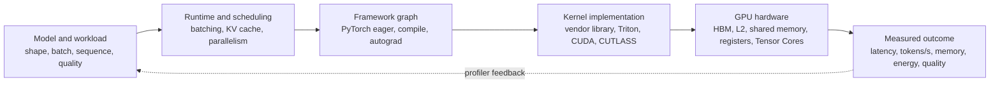
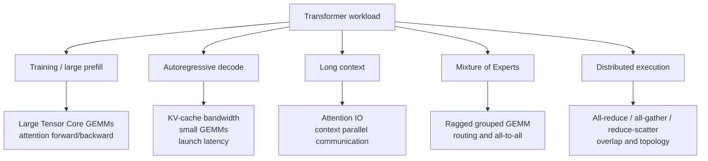

# CUDA and GPU kernel optimization for modern AI

**Current-state cutoff:** 2026-11-10  
**Primary target:** NVIDIA A100 / SM80  
**Scope:** LLM and SLM training, prefill, decode, quantization, MoE, and
distributed execution.

This is the curated synthesis. The longer evidence review, compatibility notes,
and source inventory are in `sources/state_of_art_research_agent.md`; measured
results from this project are in `results/benchmark_report.md`.

## Bottom line

Modern AI performance is not one kernel problem. It is a stack:

The durable optimization order is:

1. Choose correct shapes, precision, layouts, batching, and parallelism.
2. Use vendor libraries and PyTorch's optimized dispatch.
3. Use `torch.compile`/Inductor to remove graph-level overhead and fuse work.
4. Write Triton for custom fusions, reductions, layouts, or schedules.
5. Use CUDA/CUTLASS when the profiler proves the higher layers cannot express
   the required architecture-specific schedule.

This ordering is consistent with the PyTorch compiler architecture
([PyTorch 2 paper](https://doi.org/10.1145/3620665.3640366)), Triton's design
([Triton paper](https://doi.org/10.1145/3315508.3329973)), and NVIDIA's GEMM
guidance ([CUTLASS efficient GEMM](https://docs.nvidia.com/cutlass/latest/media/docs/cpp/efficient_gemm.html)).

## Why A100 remains an excellent learning platform

A100 exposes the principles that remain important across newer GPUs:

- TF32, BF16, FP16, INT8, and INT4 Tensor Core paths
- 2:4 structured sparsity
- High-bandwidth HBM and a large L2 cache
- `cp.async` global-to-shared copies and asynchronous barriers
- CUDA Graphs, streams, events, and NVLink/NVSwitch communication
- Enough memory to study long context, large GEMMs, distributed training, and
  serving kernels

See the [Ampere tuning guide](https://docs.nvidia.com/cuda/ampere-tuning-guide/index.html),
[A100 80GB datasheet](https://www.nvidia.com/content/dam/en-zz/Solutions/Data-Center/a100/pdf/a100-80gb-datasheet-update-nvidia-us-1521051-r2-web.pdf),
and [CUDA Best Practices](https://docs.nvidia.com/cuda/cuda-c-best-practices-guide/index.html).

What A100 does **not** provide is equally important:

- No native FP8 Tensor Core MMA
- No Hopper TMA or WGMMA
- No Hopper thread-block clusters
- No Blackwell tensor memory, block-scaled MMA, or 2-CTA MMA path

Therefore A100 is the right platform for FlashAttention-2 and enduring CUDA
optimization concepts, but not for reproducing FlashAttention-3/4's defining
hardware mechanisms.

| Generation | Representative features | Attention generation to study |
|---|---|---|
| A100 / Ampere | BF16/TF32, `cp.async`, SM80 Tensor Cores | FlashAttention-2 |
| H100 / Hopper | Native FP8, TMA, WGMMA, warp specialization | FlashAttention-3 |
| B200 / Blackwell | Microscaling formats, tensor memory, newer MMA pipelines | FlashAttention-4 |

Primary attention sources:
[FA1](https://arxiv.org/abs/2205.14135),
[FA2](https://arxiv.org/abs/2307.08691),
[FA3](https://arxiv.org/abs/2407.08608), and
[FA4](https://arxiv.org/abs/2603.05451).

## The workload determines the bottleneck

| Workload | Common limiter | High-value optimization |
|---|---|---|
| Training, large-batch prefill | Tensor Core utilization and HBM movement | GEMM shape/layout, fusion, FlashAttention, compiler |
| Batch-1 decode | Weight/KV bandwidth and launch latency | Quantized packed kernels, GQA/MQA, CUDA Graphs |
| High-throughput serving | Scheduling and KV memory management | Continuous batching, paged KV, prefix reuse |
| Long context | Attention IO and KV communication | FlashAttention, split-KV decode, context parallelism |
| MoE | Small/ragged GEMMs, routing, all-to-all | Grouped/block-sparse GEMM, load balance, overlap |
| Multi-node training | Exposed collectives | DDP/FSDP overlap, topology-aware TP/PP/CP |

## 1. Roofline, memory traffic, and launch overhead

The Roofline model bounds performance by the lower of compute throughput and
memory bandwidth:

\[
P \le \min(P_{peak}, BW \times AI)
\]

where arithmetic intensity \(AI\) is operations per byte moved
([Williams et al., 2009](https://doi.org/10.1145/1498765.1498785)).

For A100 BF16 Tensor Core peak and HBM bandwidth, the theoretical crossover is
roughly 153 FLOP/byte. Large square GEMMs can cross that threshold; norms,
activations, optimizer updates, decode KV reads, and many small GEMMs usually
cannot.

Three consequences:

1. **Fusion is primarily a memory optimization.** Fusing does not reduce the
   mathematical definition of RMSNorm or SwiGLU; it removes intermediate HBM
   writes and launches.
2. **Small kernels are latency-sensitive.** A mathematically tiny kernel can
   be dominated by CPU dispatch and launch overhead.
3. **Peak specifications are ceilings, not expectations.** Build a measured
   roofline from sustained copy bandwidth and achieved GEMM throughput.

This project measured 1.5-1.6 TB/s of useful bandwidth for large fused
SwiGLU/RMSNorm cases, versus much lower throughput for unfused eager references.

## 2. GEMM and Tensor Core optimization

Transformer compute is dominated by GEMMs, but "GEMM" spans very different
shapes:

- Training and prefill: large \(M\), high arithmetic intensity
- Decode: small \(M\), often bandwidth- and latency-limited
- MoE: many heterogeneous \(M\) values
- Vocabulary projections: very large \(N\)

The core schedule is tiled:

1. Partition output into \(M \times N\) tiles.
2. Stream \(K\)-dimension tiles through shared memory/registers.
3. Accumulate in FP32 or INT32.
4. Fuse bias, activation, quantization, or reduction into the epilogue.

Optimization variables include tile sizes, warp count, pipeline stages,
program ordering for L2 reuse, split-K, persistent scheduling, alignment, and
epilogue fusion. The official
[Triton matmul tutorial](https://triton-lang.org/main/getting-started/tutorials/03-matrix-multiplication.html)
and [CUTLASS efficient GEMM guide](https://docs.nvidia.com/cutlass/latest/media/docs/cpp/efficient_gemm.html)
are the best paired starting points.

**Current status:** cuBLAS/cuBLASLt remains the first baseline for standard
dense GEMM. Triton and CUTLASS are most valuable when the operation needs a
nonstandard layout, ragged/grouped schedule, or fused epilogue. In this
project, the educational Triton GEMM reached 141-215 TFLOP/s but remained
12-23% behind cuBLAS.

## 3. Compiler and kernel programming layers

| Layer | Best use | Main risk |
|---|---|---|
| PyTorch eager | Correctness and vendor-library baseline | Extra launches/intermediates |
| `torch.compile` / Inductor | Graph fusion, AOTAutograd, generated Triton/CUDA | Compile cost, graph breaks, recompiles |
| Triton | Custom fusions, reductions, layouts, educational GEMM | Version/shape-sensitive code generation |
| CUDA C++ | Full control of memory, streams, barriers, PTX | Highest development and maintenance cost |
| CUTLASS/CuTe | Production GEMM families and epilogues | Template/DSL complexity |

PyTorch 2.13 exposes `default`, `reduce-overhead`, `max-autotune`, and
`max-autotune-no-cudagraphs` modes, plus backend options such as Triton CUDA
Graphs ([PyTorch `torch.compile`](https://docs.pytorch.org/docs/2.13/generated/torch.compile.html)).
The versioned DDP documentation also recommends `gradient_as_bucket_view=True`
to avoid separate gradient copies and `static_graph=True` when parameter usage
and graph structure are fixed
([PyTorch DDP](https://docs.pytorch.org/docs/2.13/generated/torch.nn.parallel.DistributedDataParallel.html)).

In E7's initial short-warmup run, the transformer block appeared to improve by
1.26-1.27x under `torch.compile(mode="default")`, but E110's independent
six-run audit measured 1.08x (4x1024) and 1.06x (1x4096), and E111's
hardware-clock-locked diagnosis proved why: unlocked A100 DVFS stepped from
the 1140 MHz default application clock to the 1410 MHz boost clock mid-run
(a 1.30-1.31x cross-clock artifact). At locked 1410 MHz, `default` gives
1.09x (4x1024) and 1.07x (1x4096) with ~10% less incremental peak memory,
`max-autotune-no-cudagraphs` reaches 1.14x and 1.12x via fused Triton GEMM
epilogues, and on launch-bound 1x512 a full-step compiled CUDA Graph reaches
3.36x versus 1.63x for module-only `reduce-overhead`.

## 4. Fused norms, activations, optimizers, and loss

The mature fusion targets are:

- LayerNorm and RMSNorm
- SwiGLU/GeGLU and bias-activation combinations
- Residual plus norm
- Multi-tensor optimizer updates
- Linear plus cross-entropy, avoiding full-logit materialization

These are attractive because they have low arithmetic intensity and often
chain reductions with pointwise work. A custom Triton RMSNorm can map one row
to one program, accumulate variance in FP32, apply the scale, and write once.

The project reproduced this pattern:

- `torch.compile` RMSNorm: 4.45-7.79x over the unfused eager reference
- Triton RMSNorm: 9.26-12.51x
- Native CUDA/Triton SwiGLU: about 1.55x for the largest case
- Token-tiled cuBLAS + in-place Triton online-softmax Linear + Cross-Entropy
  (`V = 128,256`, `chunk_size = 1024`, E112): **94.8x** less transient
  logit/softmax workspace (`23,765.5 -> 250.6 MiB`, **45.1x** less total step
  incremental memory, and **16.0x** less transient workspace than unchunked
  `torch.compile`) at **1.76x** eager FP32 speed on 16K-token 1B SLMs
  (`H = 1024`), remaining **1.15x** faster at 8B LLM width (`H = 4096`) where
  4-GEMM activation-checkpointed chunking falls to **0.81x** eager speed.
- Single-launch pointer-table multi-tensor Triton `AdamW` with in-register
  global `clip_grad_norm_` scaling and low-precision/orthogonalized updates
  (`E118`, [8-bit Optimizers](https://arxiv.org/abs/2110.02861),
  [Revisiting BFloat16 Training](https://arxiv.org/abs/2010.06192),
  [Muon is Scalable for LLM Training](https://arxiv.org/abs/2502.16982)):
  fixes PyTorch 2.13's `p.grad_dtype = torch.bfloat16` `RuntimeError` across
  all three `AdamW` backends (`single-tensor`, `foreach`, `fused`) and
  accelerates `1.07B`-parameter updates over `_fused_adamw_ + _foreach clip`
  (`27.54 ms`, `40 B/param`) by **1.33x** (`20.74 ms`, `FP32` moments, `0.0`
  `grad_dtype` error), **1.69x** (`16.27 ms`, `66.00 GParams/s`, `128`-block
  `INT8 m` + square-root `UINT8 sqrt(v)`, **3.88x** moment compression to
  `2.0625 B/param`), and **1.65x** (`16.70 ms`, `64.29 GParams/s`, Philox
  stochastic-rounding `SR-BF16` at **8.0 B/param** resident — eliminating
  `BF16` round-to-nearest's `100%` sub-ULP stagnation and `8.6x` SLM loss
  degradation); under 8-GPU `FSDP2` (`DTensor` `Shard(0)`), 2-stream pipelined
  owner-sharded `AllToAll` + batched `BF16` `torch.bmm` `Muon` collapses
  PyTorch 2.13 `DTensor` `Muon`'s **`1,952`** NCCL collectives (`849.59 ms`) to
  **`7`** (`215.55 ms`, **3.94x** faster on `3.49B` isolated step, `rel_l2 =
  6.8e-5` vs 1-GPU `Muon`) and speeds up an end-to-end `0.97B` `FSDP2` training
  step **5.08x** (`965.55 -> 190.18 ms`, **25.2x** faster optimizer phase
  `804.87 -> 31.95 ms`).

## 5. Attention

FlashAttention changed the attention optimization target from "make the
matmuls fast" to "minimize HBM traffic while preserving exact online softmax."
FA1 tiles Q/K/V and never materializes the full score matrix. FA2 improves CTA
and warp work partitioning and is the principal A100 implementation
([FA2](https://arxiv.org/abs/2307.08691)).

PyTorch SDPA can dispatch among FlashAttention, memory-efficient attention,
and a math implementation; use `sdpa_kernel` to force and verify the backend
([PyTorch SDPA](https://docs.pytorch.org/docs/2.13/generated/torch.nn.functional.scaled_dot_product_attention.html)).
FlexAttention compiles custom score/mask functions into fused kernels and is
the current path for flexible attention research
([FlexAttention](https://arxiv.org/abs/2412.05496)).

Measured at sequence 2048:

- Flash SDPA: 27.6x faster than math SDPA
- Incremental memory: 16.25 MiB versus 1296 MiB
- External `flash-attn` and PyTorch Flash SDPA traded small leads by shape
- Forward+backward Flash SDPA: 13.1x faster than math SDPA
- Forward+backward incremental memory: 176 MiB versus 2160 MiB
- Packed-document GQA forward+backward (`1x8192`, `32Q/8KV`, `D=128`, E113):
  `F.scaled_dot_product_attention(..., attn_mask=bool_4d, enable_gqa=True)`
  silently fell back to `SDPBackend.MATH` (**33,152 MiB**, `269.5 ms`), and
  Cutlass `EFFICIENT_ATTENTION` (`961 MiB`) stayed invariant at `59.5-59.8 ms`
  across 1 to 64 documents; `FlexAttention` + `BlockMask` (`705 MiB`) scaled
  from `19.81 ms` (1 doc) to **3.77 ms** (16 mixed docs, **15.8x** faster than
  Cutlass) and **2.66 ms** (64 SFT docs, within **7.7%** of hand-written
  `flash_attn_varlen_func`), with `torch.compile(create_block_mask)` cutting
  mask creation **9.5-11.0x** to `0.54-0.66 ms`.
- Score-modified GQA forward+backward (`2x4096`, `32Q/8KV`, `D=128`, E113):
  where `flash_attn_func` supports `softcap=30` + `window_size=512`, its CUDA
  C++ kernel ran `1.48x` faster than `FlexAttention` (`3.69` vs `5.46 ms`),
  while both cut memory **29.3x** (`20,624 -> 705 MiB`); on smooth logarithmic
  decay (`-slope_h * log2(1 + dist)`), which `flash_attn` cannot express,
  `FlexAttention` ran **17.6x** faster than eager and **5.26x** faster than
  materialized `torch.compile` while cutting memory **11.7x** (`8,274 -> 705 MiB`)
  and `dK` relative error **2.70x**.
- Sub-quadratic linear-attention & chunkwise WY `Gated DeltaNet` training
  (`C = 64`, `B = 1, H = 16, D = 128`, E119 —
  [Mamba-2 SSD](https://arxiv.org/abs/2405.21060),
  [GLA](https://arxiv.org/abs/2312.06635),
  [DeltaNet](https://arxiv.org/abs/2406.06484),
  [Gated DeltaNet](https://arxiv.org/abs/2412.06464)): replacing
  `torch.linalg.solve_triangular` on `(I + A)^{-1}` (`4.46 ms`, `769.0 MiB`
  workspace on `4,096` chunks) with a register-pure SM80 `BF16` Tensor-Core
  `4 × 16` nilpotent `(I - A)(I + A^2)(I + A^4)(I + A^8)` + block substitution
  Triton kernel cut WY preparation to **`0.296 ms`** (`0.0 MiB` scratch —
  **15.08x** faster than `solve_triangular` and **51.61x** faster than IEEE
  SIMT) and collapsed `S = 2,048` `Fwd + Bwd` launches from `90,128`
  (`3,652.0 ms`) to **`3`** (`2.45 ms`, **1,492x** faster than recurrent eager
  and **7.05x** faster than `@torch.compile` WY `17.27 ms`). Against `16Q/4KV`
  `FlashAttention-2` GQA, `FA2` won short contexts (`0.95` vs `2.45 ms` at `2K`),
  crossed over near `S ~ 12K`, and lost by **4.69x** (`WY GDN`, `64.63 ms`) and
  **5.13x** (`SSD/GLA`, `59.09` vs `302.94 ms`) at `S = 65,536` (with a `3:1`
  Hybrid `H = 2,048` 4-layer stack running **1.71x** faster than `4 × FA2` at
  `65K` and `WY GDN` solving crowded state-reassignment MQAR at **99.68%** vs
  `SSD/GLA`'s `7.45%`). Under 8-GPU `CP = 8` up to `S = 262,144`, an `O(1)`
  `AllGather` augmented `[S_zero | P]` parallel affine-monoid scan matched
  1-GPU `GDN` bitwise (`0.0` `Fwd + Bwd` `rel_l2`), cut per-rank communication
  **256x** (`3 MiB` vs `768 MiB` for DeepSpeed-Ulysses `FA2`), outran serial P2P
  state-passing **1.46x** (`37.94` vs `55.38 ms`), and outran Ulysses `FA2`
  (`640.11 ms`) by **16.87x** (`GDN`) and **18.26x** (`SSD`, `35.05 ms`).
- Multi-Head Latent Attention (`MLA`: `D_qk = 128 + 64 = 192 -> D_v = 128`
  decompressed vs `D_qk = 512 + 64 = 576 -> D_v = 512` weight-absorbed MQA,
  `H = 4,096, n_h = 32, d_c = 512, d'_c = 1,536`, E120 —
  [DeepSeek-V2](https://arxiv.org/abs/2405.04434),
  [DeepSeek-V3](https://arxiv.org/abs/2412.19437),
  [FlashInfer](https://arxiv.org/abs/2501.01005),
  [FlashMLA](https://github.com/deepseek-ai/FlashMLA),
  [Kimi K2](https://arxiv.org/abs/2507.20534)): on `SM80` (`PyTorch 2.13+cu129`,
  `flash-attn 2.8.3`, `flashinfer 0.6.18`), direct `flash_attn_func`, `SDPA
  FLASH`, and `SDPA CUDNN` reject `192 -> 128`, while on `576 -> 512` all fused
  `FA2`/`SDPA` backends fail, **`FlexAttention` crashes exceeding A100's `163 KiB`
  shared-memory limit (`196,608 > 166,912 B`)**, and `FlashInfer` `backend="fa3"`
  fails (`sm90` WGMMA) whereas `backend="fa2"` succeeds. Our Split-Dim Triton
  `Flash-MLA` (`128+64 -> 128`) eliminated 1-pass global `dQ` atomics
  (**44.61x** faster, `196.19 -> 4.40 ms` at `S = 4,096`) and `num_stages=1`
  synchronous stalls (**45.82x** faster), cut attention autograd memory **5.58x**
  vs `FA2 V-padded` (`66.0` vs `368.5 MiB`), outran CUTLASS `SDPA EFFICIENT` by
  **2.82x-3.09x** at `S = 16K-32K`, and showed why weight-absorbed MLA (`4 × 128`
  SRAM-safe strip-streaming) is **45.58x slower** in training (`1,498.00` vs
  `32.86 ms` at `S = 8,192`) yet **8.92x** (Triton Split-KV) to **9.16x**
  (`FlashInfer FA2`, `0.282` vs `2.580 ms`) faster at `S_q = 1` decode against
  `L_kv = 16,384, B = 8` (**14.33x** KV-cache compression, crossing over below
  `S_q = 16`). Zero-attention-recompute `Latent-SAC` cut 4-layer `16K` memory
  **2.45x** (`10,221 -> 4,171 MiB`) while running **1.14x** faster than
  full-layer checkpointing (`0.0` `rel_l2` drift), and under `CP = 8` up to
  `S = 131,072`, `Compressed-Latent Zig-Zag Ring` (`576` BF16/tok, using
  pre-allocated ping-pong buffers to avoid `ncclStream` caching-allocator
  aliasing) cut P2P traffic **14.33x** (`396` vs `5,676 MiB/rank`) and per-rank
  peak HBM **2.19x** vs `Decompressed Ring` while `Split-Dim Ulysses` cut peak
  `HBM` **1.44x** (`2,334` vs `3,358 MiB`) vs `FA2 V-padded Ulysses`.
- Reasoning Post-Training (`RLVR` via `GRPO`/`DAPO` and `DPO`: `V = 128,256`,
  `G = 4..16`, `8`-GPU `FSDP2` `1.40B`-param Long-CoT stack, E121 —
  [DeepSeekMath](https://arxiv.org/abs/2402.03300),
  [DeepSeek-R1](https://arxiv.org/abs/2501.12948),
  [DAPO](https://arxiv.org/abs/2503.14476),
  [DPO](https://arxiv.org/abs/2305.18290),
  [Liger-Kernel](https://arxiv.org/abs/2410.10989),
  [veRL / HybridFlow](https://arxiv.org/abs/2409.19256),
  [ByteScale](https://arxiv.org/abs/2502.21231)): uncentered online `FP32`
  vocabulary entropy `H = (m + ln d) - (sum z e^{z-m}) / d` suffered catastrophic
  cancellation (`rel_l2 = 0.3032` and `2` physically impossible negative
  entropies at `shift = 4,096`), whereas our centered online `(m, d, e)` monoid
  (`e = sum (z-m) e^{z-m} <= 0`, finite `-1e30` SIMD sentinels) held `rel_l2 =
  0.00059` (`0` negatives) across all shifts. At `N = 8,192, H = 4,096, V =
  128,256`, our `3`-GEMM token-tiled in-place Triton `FusedLinearGRPO/DAPO`
  (`Clip-Higher` + Schulman `k3` KL + Entropy + `1/tau`) reached **239.1
  TFLOP/s** (`BF16 dW`, `107.99 ms`) and **229.6 TFLOP/s** (`FP32 dW`, `112.47
  ms` — **1.62x** faster than eager `FP32` `181.67 ms` and **1.74x** faster than
  chunked PyTorch while cutting `[N, V]` transient workspace **75.71x** from
  `18,974.0` to `250.6 MiB`), whereas `4`-GEMM Two-Pass `Saved-LSE`
  `FusedLinearDPO` (`4 B/tok` `lse[t]`) cut `8K` DPO workspace **43.73x**
  (`10,958.0 -> 250.6 MiB`) while isolating sequence-coupled DPO's `4/3` GEMM
  cost (`141.59` vs `110.17 ms` `torch.compile`). Across a 4-layer `H = 4,096`
  (`32Q/8KV, D=128`) `GRPO` stack at `G = 16`, Two-Slice Ragged
  Group-Prefix-Tree Triton `GQA` (`0` atomics, flat prompt-KV `dK/dV` sweep) ran
  **4.67x** faster than padded `FA2` (`748.63` vs `3,498.64 ms`) and **2.41x**
  faster (**3.18x** less memory) than `veRL`-style duplicated-prompt ragged
  `FA2` (`1,802.35 ms`). Under 8-GPU `FSDP2`, naive rank-local token-mean
  normalization (`1 / N_resp,r`) induced **`rel_l2 = 1.0090 / 0.9255`** gradient
  bias on `W_q / W_lm_head`, whereas global `world_size / N_resp,global`
  weighting + Adaptive Tree Split + Quadratic-Cost LPT Prefix-Tree `GQA`
  restored exact global `DAPO` equivalence (`cross-layout FSDP2 rel_l2 <=
  0.00685`) and sped up Long-CoT `FSDP2` steps **5.11x** vs padded, **2.48x** vs
  prompt-sharded ragged (`remove_padding`), and **1.49x** (**1.62x** less memory)
  vs token-greedy ragged `FA2` (`687.65` vs `1,027.04 ms`).
- SLM Knowledge Distillation (`FKL` / `MiniLLM RKL` / `GKD JSD_0.5`),
  DeepSeek-V3 `MTP`, `EAGLE-3` `TTT` Attention, and 8-GPU Vocab-Parallel
  Distillation (`V = 128,256`, `1.40B` Teacher -> `0.44B` Student SLM, E122 —
  [MiniLLM](https://arxiv.org/abs/2306.08543),
  [GKD](https://arxiv.org/abs/2306.13649),
  [Meta MTP](https://arxiv.org/abs/2404.19737),
  [DeepSeek-V3](https://arxiv.org/abs/2412.19437),
  [EAGLE-3](https://arxiv.org/abs/2503.01840),
  [Liger-Kernel](https://arxiv.org/abs/2410.10989)): opposing Teacher/Student
  baseline shifts (`+/-4,096` and `+/-32,768`) caused catastrophic `FP32`
  cancellation (`rel_l2 = 7.25` and `50.56`, `30–32/64` negative KLs) in
  uncentered online Reverse-KL, whereas our 6-statistic coupled centered monoid
  `(m_S, d_S, e_S, m_T, d_T, c_ST)` held `rel_l2 = 0.00136..0.00144` (`0`
  negatives) and eliminated `Top-128` truncation's `1,706%–1,844%` `dW` gradient
  bias. At `N = 8,192` (`H_T = 4,096 -> H_S = 1,536, V = 128,256`), 2-pass
  Coupled-Monoid `Reverse KL` ran **2.13x** faster than eager `FP32` (`80.43` vs
  `171.11 ms`, **227.4 TFLOP/s**) and **1.18x** faster than `torch.compile`
  (`94.87 ms`) while slashing `[N, V]` transient workspace **269.1x** (`27,256.5
  -> 101.3 MiB`, scaling to `16,384` tokens at `161.23 ms` / **326.0x** less
  workspace than chunked PyTorch), whereas `JSD_0.5`'s non-linear mixture added
  an irreducible 3rd scalar HBM pass (`87.66 ms`). DeepSeek-V3 `4`-head
  shared-`W_unembed` `MTP` with Fused Dual-`RMSNorm` + batched `FP32-dW` CE ran
  **1.37x** faster with **16.46x** less workspace (`118.84` vs `163.14 ms`,
  `693.1` vs `11,406.0 MiB`). In `EAGLE-3` `K = 4` `TTT`, co-packing `(4 anchors
  x 4 steps x 4 GQA heads = 64)` query rows per CTA sped up backward `dQ`
  **1.92x** (`5.71 -> 2.98 ms`) over `4x`-reloaded unpacked KV and beat
  `FlexAttention` `BlockMask` (`99.2%`-zero diagonal tiles) by **1.08–1.11x**
  across `S = 1,024..4,096` (**10.91x** faster and **41.05x** less workspace than
  `SDPA` staircase masks at `S = 2,048`). On 8 GPUs (`16,384` global tokens),
  `Hybrid FSDP2 Backbone + TP=8 Vocab-Parallel Coupled-Monoid LM_head` (`24
  B/tok` `[N, 6]` collective = `0.375` vs `4,008 MiB` logits + `FP32` `dH_S`
  `ReduceScatter`, `dw_lm_head rel_l2 <= 0.0035`) reached **205,928 tok/s**
  (`79.56 ms`), beating materialized `FSDP2` by **1.41x** (**5.53x** less HBM:
  `1,560` vs `8,631 MiB/rank`), colocated `FSDP2` Triton by **1.14x** (**3.29x**
  less HBM), and full `TP=8` teacher (`95.33 ms`) by **1.20x**.
- Natively Trainable Dynamic Sparse Attention (`DeepSeek NSA` & `Moonshot Kimi
  MoBA`), Lock-Free Split-Reduce `CSC` Backward, & Zero-Selection-Recompute
  `NSA-SAC` (`S = 4,096..65,536` on 1 GPU and `S = 16,384..131,072` on 8 GPUs,
  E125 — [DeepSeek NSA](https://arxiv.org/abs/2502.11089),
  [Moonshot Kimi MoBA](https://arxiv.org/abs/2502.13189),
  [Quest](https://arxiv.org/abs/2406.10774),
  [FlexAttention](https://arxiv.org/abs/2412.05496)): auditing PyTorch `2.13`
  `FlexAttention` exposed four production defects on dynamic fine-grained GQA
  masks (uncompiled `create_block_mask(H=64, S=16384)` **`128.0 GiB` OOM**,
  `BlockMask.from_kv_blocks` `_transpose_ordered` **`IndexError`** whenever
  `K_sel < N_blocks`, `BLOCK_SIZE = 64` TorchInductor lowering rejection, and
  sticky **`cudaErrorIllegalAddress`** `int32` index overflow at `S = 65,536`).
  Packing `[B_q_sub = 4, G = 16]` (`64` MMA rows) on `64Q/4KV, D=128` reached
  **106.52 sparse TFLOP/s** (`10.32 ms` at `S = 32,768`, **27.54x** faster than
  per-head `Quest` `M = 1` `3.87 TFLOP/s`, while Stride-`16` `Subchunk-16 x
  G = 4` hit **100.70 sparse TFLOP/s**, **6.27x** over padded `G = 4`); folding
  `16` stride-shared queries ran NSA's `l = 32, d = 16` compression branch on
  native C++ `FlashAttention-2` while our LSE-guided `A[j] + First[j+1]` kernel
  induced exact Eq. (8)-(10) scores; and our **100% Lock-Free Compacted
  Work-Tile Split-`256` `CSC` backward** (`Part_dK/Part_dV` `tl.store` +
  sequential register reduction, bypassing both sink L2 ROP contention and
  Triton `3.7.1`'s `num_warps=4` `mma -> tl.atomic_add` warp race) ran **54.88x**
  (`18.52` vs `1,016.28 ms` at `16K`) and **56.44x** (`37.11` vs `2,094.37 ms`
  at `32K`, `dk/dv rel_l2 <= 2.5e-4`) faster than `FP32` atomics. On 1 GPU at
  `S = 65,536`, full 3-branch trainable `DeepSeek NSA` (`sub4`) and GQA-group
  fused-Triton-LSE `MoBA` beat C++ `FlashAttention-2` (`1,216.62 ms`) by
  **4.84x** (`251.48 ms`) and **8.66x** (`140.53 ms`, **2.87x** over per-head
  `MoBA`); across a 4-layer `2.56K`-hidden Transformer at `S = 32,768`, `NSA`
  sped up end-to-end training **1.99x** (`810.59` vs `1,610.63 ms`) and
  Zero-Selection-Recompute **`NSA-SAC`** beat `Full-Layer AC` by **1.19x**
  (`884.02` vs `1,052.62 ms`) while cutting peak activations **1.30x** (`dw/dx
  rel_l2 = 0.0056 / 0.0015`).
- Native-Resolution Multimodal Vision-Language & Omni-Modal Training Kernels
  (`Window-Morton-2x2` Zero-Permutation Ragged ViT + Tubelet Pack, Single-Launch
  `3D M-RoPE`, & Surgical 2-Pass Disjoint Reversed-Upper `FlashAttention-2` +
  Zero-Atomic Triton `LSE` `Omni-Attention`, `P = 4,096..32,768` &
  `S = 4,096..65,536`, E126 — [Qwen2-VL](https://arxiv.org/abs/2409.12191),
  [Qwen2.5-VL](https://arxiv.org/abs/2502.13923),
  [NaViT](https://arxiv.org/abs/2307.06304),
  [Transfusion](https://arxiv.org/abs/2408.11039),
  [VeOmni](https://arxiv.org/abs/2508.02317)): auditing `cuDNN 9.20.0` exposed a
  severe **`19.4–19.5x` `Conv3d(2,14,14)` implicit-GEMM pathology** (`32.94 ms`
  HF pre-extracted / `32.65 ms` 5D video = `8.98–9.06 TFLOP/s` on `32,768`
  patches because `kernel_size == stride` and `K = 1,176`, `1,176 mod 16 = 8`),
  while PyTorch `SDPA` with an explicit `bool` hybrid bidirectional-vision /
  causal-text mask silently fell back to Math-SDPA (`242.61 ms`, `29.5 GiB` at
  `S = 8,256`) and crashed with **`28.00 GiB` OOM** at `S = 16,384` (and
  causal-only `FA2` silently corrupted visual embeddings by **`92.3%`**).
  Packing ragged tubelets directly in hierarchical **`Window-Morton-2x2`** order
  (`Frame > 8x8 Window > 2x2 Merger Quad > Patch`, `16`-aligned `K_pad = 1,184`,
  `dx rel_l2 = 0.0`) + `cuBLAS` ran in **`1.69 ms` (`175.6 TFLOP/s`, `19.54x`
  speedup)**, converted `2x2` `PatchMerger` into a zero-copy Triton `RMSNorm` +
  `view` (**`1.41x` speedup, `2.87x` lower HBM**), and drove `P = 32,768`
  heterogeneous native-resolution ViT training to **`116.97 ms` (`280,153
  patches/s`)** — **3.89x** faster (`3.10x` lower HBM) than padded 2D `FA2` ViT
  (`454.41 ms`), **1.25x** faster than eager `window_index` gather (`146.66 ms`),
  and **1.09x** faster than `NaViT` full-varlen ViT (`127.20 ms`). Single-launch
  Triton `Q+K` `3D M-RoPE` (`[16,24,24]` sectioned & `[24,20,20]` interleaved,
  exact `0.0` `FP64` `1D` reduction on text) beat HuggingFace eager by
  **2.36–2.37x** (`1.89x` lower HBM); and **Surgical 2-Pass Disjoint
  Reversed-Upper C++ `FA2` + Zero-Atomic Triton `LSE` Merger** (`BF16` vs `FP64`
  oracle `rel_l2 <= 0.0036`, Richardson `3.995x–4.0001x` across all 8 non-linear
  derivatives) ran in **`148.75 ms`** at `S = 65,536` (`28Q/4KV, D=128`), beating
  `FlexAttention` dynamic / prebuilt `BlockMask` (`341.23` / `312.64 ms`) by
  **2.29x / 2.10x** (**35.9x** over `SDPA` at `S = 8K`, and **1.41x** across a
  4-layer `3,584`-dim decoder stack at `S = 32,768`).
- Diffusion-LLM, Block-Diffusion (`BD3-LMs`), & `DiT` `adaLN-Zero` Training
  Kernels Driven by an Immutable Recursive Self-Improvement (`RSI`)
  Vector-Pareto Ratchet (`PROGRAM.md` + `code/rsi_kernel_harness.py`,
  `W in {4, 16, 64, 256}`, `L = 2,048..32,768` / `2L = 4,096..65,536`, E127 —
  [DiT](https://arxiv.org/abs/2212.09748),
  [MDLM](https://arxiv.org/abs/2406.07524),
  [LLaDA](https://arxiv.org/abs/2502.09992),
  [BD3-LMs](https://arxiv.org/abs/2503.09573),
  [LLaDA 1.5](https://arxiv.org/abs/2505.19223),
  [AutoKernel](https://arxiv.org/abs/2603.21331)): verbatim `BD3-LM` Figure 4
  `(x0_flag_q == x0_flag_kv)` crashed PyTorch `2.13` TorchInductor with a SymPy
  `InductorError` (`Trial 0a` `REJECT_COMPILE_OR_RUNTIME`), while PyTorch `SDPA`
  rejected Flash dispatch on `2L x 2L` boolean masks (`236.84 ms` at `L = 4,096`
  and a `112.0 GiB` `FP32` score-matrix wall at `L = 16,384`), and `torch.compile(flex_attention)`
  silently fell back to `16 GiB/layer` `sdpa_dense` `math_attention` once
  TorchDynamo crossed its default `8`-shape `recompile_limit`. Enforcing
  per-tensor `FP64` oracles (`rel_l2 <= 0.0076`), `FP64` unit-RMS `O(h^2)`
  Richardson (`3.9999x–4.0001x` across 8 derivatives), `>96 MiB` L2-exceeding
  buffer rotation, and `worst_shape_ratio <= 1.02` in immutable
  `code/rsi_kernel_harness.py` (`eval_harness_sha256 = 3cf0f078...`) rejected
  both 6-call varlen `FA2` (`Trial 1`, `W = 4` `1.68x` micro-CTA regression) and
  monolithic 4-accumulator GQA microblocks (`Trial 2`, `W = 64` `1.33x` register-spill
  regression), ratcheting **Adaptive Zero-Spill Split-Stream GQA Microblocks
  (`W <= 32`) + Surgical `FA2` (`W >= 64`)** (`Trial 3` `KEEP`, **1.83x** geomean
  speedup across `W = 4..256`, **54.3x** over `SDPA` `2L` at `L = 4K`, and
  **2.06x** over prebuilt `FlexAttention` at `L = 32,768` / `2L = 65,536`:
  `146.06` vs `300.35 ms`) plus **Exact Terminal Clean-Branch Pruning**
  (`Trial 4` `KEEP_TERMINAL_STAGE`, **3.29x** geomean speedup; **3.94x** at
  `2L = 65,536`: `76.29 ms`). Zero-gather / zero-atomic block-segmented Triton
  `adaLN-Zero` + `Gate-Residual-adaLN` ratcheted to **4.90x** over eager (**2.62x**
  over `torch.compile` atomic scatter), and **Active-Mask-Compacted `3-GEMM`
  `FusedLinearMaskedCE` (`V = 128,256`)** ratcheted to **1.94x** geomean speedup
  (`1.94x` lower HBM) alongside **1.82x** unbiased complementary-antithetic
  (`(t, m)` paired with `(1 - t, 1 - m)`) and **46.2x** clipped `U[0.3, 0.7]`
  `1/t` NELBO gradient-variance reduction.

This is the clearest example where an algorithmic IO change dominates ordinary
kernel tuning.

PyTorch profiler evidence confirmed that PyTorch Flash SDPA and the external
`flash-attn` package selected the same FA2-style
`flash_bwd_dq_dk_dv_loop_seqk_parallel_kernel` family at sequence 2048 and
head dimension 128. Their large-shape performance difference therefore comes
from wrapper/copy overhead and launch details rather than a different core
attention algorithm.

## 6. Decode, KV cache, and serving systems

Decode usually has query length one. It streams historical K/V with little
query parallelism, making memory bandwidth and launch latency central.

High-value techniques:

- **MQA/GQA:** reduce KV heads and KV bytes
  ([MQA](https://arxiv.org/abs/1911.02150),
  [GQA](https://arxiv.org/abs/2305.13245)).
- **Split-KV / Flash-Decoding:** parallelize over long KV sequence and combine
  partial online-softmax results.
- **Paged KV cache:** map logical blocks to physical blocks to reduce
  fragmentation and enable sharing
  ([PagedAttention](https://arxiv.org/abs/2309.06180)).
- **Continuous batching:** admit and retire requests every iteration instead
  of waiting for a static batch
  ([Orca](https://www.usenix.org/conference/osdi22/presentation/yu)).
- **Prefix caching:** reuse common prefixes, as in SGLang's RadixAttention
  ([SGLang](https://arxiv.org/abs/2312.07104)).
- **CUDA Graph buckets:** replay fixed-shape decode work without repeated CPU
  launch scheduling.

Current A100-capable ecosystems include
[FlashInfer](https://arxiv.org/abs/2501.01005),
[vLLM](https://github.com/vllm-project/vllm),
[TensorRT-LLM](https://github.com/NVIDIA/TensorRT-LLM), and
[SGLang](https://github.com/sgl-project/sglang).

The project's CUDA Graph result is deliberately nuanced: graph replay improved
a small decode-shaped smoke workload by about 2.5x, but only about 3% for a
full 4096→11008 MLP where GEMM time dominated.

The isolated FlashInfer 0.6.18 decode study makes the KV tradeoff concrete:

- At batch 64 and context 8192, MQA was 6.45x faster than GQA because it read
  one KV head instead of eight.
- Single-request MQA at context 32768 was 2.25x faster in FlashInfer's
  tensor-core path than PyTorch Flash SDPA.
- Large paged GQA batches with randomized physical pages sustained roughly
  1.5-1.7 TB/s of effective KV bandwidth.
- Paging cost 1.45x latency at batch 1/context 2048, but the indirection was
  largely hidden at batch.
- Tensor-core paged decode was 1.23x faster than the CUDA-core path for a
  heterogeneous batch of 64 requests.
- CUDA Graph replay gave 2.02x on a tiny paged shape and essentially no gain
  on saturated batch-64 decode.

Backend selection matters. The installed CUDA-core decoder rejected
group-size-32 MQA, so MQA used the tensor-core path. That planner required a
512 MiB auxiliary workspace at batch 16/64; 128 MiB overflowed. Profiler
evidence showed the tensor-core one-token request dispatching through
`BatchPrefillWithPagedKVCacheKernel`, illustrating that library categories
such as "decode" and "prefill" do not necessarily map one-to-one to kernel
families.

## 7. Quantization

Quantization has two independent problems:

1. Choose low-bit values without unacceptable quality loss.
2. Execute those packed values with a fast runtime kernel.

Algorithms:

- [LLM.int8](https://arxiv.org/abs/2208.07339)
- [SmoothQuant](https://arxiv.org/abs/2211.10438)
- [GPTQ](https://arxiv.org/abs/2210.17323)
- [AWQ](https://arxiv.org/abs/2306.00978)

Runtime kernels:

- INT8 Tensor Core GEMM with fused scales/epilogues
- W4A16 kernels such as [Marlin](https://github.com/IST-DASLab/marlin)
- CUTLASS/TensorRT-LLM packed kernels

A100 does not have native FP8 Tensor Core MMA. It can use INT8, INT4, W4A16,
and lower-precision KV caches, but Hopper/Blackwell FP8 training claims should
not be projected onto A100.

The project's symmetric W8A8 output preserved 0.99988 cosine similarity, yet
the private `torch._int_mm` path was 3.8-8.9x slower than BF16 cuBLAS. This
negative result demonstrates why production packing, scheduling, and fused
dequantization matter more than the dtype label alone.

The production vLLM Marlin round then reproduced the missing positive case:

- GPTQ-style `uint4b8` weights compressed by 4.00x channelwise or 3.88x with
  group size 128.
- Group-128 improved synthetic weight/output cosine similarity to roughly
  0.9938 versus about 0.9887 channelwise.
- The 4096→32000 vocabulary projection ran 2.10x faster than BF16 at M=1 and
  2.36x at M=32.
- At M=512 the same projection fell to 0.70x BF16 speed.
- 4096-square and MLP-down projections did not beat cuBLAS; MLP-up only
  narrowly won near M=8.

This confirms the correct rule: W4A16 is most compelling when a large weight
matrix is streamed for a small number of tokens. It is not a universal GEMM
replacement, and prefill-sized M can erase the bandwidth advantage.

In **E123** ([SwitchBack](https://arxiv.org/abs/2304.13013),
[Jetfire](https://arxiv.org/abs/2403.12422),
[DeepSeek-V3](https://arxiv.org/abs/2412.19437),
[QuaRot](https://arxiv.org/abs/2404.00456),
[COAT](https://arxiv.org/abs/2410.19313),
[Halo](https://arxiv.org/abs/2501.02625)), we resolved E6's `torch._int_mm`
negative control and took `INT8` Tensor Cores (`mma.sync.m16n8k32.row.col.s32.s8.s8.s32`,
**`624 TOP/s` peak = `2.0x` SM80's `312 TFLOP/s` `BF16` peak**) all the way to
full `3-GEMM` (`Fwd + dX + dW`) LLM/SLM training:

- **Why E6 failed vs SM80's real `INT8` Tensor-Core roofline (`4,096 × 4,096 ×
  14,336`):** Passing a contiguous row-major copy + HBM `int32->bf16` cast to
  `torch._int_mm` ran at **58.74 TOP/s** (`8.19 ms`, `0.21x` `BF16` cuBLAS
  `276.81 TFLOP/s`), whereas a zero-copy column-major `w_i8.T` view unlocked
  **431.81 TOP/s** (`1.114 ms`), pure coalesced epilogue-only Triton reached
  **417.97 TOP/s** (`1.151 ms`, **1.51x** `BF16`), and `CUTLASS SM80` fused
  `INT8 -> BF16` reached **482.15 TOP/s** (`0.998 ms`, **1.74x** `BF16`).
- **Inner-K CUDA-core promotion cliff vs Tensor-Core Orthogonal Hadamard:**
  `Jetfire`/`DeepSeek-V3`-style `1x128 x 128x128` in-loop `int32 -> fp32`
  accumulator promotion dropped GEMM speed from **417.97** to **199.29 TOP/s**
  (`0.72x` `BF16`) because `16,384` SIMT `I2F + FMUL + FFMA` ops per K-tile
  serialize behind SM80's `19.5 TFLOP/s` `FP32` CUDA-core pipe. Applying
  orthogonal Tensor-Core Randomized Walsh-Hadamard rotations (`s32`-bitcast
  native `RED.MAX.S32` + 3-op SplitMix32 stochastic rounding in zero-spill
  `64x128` / `128x64` tiles: **33.89x** faster than `FP32 atomicCAS` + Philox10,
  `29.51 -> 0.87 ms`) suppressed `65x` activation/gradient outliers **5.34x**
  (`dW rel_l2 = 0.0207` vs `0.1105` unrotated, and **0.00224** vs `0.00783`
  `Jetfire` `1x128x128` under single-CTA 2D Kronecker `H_64 x H_64`), eliminated
  `RTN-INT8`'s `100%` sub-LSB underflow bias (`0.0866` vs `1.00` over `256`
  steps), and propelled complete `3-GEMM` (`Fwd + dX + dW`) training to
  **322.45–342.34 effective TFLOP/s** (`G_acc = 1`) and **336.92–350.99
  effective TFLOP/s** (`G_acc = 4`, **1.29–1.32x** over `BF16` cuBLAS —
  physically surpassing A100's `312 TFLOP/s` `BF16` hardware ceiling!).
- **`COAT` `1 B/elem` `INT8` saved `SwiGLU` activations:** Factoring `rstd_m` out
  of `(x_m * gamma * sign) @ H_128` and compressing `(gate, up, mid)` in
  zero-spill `32x128` `COAT` `INT8` tiles sped up a 4-layer Llama-3-8B `SwiGLU`
  stack (`N = 8,192`) by **1.28x** vs `BF16` eager (`122.24` vs `156.67 ms`),
  **1.14x** vs `torch.compile` (`139.57 ms`), and **1.59x** vs activation
  checkpointing (`193.77 ms`) while cutting saved activations **3.10x**
  (`1,486.4` vs `4,608.1 MiB`).

In **E124** ([Mishra et al., 2021](https://arxiv.org/abs/2104.08378),
[SR-STE](https://arxiv.org/abs/2102.04010),
[Transposable N:M Masks](https://arxiv.org/abs/2102.08124),
[MVUE N:M Gradients](https://arxiv.org/abs/2203.10991),
[Hu et al., ICML 2024](https://arxiv.org/abs/2404.01847)), we unlocked SM80's
other **`624 TFLOP/s` hardware path — `2:4` Semi-Structured Sparse `BF16` Tensor
Cores (`mma.sp.sync.m16n8k32`)** — for complete `3-GEMM` (`Fwd + dX + dW`)
LLM/SLM pre-training without weight quantization:

- **PyTorch `2.13` `semi_structured` triple-defect audit (`[14336, 4096]`,
  `3,670,016` `4x4` tiles):** (1) `SparseSemiStructuredTensorCUTLASS` regressed
  to **224.76 effective TFLOP/s** (`4.28 ms`, **0.82x** dense `BF16` cuBLAS
  `274.53 TFLOP/s`), whereas `cuSPARSELt 0.8.1` jumped to **431.06 effective
  TFLOP/s** (`alg_id=0`) and **448.21 effective TFLOP/s** (`2.15 ms`, **1.63x**
  dense) when plan-tuned (`alg_id=3`); (2) default `prune_dense_static_sort("")`
  sorted signed `W_ij` instead of `|W_ij|`, skewing kept weights to **74.22%
  positive** (`54.02%` L1 retained), while `largest_abs_values_greedy`
  deadlocked **15.79%** of `4x4` bipartite tiles at `nnz = 7 < 8`; (3)
  `torch._C._cusparselt.mm_search` returned non-divisible `split_k > 1` plans
  that crashed `cusparseLtMatmul` under `transpose_result=True`.
- **Zero-spill `Exact-90` Bipartite DP, `KKT-Exact Madow MVUE 2:4` (`dW`), &
  `16-bit Bitmask Grad-SR-STE`:** Evaluating all `90` `2`-regular `4x4`
  bipartite masks in `30` scalar ops via `19` row-sum profiles (`0` spills, `67`
  regs) achieved **100.00% of the exhaustive 90-mask L1 oracle** (`70.24%` L1
  retained, `0` structural deadlocks) in **0.271 ms** (**1.64x** faster than
  PyTorch's greedy C++ kernel, **23.6x** faster than dual `_cslt_compress`).
  Coupled with fused `[M, N] -> [N, M]` **`KKT-Exact Madow-Systematic MVUE
  2:4`** gradient packing (`1,024`-step `dW rel_l2 = 0.0148` vs `0.2164`
  permanent Greedy Top-2 bias) and `1/sqrt(v_hat)`-normalized **`Grad-SR-STE`**
  (**62.5x** lower tail mask flip rate than `Naive STE` / `Weight-SR-STE`),
  complete `3-GEMM` Linear training reached **393.0–394.4 effective TFLOP/s**
  (`7.32 ms` vs `11.01 ms` dense at `M = 8,192`, **1.50–1.51x** dense `BF16` —
  `+26.4%` above A100's `312 TFLOP/s` dense `BF16` hardware ceiling!), while a
  4-layer Pre-Norm `Sparse-SwiGLU` + optimizer step (`8,192` tokens) ran
  **1.45x** faster than dense eager (`112.37` vs `163.28 ms`) and **1.30x**
  faster than `torch.compile` (`146.00 ms`).

## 8. MoE

MoE performance is a pipeline:

1. Top-k routing
2. Histogram/prefix sum by expert
3. Token permutation
4. Grouped or block-sparse expert GEMM
5. Weighted combine and inverse permutation
6. All-to-all dispatch/combine under expert parallelism

The main kernel problem is many small, differently sized GEMMs. Persistent
grouped scheduling and block-sparse formulations reduce launch overhead and
padding. [MegaBlocks](https://arxiv.org/abs/2211.15841) is the central
block-sparse reference; CUTLASS documents persistent grouped scheduling in its
[grouped scheduler guide](https://docs.nvidia.com/cutlass/latest/media/docs/cpp/grouped_scheduler.html).

For A100, compare looped GEMMs, grouped GEMM, and block-sparse implementations.
Do not assume the newest MoE projects target Ampere: some current communication
and grouped-GEMM paths require Hopper or newer.

The project's vLLM 0.29 fused-expert study reproduced the grouped-scheduling
benefit on A100. It used a 1024-hidden/2816-intermediate SLM shape and a
4096-hidden/11008-intermediate LLM shape with uniform and 80%-hot routing:

- For 8 SLM experts, the fused path was about 5-6x faster than a batched
  per-expert PyTorch loop at small and moderate token counts, and about
  3.7x at 2048 tokens/top-2.
- For 32 SLM experts, it was roughly 18-20x faster at 32-512 tokens and
  14.6-17.2x at 2048 tokens/top-2.
- The LLM shape reached 110.7 useful TFLOP/s at 512 tokens/top-2 with uniform
  routing, but only 85.6 TFLOP/s with hot routing, a 22.7% loss.
- The 32-expert SLM case lost 17.3% useful throughput under hot routing at
  2048 tokens/top-2.
- Tiny cases could pad assignments by as much as 16x and still win because
  grouped scheduling removed many expert-specific launches.

These speedups are against the explicit per-expert loop, not against every
production grouped GEMM or block-sparse implementation. Profiler evidence
identified two `fused_moe_kernel` calls plus fused SiLU/multiply,
`moe_align_block_size`, and `moe_sum`. The installed build lacked some
A100 shape-specific tuned configuration files, so fallback schedules may
leave additional headroom.

Expert parallelism adds a separate communication regime. In an equal-split
BF16 all-to-all with 4096-hidden tokens, the process-median small-message
floor was about 0.096 ms on 8 GPUs and 0.251 ms on 24 GPUs. At 4096 tokens
per peer, logical per-rank injection reached 210.1 GB/s intra-node but only
30.6 GB/s across three nodes. This metric is logical payload throughput, not
physical fabric bus bandwidth, but it makes the topology penalty explicit.

A follow-up four-microbatch pipeline then overlapped dispatch of microbatch
\(i+1\) with vLLM fused-expert compute for microbatch \(i\). With
1024-hidden BF16 tokens, eight experts, top-2 routing, and intermediate size
2816:

- On one 8-GPU NVLink node, overlap was effectively neutral. The best
  process-median speedup was 1.026x, and the smallest case slowed to 0.992x.
- Across 24 GPUs, the 256-token-per-peer case improved from 8.044 ms
  sequentially to 6.568 ms, a 1.225x speedup and 18.3% critical-path saving.
- That medium/large cross-node case achieved 93.9% of the simple
  one-dispatch/one-compute pipeline ideal; at 1024 tokens per peer, speedup
  was 1.175x because compute dominated more strongly.

The lesson is not simply "always overlap." Fine-grained overlap has launch,
bookkeeping, and resource-contention costs. It becomes valuable when exposed
communication is large enough, while fast intra-node collectives may be
better left sequential. This isolated pipeline still excludes router cost,
permutation, combine all-to-all, capacity factors, and other model layers.

A fixed-total follow-up swept one, two, four, and eight chunks on 24 GPUs:

- With 1024 total tokens per peer, four chunks minimized absolute latency at
  6.525 ms, 1.294x faster than unchunked sequential execution. Eight chunks
  showed a larger speedup against its own slower sequential baseline, but was
  1.7% slower in absolute time.
- With 4096 total tokens per peer, eight chunks were numerically best at
  24.452 ms, 1.151x faster than unchunked sequential. The advantage over four
  chunks was only 0.5%, so the two should be treated as near parity.
- Communication-only time increased as the same bytes were split across more
  collectives, exposing the launch-cost side of the granularity tradeoff.

This distinction matters for benchmark interpretation: relative overlap
speedup can improve merely because the chunked sequential baseline gets
worse. The deployment objective is minimum end-to-end latency at fixed work,
not the largest speedup ratio.

The final isolated expert-parallel round then added the return or combine
all-to-all:

- On 8 GPUs, the full dispatch→expert→combine pipeline produced repeatable
  1.074x and 1.070x speedups at 1024 and 4096 total tokens per peer. This is
  larger than the nearly neutral dispatch-only overlap because combine adds
  another exposed communication phase.
- Across 24 GPUs, the 1024-token case fell from 11.253 ms sequentially to
  7.395 ms pipelined: 1.522x faster and 34.3% less critical-path time.
- At 4096 tokens per peer, latency fell from 38.406 ms to 25.805 ms:
  1.488x faster and 32.8% less critical-path time.
- The resulting 24-GPU pipeline was only 5.3% above isolated compute time at
  1024 tokens and 14.4% above it at 4096 tokens.

All promoted runs returned rank/destination markers within BF16 rounding and
matched sequential output exactly. A simple ideal-pipeline estimate based on
separately timed communication and compute could exceed 100% efficiency;
that is evidence that isolated stage timings do not reproduce the integrated
schedule's synchronization and launch behavior. The measured critical paths
are the authoritative result.

The equal-split assumption was then removed with variable-split all-to-all:

- On 24 GPUs at 4096 tokens per rank, sending 80% of every source rank's
  tokens to one global destination concentrated 19.2x the mean receive load
  on the hottest rank.
- That global hot spot took 4.632 ms, 13.96x slower than rotated-hot routing
  that kept 80% of each sender's tokens on its matching rank.
- Rotated-hot was also 1.68x faster than balanced routing despite similarly
  uniform receiver totals, because balanced routing kept only about
  \(1/24\) of assignments local while rotated-hot kept 80% local.
- A destination capacity factor of 1.25 cut global-hot latency by 7.87x, but
  dropped 74.8% of assignments. It is therefore a capacity/quality tradeoff,
  not a work-preserving communication optimization.

At small payloads, launch overhead blurred the hot-spot penalty; at larger
payloads, placement and receiver concentration dominated. This shows why an
expert-parallel design must jointly optimize router balance, expert placement,
capacity policy, and communication—not just the all-to-all implementation.

The local router and assignment-preparation study closes another fixed-cost
gap:

- vLLM's fused softmax/top-2 kernel was 2.36-2.60x faster than an FP32
  PyTorch softmax, `topk`, and renormalization reference.
- Router projection took roughly 0.048-0.063 ms, fused top-k 0.040-0.053 ms,
  and `moe_align_block_size` sorting/padding 0.036-0.060 ms across the tested
  8/32-expert, 32-8192-token shapes.
- Router preparation was about 29.5% of the E=8/T=32 full path and 20.9% at
  E=32/T=512, but only 2.8% at E=32/T=8192 as expert GEMMs dominated.
- The full fused-router path was about 1.14x faster than the PyTorch-router
  path at E=8/T=32.

Profiler evidence showed the router CUTLASS GEMM, vLLM `topkGating`,
`moe_align_block_size`, token-count sorting, two fused expert GEMMs, fused
SiLU/multiply, and the final expert sum. A tiny deterministic FP32
expert-index epsilon was required to make exact BF16 logit ties use identical
expert ordering across backends. This is a benchmarking tie-breaker, not a
claim about production router policy.

The next round connected those previously isolated stages into one synthetic
expert-parallel layer: BF16 router projection, fused top-2, token duplication
and destination sorting, count exchange, variable-split hidden/id/weight
dispatch, two local experts per rank, return all-to-all, and FP32 weighted
inverse permutation. Every 8- and 24-GPU output matched a local global-expert
reference exactly in BF16.

At 24 GPUs and 2048 tokens per rank:

- Balanced learned routing took 2.855 ms end to end.
- A common positive bias on rank 0's experts sent 95.1% of assignments there,
  produced 22.8x mean receive load, and raised latency to 18.707 ms: 6.55x
  slower than balanced routing.
- Biasing each source toward its own experts kept 95.0% of assignments local
  with uniform global receiver load and reached 2.630 ms, 1.09x faster than
  balanced.
- Router plus token packing remained about 21.5% of the balanced critical
  path. Under global bias, the hot rank's local expert compute became the
  dominant diagnostic stage.

The locality gain is smaller than in the isolated payload-only all-to-all
study because a real layer retains fixed router/permutation work, count
exchange, metadata collectives, return communication, and weighted combine.
Conversely, the integrated hot-spot penalty includes both communication and
the expert-compute concentration that a communication-only benchmark cannot
show. Separate stage timings reuse prepared tensors and are not additive; the
integrated critical path is authoritative.

A destination-capacity follow-up then retained the highest router weights in
each source→destination segment before communication. The per-source cap was
`ceil(capacity_factor * local_assignments / world_size)`, which prevents one
source from monopolizing a destination without adding a global selection
collective. Dropped weights were not renormalized.

At 24 GPUs and 2048 tokens per rank:

- The capacity-capable uncapped path took 19.429 ms.
- Factor 1.25 reached 3.705 ms, a 5.24x speedup, but dropped 89.9% of
  assignments, retained 12.0% of router weight, fully removed both experts
  for 82.1% of tokens, and reduced output cosine to 0.393.
- Factor 4 reached 5.515 ms, 3.52x faster, while retaining 31.3% of router
  weight at 0.641 cosine.
- Factor 8 reached 8.495 ms, 2.29x faster, while retaining 55.2% of router
  weight at 0.825 cosine.

On 8 GPUs, the hotspot was about 7.8x the mean rather than 22.8x. Capacity
factor 8 therefore dropped nothing and was slightly slower than uncapped
because selection overhead remained. This topology dependence is important:
the same numeric factor can be a no-op on one placement and a severe
model-changing clip on another.

Every capped distributed output matched an independently masked global-expert
reference within BF16 tolerance. That establishes implementation correctness,
not model quality. Capacity must be selected with auxiliary load-balancing,
overflow routing, or end-to-end task evaluation; latency alone strongly
favors settings that discard most of the model's routed computation.

A continuous router-bias sweep then located the hotspot onset rather than
comparing only balanced and extreme routes. A common logit bias was added to
rank 0's experts while inputs and all weights remained fixed:

- At 24 GPUs/2048 tokens, bias 0.5 sent 10.4% of assignments to rank 0 and
  already raised latency 1.38x.
- Bias 1 sent 20.9% to rank 0 and raised latency 2.06x, even though routing
  still covered 19.9 effective destinations.
- The same bias 1 cost 1.51x on one 8-GPU NVLink node. The first 2x slowdown
  appeared at bias 2 intra-node but bias 1 cross-node.
- Bias 4 sent 95.1% to rank 0 and reached 7.00x cross-node latency versus
  2.70x intra-node.

The critical path grew through both dispatch and expert compute, with expert
compute dominant because the hot receiver executed most routed GEMMs. Global
entropy alone is insufficient: traffic can remain spread across many
destinations while one receiver already determines latency. Route semantics
also changed before the systems cliff; at 24-GPU bias 1, only 68.0% of token
expert sets matched bias 0 and synthetic output cosine was 0.843. These are
perturbation metrics, not task quality, but they show why load-balancing loss,
placement, capacity, and model behavior must be evaluated jointly.

A temporal follow-up rotated the hot destination across microbatches. Each
cycle contained one microbatch per rank, so every rank was hot exactly once
and aggregate receiver totals returned to near-uniform:

- At 24 GPUs/2048 tokens per rank per microbatch, rotating bias 1 had only
  1.06x aggregate max/mean receive load but took 126.720 ms versus
  74.334 ms balanced: 1.70x slower.
- Rotating bias 2 remained 1.05x aggregate-balanced but reached 255.202 ms:
  3.43x slower, with 12.194 ms step p95.
- The rotating cycles were within about 3% and 1% of persistent bias-1 and
  bias-2 cycles. Changing which rank is hot improves long-window fairness,
  not the synchronized microbatch critical path.
- On one 8-GPU node, rotating bias 1 and 2 cost 1.55x and 2.14x at the same
  2048-token shape, preserving the topology gap.

This is a counterexample to evaluating MoE health from long-window load
averages alone. Aggregate balance can be perfect while every microbatch pays
for a different overloaded receiver. Production monitoring and routing
objectives therefore need windowed and tail-aware imbalance, not just
epoch-level expert counts or entropy.

A packed-dispatch follow-up tested whether fewer collectives improve the
integrated layer. The split baseline sends hidden BF16, local expert int32,
and router-weight BF16 with three payload all-to-alls after count exchange.
Two alternatives were measured:

- An all-in-one packet appends ID and weight as two BF16 columns and uses one
  payload collective. Its width overhead is only 0.195%, but the widened row
  stride is not contiguous for the fused expert kernel, so unpacking must copy
  the full hidden activation.
- A metadata-only packet keeps hidden activations contiguous and combines only
  ID plus weight, reducing payload collectives from three to two.

Every packed receive tensor and final output matched the split BF16 path
bit-for-bit. On one 8-GPU node, metadata packing was slower because conversion
and concatenation cost more than the saved tiny collective. Across 24 GPUs,
the full matrix showed a small dispatch gain. A dedicated 30-cycle
Latin-square crossover, which rotated all three methods through each timing
position, reproduced 1.027-1.036x metadata-dispatch speedup and 1.014-1.022x
full-layer speedup at 2048 balanced tokens per rank. The all-in-one path was
about 4-5% slower in dispatch and essentially neutral end to end.

This result captures two production lessons. First, collective count is not an
optimization objective independent of the consumer kernel's layout contract.
Second, low-single-digit distributed gains require order-balanced measurement:
grouped normal-order timing suggested a gain while reversed timing suggested a
loss; the crossover isolated the smaller reproducible effect.

The next experiment compressed the remaining large payload: routed hidden
activations. Each hidden row was symmetrically quantized to INT8 with one BF16
per-token scale; expert ID and router weight stayed in BF16 metadata, and the
received activation was dequantized to BF16 before the unchanged fused expert
kernel. This reduced forward-dispatch bytes by 49.8%; return communication
remained BF16.

The numerical tradeoff was mild for this synthetic layer: hidden NRMSE stayed
below 0.00836, output NRMSE below 0.0132, and output cosine above 0.99991.
The performance tradeoff depended on topology and receiver concentration:

- On one 8-GPU node, generic PyTorch quantization/dequantization reduced median
  dispatch speed to 0.605x and full-layer speed to 0.876x.
- In a 24-GPU alternating-order crossover, balanced routing still lost at
  0.913x dispatch and 0.915x end to end.
- A moderate global bias crossed over to 1.094x dispatch and 1.022x end to
  end.
- Extreme bias reached 1.249x dispatch and 1.061x end to end; with
  quantization precomputed, dispatch reached about 1.30x.

The mechanism is a fixed conversion tax versus a variable network saving.
Quantization cost about 0.24 ms and dequantization about 0.10 ms, while the
extreme hot receiver's BF16 dispatch was roughly 5.94 ms. Compression only
won after cross-node receiver traffic became large enough.

[DeepEP](https://github.com/deepseek-ai/DeepEP) is the relevant production
direction: its official interface supports FP8 expert dispatch, GPU-side
receive counts, deferred epilogues, and communication/compute overlap.
However, its current main branch explicitly requires NVIDIA Hopper or newer
GPUs. The A100 experiment here is therefore a generic PyTorch/NCCL
communication-compression reproduction, not a DeepEP benchmark. The result
also explains why a fused quantize/pack/transport/dequantize path is necessary:
independent PyTorch conversion kernels erase the balanced-traffic bandwidth
saving.

The A100 follow-up implemented the missing local fusion in Triton. One send
kernel performs the per-token absolute-max reduction, rounds the scale to the
transmitted BF16 value, quantizes to INT8, and packs expert ID, router weight,
and scale. One receive kernel dequantizes and unpacks contiguous expert inputs.
The NCCL transport remains separate, so this is not yet a transport-fused
DeepEP-style kernel.

Fusion reduced median quantize/pack time from about 0.240 ms to 0.084 ms and
dequantize/unpack from 0.164 ms to 0.092 ms. Four independent 24-GPU
Latin-square crossovers established:

- Balanced dispatch improved to 1.121x BF16, but the complete layer remained
  neutral at 0.999x because other stages diluted the forward-dispatch saving.
- Moderate bias reached 1.453x dispatch and 1.109x full-layer speed.
- Extreme bias reached 1.692x dispatch and 1.149x full-layer speed.
- On one 8-GPU node, fusion made INT8 dispatch 1.504x faster and the full INT8
  layer 1.117x faster than eager conversion, but median fused dispatch still
  reached only 0.933x BF16 across the full shape/route matrix.

The distinction between stage and layer speedup is central. Fusing conversion
can make balanced compressed communication faster without improving the whole
layer, while receiver skew creates enough exposed communication for the same
kernel to produce a double-digit end-to-end gain. The numerical envelope
remained stable: output NRMSE stayed below 0.01311 and cosine above 0.999914.

Compressing the expert-output return path exposed another systems boundary.
Per-row INT8 plus one BF16 scale reduced the main return payload by 49.9%, but
the prototype required separate payload and scale all-to-alls. On one 8-GPU
node the extra collective and conversion reduced median return speed to
0.489x and the round-trip layer to 0.942x BF16. Four position-balanced
24-GPU crossovers showed three distinct regimes:

- Balanced isolated return was 0.954x, while the integrated round-trip path
  measured 1.024x BF16 and 1.015x forward-only INT8. This low-single-digit
  integrated gain is a schedule interaction, not evidence that the isolated
  return kernel is faster.
- Moderate bias produced 0.986x return speed and reduced the layer from
  1.116x BF16 with forward-only compression to 1.096x with both directions.
- Extreme bias made return traffic expensive enough to cross over at 1.474x;
  the layer improved from 1.147x forward-only to 1.187x BF16, or 1.034x over
  forward-only compression.

The quality envelope remained tight for the synthetic layer: maximum
round-trip output NRMSE was 0.01556 and minimum cosine was 0.999879. The
engineering implication is more specific than "compress both directions":
the return scale should be byte-packed into the INT8 packet or fused into the
transport. Saving bytes while adding a collective can lose until receiver
concentration is extreme.

The byte-packing follow-up revealed that packet alignment is equally
important. A minimal 1026-byte row placed 1024 INT8 values and the raw BF16
scale in one `uint8` allocation and removed the scale collective without a
copy kernel. It nevertheless lost to the aligned two-collective path on
24 GPUs: return speed was only 0.909x/0.779x/0.517x for balanced,
moderate-bias, and extreme-bias routing. The misaligned stride slowed both
Triton conversion and prebuilt NCCL transport.

Padding each row by 14 bytes to 1040 restored 16-byte alignment while still
reducing return bytes by 49.2%. Four 24-GPU crossovers then measured:

- Balanced: 1.112x return versus two collectives and 1.039x full-layer gain.
- Moderate bias: 1.097x return and 1.023x full-layer gain.
- Extreme bias: 1.046x return and 1.005x full-layer gain, because the large
  compressed payload already dominated the two-collective path.

The aligned end-to-end path reached 1.046x/1.139x/1.193x BF16 for the three
routes. On one 8-GPU node, the median layer gain versus two collectives was
only 1.003x. Aligned and two-collective outputs were bit-identical; maximum
output NRMSE versus BF16 was 0.01529 and minimum cosine 0.999883. This is a
direct example of why communication formats should optimize launches, bytes,
and alignment together rather than minimizing only one of them.

A transport-only width sweep then tested whether 16-byte padding was an
accident of hidden size 1024. It paired standard 512/1024/4096 widths with
510/1022/4094 controls whose raw `H+2` packets are already
512/1024/4096-byte aligned. Packet rows were rounded to
2/4/8/16/32/64 bytes and measured with balanced, moderate-hot, and
extreme-hot variable splits.

The 24-GPU controls clustered together because every requested alignment
created the same physical packet; their 16-byte-labelled aggregate median was
1.418x the two-collective return. Standard-width raw packets were different:
2-byte rounding had a 0.862x aggregate median and a 0.454x worst case.
Eight-byte rounding crossed over in aggregate at 1.022x but still fell to
0.885x in one case. Sixteen bytes was the smallest tested alignment that won
all nine standard-width/load cases: 1.096x aggregate median and 1.017x worst
case. Sixty-four bytes reached a slightly higher 1.115x median but spent more
padding and had a similar 1.015x worst case.

On one 8-GPU node, 16-byte rounding was only 1.004x in aggregate and fell to
0.948x in its worst case; no alignment won every intra-node route. The
recommendation is therefore topology-gated: use at least 16-byte row
alignment for this A100 cross-node INT8 packet format, but do not assume the
same packet is profitable within one NVLink domain. This is a transport-only
result with synthetic split matrices, not a universal NCCL alignment
guarantee.

The next integration placed the aligned packet inside the fixed-work
dispatch→expert→return pipeline. Each format—BF16, two-collective INT8, and
aligned packet INT8—was measured sequentially and with return of chunk
`i-1` plus dispatch of chunk `i+1` overlapped with expert compute and return
quantization for chunk `i`.

Three 24-GPU position-balanced crossovers established:

- At 1024 tokens per peer/four chunks, BF16 overlap reached 1.422x, packet
  overlap reached 1.338x, and the packet pipeline was 1.448x unpipelined
  BF16.
- At 4096 tokens per peer/eight chunks, the corresponding values were
  1.513x, 1.417x, and 1.551x.
- Packet pipelining was only about 1.022x faster than already-pipelined BF16;
  most of the combined gain came from overlap rather than compression.
- The packet was still the correct compressed design: it was
  1.117x/1.145x faster than two-collective INT8 pipelining, which reached
  only 0.914x/0.895x the BF16 pipeline.

On 8 GPUs, packet pipelining stayed at 0.867x/0.970x BF16 pipelining. The
topology gate therefore survives integration. Packet and two-collective
outputs matched bit-for-bit, while packet NRMSE versus BF16 stayed below
0.00813 with cosine above 0.999966.

The equal-split result did not transfer directly to router-derived variable
traffic. A follow-up used fused-router/top-2 assignments, different
send/receive counts per microbatch, packed metadata dispatch, local experts,
and weighted inverse permutation. Routing, packing, count exchange, and CPU
count extraction were prepared outside timing so the measured region
isolated variable dispatch, experts, return, dequantization, and combine.

At 24 GPUs and 2048 tokens per rank in four chunks:

- Balanced traffic had only 1.08x instantaneous receiver imbalance. BF16
  overlap reached 1.042x, but the packet pipeline was 0.854x pipelined BF16
  and 0.894x sequential BF16. It still beat two-collective INT8 pipelining by
  1.067x.
- Bias 1 created 5.00x receiver imbalance. BF16 overlap reached 1.272x, while
  packet overlap was neutral at 0.989x. The packet pipeline was 0.744x
  pipelined BF16 and 0.988x sequential BF16.
- Bias 4 created a 22.82x hot receiver. Packet overlap reached 1.370x and
  finally matched the BF16 pipeline at 1.004x, while reaching 1.394x
  sequential BF16 and 1.072x two-collective INT8.

Five independent 24-GPU crossovers produced the route medians above. On
8 GPUs, packet versus pipelined BF16 was 0.833x/0.834x/0.996x for
balanced/bias-1/bias-4 traffic. Every distributed BF16 output matched the
global-expert reference exactly, packet and two-collective INT8 were
bit-identical, and pipeline output matched sequential output within each
format. Maximum packet NRMSE was 0.00851 and minimum cosine 0.999964.

This changes the systems conclusion. Equal-split packetization and overlap
were complementary because the communication schedule remained exposed.
With real variable splits, BF16 communication can hide behind expert work
while quantize/dequantize conversion remains on the critical path. A faster
isolated compressed return is therefore not sufficient evidence for a faster
pipeline. Compression reached parity only when receiver concentration was
extreme enough to expose return traffic and hot-rank compute. GPU-side count
handling and router/count overlap remain necessary before treating this as a
fully end-to-end layer result.

The next experiment moved that preparation into the measured path. It
included router projection, fused top-k, token permutation, metadata packing,
count exchange, CPU split extraction, variable dispatch, experts, return, and
weighted combine. A precomputed schedule retained the v23 payload-only lower
bound; an online staged schedule exposed all preparation before the payload
pipeline; and a double-buffered schedule ran future device router/packing work
on a separate CUDA stream.

At 24 GPUs, preparing four 512-token chunks took about 4.0 ms for every route.
Position-balanced crossovers measured:

- Balanced BF16 staged latency at 2.004x the precomputed payload path.
  Double-buffering reduced performance to 0.915x staged. Packet overlap
  reached 1.024x, and the final online packet was 1.034x BF16.
- Bias 1 BF16 staged latency was 1.952x the lower bound. Router overlap reached
  only 0.931x staged; packet overlap fell to 0.910x, and packet was 0.853x
  online BF16.
- Bias 4 diluted the fixed preparation tax to 1.300x because hot-rank expert
  work dominated. BF16 and packet overlap were neutral at 0.995x and 0.992x;
  packet and BF16 were effectively tied at 1.001x.

On 8 GPUs, preparation alone took about 3.4 ms and raised BF16 latency by
1.70-2.19x. Router overlap changed sign across routes and repetitions; only
balanced BF16 had a positive two-run median at 1.069x, while bias 1 and bias 4
reached 0.967x and 0.918x.

The boundary is the host split contract, not simply missing CUDA concurrency.
In this PyTorch/NCCL path, variable-split `all_to_all_single` needs Python
split lists. The router event must complete before count exchange can be
launched safely, and receive counts must return to the CPU before payload
buffers and collectives are issued. The attempted pre-event asynchronous
count launch did not produce reliable receive counts at scale and was not
used for performance claims. Once the supported synchronization was restored,
separate-stream router work often contended with the active payload/expert
pipeline instead of hiding behind it.

Every online BF16 output matched the global-expert reference exactly, online
staged and overlapped schedules matched their precomputed format exactly, and
packet NRMSE/cosine remained 0.00851/0.999964. The production implication is
specific: useful asynchronous preparation needs a GPU-side count and dispatch
interface, not merely another CUDA stream around a host-split collective API.

A static-capacity follow-up tested whether fixed shapes can sidestep that API
boundary on A100. Every source-destination pair received a fixed slot count,
dispatch and return used equal-size all-to-all, and no count exchange or
Python split list was required. To keep the path fully static, padding rows
ran through the dense expert kernel with zero router weight. The variable and
padded paths retained the same highest-weight assignments and matched
bit-for-bit.

The result depends sharply on topology and route concentration:

- On 24 GPUs, balanced factor 2 was lossless with 50.4% padding and 2.02x
  fixed rows per accepted assignment. It was nevertheless 1.141x faster than
  variable splits in three position-balanced crossovers. Removing host
  synchronization and using regular equal-size collectives repaid twice the
  dense rows across nodes.
- Balanced factor 1 reached 1.656x by dropping 5.8% of assignments; it retained
  96.4% of router weight and output cosine 0.9919.
- Bias-1 factor 4 reached 1.068x with 3.6% assignment loss and 0.9917 cosine.
  The lossless factor-8 path was only 0.773x because 87.5% of fixed slots were
  padding.
- Under bias 4, factor 2 reached 1.208x only by dropping 86.1% of assignments,
  fully dropping both experts for 75.9% of tokens, and reducing cosine to
  0.484. The lossless factor-24 path was 0.753x with 95.8% padding.

On one 8-GPU NVLink node, no lossless capacity won: balanced/bias-1/bias-4
reached 0.947x/0.867x/0.900x. Balanced factor 1 did reach 1.194x with 2.6%
assignment loss and 0.9968 cosine, while the other dropped candidates were
near break-even.

A follow-up replaced coarse factors with the exact router-derived lossless
threshold: the maximum source-destination count across all ranks. On 24 GPUs,
balanced routing required factor 1.594, carried 37.3% padding, and reached
1.246x variable-split speed. Bias-1 required factor 5.391 rather than 8,
carried 81.4% padding, and crossed over at 1.121x. Five position-balanced
runs, including two reversed-capacity-order controls, confirmed both results.
Bias-1 improved further to 1.188x at 12.5% slot headroom despite 83.5%
padding, showing that the smallest lossless tensor need not be the fastest
fused-expert shape. On 8 GPUs, exact balanced and bias-1 thresholds remained
near parity at 0.997x and 0.985x.

This establishes a narrower alternative to GPU-side variable counts. Static
capacity can be a real systems optimization when cross-node synchronization
is expensive, including moderate skew when the slot count is tuned tightly.
As skew grows, the lossless capacity still multiplies communication and
expert compute, while kernel tile boundaries make latency non-monotonic in
row count. Lower capacities may benchmark faster, but those gains must be
reported as capacity/quality tradeoffs rather than kernel speedups.

A GPU-compaction follow-up then marked zero-weight slots with expert ID -1.
vLLM ignored those invalid assignments during device-side alignment without
returning counts to Python. An identity expert map safely zeroed skipped
outputs; a second variant used a custom row-selective Triton cleanup kernel.

The result separates aggregate padding from critical-rank work:

- Exact balanced routing removed 34.2% of aggregate aligned rows and 28.6%
  on the critical rank, but mapped expert execution was only 0.962x dense and
  the static layer was 0.983x dense.
- Exact bias-1 removed 79.7% of aggregate rows but only 11.1% on the critical
  hot rank. Mapped experts and the static layer reached only 0.955x/0.962x
  dense speed.
- Exact bias-4 removed 94.8% of aggregate rows but just 1.1% on the critical
  rank. Compaction improved dense static execution by 1.019x. With 12.5%
  headroom it reached 1.072x expert and 1.030x layer speed, but was still
  only 0.766x variable splits because equal-size transport remained padded.
- The custom Triton row cleanup never beat identity-map zeroing; its best
  median expert ratio was 0.991x.

GPU compaction therefore needs a critical-path cost model. Eliminating work
from idle ranks does not shorten a synchronized layer, and compute sparsity
cannot repair communication that still transmits fixed padded bytes.

A fixed-profile transport follow-up removed that uniform-transport
requirement. It calibrated a complete source-destination capacity matrix over
eight disjoint batches, then reused fixed asymmetric split lists for dispatch
and return. No per-batch count exchange or CPU split extraction remained, but
inactive matrix entries were not transmitted.

Four profiles separated the design questions: uniform exact slots, a 1.125x
multiplicative calibration, additive +16-row calibration, and an oracle
held-out matrix. The oracle is a zero-padding upper bound rather than a
deployable profile. Five position-balanced 24-GPU crossovers, including two
reversed-profile-order controls, established:

- The lossless +16 profile reached 1.180x/1.197x/1.124x end-to-end speed for
  balanced/bias-1/bias-4 routing. Payload-only speedups were
  1.236x/1.252x/1.134x.
- Uniform transport reached 1.201x/1.123x for balanced/moderate routing but
  fell to 0.796x under extreme skew. Calibrated transport restored a
  work-preserving extreme-skew win.
- Additive calibration reduced aggregate rows by 0.3%/70.6%/93.8% versus
  uniform, yet the critical receiver had 10.7%/6.6%/1.7% more rows. Aggregate
  bytes and hot-rank work are different metrics; removing count exchange and
  reducing network-wide traffic can still improve the synchronized layer.
- Multiplicative calibration dropped 0.110%/0.151%/0.090% of assignments.
  Percent headroom is too small for rare low-count cells and must be treated
  as a capacity/quality tradeoff. Additive +16 was lossless for every final
  route.
- Oracle speed was 1.183x/1.178x/1.174x. Zero padding was not always fastest,
  showing that fixed collective schedules and count-exchange removal matter
  independently of transmitted rows.

The topology boundary remained. On one 8-GPU node, +16 accelerated the
prebuilt payload by 1.161x/1.174x/1.161x, but complete-layer speed was only
0.952x/0.961x/0.959x because the static route builder performs two general
sorts.

The route-packing follow-up changed that conclusion. It compared the original
stable weight sort plus stable destination sort, a lossless destination-only
sort, and a Triton kernel with one program per top-k assignment. The Triton
program atomically reserves a destination-local slot and writes the hidden
row, local expert ID, router weight, and return token index in one launch.
Profile capacities and offsets remain precomputed.

Across two 8-GPU and five 24-GPU position-balanced crossovers:

- Destination-only sorting improved packing by about 1.10-1.11x. It made the
  full layer 1.021-1.034x dynamic intra-node and 1.169-1.260x cross-node.
- Triton packing improved the two-sort stage by
  3.363x/3.547x/3.519x on 8 GPUs and 3.522x/3.493x/3.479x on 24 GPUs for
  balanced/bias-1/bias-4 routing.
- The complete Triton fixed-profile layer reached
  1.500x/1.479x/1.501x dynamic speed intra-node and
  1.704x/1.686x/1.453x cross-node. The same profile that lost in v28 now won
  on both topologies because packing fell from about 1.0 ms to 0.29 ms.
- Extreme route concentration did not materially slow the atomic packer at
  this 1024-assignment shape: 24-GPU packing medians stayed
  0.289/0.289/0.292 ms. Its smaller layer speedup comes from later hot-rank
  transport and expert work.

This kernel is lossless-only. Atomic arrival order does not retain the highest
weights after a profile overflow, so a miss needs fallback, profile rebuild,
or a clipping-capable path. Every measured route had zero overflow, identical
assignment sets, and bit-exact output.

The width/load follow-up implemented that tiled design. Slot reservation is a
first kernel that writes one fixed index per assignment. A second kernel uses
an assignment-by-tile grid to copy the hidden row, with tile zero writing
metadata. The matrix covered hidden 512/1024/4096, 1024-16384 assignments per
rank, balanced/moderate/extreme routing, and 2/8/24 GPUs.

The results establish a shape-gated policy:

- The extra reservation launch makes tiling 1.12x slower than one-pass at
  hidden 512 on 8 GPUs and 1.17x slower on 24 GPUs. One-pass remained the
  best measured path through hidden 1024.
- At hidden 4096, 256-wide tiling remained 3.1-3.3x faster than sorting and
  made router-plus-pack 1.16-1.22x faster than the dynamic path.
- Tile size mattered at large row traffic. For 8192 tokens and hidden 4096,
  tile 512 improved tile 256 by 1.30x intra-node and 1.26x cross-node; it
  improved tile 128 by 1.97x and 1.88x.
- The tuned tile-512 path reached 4.108-4.184x sorting speed and
  1.355x/1.417x/1.394x dynamic router-plus-pack speed on 8 GPUs. Across
  24 GPUs it reached 4.166-4.192x sorting and
  1.373x/1.432x/1.375x dynamic speed.
- Route-dependent packing spread at the largest tuned shape was only 1.066x
  on 8 GPUs and 1.006x on 24 GPUs. Hidden-row traffic and tile geometry,
  rather than destination-atomic serialization, set the crossover.

All 280 records had zero overflow, exact token/expert keys, exact hidden and
router-weight rows, and exact zero padding. This is still a local
router-plus-pack study, not a wide-model end-to-end layer. The next systems
target is profile adaptation on trained, nonstationary router traces; the
next integration target is the tuned shape-gated packer inside wide expert
communication and compute.

The wide-layer integration supplied that missing system test. It placed the
tile-512 packer inside a hidden-4096/intermediate-4096 expert-parallel layer
and separated route-plus-pack, prebuilt payload, and complete end-to-end time.
An independent held-out capacity diagnostic found that the smallest lossless
additive margin was topology-specific: +18 rows per source-destination cell on
8 GPUs and +16 on 24 GPUs.

- On 8 GPUs, tile-512 made route-plus-pack
  1.165x/1.184x/1.199x dynamic speed for balanced/bias-1/bias-4 routing.
  Complete-layer speed was 0.990x/1.035x/1.015x because fixed transport still
  padded 20.0%/19.7%/14.0% of rows.
- On 24 GPUs, routing remained 1.156x/1.163x/1.166x dynamic, but 37.0%/37.0%/
  30.3% padding reduced prebuilt payload speed to 0.814x/0.889x/0.987x and
  complete-layer speed to 0.873x/0.917x/0.996x.
- The kernel optimization itself remained valuable: tile-512 improved the
  complete fixed-profile layer over two-sort by 1.209x/1.107x/1.032x on
  24 GPUs. It removed a route-building bottleneck, but could not repair the
  padded communication and dense-expert work imposed by the transport policy.
- Two order-balanced 8-GPU and five 24-GPU crossovers had zero overflow,
  identical assignments, and bit-exact outputs. The two-GPU bias-1 payload
  anomaly did not reproduce.

This is the system-level boundary: a faster custom kernel can reverse one local
bottleneck without making the surrounding algorithm competitive. Per-cell
additive headroom grows with the number of destinations, so a deployable static
profile needs topology-scalable risk allocation, adaptation, and a miss
fallback rather than independently padding every matrix cell.

The trained-router follow-up tested that requirement with
[OLMoE-1B-7B-0924](https://huggingface.co/allenai/OLMoE-1B-7B-0924). It
collected expert-count traces from all 16 MoE
layers over 480 deterministic generated-text samples spanning ten ordered
domains. Each sample has 128 tokens, 64 experts, and top-8 routing. Four
domains calibrate profiles; six evaluate controlled distribution shift.

- The synthetic lossless margins did not remain lossless. Per-cell +18
  spilled in 32.6% of 8-rank layer-steps, while +16 spilled in 67.7% of
  24-rank layer-steps.
- A two-domain sliding risk profile with no extra row budget reduced total
  fixed-plus-overflow rows from 1.651x to 1.197x dynamic at 24 ranks, but
  spilled on every evaluated layer-step. An 8% row budget still spilled on
  every step and used 1.266x rows.
- A correctness-preserving side channel kept accepted assignments in fixed
  tile-512 slots and sent only excess rows through variable metadata-packed
  dispatch. Assignment partitioning was exact; maximum BF16 output error was
  0.00390625 and minimum cosine was 0.99999976.
- The systems result was negative. Additive spill reached only 0.734x dynamic
  speed on 8 GPUs and 0.612x on 24 GPUs. The lower-row risk-0 profile reached
  0.536x and 0.515x because every miss adds an overflow guard, count exchange,
  extra hidden/metadata/return collectives, and a second expert launch.

This closes one fallback option: a separate variable spill pipeline is too
expensive at the measured 128-token/top-8 shape, even when it removes much of
the padded traffic. A useful next design must preserve one collective
sequence, for example by combining base and overflow into one packet,
overprovisioning receiver buffers, or using a device-resident variable-split
transport primitive.

The next experiment found a simpler winning policy: do not split a miss.
Use fixed tile-512 all-to-all only when every count fits, and run the complete
dynamic path otherwise.

- A two-rank semantic gate showed that posting a larger NCCL receive tensor
  for a smaller send did not complete within 90 seconds. This PyTorch/NCCL
  route cannot discover variable message length from an oversized receive.
- Adaptive profiles used a 16% row budget on 8 ranks and 48% on 24 ranks.
  They hit 88.9%/63.9% of evaluated layer-steps and served
  1.270x/1.412x dynamic rows on average.
- Fixed all-to-all on hits plus full dynamic fallback reached 1.297x dynamic
  speed on 8 GPUs and 1.159x on 24 GPUs. The additive policy reached
  1.176x/1.092x.
- Grouped exact-size P2P was a negative control. It reached
  0.766x/0.554x dynamic and only 0.591x/0.478x the matching all-to-all path.
  Per-peer operations and synchronization outweighed any transport selection
  benefit.
- All misses used the original exact dynamic path. Maximum BF16 difference was
  0.0009765625 and minimum cosine was 0.99999976.

The resulting systems policy is conditional specialization: optimize the
common fitted case, but fall back before launching communication when the
profile misses.

The device-side follow-up showed that PyTorch 2.13 can express the decision,
but that control flow alone does not solve variable transport:

- The tiled packer's overflow scalar was reduced across ranks with functional
  NCCL and passed directly to `torch.cond`. A semantic gate selected distinct
  all-to-all signatures without copying the predicate to Python.
- The exact count-free miss branch all-gathered each token once, selected
  local-expert assignments on device, and reduce-scattered token
  contributions. Its hidden-row traffic scales as `world_size / top_k`:
  1x dynamic rows on 8 ranks and 3x on 24 ranks for top-8.
- Order-balanced expected speed reached only 0.582x dynamic on 8 GPUs and
  0.616x on 24 GPUs. Speculative packing and the scalar global decision
  dominated the small layer; fixed-signature fallback traffic remained
  slower than variable all-to-all.
- Each profile/case required about 0.36/0.70 seconds of one-time conditional
  graph compilation on 8/24 GPUs. Functional all-to-all still accepts Python
  split lists, so profile signature changes specialize another graph.
- BF16 fallback accumulation preserved quality: maximum absolute difference
  was 0.015625 and minimum cosine exceeded 0.999993.

The production gap is therefore a device-count communication interface, not
just a device branch. DeepEP-like runtimes, NVSHMEM-style device scheduling,
or a custom persistent transport can consume or amortize dynamic routing
state; standard PyTorch all-to-all on this A100 stack still forces a choice
between a host split barrier and fixed-shape overcommunication.

A persistent scheduler can partially close that gap without a new transport
when several independent microbatches are ready. The measured controller
packs all candidate fixed routes, reduces one vector of overflow flags,
synchronizes once to the CPU, and then launches the eager fixed or dynamic
path for each item.

- At queue depth 8, controller cost fell from 123-126 to 18.9 microseconds per
  item on 8 GPUs and from 156-157 to 22.5-24.0 microseconds on 24 GPUs.
- The break-even hit rate was about 49% intra-node and 43% cross-node.
  Additive profiles reached 68.5%/33.3%, so batching produced
  1.111x/0.954x dynamic speed on 8/24 GPUs.
- Sliding adaptive profiles raised hits to 88.9%/63.9% and made the same
  controller profitable on both topologies: 1.234x on 8 GPUs and 1.088x on
  24 GPUs.
- Retaining eight speculative route buffers added about 36/46 MiB per rank.
  Dispatch also waits for the queue-level decision, so scheduler tail latency
  and fairness remain outside this throughput experiment.

This is not a replacement for device-count transport. It is an amortization
strategy for serving systems that already maintain a ready queue. Sequential
MoE layers from one request cannot be grouped this way because later hidden
states depend on earlier expert outputs.

Queueing analysis narrows when that scheduler optimization should be enabled.
A Poisson single-server simulation used both measured service replicates and
timeout fallback to the scalar path.

- Immediate service remained best at light load. A 0.5 ms batching window
  added about 0.5 ms to p99 at 50% scalar utilization.
- At 75%, optimistic streaming improved p99, but releasing all results at the
  batch fence was still 6-7% worse. Per-request completion instrumentation
  matters for latency claims.
- At 90%, both completion bounds improved: fenced p99 fell by 40.6% on 8 GPUs
  and 33.2% on 24 GPUs.
- At 110%, adaptive batching improved throughput by about 11.5% and kept
  fenced p99 at 73.7/90.0 ms instead of scalar queues growing to 4.0/6.5 s.
- At 120%, tail latency returned to seconds. The 24-GPU load exceeded its
  1.162x measured vector capacity; the 8-GPU load was too close to its 1.242x
  limit for a low tail.

The serving policy should therefore use both load and fit-rate gates: execute
immediately below the saturation region, batch briefly near saturation, stream
completed results, and apply admission control before vector capacity is
exhausted.

A complementary continuous-decode model used the measured A100 FlashInfer
paged-GQA and CUDA-Graph MLP points as a 32-layer Llama-class service curve.
It separates the kernel work saved by ragged paging from the scheduler work
needed to control overload.

- The attention fit covered batch 1/16/64, context 2048/8192, the measured
  heterogeneous batch-64 point, and both process replicates. Worst calibration
  error was 12.4%.
- Mixed prompt/output lengths created about 3.26x padded-to-longest KV work.
  At 0.8x ragged capacity, ragged execution sustained 1.92x the padded
  control's output-token throughput. The homogeneous control stayed nearly
  equal, isolating length heterogeneity as the cause.
- At 1.1x ragged capacity, unbounded FCFS reached 10.1-second p99 decode-stage
  TTFT even though active-request p99 TPOT remained about 19.5 ms. TPOT alone
  can therefore hide admission collapse.
- A 250 ms predicted-TTFT guard admitted 88.5% of arrivals, retained 98.1% of
  output throughput, and held p99 decode-stage TTFT at 248 ms. At 1.25x load,
  it rejected about 21% rather than allowing the queue to grow without bound.

This is not yet a serving-engine benchmark. It excludes prefill, prefix reuse,
network ingress, sampling, CPU scheduling, incremental KV allocation, and GPU
jitter. The next live allocation should validate the same policies in vLLM or
another continuous-batching engine with true end-to-end TTFT and TPOT.

Static CUDA-Graph shape caching was then separated from ragged attention.
The control rounds context and batch shapes, executes nonempty context buckets
sequentially, and gives the main model no replay-speed credit. An additional
upper bound grants every static attention group the full measured tiny-shape
graph saving.

- Graph benefit was shape-dependent: 2.022x at batch 2/context 257 and only
  1.001x at batch 64/context 2048.
- The best mixed-length exact-batch four-context policy reached 46.2% of
  ragged capacity. The deliberately optimistic graph bound reached 50.4%.
- Power-of-two batch reuse reduced capacity by 1.176x versus exact batches,
  while exact batches required 3.38x as many observed graph signatures.
- Eight context buckets reduced padding but lost to four because sequential
  groups rose from about 2.98 to 3.89 per step.
- Fine homogeneous buckets retained 79.5% of ragged capacity, narrowing the
  claim to heterogeneous fixed-context padding rather than graph replay.

This negative control matters because modern serving engines commonly combine
CUDA Graphs with paged or ragged attention. Capturing a graph does not require
reading every sequence to the same context length. Static shape caches should
stabilize launches and memory addresses without replacing useful-work-aware
attention.

The admission policy was then audited across all nine prompt/output classes.
The existing TTFT-only paths reproduced v37 exactly before adding a
completion-aware proxy.

- At 1.1x load, TTFT-only acceptance was nearly class-neutral: Jain index
  0.9996, long/short output acceptance 0.993x, and long/short prompt acceptance
  1.020x.
- A 10-second completion proxy admitted 90.3% rather than 88.5% of requests,
  but accepted only 87.8% rather than 88.5% of offered output tokens. Mean
  accepted generation length fell from 133.6 to 130.9 tokens.
- Long-output acceptance fell to 0.951x short-output acceptance, while prompt
  length remained neutral. The policy was selecting generation cost.
- Output throughput stayed within 99.8% of TTFT-only and p99 completion
  improved only from 9.49 to 9.37 seconds. At 1.25x load, the request-count
  gain grew while long/short acceptance fell to 0.941x.

This is the difference between SLO compliance and service fairness. A
completion-aware admission model can improve accepted-request counts by
changing the request mix. Production systems should expose that choice as
token budgets, weighted tenant quotas, or reservation classes and report both
request and token acceptance.

Chunked prefill was then modeled from measured A100 kernels. FlashAttention
causal-pair latency had 4.33% maximum fit error; a cuBLAS launch-plus-FLOP
model fit at M=512/4096 predicted measured 4096-to-11008 and
11008-to-4096 projections within 0.65%. These service curves were composed
across 32 layers with the prior paged-decode model.

- Monolithic prefill had the highest no-cache capacity, 7.36 requests/s, but
  caused 348 ms p99 maximum token gaps at 0.2x decode-only load.
- 1024-token chunks retained 93.4% of capacity and cut the gap tail by 75.4%.
  P99 TPOT improved from 108 to 70 ms, while p99 TTFT worsened from 1.20 to
  2.23 seconds.
- 512-token chunks reduced the gap to 55 ms but approached saturation and
  raised p99 TTFT to 4.96 seconds.
- A 2:1 decode-priority policy improved p99 TPOT to 28.7 ms but crossed its
  smaller capacity and grew p99 TTFT to 21 seconds. Decode protection can
  starve prefill.
- A synthetic prefix cache—half the requests with 75% of prompt tokens
  cached—removed 33.7% of prefill service and raised monolithic capacity by
  30.0%. The same chunk-size tradeoff remained.

This agrees with the systems rationale behind vLLM chunked prefill and SGLang
prefix reuse: chunking bounds decode interference, while reuse avoids repeated
prefill work. The deployable policy must tune chunk size and scheduling ratio
to both prefill backlog and prefix-hit rate rather than selecting one fixed
token budget.

A service-time controller then chose the largest chunk within a 50 or 100 ms
predicted kernel budget and relaxed that budget as prefill queue age grew.

- All 192 matching fixed-policy v40 scenarios reproduced exactly.
- The 100 ms controller retained 98.9% of no-cache monolithic request
  capacity, versus 93.4% for fixed 1024 tokens.
- At no-cache 0.2x decode-only load, it delivered a middle point:
  1.72-second p99 TTFT and 84.6 ms p99 TPOT, between fixed 2048 and 1024.
- Only 5.9% queue-age escalation was enough to push p99 maximum token gap to
  143 ms, nearly the fixed-2048 tail. Rare long slices dominate p99.
- With prefix reuse at 0.2x load, adaptive 100 ms slightly improved
  fixed-1024 TTFT and TPOT while lowering load, but 0.26% escalated slices
  still raised the token-gap p99 from 82 to 136 ms.
- Under no-cache 0.3x load, escalation exceeded 85% and the controller
  converged toward large chunks. Feedback can drain the prefill queue or hold
  the decode-stall tail, but cannot do both past combined capacity.

This suggests a production controller needs a hard token-stall bound plus
separate queue-age admission. A single time budget with escalation mixes those
objectives and allows rare queue relief to violate decode-tail expectations.

The mechanisms were then separated: a hard non-escalating 100 ms prefill slice
plus optional admission on two or four seconds of predicted queued prefill GPU
service.

- The hard slice held every scenario's p99 maximum token gap below 120 ms.
- Without admission, no-cache 0.3x load still reached 41.8-second p99 TTFT.
- The two-second guard accepted 94.5% of requests, reduced p99 TTFT by 70.7%
  to 12.3 seconds, and raised completed output throughput because rejected
  work prevented queue collapse.
- The accepted predicted backlog stayed below two seconds, yet actual p99
  TTFT was 6.2x larger. Prefill GPU service alone omitted decode and future
  arrivals.
- At 0.4x load, the guard accepted 85.9% and reduced p99 TTFT from 99.1 to
  15.2 seconds while preserving an 86 ms maximum-gap p99.
- Rejected prompts were 3.1–3.5x longer than accepted prompts, while output
  length stayed nearly neutral. Cost-based admission introduced prompt bias.
- Prefix reuse raised 0.4x acceptance to 94.8% but did not remove the bias.

This closes the local scheduler loop: stall caps, admission, and fairness are
independent controls. A production predictor must include decode occupancy and
load uncertainty, then apply explicit prompt-token or tenant weights rather
than treating prefill cost as neutral.

Fixed safety margins made that conclusion quantitative. Multiplying the
prefill-only predictor by 4x reduced no-cache 0.3x p99 TTFT from 12.25 seconds
to 636 ms while accepting 90.5% of requests. An 8x margin reached 293 ms at
0.3x and 318 ms at 0.4x, but excluded every 6144-token prompt and reduced
prompt-class Jain fairness to about 0.666. A square-root prompt credit restored
long-prompt access and raised Jain fairness to 0.956 at 0.3x, but overcorrected:
long prompts were accepted 1.718x as often as short prompts, aggregate
acceptance fell to 64.6%, output throughput fell from 884 to 668 tokens/s, and
p99 TTFT rose to 1.03 seconds. Prefix reuse improved the operating point but
did not remove the frontier.

The systems conclusion is stronger than “add a conservative multiplier.”
Latency calibration, throughput, and prompt access are separate objectives.
A production scheduler needs an end-to-end work predictor plus an explicit
weighted-fair policy over tokens, tenants, or reservation classes; encoding
fairness as a prompt-length adjustment merely moves the exclusion boundary.

An online equal-class controller then tested that distinction. It retained the
8x safety baseline but adjusted each class limit from cumulative smoothed
acceptance deficits. At no-cache 0.3x load, gains 2/4/8 raised Jain fairness
from 0.666 to 0.946/0.979/0.993, with p99 TTFT
462/510/548 ms and output throughput 797/761/728 tokens/s. Gain 4 delivered
1.139x the square-root policy's throughput at 0.494x its p99 TTFT while also
improving fairness. At 0.4x, gain 4 accepted 64.6% and delivered 878 tokens/s
with 0.969 fairness, versus 46.6%, 634 tokens/s, and 0.892 for square-root
credit. Prefix reuse raised the gain-4 point to 83.8% acceptance and
1,151 tokens/s with 462 ms TTFT and 0.991 fairness.

The controller did not require extreme credits: at no-cache 0.3x, gain 4 used
mean class multipliers 0.675/0.884/1.692, and none of the evaluated policies
hit the 0.5x/4x bounds. This makes feedback preferable to a static prompt
formula under sustained load, but not universally superior. At light load the
square-root control accepted more work, while feedback achieved a lower TTFT.
Cumulative fairness state also assumes stationarity; rolling windows and
phase-shift tests are required before mapping the result to tenant service
contracts.

The phase-shift study made that limitation measurable. Four exact
500-request mixtures rotated from short-heavy to long-heavy to medium-heavy
and back to short-heavy. Aggregate fairness was not sufficient: at no-cache
0.4x load, square-root credit reported 0.956 overall Jain fairness while its
worst phase was only 0.660. With prefix reuse, 0.990 aggregate fairness hid a
0.555 worst phase.

Cumulative gain-4 feedback was smooth but stale. At no-cache 0.3x it achieved
0.981 mean and 0.954 worst phase Jain, 656 output tokens/s, and 721 ms p99
TTFT, but assigned the returning short-heavy phase 0.207 less credit than the
initial short-heavy phase. A 128-request window nearly removed that hysteresis
and raised throughput to 724 tokens/s, but phase fairness fell to 0.903/0.868.
A 512-request window retained 0.970/0.940 phase fairness with 675 tokens/s and
642 ms TTFT.

At higher load, bounded state could dominate cumulative feedback. At
no-cache 0.4x, the 512-request window improved mean/worst phase Jain from
0.942/0.862 to 0.958/0.922, raised throughput from 750 to 803 tokens/s, and
reduced TTFT from 783 to 678 ms. With prefix reuse, it improved fairness from
0.981/0.954 to 0.983/0.966, throughput from 1,047 to 1,094 tokens/s, and TTFT
from 1.14 seconds to 670 ms.

This adds state horizon as a serving-control dimension. Short request windows
respond quickly but amplify sampling noise; long windows stabilize fairness
but retain old regimes. Because a request-count window also changes its
effective time span with traffic, production control should prefer wall-time
or predicted-service decay and audit fairness per phase or tenant, not only
over an entire trace.

Exponential decay then separated those clocks. For the same no-cache prompt
sequence, a 20/40-second predicted-service half-life retained exactly
204.0/333.3 effective requests at both 0.3x and 0.4x load. Wall-time histories
grew from 220.9→282.5 and 386.8→469.2 requests as arrival rate increased.
Service time therefore normalized controller memory by offered GPU work rather
than traffic volume.

At no-cache 0.3x, service-40 improved the 512-request policy's mean/worst
phase Jain fairness from 0.970/0.940 to 0.981/0.964 with essentially unchanged
throughput (675→678 tokens/s) and TTFT (~642 ms). At 0.4x, service-20 favored
throughput—825 tokens/s and 627 ms TTFT—but reduced worst-phase fairness to
0.869. Service-40 kept 0.964/0.927 fairness with 799 tokens/s and 687 ms TTFT.
Wall-40 reached the strongest 0.936 worst phase among decayed no-cache
policies, but its 761 tokens/s and 726 ms TTFT exposed the cost.

Prefix reuse changed the request-equivalent horizon while preserving the cost
clock. At cached 0.4x, service-40 retained 440.2 requests because cached
requests consumed less predicted service; it reached 0.989/0.980 phase
fairness, 1,074 tokens/s, and 859 ms TTFT. This is desirable if fairness state
should follow GPU cost, but it also means predictor error directly changes
policy memory. Live systems should advance the clock with measured
end-to-end GPU service and attach fairness to tenant or reservation identity.

The calibration sensitivity study isolated that risk by changing only the
fairness clock. Uniform ±25% error mostly reparameterized the half-life:
at no-cache 0.4x, a 0.75x clock retained 402.6 effective requests and improved
worst-phase Jain from 0.927 to 0.944 at a throughput cost
(799→767 tokens/s), while 1.25x retained 285.9 requests, reduced fairness to
0.911, and lowered TTFT from 687 to 646 ms.

Class-specific error was smaller in aggregate but not neutral. Long-only
±25% changed the mean clock by just 0.936x/1.064x, yet moved no-cache 0.4x
worst-phase Jain to 0.937/0.924. Aggregate calibration therefore cannot prove
class-neutral policy memory.

Cache blindness produced the largest structured error. At cached 0.4x, a
no-cache fairness clock charged 1.973x mean and 2.394x long-prompt service,
shrinking effective history from 440.2 to 333.1 requests and worst-phase Jain
from 0.979 to 0.971. Throughput and TTFT moved only from
1,073→1,076 tokens/s and 859→841 ms because admission remained correctly
cache-aware. This is operationally important: fairness-clock bugs can be
nearly invisible to standard latency and throughput dashboards.

Global scale error can be corrected by retuning a half-life. Structured error
requires measured per-class work: prefix reuse, batching, decode occupancy,
and tenant-specific request shape must reach the fairness accounting path.

The next step replaced prompt labels with tenant identity. Three exact
classes—interactive, long-context, and generation-heavy—had different prompt,
output, and cache mixes. Prompt fairness again proved insufficient: at
no-cache 0.4x, prompt-class Jain was 0.940 and tenant Jain was 0.979, but
acceptance was 65.2%/45.5%/59.4%. A high aggregate Jain score hid a
20.4-point tenant range.

Gain-4 tenant feedback improved throughput from 944 to 1,097 tokens/s and
TTFT from 550 to 479 ms, yet tenant Jain remained 0.973 because the
prefill-cost admission boundary still penalized long-context work. Gain 8
raised tenant/service Jain to 0.990/0.987 and long-context acceptance to
54.6%, at 1,044 tokens/s and 515 ms TTFT. This is the same systems pattern:
feedback strength can compensate for cost bias, but it trades throughput and
latency.

Weighted 1.0/0.85/0.70 reservations made the policy target explicit. At
no-cache 0.4x they reached 0.978 normalized Jain with
82.6%/50.5%/59.9% acceptance. Interactive accepted-service share rose from
26.9% to 31.2%, while generation-heavy share fell from 56.0% to 52.3%.
This was not neutral fairness; it was an intentional service contract.

Tenant-correlated prefix reuse shifted the frontier. Exact interactive,
long-context, and generation-heavy cache-hit counts were 700/250/50. At
cached 0.4x, gain-8 equal tenant fairness reached 0.996 Jain and
1,321 tokens/s, while weighted reservations reached 0.989 normalized Jain,
1,311 tokens/s, and 438 ms TTFT.

The end-to-end controller clock added measured batch-1 decode service and
retained about 314–322 effective requests, versus 372–482 for prefill-only
memory. It is still an approximation: production serving must causally
allocate shared batched decode service to tenants and use real reservation
identity.

Exact fitted-model attribution quantified the approximation error. An
observer split every batched decode step into one batch coefficient per
request, context-token cost, and equal intercept/MLP shares without changing
the scheduler. Batch-1 standalone service overcharged accepted decode work by
12.7–15.1x at no-cache 0.3x, 19.4–21.0x at no-cache 0.4x, and
20.1–22.0x with prefix reuse. Total prefill-plus-decode work was still
overestimated by 6.9–11.2x.

This was not only a global scale error. At no-cache 0.4x gain-8 tenant
fairness, standalone accounting assigned generation-heavy requests 55.9% of
accepted total service, versus 36.2% under causal attribution. Under weighted
reservations the shares were 52.3% versus 34.6%. Output-heavy requests persist
into smaller late batches, so their batch-1 overcharge differs from
interactive traffic.

Equal sharing of each observed step was a strong approximation: its total
tenant-share L1 error stayed around 1.7–3.8 percentage points, compared with
12.1–20.7 points for standalone total service. The fitted context correction
is needed for exact attribution, but batch occupancy explains most error.

The systems conclusion is that batch-1 cost can rank offered work but cannot
serve as causal accepted-service accounting. Fairness, reservations, billing,
or quotas should consume observed batched steps and define how common launch,
attention-intercept, and MLP work is shared.

Closing the control loop exposed a second distinction: correct accounting is
necessary but insufficient. A service ledger updated from observed prefill
slices and exact batched decode allocation needed enough feedback gain to
overcome the cost-based admission boundary. At no-cache 0.4x, the prior E57
equal-tenant controller reported 0.990 request-acceptance Jain but only 0.969
causal-service Jain, with 25.2%/38.4%/36.2% interactive/long/generation
service shares. Equal causal gains 4/8/16 produced service Jain
0.948/0.984/0.995: low-gain causal control was actually worse, while gain 16
rebalanced shares to 33.1%/30.5%/36.2%.

The stronger controller did not simply trade everything away. Against causal
gain 4, gain 16 reduced throughput from 1,128 to 1,030 output tokens/s and
raised p99 TTFT from 451 to 478 ms. Against the batch-1 proxy control, however,
it retained 98.6% of throughput, accepted more requests, and improved TTFT
from 515 to 478 ms. Accurate shared-work accounting changed which requests
were admitted, not just how their usage was reported.

Weighted reservations behaved similarly. No-cache gains 4/8/16 reached
reservation-normalized causal Jain 0.917/0.966/0.989 and target-share L1
errors 12.1/7.8/4.4 percentage points. Tenant-correlated prefix reuse left a
larger gain-16 residual: 0.969 normalized Jain and 7.7-point error. Thus a
service contract needs causal attribution, a target-aware controller, and
sufficient control authority for correlated prompt, output, and cache mixes.
Request Jain, token Jain, and service-share Jain are not interchangeable.

Admission-time commitments tested the remaining feedback delay. E59 updates
only after GPU work executes, so all requests admitted at one scheduler
timestamp otherwise see the same ledger. Pending service reduced unchanged
within-batch transitions from 100% to 36% under Poisson traffic and about
70% for 16-request bursts. The mechanism existed, but its aggregate value
depended more on prediction accuracy than on removing the stale read.

A fixed batch-32 decode commitment was well calibrated under no-cache Poisson
traffic: 0.95x actual accepted service with 1.2 percentage points of tenant
share error. It improved aggregate equal-target error from 2.9 to 2.2 points
with only a small throughput change. The same assumption reserved only 0.35x
actual service under 16-request bursts because burst admission changed the
batch and queue regime. Static occupancy estimates therefore do not transfer
across traffic shapes even when kernel coefficients are measured accurately.

Batch-1 was again a valuable negative control. It reduced mean local
admission-batch target error from 44.8 to 36.2 points and aggregate error from
2.8 to 1.9 points under no-cache burst-16 traffic, but reserved 3.3x actual
service and raised p99 TTFT from 549 to 723 ms. Under Poisson traffic it
reserved 7.2x actual service, reduced throughput from 1,030 to
844 output tokens/s, raised TTFT from 478 to 806 ms, and worsened aggregate
target error from 2.9 to 9.4 points. More aggressive feedback is not robust
when its future-work model is biased.

The larger result was about arrival shape. At identical mean no-cache load,
actual-only throughput fell from 1,030 to 924 to 382 output tokens/s for
Poisson, four-request, and sixteen-request arrivals; accepted requests fell
from 69.4% to 62.7% to 29.2%. Prefix reuse shifted those values upward but
preserved the pattern. Service commitments can reduce transient tenant skew,
but burst backpressure, queue management, and calibrated pending-work
prediction are separate requirements.

Ingress pacing quantified the backpressure frontier while retaining the
original client-arrival clock. For no-cache sixteen-request bursts, spreading
requests over only 10% of the 1.4–1.5 second burst period raised acceptance
from 29.2% to 38.4% and throughput from 382 to 510 output tokens/s. P99
server TTFT improved slightly from 549 to 545 ms; client-visible TTFT rose to
622 ms because p99 ingress delay was 147 ms. A moderate token bucket can
therefore recover a third of lost throughput without delaying the full burst.

The frontier steepened quickly. At 25% pacing, throughput reached
686 tokens/s and acceptance 48.2%, but client TTFT rose to 772 ms. At 50%,
throughput reached 949 tokens/s while TTFT exceeded 1.07 seconds. At 90%,
throughput recovered to 1,144 tokens/s—near the smooth-arrival frontier—but
p99 ingress delay was 1.32 seconds and TTFT 1.68 seconds. Reporting latency
from the paced arrival would have hidden this cost and misclassified waiting
as scheduler efficiency.

Four-request bursts required much less smoothing. Ten-percent pacing raised
no-cache throughput from 924 to 1,016 tokens/s for 37 ms p99 ingress delay and
24 ms more client TTFT. Prefix reuse shifted the sixteen-request frontier
upward: the same 10% pacing raised cached throughput from 559 to
739 tokens/s and acceptance from 42.4% to 56.6%.

Once pacing reduced mean admission batches toward one, batch-32 commitments
added little. At no-cache burst 16 and 25% pacing, actual-only and commitment
throughput was 686/665 tokens/s with target error 3.0/2.9 points. This
separates the controls cleanly: ingress pacing chooses when work becomes
eligible, while causal commitments choose tenant mix among simultaneously
eligible work. The pacing rate should be derived from an end-to-end latency
budget rather than tuned solely for accepted throughput.

Absolute-window SLO optimization made that dependence explicit. A candidate
window was accepted only when the maximum p99 client TTFT across two measured
service fits and three workload seeds stayed below 650, 800, or 1000 ms.
This rejects median-only configurations that fail on a slower fit or seed.

The strict 650 ms frontier was not universal. At no-cache 0.4x load,
four-request bursts selected a 100 ms window and delivered
1,087 output tokens/s, while sixteen-request bursts selected only 50 ms and
delivered 443 tokens/s. With prefix reuse, both selected 200 ms; cached
burst-16 throughput reached 795 tokens/s, 1.42x unpaced, with 620 ms maximum
p99. Cache state changed the safe ingress budget even though the client SLO
was identical.

Load also changed whether pacing was worthwhile. At no-cache 0.3x, unpaced
burst-16 traffic already had 635 ms worst-scenario p99, so the 650 ms
optimizer selected no delay. At 0.4x it selected 50 ms. A fixed token-bucket
window cannot simultaneously be throughput-optimal across load regimes.

The 800 ms contract was more stable: no-cache and cached burst-16 traffic at
0.4x both selected 300 ms, reaching 628 and 890 tokens/s. This suggests an
absolute 200–300 ms region can be a reasonable operational starting point,
but it is not a universal rule. Four-request traffic hit the 90%-period cap:
a requested 400 ms window became about 330 ms, and the 1000 ms SLO found no
better point.

Loose long-burst SLOs continued to trade latency for admission. Cached
burst-16 traffic under a 1000 ms contract selected 600 ms, delivered
1,076 tokens/s—1.93x unpaced—and kept maximum p99 at 963 ms. The result is a
service contract, not a free speedup: the ingress queue deliberately spends
most of the available latency budget.

Production pacing should therefore be adaptive to observed burst size,
offered load, and cache/service regime, use the original client arrival as
the clock, and validate against tail variation rather than median service.

The deployment question is how much state that adaptive policy really needs.
Compressing the eight-state robust oracle showed a clear complexity frontier.
Under a strict 650 ms SLO, one universal zero-delay key retained only 84.0%
mean and 70.3% worst-state oracle throughput. Cache-only two-key control
reached 91.3%/78.2%, while four burst+cache keys reached 95.8%/86.2%.
Load+cache improved mean retention to 96.3% but left the same 78.2%
worst-state floor, so average and worst-state objectives preferred different
feature sets.

At 800 ms, four keys were a strong operating point. Burst+load retained 98.5%
mean and 88.3% worst-state oracle throughput; burst+cache retained 98.0% mean
but a better 90.4% worst state. A universal 150 ms policy retained only
90.9%/81.6%. At 1000 ms, the policy compressed much further: cache-only
two-key control retained 99.8% mean and 98.9% worst-state throughput, while
burst+cache reproduced the oracle exactly.

Median tuning was unsafe even with more state. At 800 ms, median full-state
lookup appeared to deliver 105.0% of robust-oracle throughput, but only
because it violated 16.7% of scenarios across five states; maximum excess was
797 ms. Median burst+cache tuning exceeded the 650 ms SLO by up to 397 ms,
and median full-state tuning exceeded the 1000 ms SLO by 597 ms. Additional
keys allowed each state to overfit its median and choose a more aggressive,
less reliable window.

The practical policy is therefore a compact robust lookup rather than a
large median-tuned table. Four burst+cache or burst+load keys recover about
98% of the 800 ms oracle without violations. A 1000 ms contract can often
key only on cache state. Strict 650 ms operation needs more state or accepts
meaningful worst-case throughput regret.

Robustness at a lookup key is not robustness to a wrong key. Injecting 10%
independent burst, load, and cache classification errors into the 800 ms
full-state policy produced 3.36% expected scenario violation probability and
9.04% unsafe-key probability. Expected throughput appeared to rise to 100.4%
of the true-state oracle because some mistakes selected more aggressive,
unsafe windows.

A one-feature uncertainty envelope traded throughput for safety. It selected,
for each estimated key, a window feasible for every true keyed state within
Hamming distance one. At 800 ms it reduced full-state violation probability
to 0.13% and unsafe-path probability to 0.58%, while retaining 94.9% mean
oracle throughput. Under perfect classification, the envelope retained
95.0%, making the safety tax explicit.

Every isolated 10% burst, load, or cache error had zero envelope violations.
Residual joint-error risk required simultaneous mistakes in at least two
keyed features. Under 10% joint error, a burst+cache envelope retained 92.2%
throughput with only 0.02% violation probability. A cache-only envelope
collapsed to the universal safe policy: zero violations but 90.9% throughput.

Feature sensitivity followed the policy key. Load error did not affect
burst+cache. In full-state 800 ms control, isolated load error caused 1.87%
expected violations, burst error 1.25%, and cache error 0.63%. At 650 ms,
naive full-state violation probability grew from 2.71% to 5.23% to 9.65% as
joint error rose from 5% to 10% to 20%; the envelope reduced this to
0.06%/0.24%/0.90%.

The envelope bounds likely risk rather than absolute worst case. Rare
multi-feature errors could still expose a large SLO excess. Production
control should therefore be confidence-aware: use the compact robust lookup
for high-confidence classification, a one-feature envelope when one signal is
uncertain, and an all-state safe or reject/defer path when several signals
are uncertain.

E65 implemented that policy as an explicit confidence set. Each low-confidence
feature can take either binary value while high-confidence features remain
fixed to their estimates. The controller chooses the maximum-throughput
window that is robustly feasible for every state in the set. This avoids
paying for unrelated dimensions, unlike a static Hamming-radius envelope.

At 800 ms with 10% joint error, perfect mistake flags retained 99.3% mean
oracle throughput with zero violations. A 95%-recall/5%-false-alarm signal
retained 99.0%, reduced naive scenario violation probability from 3.36% to
0.17%, and recovered 4.16 throughput percentage points versus static
Hamming-1. Increasing false alarms to 20% lowered throughput to 98.0% without
materially improving the risk floor; unflagged mistakes, not conservative
flags, dominate residual safety.

The resulting probability ordering is useful operationally: scenario
violation probability is bounded by unsafe-path probability, which is bounded
by confidence-miss probability. A production controller should therefore
calibrate and monitor mistake-flag recall directly. Overall classifier
accuracy or average confidence is insufficient because a rare unflagged
mistake can still select a window with hundreds of milliseconds of SLO
excess. When confidence is uninformative, always flag reduces to the
universal safe policy and exposes the full throughput cost of deterministic
safety.

E66 mapped that calibration requirement into a detector operating frontier.
Across 7,128 recall/false-alarm points, the required recall changed with the
service contract. At 10% joint state error and 5% false alarms, a 0.1%
expected scenario-violation budget required 99% recall at 650 ms, 97.5% at
800 ms, and 92.5% at 1000 ms. For the 800 ms contract and a 0.25% budget,
5%/10%/20% state error required 90%/95%/97.5% recall. A confidence threshold
is therefore workload- and SLO-specific rather than a fixed model setting.

False alarms were a throughput tax. Under zero expected violations at
800 ms/10% state error, 0%/5%/20% false alarms retained
99.32%/98.99%/97.90% of oracle throughput. More false alarms could slightly
reduce the recall required for a risk budget, but did not recover their
throughput cost. Miss recall remained the primary safety variable.

Deployable profiles exposed a discontinuity. At 800 ms/10% error, the full
policy could not meet a 0.1% budget with the tested non-oracle profiles, so
it fell back to always-flag universal control at 90.9% throughput. Relaxing
the budget to 0.25% admitted the 95%-recall/5%-false-alarm profile and raised
throughput to 99.0%. Cache-only and burst+cache crossed the 0.1% budget with
that same profile because fewer keyed dimensions create fewer opportunities
for an unflagged mistake.

The unconstrained recall/false-alarm surface is an idealized upper bound, not
a threshold recommendation. Production selection needs a measured ROC curve,
online state-error estimates, and a risk budget. Distribution shift should
trigger a safer operating point or safe-lane fallback when observed recall
no longer satisfies the configured service contract.

E67 showed that identifying a feasible point is not the same as certifying
it online. Using one-sided Wilson bounds with Bonferroni correction across
each keyed feature's state error, mistake recall, and false alarms, the
800 ms full-policy 0.1% risk point needed 8,731 labeled requests at joint
95% confidence when actual recall was 99%. Joint 99% confidence raised this
to 12,670. The 0.25% point needed only 2,393 requests because its recall
requirement fell from 97.5% to 95%.

Strict contracts can be statistically expensive even when the detector is
strong. The 650 ms/0.1% point required 99% recall. A detector whose true
recall is exactly 99% cannot certify a lower bound above 99% from finite
data; 99.5% actual recall still needed 31,915 labeled requests. By contrast,
the 1000 ms point required 92.5% recall and was limited by state-error
certification at 1,451 requests.

Calibration margins mattered as much as nominal rates. For the 800 ms
full-policy 0.25% point, moving actual state error from 80% to 95% of its cap
raised the sample from 2,393 to 23,211. Moving false alarms from 50% to 90%
of their cap raised it to 13,316. Policy dimensionality also mattered:
cache-only, burst+cache, and full-state control needed 1,019, 1,290, and
8,731 labeled requests for the 800 ms/10% error/0.1% risk case.

Production systems therefore need a monitoring state machine, not only a
threshold. The optimized confidence policy should remain disabled until its
certificate is valid, revert to a structural safe lane when drift invalidates
the bound, and use sequential or time-uniform confidence methods when
observations are correlated or thresholds adapt online.

E68 made monitoring optional-stopping safe with a transparent baseline. Each
metric-feature stream received a Bonferroni share of the joint alpha budget
and spent it over effective trial count as
`6 alpha / (pi^2 m^2)`. Hoeffding bounds at each spent alpha are then valid
simultaneously over all integer monitoring times by a union bound.

The guarantee was expensive. Across finite matching cases, the anytime plan
required a median 41.65x the E67 one-shot Wilson sample and 75.41x at p90.
For the 800 ms full policy, 10% state error, and 0.1% risk, the requirement
rose from 8,731 to 770,825 labeled requests. The 650 ms point with actual
99.5% recall rose from 31,915 to 8,114,375. These values demonstrate the cost
of the simple construction; they motivate tighter mixture or
empirical-Bernstein confidence sequences rather than repeated use of
one-shot intervals.

Fresh-audit drift detection showed a second bottleneck. A 10%→12.5%
state-error breach was detected after 20,433 requests and a 5%→7.5%
false-alarm breach after 22,210. Detecting a 97.5%→95% recall breach required
255,413 requests because recall labels exist only on the expected 20,433
mistakes. Confidence monitoring can therefore be limited by rare error
events even at high request volume.

Production monitoring must combine time-uniform validity with freshness.
Accumulating all historical data can hide a new violation. Rolling windows,
change-point tests, or martingale-safe discounting should trigger a structural
safe lane while the post-change certificate is rebuilt. The summable-alpha
Hoeffding sequence is a correctness reference, not the final efficiency
frontier.

E69 improved that reference by reducing the number of allowed looks. Alpha
was spent over geometric checkpoint index rather than every request. Median
certification labels fell to 53.3%, 51.3%, 51.5%, and 47.1% of E68 for
1.10x, 1.25x, 1.50x, and 2.00x schedules. Median overhead versus one-shot
Wilson remained about 22x, so cadence optimization recovered only part of
the statistical efficiency gap.

The tradeoff was delayed action. The 1.10x schedule had a 4,705-request
median pure checkpoint delay and is the low-latency baseline. The 1.25x and
1.50x schedules reduced alpha-spending cost further but raised median delay
to 11,345 and 24,373 requests. The 2.00x schedule won the most certification
cases but had 244,155 requests of p90 quantization delay and could retain
nearly all of E68's request cost in its worst case.

Different objectives preferred different cadences. At 800 ms/10% error/0.1%
risk, the full policy favored 1.10x: 431,323 labels versus E68's 770,825.
The strict 650 ms point favored 1.50x at 3,543,305 labels. Drift detection
favored 1.50x most often, while 2.00x minimized the highlighted recall-breach
sample to 131,072 requests but delayed action by 16,347 requests after the
same-look statistical threshold.

Scheduled-look validity is an operational constraint, not only analysis
metadata. Monitoring code must not inspect, alert, or change policy between
declared checkpoints. If intermediate decisions are needed, their alpha must
be preregistered. The practical frontier now has three axes: statistical
boundary tightness, monitoring cadence, and safe-lane reaction latency.

E70 changed only the fixed-look statistical boundary while preserving E69's
checkpoint and alpha protocol. Inverting binary relative entropy yielded
Bernoulli-KL Chernoff intervals contained inside the corresponding
Hoeffding intervals. Median certification samples fell to
18.0%/21.0%/19.8%/25.0% of E69 across the four schedules, and median overhead
versus one-shot Wilson fell from about 22x to 4–5x.

For the 800 ms full-policy 0.1% point, KL required
32,895/31,587/27,309/32,768 labels instead of E69's
431,323/459,668/466,608/524,288. The strict 650 ms point fell from
3.54–4.28 million labels to 120–138 thousand. The result isolates the main
E68/E69 inefficiency as a distribution-free-bound tax rather than an
unavoidable price of scheduled-look validity.

Drift detection improved similarly. At 1.10x, the highlighted state-error,
recall, and false-alarm breaches needed 4,441, 18,566, and 2,756 requests
instead of 12,680, 151,172, and 12,680 under E69. Recall labels remained
sparse, but the KL tail used them much more efficiently.

The best cadence changed after tightening the boundary. The 1.50x schedule
won most certification cases, while 2.00x won most drift cases. Cadence and
boundary are therefore coupled optimization choices. Exact binomial
inversion or optimized mixture confidence sequences may tighten the frontier
further, but must be evaluated against the same containment, alpha-budget,
and action-delay gates.

E71 optimized the Bonferroni allocation that E70 had kept equal. A positive
5%-grid sweep shifted alpha toward the metric closest to its bound. At
1.10x, scenario-conditioned allocation reduced the median certification
sample to 90.9% of equal-alpha KL. The 800 ms full-policy 0.1% case allocated
55% to recall and fell from 32,895 to 29,904 labels; near the state-error or
false-alarm boundaries, the selected share moved to those metrics.

The optimization was not universal. No non-equal 1.10x allocation improved
every finite workload. Its median-optimized global split improved 25.9% but
worsened 8.9% by one checkpoint, so equal alpha remained the minimax choice.
At 1.25x and 1.50x, a near-equal 35%/35%/30% split was globally
non-worsening. At 2.00x, checkpoint quantization allowed an
80%/15%/5% state-heavy split to improve 14.29% of cases without worsening
any.

Certification and drift objectives also diverged. The highlighted
recall-heavy 1.10x allocation reduced certification by 9.1% but slowed
state-error drift detection from 4,441 to 4,886 requests. Across active
1.10x checks, 20.24% of drift signals became slower, with a 1.21x worst
case. Alpha allocation must therefore be optimized against both activation
and fallback latency.

Weighted alpha is valid only when selected independently of the monitored
outcomes. Per-case E71 allocations are offline, scenario-conditioned oracles.
Production should preregister a robust global split, select weights using
separate calibration data, or account for allocation search in the
confidence budget.

E72 evaluated that global deployment choice directly. Each of the 172 E71
allocations became one preregistered configuration across all finite
certification cases and fresh drift checks. Equal alpha reproduced all 7,560
finite E70 drift crossings exactly.

Fine checkpoint schedules were unforgiving. At 1.10x, equal alpha was the
only jointly nonworsening split and the only configuration below a strict
1.10x worst-drift cap. The certification-first 60%/10%/30% split reduced
certification geometric mean by 1.61%, but worsened some certification cases
by 1.1002x and some drift checks by 1.1058x. Optimizing an average activation
cost therefore hid a one-checkpoint fallback regression.

At 1.25x, a near-equal 35%/35%/30% split reduced certification geometric
mean by 0.99% without worsening certification, at the price of a 1.25x worst
drift check. At 1.50x, integer checkpoint rounding pushed the same worst
drift ratio to 1.5002x, illustrating that a nominal cadence factor is not an
exact delay cap at small counts.

The coarse 2.00x schedule produced the only meaningful robust exception.
The 35%/35%/30% split reduced certification geometric mean by 2.00% and drift
geometric mean by 0.04%, while neither domain exceeded equal alpha. In
contrast, E71's 80%/15%/5% certification optimum reduced certification
geometric mean by 9.43% but increased drift geometric mean by 14.16% and
could delay fallback by a full 2.00x checkpoint.

The systems rule is to select monitoring alpha under an explicit
worst-fallback-delay constraint. Pareto averages are useful for diagnosis,
but insufficient for safety-critical controller activation and fallback.

E73 tested whether E72's coarse-grid exception was stable to ordinary
checkpoint implementation choices. Eight logarithmic phases and
ceil/nearest/floor request rounding produced 22 unique 2.00x grids. The
phase-0 power-of-two grid reproduced E72 exactly.

The non-equal result did not generalize. The 35%/35%/30% split was jointly
nonworsening on only 11/22 grids. Across all grids its certification
geometric mean was slightly worse than equal at 1.00067x, while drift was
slightly better at 0.99907x. More importantly, its worst certification and
drift ratios reached 2.00003x and 2.00045x. The other E72 non-equal
jointly-nonworsening splits passed 11/22 and 4/22 grids.

The certification-first and average-joint negative controls were even more
fragile: neither passed any grid and worst drift reached 2.0122x. A small
phase or integer-rounding change can place equal and weighted alpha on
adjacent 2.00x checkpoints, converting a tie into a full-checkpoint delay.

Equal alpha was the only candidate jointly nonworsening on all 22 grids.
Checkpoint cadence, exact look positions, integer rounding, and alpha weights
must therefore be versioned and certified together. A coarse-grid
nonregression claim is not portable across scheduler implementations.

E74 removed E73's candidate-selection limitation by evaluating all 172
positive 5%-grid allocations across every phase/rounding grid. Equal alpha
was the only allocation jointly nonworsening on all 22 grids and remained
the unique cross-grid minimax choice.

The result was broad rather than a near-equal corner case. 160 allocations
passed no grid, and only 12 passed even one. The best non-equal survival
count was 11/22. Cross-grid drift caps from 1.00x through 1.50x admitted only
equal alpha. A 2.00x cap also admitted 30%/35%/35%, but its worst
certification ratio was 2.00010x.

Average objectives were actively misleading. Eleven allocations improved
both certification and drift geometric means across grids. The best balanced
average, 55% state / 20% recall / 25% false alarms, reached
0.98448x/0.99740x means but had 2.00041x/2.01220x worst ratios and was
jointly nonworsening on no grid. Every non-equal member of the 13-point
cross-grid Pareto front retained an approximately full-checkpoint tail
regression.

The full-simplex conclusion is therefore equal alpha, not a more carefully
tuned unequal split. Under uncertain checkpoint implementation, robust
activation and fallback delay dominates small average label savings.

E75 applied the same robustness principle to cadence. It held equal alpha
fixed and evaluated each 1.10x/1.25x/1.50x/2.00x schedule on the original
recursive-ceil E70 grid plus direct logarithmic phase grids with
ceil/nearest/floor rounding. Every E70 base crossing reproduced exactly.

The nominal cadence frontier reversed. E70's 1.50x schedule won most
certification cases and 2.00x won most drift cases on their exact grids.
Under maximum cost across valid grid constructions, 1.10x uniquely won
1,773/1,918 certification and 1,663/1,890 drift cases. 1.25x won almost all
remaining cases; neither 1.50x nor 2.00x uniquely won any robust case.
Nominal winners survived in only 5.53% and 9.21% of certification and drift
cases.

The global fixed-cadence result was equally sharp. Relative to the per-case
robust cadence oracle, 1.10x had only 1.00882x worst certification regret and
1.01796x worst drift regret. 1.25x reached 1.03699x/1.08029x, 1.50x reached
1.15114x/1.16058x, and 2.00x reached 1.41075x/1.44689x.

Robustness itself has a cost. The per-case robust cadence oracle required a
median 1.202x more certification requests and 1.232x more drift requests than
the nominal exact-grid oracle, with maxima 1.447x and 1.455x. This is not a
statistical-bound tax; it is an implementation-uncertainty tax.

The monitoring certificate therefore includes cadence construction as well
as alpha. When phase and rounding are not frozen, 1.10x is the robust global
default. Coarser nominal savings are mostly checkpoint-lattice-dependent.

E76 added the operational cost omitted by that request-count result. Each
statistical look received a synchronous request-equivalent cost, and robust
composite cost was maximized over E75's valid grids.

The global minimax cadence became a piecewise frontier. In the exact
0–500 integer scan, certification selected 1.10x at overhead 0–2, 1.25x at
3–44, 1.50x at 45–344, and 2.00x at 345–500. Drift switched earlier:
1.10x only at zero, 1.25x at 1–3, 1.50x at 4–43, and 2.00x from 44 onward.
High sampled overheads through 10,000 remained at 2.00x.

The rapid drift transition is intuitive: recall labels are sparse, so a
fine cadence can spend many checks before accumulating enough effective
trials. One request-equivalent per look was enough to move drift minimax
from 1.10x to 1.25x.

At overhead 10, the certification/drift choices were 1.25x/1.50x and median
composite oracle cost was 1.0185x/1.1117x request-only. At overhead 100,
the choices were 1.50x/2.00x and median cost was 1.1176x/1.6724x. At
overhead 500, both chose 2.00x and median cost reached 1.3924x/3.2470x.

This model is an upper-bound planning abstraction: it assumes cumulative
synchronous look cost. A deployment can map a check taking `t` seconds at
`r` requests/second to approximately `t*r` request-equivalents. Asynchronous
or batched checks can be much cheaper. The systems conclusion is therefore a
frontier, not one universal cadence: 1.10x for effectively free looks,
1.25x/1.50x for moderate cost, and 2.00x only when monitoring work dominates
request-count delay.

E77 replaced E76's synchronous blocking assumption with FIFO asynchronous
monitor workers. Every checkpoint remained a declared statistical look, but
request processing continued while one, two, four, eight, or unlimited
workers evaluated prior looks.

Concurrency substantially extended the fine-cadence region. For
certification, one worker retained 1.10x through service cost 41, two through
82, four through 165, and eight through 352 request-equivalents. Unlimited
workers retained 1.10x throughout the 0–500 exact scan and sampled costs to
10,000.

Sparse-label drift was less tolerant. The one-worker cadence boundaries were
4/8/19 for 1.25x/1.50x/2.00x; two workers shifted them to 8/16/39, four to
15/35/84, and eight to 31/72/334. At service cost 10, one worker selected
1.50x, two selected 1.25x, and four or more preserved 1.10x.

Queueing appeared first in the tail. At service 500, one-worker
certification median/p90 action delay was 500/3,241 requests, while drift was
2,999/3,928. Eight workers reduced those to 500/517 and 513/562;
unlimited workers added exactly 500. Every asynchronous result was contained
by E76's synchronous upper bound.

The monitoring system now has a three-way design: cadence, per-look service
time, and worker concurrency. Asynchrony removes request-path blocking but
does not remove queueing. Capacity should be calibrated against the
sparse-label drift path and tail action delay, not only mean certification
cost.

E78 tested a queue discipline closer to freshness-sensitive monitoring:
running checks remain nonpreemptive, but a newly arriving checkpoint replaces
the older pending look whenever every worker is occupied. Because selection
uses only arrival and worker state, skipped looks leave their alpha unspent.
A separate monotone-threshold gate verified statistical sufficiency after a
dropped crossing for the fixed expected empirical rates used by E68.

The policy dominated FIFO throughout the exact 0-500 integer scan. No
per-schedule action was later, and all 7,631,232 per-case oracle comparisons
were equal or faster. At service 500, one-worker drift median/p90 action delay
fell from 2,999/3,928 requests to 546/852, and the robust minimax cadence
changed from 2.00x to 1.25x. The largest saved action delay was 4,000
requests. Around that operating point, fine cadences often discarded
20-30% of queued jobs.

Coalescing did not produce a simple monotone cadence frontier. Across service
costs 0-500, one-worker drift changed minimax winner 53 times, two workers 19
times, four workers 10 times, and eight workers once. These were not lexical
ties: 49 of the 53 one-worker changes were decided by maximum fixed-cadence
regret and four by p90 regret. Integer look arrivals, nonpreemptive completion,
and which crossing look gets replaced create a genuine queue/lattice
interaction.

This changes the deployment recommendation. Latest-pending coalescing is a
safe freshness optimization only when look selection remains
outcome-independent and later processed looks preserve the confidence
threshold. Choose cadence from measured service points or an exact policy
table rather than assuming it coarsens monotonically with monitor cost.
Variable check cost, preemption, correlated services, delayed labels, and
fluctuating empirical estimates remain open production concerns.

E79 tested the most important omitted variable: realized empirical
fluctuation. It simulated 24 stratified certification and 18 drift profiles
with 4,096 paths per cadence, then replayed every path through the same
one/two/four/eight-worker, service-10/100/500 FIFO and latest-pending queues.

The distinction between validity and action latency became concrete:

1. Queue selection remained outcome-independent, so coalescing evaluated a
   subset of preregistered looks. Every coalesced null alert was also a FIFO
   alert; the largest simulated FIFO false-alert rate was 0.439% against a
   1.667% stream budget.
2. Certification had zero observed regressions across 4,718,592 repeated
   path/config comparisons and accelerated 7.05%.
3. Drift accelerated 22.25% but regressed 0.0328%. All eventual actions were
   retained, but a skipped crossing could disappear before the next processed
   look and reappear thousands of requests later.
4. False-alarm and state-error drift were most sensitive at 0.0633% and
   0.0347% regression. Mistake-recall drift reached only 0.00034%.
5. The worst aggregate configuration regressed 0.137%; the worst individual
   low-margin false-alarm profile regressed 0.830%, with 3,995-request p90
   positive delay.

E78's exact dominance is therefore an expected-rate planning result, not a
pathwise theorem. Latest-pending coalescing remains useful and alpha-safe, but
a production monitor should state whether it promises average/tail
improvement or strict no-later action. The latter needs additional retained
state, such as a predecessor slot, or an explicit confirmation rule.

E80 tested whether bounded retained state closes that gap. The queue kept the
newest K pending checkpoints for K=1/2/4/8/16/32/64, dropped the oldest pending
look when full, and processed retained work in chronological order.

The frontier was not a monotone safety improvement:

1. Aggregate drift regression declined from 0.0328% at K=1 to 0.00746% at
   K=16 and 0.00314% at K=32.
2. Work savings and acceleration declined in parallel. K=1 processed 86.27%
   of looks and accelerated 22.25% of drift actions; K=16 processed 94.83%
   and accelerated 14.47%; K=32 processed 98.03% and accelerated 8.63%.
3. Worst-profile risk remained high relative to the aggregate. K=16 still
   reached 0.708%, and K=32 reached 0.684%.
4. Delay severity could grow while frequency fell. The K=32 worst profile had
   15,750-request median and 19,500-request maximum positive delay.
5. Retaining more work could reorder service against a newer crossing.
   K=2 and K=4 each introduced one 21,980-request certification slowdown,
   while K=1 had none in the sampled matrix.
6. K=64 was FIFO-equivalent on these grids, processed every look, and removed
   all coalescing benefit.

The structural result is stronger than the sampled frontier. If an
outcome-independent policy drops a declared look, construct a path where only
that look crosses; FIFO acts and the dropping policy cannot. No bounded
freshest-K policy can promise strict FIFO dominance while it saves work.
Depth is therefore an aggregate-risk control, not a correctness theorem.

E81 avoided that impossibility by preserving every look. Pending checkpoints
were merged into one query/job, and every cumulative sufficient-statistic
snapshot was evaluated at the batch fence. A single-look batch retained FIFO
cost; the experiment swept the marginal cost of each extra snapshot.

The resulting boundary is both statistical and systems-oriented:

1. Zero marginal cost reproduced E78's launch schedule but assigned every
   skipped look to its batch. It saved 13.73% of launches and 20.86% of
   modeled service work, accelerated 22.27% of drift actions, and produced
   zero regressions.
2. Alert semantics were exact at every cost: no eventual action was missed,
   and null alert membership matched FIFO path-by-path.
3. Any positive marginal cost could delay batch completion. At 0.01% marginal
   cost, regression frequency was 0.0361%, close to E79's dropping result,
   but maximum delay was only three requests instead of thousands.
4. A 0.2% marginal cost retained a 0.0985% aggregate regression rate with
   6.84/45-request mean/maximum positive delay. The worst profile still
   reached 10.42%, so aggregate budgets can conceal concentrated risk.
5. At 50%, batching saved 16.76% of launches and 12.31% of total work, but
   maximum positive delay reached 11,250 requests. At 100%, total work equaled
   FIFO and batch fencing slowed 8.21% of drift comparisons.

This design turns a statistical problem into a kernel/query problem: evaluate
many historical cumulative snapshots with near-zero marginal work or stream
partial batch results. If the merged query must pay meaningful cost per look
and emits only at the end, exactness remains but latency tails return.

E82 streamed those partial results. The batch formation and total service work
were unchanged, but each cumulative checkpoint became visible when its
incremental evaluation completed.

The effect was consistently favorable:

1. Every member look and action was no later than E81's batch fence.
2. FIFO regressions remained zero through 0.2% marginal snapshot cost. This
   point still saved 13.84% of launches and 20.88% of work and accelerated
   22.22% of drift actions.
3. The first regression at 0.25% had only 1.05/2-request mean/maximum delay,
   versus the thousand-request tails seen when looks were dropped.
4. A 0.4% marginal cost met a 0.1% aggregate target but not a worst-profile
   target: 0.0734% aggregate versus 15.06% worst-profile regression.
5. At 50%, streaming reduced batch-fence aggregate regression from 0.286% to
   0.202% and maximum positive delay from 11,250 to 2,992 requests.
6. At 100%, it reduced regression from 8.21% to 0.264%, despite total work
   matching FIFO, because early member results escaped the batch fence.

The systems hierarchy is now clear. Dropping looks saves work but changes
realized latency semantics. Exact batching preserves semantics but can create
a fence. Streaming exact batches preserves semantics and removes most fence
delay. The remaining optimization target is incremental snapshot cost and
worker partitioning, not statistical validity.

E83 isolated one more systems degree of freedom: member order inside an exact
streaming batch. Batch formation, launches, total work, and alert membership
were unchanged.

Recent-first orders sharply reduced drift regression:

1. At 0.25% marginal cost, newest-oldest reduced aggregate regression from
   0.0339% to 0.0138% and worst-profile regression from 5.13% to 0.732%.
2. At 1%, newest-first reached 0.0151% aggregate regression. Newest-oldest
   reached 0.0162% but kept maximum delay at 64 requests instead of 225.
3. At 10%, newest-oldest minimized aggregate regression and retained the
   0.732% worst-profile envelope.
4. At 50%, newest-first was slightly safer in frequency, while newest-oldest
   cut maximum delay by about 3x.
5. At 100%, newest-first reached 0.0440% aggregate and 0.952% worst-profile
   regression, but its maximum delay reached 22,500 requests.

Chronological order remained stronger for certification aggregate risk,
especially when marginal work equaled a standalone check. The result is not
"newest first always wins." Member order expresses the objective: newest-first
minimizes drift regression frequency, newest-oldest balances frequency and
delay, and oldest-first protects chronological certification behavior.

E84 made that objective dependence explicit with weight-free lexicographic
selection and a complexity-aware Pareto audit.

1. Robust aggregate-risk selection uses oldest-first for certification and
   newest-first for drift; maximum-delay minimax uses oldest-first in both
   domains.
2. Conditioning only on the breach metric provided no benefit: all three
   metric-robust choices collapsed to newest-first.
3. Conditioning only on marginal cost reduced aggregate drift regression by
   1.56% relative to fixed newest-first.
4. Conditioning jointly on breach metric and marginal cost reduced aggregate
   regression by 28.27%, from 4,220 to 3,027 events over 21,233,664
   comparisons, and exactly matched the per-cell regression oracle.
5. Adaptation improved the aggregate without improving the worst envelope.
   The 100%-cost point still chose newest-first for every metric, leaving
   0.04402% worst-cost regression, 0.07587% worst metric-cost regression, and
   a 22,500-request maximum delay.

The current systems conclusion is therefore conditional rather than scalar:
use fixed newest-first when simplicity and aggregate drift risk dominate; use
newest-oldest or oldest-first when delay severity is a hard constraint; use
metric+cost adaptation only when its 18-key calibration and versioning burden
is justified by the aggregate regression reduction.

E85 showed that the apparent 18-key burden was mostly an artifact of the raw
table representation. Exact contiguous compression recovered the full E84
oracle with eight rules; four, five, and seven rules retained 92.54%, 97.82%,
and 99.33% of its regression reduction.

The hard systems tradeoff was instead tail delay:

1. A three-key per-metric policy retained 75.61% of the oracle gain but still
   reached 19,500 requests of positive delay.
2. A 4,999-request cap made the best compressed policy worse than fixed
   newest-first.
3. Caps of 10,000/10,500 requests retained only 39.06%/54.48% of the gain.
4. The first policy to beat fixed newest-first below a 10,000-request tail
   used five rules at an 8,000-request cap and removed only 53 regressions.
5. Full oracle recovery required accepting the 22,500-request observed tail.

This distinguishes two deployment questions that should not be conflated.
Configuration compression is cheap and exact on the tested grid; tail-risk
reduction is expensive because the newest evidence that prevents regressions
can itself delay older crossings.

E86 added cost-estimation uncertainty and showed that exact-cost optimization
is not automatically robust optimization.

1. One-cell cost errors made the E84 nominal policy adversarially worse than
   fixed newest-first, while E85's compressed mapping improved both aggregate
   and adversarial outcomes. Compression acted as regularization because it
   removed low-cost tie choices that extrapolated poorly.
2. Two-cell errors caused a qualitative reversal: E84 was 16.44% worse than
   fixed across all admissible pairs and 144.86% worse under the adversarial
   estimate envelope.
3. E85 remained 17.52% better in all-pair risk but became 11.49% worse
   adversarially.
4. An uncertainty-aware six-rule mapping retained a 16.31% all-pair gain,
   matched fixed's 0.07587% worst-cell regression, and kept adversarial
   aggregate risk within 0.40% of fixed.
5. The price remained maximum delay: the minimax mapping used newest-first in
   high-cost uncertainty sets and therefore retained the 22,500-request tail.

The current deployment rule is to optimize over a certified cost uncertainty
set, not a point estimate. Exact-grid ties should be resolved using neighboring
robustness, and a compact mapping should be evaluated separately for aggregate
traffic, adversarial bucket error, worst-cell risk, and delay.

E87 jointly constrained uncertainty and delay and exposed a three-gate
frontier:

1. **10,500 requests:** the first cap that improved both all-admissible-pair
   and adversarial aggregate risk for radius-one and radius-two errors. It cut
   the original delay tail by 53.33%.
2. **19,500 requests:** the aggregate optimum. It reduced radius-one
   all-pair/adversarial regression by 26.92%/20.97% and radius-two by
   26.27%/20.97% versus fixed newest-first.
3. **22,500 requests:** the first cap matching fixed's 0.07587% worst-cell
   envelope. Under radius two, adversarial aggregate risk was nevertheless
   0.40% worse than fixed.

The 19,500 cap outperformed the uncapped worst-cell-first policy in aggregate
and adversarial counts. This non-monotonicity is not a simulation error:
excluding one high-delay order removed a choice that improved the worst cell
but harmed frequency. Hard constraints can regularize lexicographic robust
selection, so loosening a cap need not improve every secondary objective.

E88 solved the expected-risk crossover as estimator accuracy varies:

1. Symmetric adjacent-cell errors favor the radius-one 19,500-cap mapping
   below 42.804% exact accuracy and E85 above it.
2. Symmetric one-/two-cell errors move the E85 crossover to 56.313%.
3. Downward bias is hardest: uncapped radius-two minimax wins below 32.381%,
   the 19,500-cap mapping wins until 68.649%, and only then does E85 win.
4. Upward bias is easier for E85: the two capped regimes end at 14.754% and
   27.969%.
5. The ten-segment E84 point oracle never uniquely wins; E85 has identical
   exact-cost outcomes, fewer rules, and better neighboring-cost behavior.

The resulting deployment rule is measurable. Estimate the cost classifier's
confusion kernel; use a 19,500-cap robust mapping below the relevant crossover
and E85 above it. If errors are strongly downward-biased and accuracy is very
low, use the uncapped radius-two minimax mapping—but explicitly accept its
22,500-request support tail.

E89 showed that this rule also depends on traffic prevalence. Across all
3,003 points of a six-cell 10% simplex:

1. E85's prevalence-majority crossover moved to 48% for symmetric adjacent
   errors, 63% for symmetric radius two, and 70% under underestimation.
2. To win 90% of prevalence profiles, E85 required 95%, 96%, and 98%
   accuracy in those three kernels.
3. Perfect accuracy made E85 regression-optimal everywhere, but only 94.14%
   of profiles selected it after delay/complexity tie-breaking.
4. Minimax per-cost regret selected E85 earlier than majority traffic did:
   32% symmetric radius one, 30% symmetric radius two, and 64%
   underestimation. For overestimation it selected E85 at all accuracies.

Thus there are three distinct deployment notions: uniform expected risk,
prevalence-majority preference, and distribution-free minimax regret. They
should be reported separately rather than collapsed into one crossover.

E90 added the missing statistical gate: how much traffic is needed before a
prevalence-selected policy is identifiable with high confidence.

1. The exact stability radius is the minimum L1 move from the true six-cell
   prevalence to any competitor regression boundary.
2. At 50% estimator accuracy, median 95%-confidence requirements ranged from
   498 requests under overestimation to 1,346 under symmetric adjacent errors,
   while p90 requirements ranged from 25,415 to 95,789.
3. With 100K samples, 88.28%–94.11% of profiles were certifiable across the
   four error kernels. At 10K, 90% coverage required at least
   86%–97% estimator accuracy.
4. Perfect classification split the simplex into 94.14% infinite-radius
   profiles, where E85 was unbeatable in regression, and 5.86% zero-radius
   identity ties. No finite amount of prevalence data resolves the latter.

This separates statistical uncertainty from policy ambiguity. A deployment
should report the confidence level, observed sample count, stability radius,
and whether the result is a unique policy or a tie set. The current bound is
distribution-free and conservative; exact multinomial regions or
regret-tolerant certification are natural next steps.

E91 implemented the regret-tolerant alternative. It guarantees that the
empirical winner's true weighted-regression excess is below a declared
absolute tolerance:

1. At 50% estimator accuracy, one ppm of tolerated excess regression reduced
   the worst p90 95%-confidence requirement from E90-scale tens of thousands
   to 8,987 requests across all four kernels.
2. Five ppm reduced that worst p90 to 881 requests, ten ppm to 533, and
   50 ppm to 50.
3. Uniformly over every tested estimator accuracy, one ppm supported 90%
   prevalence coverage with 10K samples, ten ppm with 1K, and 50 ppm with
   100 samples at 95% confidence.
4. A zero-regret set certificate removed all 176 perfect-classification
   identity failures: any regression-optimal policy was acceptable even when
   delay or complexity selected a different name.

The practical lesson is to certify service outcomes rather than policy
identity unless the exact mapping is itself a contract. The pairwise-safe
radius remains conservative because a bad policy can tie the true winner
without becoming the global empirical winner, and the absolute ppm budget
must be translated into product-level latency/SLO cost before deployment.

E92 measured the resulting finite-sample slack with deterministic multinomial
calibration of the full lexicographic selector:

1. Across 192 representative cases, the largest observed failure probability
   at the E91 bound was 0.030%, and the largest one-sided 95% Monte Carlo upper
   bound was 0.0592%, far below the nominal 5%.
2. The E91 L1 event itself was rare: median/p90/maximum empirical exceedance
   rates were 0.030%/0.095%/0.220%. The concentration inequality, rather than
   only the pairwise policy boundary, dominated the slack.
3. The first passing tested point used a median 10.53% of the E91 sample
   count; median tested reduction was 9.5x and p90 reduction 33.33x.
4. The hardest p90-requirement profiles had a 10x median tested reduction and
   a 331.83x p90 tail, showing that worst theoretical radii need not imply
   proportionally difficult empirical selection.

These results motivate a two-layer deployment method: retain E91 as the
distribution-free safety certificate, then use calibrated or exact
multinomial inference to reduce logging cost when the traffic model is
credible. Calibration must be refreshed under drift and cannot be promoted
to a universal reduction factor.

E93 supplied the finite-sample analytic middle layer. For each true
over-tolerance policy, the empirical selector can choose it only if its sample
mean regression difference from the true winner is nonpositive. The exact
categorical Chernoff exponent bounds that event, and a union bound includes
only bad competitors.

1. At 50% estimator accuracy, the worst p90 requirement fell to 4,796
   requests for zero regret, 772 for one ppm, 109 for five ppm, and 52 for
   ten ppm.
2. On E92's representative cases, the Chernoff certificate cut E91 samples by
   4.87x at the median and 22.33x at p90.
3. The analytic result was within 1.02x of E92's first passing tested point at
   the median and 3x at p90; 95 of 192 cases required no more samples than
   that empirical grid point.
4. Exact zero regret retained a 112.69-billion-sample worst profile, while a
   one-ppm tolerance capped the full-grid maximum at 18,077. Tiny tolerated
   regret regularized statistical identifiability as strongly as it had
   regularized the earlier delay-policy frontier.
5. Independent checks matched 27 KL projections to within 5.9e-12 and
   confirmed 32 exact multinomial pairwise-union probabilities were bounded.

The resulting hierarchy is explicit: E91 is the broad distribution-free
fallback, E93 is the policy-specific finite-sample certificate under a trusted
categorical model, and E92 measures the remaining overlap/global-winner slack.
None covers uncertainty in the underlying E83 path-risk estimates, which is a
separate statistical layer.

E94 removed the pairwise/global-winner component of that slack by requiring a
bad policy to have no higher empirical regression than every tested policy:

1. The multivariate tilt improved 62 of 192 representative cases, with a 2x
   p90 and 6x maximum reduction versus E93.
2. Analytic sample counts met or beat E92's first passing grid point in 113
   cases rather than E93's 95.
3. Median/p90/max residual ratios to E92 became 1x/2.4x/6x.
4. 124 of 1,004 bad-policy minimizer events were impossible on the true
   prevalence support.
5. Independent primal KL projections agreed within 6.4e-7, and 32 exact
   multinomial global-event probabilities were contained by the bound.

Most zero-regret events remained pairwise-limited, while positive tolerances
benefited more from global constraints. The remaining gap is now attributable
primarily to secondary lexicographic tie-breaking and union overlap rather
than the pairwise true-winner relaxation.

E95 closed that gap exactly for the tractable representative cases:

1. 159 of 192 cases were scanned through the E94 bound with complete
   multinomial enumeration; exact median/p90/max sustained requirements were
   4/17/142 samples.
2. E94/exact ratios were 1.33x median and 2.75x p90, while E91/exact remained
   9.07x/40x.
3. All tractable E92/E93/E94 sample points were genuinely below 5% failure,
   confirming that neither Monte Carlo nor analytic certificates produced a
   discovered false pass.
4. Fourteen cases had nonmonotone exact failure curves, with a maximum
   28.35-point upward jump as n increased. Lattice alignment and secondary
   selection rules can dominate tiny sample regimes.

This establishes a practical three-tier certificate: exact enumeration for
sparse tractable traffic, E94 multivariate Chernoff for representative
policy-aware certification, and E91 as the broad distribution-free fallback.
The next unresolved layer is uncertainty in the underlying measured E83 risk
surface itself.

E96 quantified that layer with simultaneous cellwise intervals and exact
rectangular propagation:

1. Current 95%-family path evidence left a 25.20-ppm worst p90 policy-regret
   envelope and a 52.03-ppm maximum across kernels and estimator accuracies.
2. Only 16.92% of profiles were within ten ppm in the worst regime, while
   89.68% were within 25 ppm and 99.967% within 50 ppm.
3. A 90%-coverage target required unchanged-rate evidence multipliers of
   2x/8x/16x/128x for 25/10/5/1 ppm.
4. Simultaneous 95% intervals were 1.74x wider than E83's reported marginal
   Wilson intervals at the median and 2.07x at p90 because all 72 cells were
   protected together.

The certification hierarchy therefore has two sample axes: traffic samples
identify prevalence, while simulation/path samples identify the policy risk
surface. E91–E95 reduced the first axis to tens of samples in many regimes;
E96 showed that ppm-level claims can still require millions more path
comparisons per cell. The next production-quality improvement would retain
paired per-path policy outcomes so confidence bounds can exploit covariance
instead of a conservative rectangular envelope.

E97 improved the rectangular method without assuming covariance by
preregistering alpha weights from policy geometry:

1. Mean-absolute contrast reduced current 95%-family p90 robust regret by
   10.0% and maximum regret by 8.4%.
2. It increased worst-regime ten-ppm coverage by 8.29 points and halved the
   90%-coverage evidence multiplier at ten and 25 ppm.
3. The method won 4,039 of 4,040 evaluated conditions despite using no
   observed event-rate information in its weights.
4. A selection-safe best-of-four erased the gain because each candidate had
   to receive only one quarter of family alpha. Pre-registration was more
   valuable than adaptive choice.

This is a low-cost experimental-design improvement, not a substitute for
paired outcomes. It reallocates confidence precision toward cells that can
change policy comparisons, while E96's binomial and independence limitations
remain intact.

E98 showed that the same geometry is more powerful when it controls future
measurement:

1. Geometry-aware paths improved p90 robust regret in all 7,272 nontrivial
   tested conditions.
2. At 2x total evidence, targeted paths plus targeted alpha reduced p90/max
   robust regret to 10.40/24.47 ppm, versus 14.44/33.55 ppm for uniform paths
   with targeted alpha.
3. Ten-ppm coverage rose by 17.92 points at 2x. The 90%-coverage requirement
   was 3x total evidence instead of 6x under uniform paths/equal alpha.
4. At 25 ppm, full coverage required 2x rather than 6x.

This converts E97 from a reporting refinement into a concrete next-run
sampling plan. The gains are projected under unchanged E83 rates and require
confirmation with preregistered, newly measured outcomes. Paired per-path
records remain the more fundamental improvement because they could replace
the conservative rectangular model rather than only allocate its precision.

E99 made that sampling plan analytic. Minimizing a confidence-adjusted
mean-contrast width surrogate gives a lower-bounded water-fill allocation:

1. At 2x total paths, p90/max regret improved from 10.40/24.47 ppm under
   E98's linear geometry weights to 10.02/23.82 ppm.
2. The design won every local p90 comparison through 2x and 94.24% across
   all nontrivial budgets.
3. The benefit was strongest when evidence was scarce: only 31 cells were
   active at 1.25x and global p90 regret improved by 5.17%.
4. The mean-width objective exposed a Pareto tradeoff. Maximum regret became
   1.15% worse at 4x and 3.94% worse at 16x, even though global p90 improved.

The result argues against calling one geometry allocation universally
optimal. Water filling is appropriate for scarce, p90-oriented confirmatory
runs; linear contrast weights are safer for high-budget maximum-regret
protection. A future active allocation should preregister the objective before
collecting new paths.

E100 tested the obvious regularization compromise and rejected it:

1. Partial linear floors were globally dominated at every tested budget.
2. Pure water filling dominated through 3x evidence. At 4x and above, only
   pure water filling and pure linear allocation remained globally Pareto.
3. The same endpoint-only structure held in 93.58% of local conditions.
4. Partial floors did not reduce coverage requirements and sometimes made
   them worse.

The transition is driven by which cell controls the exact rectangular
maximum, not by a smooth average-width continuum. This is operationally
useful: a deployment should declare whether broad p90 or worst-tail regret is
the contract and choose the matching endpoint. A blended allocation adds
complexity without buying a robust compromise.

E101 then tested an apparently safer alternative: protect every policy pair
and actual-cost vertex by minimizing their worst confidence-adjusted width.
The convex optimization was solved and certified, but the design failed:

1. Its surrogate improved by 34–44% relative to E99.
2. At 2x, exact p90/max regret degraded to 17.39/39.60 ppm from
   10.02/23.82 ppm.
3. It lost every one of 7,272 local p90 and maximum-regret comparisons
   against both E98 and E99.
4. The extra robustness focused on geometrically extreme, zero-accuracy
   policy pairs that rarely governed the measured selection objective.

This is a broader lesson for kernel and serving experiments: optimizing a
valid worst-case proxy can be actively harmful when its uncertainty set
contains irrelevant decisions. Robustness should be outcome-independent but
task-aware. The E98/E99 mean-contrast endpoints remain the supported
prospective designs.

E102 showed how to become task-aware without invalid post-selection
inference: use E83 only as a pilot, freeze the selected policy and allocation,
then certify from independent future paths.

1. Pilot-selected/all-competitor sampling improved p90 in 92.68% of local
   comparisons with outcome-independent geometry.
2. At 1x future evidence, p90/max regret improved to 13.54/30.00 ppm from
   geometry's 13.69/30.61 ppm.
3. Current-worst-only pilot scoring was too narrow, confirming that task
   awareness still needs competitor breadth.
4. Excluding pilot counts cost 35.1% p90 regret at 1x future evidence versus
   reusing the pilot in E99's combined-data plan, but that gap decayed to
   2.9% at 15x.

This is the first outcome-aware allocation in the sequence with a clean
prospective validity story. It also identifies the next statistical target:
any method that wants to reuse E83 counts must use adaptive-valid or
selection-adjusted confidence intervals rather than fixed-sample
Clopper-Pearson bounds.

E103 closed most of that gap with exact two-stage p-value combination:

1. Budget-weighted Stouffer safely reused pilot and future evidence and
   recovered 88.2% of the optimistic pooled oracle's p90 gain at 1x.
2. It was within 1–3% of pooled fixed-sample CP across the budget range while
   retaining adaptive validity.
3. Exact small-design enumeration verified type-I control under pilot-
   dependent future sample sizes.
4. Equal-stage Fisher weighting reversed at high future budgets; weighting
   by the preregistered stage budget removed that failure.

This is materially tighter than sample splitting without requiring a
time-uniform penalty. Its scope is deliberately narrow: one pilot, one future
stage, and weights fixed independently of pilot outcomes. Repeated monitoring
still requires the earlier confidence-sequence machinery.

E104 mapped the weight sensitivity:

1. A fixed `sqrt(2)` future-stage boost improved E103 at every tested budget
   and won 97.26% of p90 conditions.
2. The improvement was modest but consistent: 1x p90/max regret fell from
   10.89/26.01 to 10.63/25.39 ppm.
3. Post-hoc choice was not free. Dividing alpha across five candidates made
   the selection-safe family substantially worse than E103.
4. Pilot-dependent realized sample-size weighting produced a concrete
   5.218% rejection rate at nominal 5%, despite each fixed-weight Stouffer
   test being valid.

The distinction is important for adaptive kernel experiments. A sample size
may be chosen from pilot results, but a combination weight that uses that
realized sample size also becomes pilot-dependent. Fixed stage weights remain
valid; data-dependent weights require their own martingale or conditional
calibration argument.

E105 densified the valid fixed-weight frontier. The condition-specific
optimum moved between 1.25 and 1.6, but `sqrt(2)` minimized worst global
relative regret: at most 0.154% above the best tested candidate across p90
and maximum-regret metrics, 95% and 99% confidence, and every future budget.
It also lay inside every tested 0.5% global plateau. This converts E104's
coarse-grid winner into a robust preregistration recommendation rather than
a claim of a unique optimum. Multiplier 1.5 was slightly better on average
and won more local p90 cases, while 1.6 won most maximum-regret cases.

The inferential boundary does not change. E105 is post-hoc with respect to
E83, so `sqrt(2)` may be preregistered for a fresh independent pilot but
cannot replace E103's multiplier one on the existing pilot at full alpha.
The finite grid also does not establish a continuous optimum.

E106 numerically refined that limit. Vectorized exact binomial-tail
bisection and direct envelope intersections placed the minimax multiplier at
1.428317. Its worst relative-regret excess was 0.1292%, compared with
0.1557% for `sqrt(2)`. The common 0.25% plateau remained broad:
[1.372817, 1.528723]. Condition-specific optima ranged from 1.26 to
1.636681, so the main conclusion is stability rather than a uniquely
privileged constant.

For implementation, `sqrt(2)` remains the simpler robust preregistration
choice because it lies well inside every common plateau and sacrifices only
0.0265 relative-regret percentage points in the worst case. The numerically
refined multiplier is useful when a formal minimax specification justifies
the extra precision. Neither result may be selected retrospectively from
E83 without adjustment.

E107 made that implementation preference empirical. Across deterministic
integer projections, point-binomial futures, and Jeffreys
posterior-predictive futures, `sqrt(2)` won 34 of 68 scenario-level minimax
contests versus 11 for 1.428317. It was lower-regret in 1,533 of 2,448 direct
comparisons, and won 24 of 32 posterior-predictive scenarios. The median raw
difference was only 0.000456 ppm, so this is not a claim of a large
performance gap. It is evidence that optimizing 0.014 in the multiplier is
less valuable than choosing a simple point deep inside the broad plateau.

The modern experimental-design lesson parallels kernel tuning: do not
overfit a benchmark-derived parameter when its apparent advantage is smaller
than plausible future-workload variation. Prefer a preregistered,
interpretable plateau interior unless independent evidence supports the
extra precision.

E108 strengthened that conclusion with four independent posterior-predictive
seed blocks. `sqrt(2)` won 102 of 128 scenario-level minimax contests and
3,788 of 4,608 condition comparisons. The exact 95% interval for its
simulation win rate was 71.67%-86.28%, and every seed block favored it. This
is enough to reject the concern that E107's recommendation was a one-seed
Monte Carlo artifact, while still not turning the Bayesian planning
simulation into a frequentist coverage guarantee.

E109 then introduced structured posterior dependence. `sqrt(2)` won every
profile-level contest: 18/32 under global correlation, 23/32 under
cost correlation, 27/32 under order correlation, 22/32 under metric
correlation, and 25/32 under a mixed 75%-shared-variance profile. Combined
across correlated profiles, it won 115 of 160 scenarios and 4,432 of 5,760
condition comparisons. The exact 95% interval for its correlated-scenario
win rate was 64.23%-78.69%.

This removes one important sensitivity but not all dependence uncertainty.
The Gaussian copulas are positive, interpretable stresses rather than a
fitted traffic model; negative, adversarial, and non-Gaussian structures
still need independent evidence. The operational recommendation nevertheless
remains `sqrt(2)`.

E110 independently reproduced the representative early GPU panel on a fresh
same-stack 8xA100 allocation. Native CUDA SwiGLU and Triton RMSNorm were
within 0.3-0.4% of the original throughput, Triton SwiGLU was within 1.5%,
sequence-2048 Flash SDPA speedup was within 0.9%, and 256 MiB all-reduce was
within 4.6%. cuBLAS still beat the educational Triton GEMM in every shape.

The exception was end-to-end `torch.compile` speedup. Six process runs gave
median gains of only 1.08x and 1.06x versus the original 1.26-1.27x. For the
long-sequence shape, compiled absolute latency reproduced while eager became
faster; for the 4x1024 shape, compiled latency itself varied substantially.
This separates robust kernel conclusions from a less reproducible composite
ratio and reinforces process-level repetition as a requirement for compiler
claims.

E111 closed that open compiler question on the same 8xA100 node across three
full process repetitions with NVML clock/power telemetry, cold versus warm
TorchInductor caches, reversed execution order, hardware-locked 1140/1410 MHz
SM clocks, seven compiler/CUDA-Graph modes, and `torch.profiler` device-kernel
attribution. Cold- and warm-cached `compile(default)` artifacts differed by at
most 0.11% at locked 1410 MHz, falsifying cache-drift hypotheses. Instead,
short 3-step warmup caught the first benchmarked implementation at 1140 MHz
and the second after auto-boost reached 1410 MHz, creating a 1.30-1.31x
synthetic cross-clock ratio (or inverting the ratio to 0.88x when compile ran
first). At locked 1410 MHz, `torch.profiler` showed that 75.5% (4x1024) and
80.4% (1x4096) of eager device kernel time already executes inside cuBLAS BF16
GEMMs and FlashAttention-2, while PyTorch 2.13's `nn.RMSNorm` already uses a
fused vectorized CUDA kernel; `compile(default)` cuts the remaining ~610 us
SwiGLU/view/loss work by 36.3% (-222 us), predicting 1.10x/1.08x speedups that
match the measured 1.09x/1.07x wall-clock ratios within 0.5%. Beyond
`default`, `max-autotune-no-cudagraphs` reaches 1.14x (4x1024) and 1.12x
(1x4096) by replacing selected cuBLAS projections with fused Triton
GEMM-epilogue templates (`triton_tem_fused_*`), while on launch-bound 1x512
(71.7% CPU/autograd overhead), capturing the entire training step (`zero_grad`
+ forward + loss + backward) in one CUDA Graph around `compile(default)`
reaches 3.36x versus 1.63x for module-scoped `reduce-overhead`.

E112 extended hardware measurement to the terminal large-vocabulary LM head
(`V = 128,256`) across 1B/3B SLM (`H = 1024, 2048`) and 8B LLM (`H = 4096`)
shapes in three independent process repetitions. Naive `eager_bf16_logits_ce`
suffered `1.47e-2–2.80e-2` forward loss drift (>1,000x worse than FP32
log-sum-exp), while `torch.compile` fused `.float() + log_softmax + nll_loss`
yet still materialized the full `[BT, V]` BF16 `mm` output (`4,008.0 MiB` at
`BT = 16,384`). Exploiting terminal-loss structure (`dL/dz = (softmax(z) - e_y)/N`),
`triton_fused_linear_ce_bf16_dw` paired 3 token-tiled cuBLAS Tensor Core GEMMs
with an in-place two-pass online-softmax Triton kernel (`chunk_size = 1024`),
cutting `16384x1024` transient workspace `94.8x` (`23,765.5 -> 250.6 MiB`;
`45.1x` total step incremental reduction) at `1.76x` eager speed. By contrast,
4-GEMM activation-checkpointed chunking (`1.30–1.32x` measured GEMM time)
crossed from `1.15x` at `H = 1024` to `0.93x` at `H = 2048` and `0.81x` at
`H = 4096`. Across 1 to 64 chunks, `C = 1024–2048` retained `94.3–98.1%` of
unchunked throughput, and `torch.addmm(..., out_dtype=torch.float32)` kept
`dW` relative L2 error completely invariant to chunk count.

E113 then evaluated PyTorch 2.13 `FlexAttention` (`BlockMask` + `score_mod` +
`enable_gqa=True`) head-to-head against `SDPA`, materialized `torch.compile`,
and hand-written `FlashAttention-2` (`flash_attn_varlen_func` and
`flash_attn_func` softcap/window) across three independent process repetitions.
On sequence-packed GQA (`1x8192`, `32Q/8KV`, `D=128`), pairing `enable_gqa=True`
with a 2D boolean `attn_mask` in `F.scaled_dot_product_attention` triggered a
silent fallback to `SDPBackend.MATH` (`33,152 MiB`, `269.5 ms`), while forcing
Cutlass `EFFICIENT_ATTENTION` (`961 MiB`) stayed invariant at `59.5-59.8 ms`
across 1 to 64 documents and `flex_attention` without `BlockMask` stayed flat
at `36.5 ms`. Supplying `BlockMask` (`0.54-0.66 ms` to build via
`torch.compile(create_block_mask)`, `9.5-11.0x` faster than eager) scaled
`FlexAttention` to `3.77 ms` on 16 mixed-length documents (`15.8x` over
Cutlass) and `2.66 ms` on 64 short SFT documents (within `7.7%` of
`flash_attn_varlen_func`'s `2.47 ms`). On score-modified GQA (`2x4096`),
`torch.compile` over materialized `matmul + score_mod + softmax` still held
`8,274-10,322 MiB` of `O(S^2)` backward state (`27.7-28.4 ms`), whereas
`FlexAttention` (`705 MiB`) came within `1.48x` of native CUDA `flash_attn` on
Gemma-2 `sw512_softcap30` (`5.46` vs `3.69 ms`) and delivered `5.26x` speed and
`11.7x` memory reduction over materialized `torch.compile` on custom
`sw512_log_decay_bias`, where fixed-kernel `flash_attn` has no support.

E114 extended multi-GPU measurement across `TP = 2, 4, 8` on the 8xA100 NV12
NVSwitch node in three independent process repetitions, connecting NVSwitch
`SymmetricMemory` collectives to Megatron Tensor/Sequence Parallelism and
TorchInductor `Async-TP` (`_micro_pipeline_tp`). On SM80 NVSwitch (without
Hopper NVLS hardware multicast), `two_shot_all_reduce_` beat NCCL by `11.40x`
at `64 KiB` (`22.2` vs `251.4 us` on `TP = 8`), `8.83x` at `1 MiB` (`32.9` vs
`284.1 us`), and `1.15-1.48x` even at `64 MiB` (`196.4-209.6 GB/s` bus BW),
while `one_shot_all_reduce` collapsed to `0.27x` NCCL (`4.23x` slower than
two-shot) at `64 MiB` due to `(TP - 1) = 7x` versus `2*(TP - 1)/TP = 1.75x` P2P
read amplification. For collective-GEMM micro-pipelining, `M_shard = M_global /
TP >= 1024` governed profitability across every topology: on `TP = 8`,
`fused_all_gather_matmul` and `fused_matmul_reduce_scatter` crossed from
`0.51x`/`0.29x` at `M = 2048` (`M_shard = 256` wave quantization) to
`1.21x`/`1.08x` at `M = 32,768` (`M_shard = 4096`). E114 also exposed a double
PyTorch 2.13 compiler trap: obeying `enable_symm_mem_for_group`'s deprecation
warning leaves `is_symm_mem_enabled_for_group == False` (`0/0` fused ops) and
permanently poisons TorchInductor's persistent FX graph cache (`fx_cache_poisoned
= True`). In Llama-3-8B GQA Transformer block training (`TP = 8`), sequence-first
`[S, B, H]` `Shard(0)` eliminated `cat_split` reassembly kernels, winning
`1x4096` by `1.61x` over `Shard(1)` (`6.35` vs `10.26 ms`), cutting `8x4096`
incremental memory `1.99x` (`2,576.8 -> 1,295.0 MiB`), and unlocking `1.06-1.08x`
`Async-TP` overlap (`1.22x` over Megatron TP eager), while batch-first `[B, S, H]`
`Shard(1)` compiled SP reached `1.32x` over Megatron TP eager at `8x4096`
(`31.71 ms`, `1,504.5 MiB`) via contiguous per-sequence FlashAttention-2 strides.

E117 extended the MoE study from inference-only fused experts (`E14-E44`) to
full differentiable fine-grained MoE training (`Router + Switch/z-loss + Permute
+ GateUp + SwiGLU + Down + WeightedUnpermute`, `Fwd + dX + dW + dRouter`) across
`E = 8, 32, 64` (`K = 2, 4, 8`) and 8-GPU `EP = 8` on 8xA100 NV12 NVSwitch in
three independent process repetitions. Auditing PyTorch 2.13's
`torch._grouped_mm` on SM80 uncovered three training bottlenecks: zero-strided
backward `grad_output` rejection (`Invalid strides [0, 0]`), `6` synchronous
unpinned `offs.cpu()` `Memcpy DtoH` host-device stalls per SwiGLU layer that
break `CUDAGraph` capture, and `384` C++ host-loop cuBLAS/CUTLASS GEMM launches
untouched by `torch.compile`. Replacing `aten::_grouped_mm` with L2-swizzled
device-resident Triton Grouped GEMMs (`Fwd`, `dX`, `dW` reading `offs` in SRAM
with `0` `DtoH` syncs) accelerated fine-grained `E = 64, top-8` training (`H =
2048, I = 768`) by `3.13x` at `T = 256` (`8.94 -> 2.85 ms`), `3.03x` at `T =
512` (`9.02 -> 2.97 ms`), and `2.42x` at `T = 1024` (`9.06 -> 3.74 ms`, avoiding
`padded_bmm_3d`'s `7.24x-8.00x` skew blowup), while crossing back to `0.91x` on
coarse `E = 8, T = 4096` (`M_e = 1024`) where large-tile cuBLAS SASS GEMMs win.
Combining GPU radix `argsort` + `scatter_add_` + `cumsum` with SRAM-offset
Triton Grouped GEMMs captured the entire dropless dynamic-routing training step
into one `CUDAGraph` (`0.0` dynamic-routing drift, `1.69 ms` / `2.32x` vs
`pytorch_grouped_mm` on launch-bound `E = 8, T = 256`, vs `+4.8 ms` on `2.25 GiB`
64-expert weights from `3x`-weight `zero_()+AccumulateGrad` HBM traffic). Fused
Triton `Permute` + `SwiGLU` + single-pass `dout`-reuse `WeightedCombine`
(`dy_perm` + `d_probs`) sped up the `H = 4096, T = 4096` layer `1.46x` (`40.11
-> 27.47 ms`) and cut isolated permute+combine memory `2.58x` (`2,144.1 ->
832.1 MiB`, `5.72x` faster at `594.5 GB/s`). On 8-GPU `EP = 8` (`64` global
experts, `max_dx_rel_l2 = 0.00024` vs 1-GPU reference), `Split-dW` backward
`AllToAll` overlap led at `T_local = 512..1024` (`1.30x` / `1.25x` over
sequential PyTorch `_grouped_mm`, `208.8-222.1 TFLOP/s`) and dual-microbatch
ping-pong won at `T_local = 2048` (`1.26x` over PyTorch seq / `1.33x` over
Triton seq, `233.9 TFLOP/s`), whereas static `CF = 1.0` clipping under
`hot_rank0_60pct` dropped `60.6%` of assignments and degraded `dX` cosine to
`0.804`.

E118 closed the multi-tensor optimizer and distributed orthogonalized-update
pillar across 1 GPU and 8-GPU `FSDP2` (`DTensor` `Shard(0)`) on 8xA100 NV12
NVSwitch in three independent process repetitions. Auditing PyTorch 2.13
exposed two production bottlenecks: (1) setting `p.grad_dtype =
torch.bfloat16` on `FP32` master parameters raises `RuntimeError` across all
three `torch.optim.AdamW` backends (`single-tensor`, `foreach=True`,
`fused=True`), while `_foreach` `clip_grad_norm_` performs an extra in-place
`grad *= clip_coef` HBM read+write pass (`40 B/param` total with
`_fused_adamw_`); and (2) `torch.optim.Muon` rejects `foreach=True`, launches
`4,048` CUDA kernels on `112` 2D matrices (`288.58 ms` on 1 GPU vs `126`
launches / `244.52 ms` for shape-bucketed Triton + `torch.bmm`), and under
8-GPU `FSDP2` (`Shard(0)`) triggers **`1,952`** synchronous NCCL collectives
(`849.59 ms`) on a 16-layer `3.49B` Llama-3-8B-width model while duplicating
all Newton-Schulz-5 GEMMs across ranks (whereas 0-communication shard-local NS5
corrupted the update direction by `39.3%`). Using binary-searched GPU
pointer-table Triton kernels that compute global `sum(g^2)` in one launch and
apply `clip_coef` in registers accelerated `1.07B`-parameter `AdamW + clip`
over `_fused_adamw_ + _foreach clip` (`27.54 ms`, `38.99 GParams/s`) by `1.33x`
(`20.74 ms`, `FP32` moments, `0.0` `grad_dtype` error), `1.78x` (`15.51 ms`,
`69.21 GParams/s`, `BF16` moments), `1.69x` (`16.27 ms`, `66.00 GParams/s`,
`128`-block `INT8 m` + square-root `UINT8 sqrt(v)`, `3.88x` moment compression
to `2.0625 B/param` and `6,842x` vs `6,939x` FP32 SLM loss reduction), and
`1.65x` (`16.70 ms`, `64.29 GParams/s`, IEEE-754 sign-magnitude Philox
stochastic-rounding `SR-BF16` at `8.0 B/param` resident — tracking `1,000`
sub-ULP `1e-4` steps on both `+1.0` and `-1.0` to `0.17%` drift error and
matching `FP32` SLM final loss `0.000755` vs `0.000759`, whereas `BF16`
round-to-nearest froze `100%` of sub-ULP weights and stalled `8.6x` higher at
`0.006473`, with batched `Muon + AdamW` reaching `0.000100` / `52,508x`
reduction). On 8-GPU `FSDP2`, `SR-BF16` and `INT8-mv` doubled isolated `3.49B`
step throughput (`14.39 -> 7.02 / 7.16 ms`, `497.5 / 487.3 GParams/s`) and cut
end-to-end `0.97B` steady memory by `696 MiB/rank` (`3,832.4 -> 3,136.3 MiB`,
`209,020 tok/s`), while Moonshot-style 2-stream pipelined owner-sharded
`AllToAll` + batched `BF16` `bmm` `Muon` cut `FSDP2` collectives from `1,952`
to `7` (`279x` fewer), matched 1-GPU `Muon` within `rel_l2 = 6.8e-5`, sped up
the `3.49B` step `3.94x` (`849.59 -> 215.55 ms`), and accelerated the `0.97B`
end-to-end `FSDP2` step `5.08x` (`965.55 -> 190.18 ms`, `25.2x` faster
optimizer phase `804.87 -> 31.95 ms`).

E119 extended the curriculum to sub-quadratic linear-attention (`Mamba-2 SSD` /
`GLA`) and chunkwise WY `Gated DeltaNet` (`GDN`) training kernels plus 8-GPU
long-context Context Parallelism (`CP = 8` up to `S = 262,144`) across three
independent process repetitions on 8xA100 NV12 NVSwitch
([Mamba-2 SSD](https://arxiv.org/abs/2405.21060),
[GLA](https://arxiv.org/abs/2312.06635),
[DeltaNet](https://arxiv.org/abs/2406.06484),
[Gated DeltaNet](https://arxiv.org/abs/2412.06464)). Formulating chunkwise WY
in effective corrected values `u_i = beta_i (v_i - exp(g_i) S_i^T k_i)` ensured
every intra- and inter-chunk exponent (`gamma_i <= 0`, `gamma_i - gamma_j <= 0`
for `i >= j`, `gamma_{63} - gamma_j <= 0`) remained bounded in `(0, 1]`,
avoiding naive cumulative-decay `exp(-gamma)` `FP32` overflow (`min gamma =
-590.91` at `S = 1,024`), matching recurrent autograd in `FP64` to `1.331e-15`,
and achieving `3.9999x-4.0015x` Richardson central-difference (`h` vs `h/2`)
ratios across all five inputs (`q, k, v, beta, g`). Partitioning each `C = 64`
chunk into four `16 × 16` SM80 Tensor-Core MMA tiles inverted `(I + A)^{-1}`
via exact 4-step nilpotent doubling `(I - A)(I + A^2)(I + A^4)(I + A^8)` + block
forward/backward substitution in registers (`0.296 ms`, `0.0 MiB` HBM scratch
on `4,096` chunks — `15.08x` faster than `torch.linalg.solve_triangular`
`4.456 ms` / `769.0 MiB` and `51.61x` faster than IEEE SIMT `15.252 ms`), while
reducing `S = 2,048` `Fwd + Bwd` from `90,128` recurrent launches (`3,652.0 ms`)
to `3` Triton launches (`2.45 ms`, `1,492x` faster than recurrent eager and
`7.05x` faster than `@torch.compile` WY `17.27 ms`, whose Python chunk loop hit
`>120 s` cold AOTAutograd unrolling). On 1 GPU (`B = 1, H = 16, D = 128` vs
`16Q/4KV` `FlashAttention-2` GQA), `FA2` led below `8K` (`0.95` vs `2.45 ms` at
`2K`) before sub-quadratic scaling crossed over between `8K` and `16K` (`16.34`
vs `19.89 ms`, `1.22x`) and reached `4.69x` (`WY GDN`, `64.63 ms`, `1,014
ktok/s`) and `5.13x` (`SSD/GLA`, `59.09 ms`, `1,109 ktok/s` vs `302.94 ms`) at
`S = 65,536` — paying only `+9.4%` latency for Householder erasure while lifting
crowded state-reassignment MQAR (`96` keys in `H = 1, D = 64`) from `SSD/GLA`'s
`7.45%` to `99.68%` (with both reaching `100.0%` on uncrowded orthogonal keys)
and accelerating a `3:1` Hybrid (`3 GDN + 1 FA2`) 4-layer `H = 2,048` stack
`1.71x` (`899.71` vs `1,542.24 ms`) at `65K`. Across 8 GPUs (`CP = 8`), scanning
augmented `[U_wy | 0]` from `[0 | I_D]` (`[B, H, D, 2D]`) in parallel with one
`3 MiB/rank` `AllGather` and adjoint transposition `P_bwd == P^T` matched 1-GPU
`GDN` bitwise (`0.0` `Fwd + Bwd` `rel_l2`), cut communication `256x` vs
DeepSpeed-Ulysses `FA2` at `S = 262,144` (`3` vs `768 MiB/rank`), outran serial
P2P state-passing `1.46x` (`37.94` vs `55.38 ms`), outran Ulysses `FA2`
(`640.11 ms`) by `16.87x` (`GDN`, `6.91 M tok/s`) and `18.26x` (`SSD`,
`35.05 ms`, `7.48 M tok/s`), and accelerated a 4-mixer `3:1` `CP = 8` hybrid
stack `2.32x` at `65K` and `2.93x` at `131K`.

E120 investigated Multi-Head Latent Attention (`MLA`: `H = 4,096, n_h = 32,
d_c = 512, d'_c = 1,536, d_{nope} = 128, d_R = 64, d_v = 128`) training kernels,
weight-absorption `512+64 -> 512` vs split-head `128+64 -> 128` execution
duality, zero-attention-recompute `Latent-SAC`, and 8-GPU Context Parallelism
(`CP = 8` up to `S = 131,072`) across three process repetitions on 8xA100 NV12
NVSwitch ([DeepSeek-V2](https://arxiv.org/abs/2405.04434),
[DeepSeek-V3](https://arxiv.org/abs/2412.19437),
[FlashInfer](https://arxiv.org/abs/2501.01005),
[FlashMLA](https://github.com/deepseek-ai/FlashMLA),
[Kimi K2](https://arxiv.org/abs/2507.20534)). Auditing the `SM80` software stack
revealed two distinct structural gaps: on decompressed `D_{qk} = 192 -> D_v =
128`, direct `flash_attn_func`, `SDPA FLASH`, and `SDPA CUDNN` reject `D_{qk}
!= D_v` (forcing `+50%` zero-padding `V -> 192` plus `32x` `[B, S, H, 192]`
`K_{rope}` HBM expansion), while on weight-absorbed MQA `D_{qk} = 576 -> D_v =
512` (`n_h` absorbed queries sharing `1` `[c_{KV} | k_R]` head), all `FA2` and
fused `SDPA` backends fail, `FlexAttention` crashes exceeding A100's `163 KiB`
shared-memory ceiling (`196,608 > 166,912 B`), and `FlashInfer` `backend="fa3"`
fails (`cudaErrorNoKernelImageForDevice`) whereas `backend="fa2"` runs cleanly.
Our Split-Dim Triton `Flash-MLA` (`128` NoPE + `64` un-expanded `1`-head RoPE ->
`128` V) and SM80 SRAM-safe `4 × 128` strip-streamed Weight-Absorbed Triton MLA
(`512+64 -> 512` with merged `dC_{kv} = \sum_h (P^\top dO + s \cdot dS^\top
Q_{abs})` in `<48 KiB` SRAM) satisfied `FP64` Richardson central-difference (`h`
vs `h/2`) convergence at `min = 3.9995x` and `BF16` parity `<= 0.0026`. At `S =
4,096, H = 32`, 2-pass lock-free `cp.async` (`num_stages = 2`) ran in `4.40 ms`
— `44.61x` faster than 1-pass global `tl.atomic_add` `dQ` (`196.19 ms`) and
`45.82x` faster than synchronous `num_stages = 1` (`201.48 ms`) — while cutting
attention autograd memory `5.58x` vs `FA2 V-padded` (`66.0` vs `368.5 MiB`) and
beating CUTLASS `SDPA EFFICIENT` by `2.82x-3.09x` end-to-end at `S = 16K-32K`
(`101.96` vs `287.13 ms` at `16K`, saving `504-1,008 MiB/layer` vs `FA2
V-padded`). Sweeping query length `S_q = 1..4,096` against `L_{kv} = 16,384, B =
8` (`14.33x` KV-cache compression: `2,064 -> 144 MiB`) proved the exact
prefill-to-decode duality: weight absorption sped up `S_q = 1` decode `8.92x`
(Triton Split-KV, `0.289` vs `2.580 ms`) and `9.16x` (`FlashInfer FA2`, `0.282
ms`), crossed over before `S_q = 16` (`0.70x`), and became `45.58x` slower in
`S = 8,192` training (`1,498.00` vs `32.86 ms`) due to `4x` wider Tensor-Core
attention FLOPs. Discarding `14,336` BF16/token of decompressed `(Q, K_{nope},
V)` while saving `(c_Q, c_{KV}, k_R)` + `(O, LSE_2)` (`Latent-SAC`) cut 4-layer
`16K` memory `2.45x` (`10,221 -> 4,171 MiB`) and outran full-layer checkpointing
`1.14x` (`687.92` vs `781.52 ms`) with `0.0` `rel_l2` drift. Finally, under
`CP = 8` up to `S = 131,072`, `Compressed-Latent Zig-Zag Ring` (`576` BF16/tok
with pre-allocated ping-pong buffers preventing PyTorch caching-allocator /
`ncclStream` aliasing) matched 1-GPU gradients (`max dX / dW_{ukv} rel_l2 =
0.00078 / 0.00447`), cut P2P traffic `14.33x` (`396` vs `5,676 MiB/rank`) and
per-rank peak HBM `2.19x` (`2,507` vs `5,500 MiB`) vs `Decompressed Ring`, while
intra-node `Split-Dim Ulysses + Shared-K_rope AllGather` achieved the lowest
peak HBM (`2,334` vs `3,358 MiB`, `1.44x` lower and `1.30x` less `AllToAll`
traffic than `FA2 V-padded Ulysses`).

E121 investigated Reasoning Post-Training (`RLVR` via `GRPO` / `DAPO` and `DPO`)
terminal vocabulary kernels (`V = 128,256`), Two-Slice Ragged Group-Prefix-Tree
`FlashAttention` (`32Q/8KV, D = 128`), and 8-GPU `FSDP2` Long-CoT straggler
balancing (`1.40B`-parameter stack, `16 × G=8 = 128` skewed rollouts) across
three process repetitions on 8xA100 NV12 NVSwitch
([DeepSeekMath](https://arxiv.org/abs/2402.03300),
[DeepSeek-R1](https://arxiv.org/abs/2501.12948),
[DAPO](https://arxiv.org/abs/2503.14476),
[DPO](https://arxiv.org/abs/2305.18290),
[Liger-Kernel](https://arxiv.org/abs/2410.10989),
[veRL / HybridFlow](https://arxiv.org/abs/2409.19256),
[ByteScale](https://arxiv.org/abs/2502.21231)). Auditing online vocabulary
Shannon entropy over `V = 128,256` on peaked CoT steps (`H ~ 0.000263` nats)
proved that uncentered `FP32` accumulation `H = (m + ln d) - (sum z_v e^{z_v -
m}) / d` suffers catastrophic mantissa cancellation (`rel_l2 = 0.3032` and `2`
physically impossible negative entropies `min = -0.000386` at `shift = 4,096`),
whereas our shift-invariant centered online 3-statistic monoid `(m, d, e)` (`e =
sum (z_v - m) e^{z_v - m} <= 0`, `H = ln d - e / d`, using finite `-1.0e30` SIMD
sentinels to avoid IEEE-754 `0.0 * (-inf) = NaN`) maintained `rel_l2 = 0.000591
.. 0.000599` (`0` negatives) across `shift = 0 .. 65,536`. Analytical `FP64`
Richardson central-difference (`h` vs `h/2`) ratios across `GRPO/DAPO` (`dH`,
`dW`), `Saved-LSE DPO` (`dH`, `dW`), and Prefix-Tree `GQA` (`dQ`, `dK_{shared}`,
`dV_{shared}`) reached `min = 3.9997x` (requiring away-from-kink evaluation off
PPO/DAPO's measure-zero `1 - eps_low` / `1 + eps_high` subgradient jump). At
`N = 8,192, H = 4,096, V = 128,256`, our token-tiled `3`-GEMM in-place Triton
`FusedLinearGRPO/DAPO` (`Clip-Higher` + Schulman `k3` KL + Entropy + `1/tau`,
`BLOCK_V = 8192, num_warps = 16`) sustained `239.1 TFLOP/s` (`BF16 dW`, `107.99
ms`) and `229.6 TFLOP/s` (`FP32 dW`, `112.47 ms`, `1.62x` faster than eager
`FP32` `181.67 ms` and `1.74x` faster than chunked PyTorch `195.67 ms`, scaling
to `16,384` tokens at `223.00 ms` / `231.6 TFLOP/s`) while slashing `[N, V]`
transient workspace `75.71x` (`18,974.0 -> 250.6 MiB` vs eager and `43.72x` vs
`torch.compile`). By contrast, sequence-coupled `DPO` cannot form
`sigma(-beta Delta_b)` until every token's `log pi_theta` is reduced, imposing
an irreducible `4`-GEMM pass structure when avoiding `[N, V]` logit storage: our
Two-Pass `Saved-LSE` `FusedLinearDPO` (`4 B/tok` `lse[t]` saved in Pass 1 so
Pass 2 writes `du` with zero softmax reduction) cut `8K` workspace `43.73x`
(`10,958.0 -> 250.6 MiB`) while running in `141.59 ms` vs `110.17 ms` `3`-GEMM
`torch.compile` (`1.285x`, matching the `4/3 = 1.33x` GEMM floor). Across a
4-layer `H = 4,096` (`32Q/8KV, D = 128`) `GRPO` stack (`L_{prompt} = 1,536`,
`G = 4, 8, 16`), causal induction keeps `Prompt_b` hidden states identical
across all `G` rollouts (`<= 0.0098` 4-layer `BF16` parity); our Two-Slice
Ragged Group-Prefix-Tree Triton `GQA` (two-slice response Q loop + single flat
contiguous `[t_{start}, doc_{end})` prompt-KV `dK/dV` sweep with `0` atomics)
compressed `G = 16` backbone tokens `3.38x` (`65,418 -> 19,338`), running
`4.67x` faster than padded `FA2` (`748.63` vs `3,498.64 ms`), `2.41x` faster
(`3.18x` less HBM) than duplicated-prompt ragged `FA2` (`1,802.35 ms`), and
`1.06x` faster than `FlexAttention` `BlockMask` (`790.81 ms`) without its
`1.37 s` dynamic mask compilation. Finally, under 8-GPU `FSDP2` (`fully_shard`,
which requires `nn.Module.__call__` entrypoints so pre-forward unshard hooks
fire), naive rank-local `1 / N_{resp,r}` averaging combined with `FSDP2`'s
`1 / world_size` `ReduceScatter` induced `rel_l2 = 1.0090 / 0.9255` gradient
bias on `W_q / W_{lm\_head}`; global `world_size / N_{resp,global}` token
weighting + Adaptive Tree Split + Quadratic-Cost LPT Prefix-Tree `GQA` restored
exact global `DAPO` parity (`<= 0.00685` cross-layout `FSDP2` `rel_l2`) and sped
up `1.40B`-parameter Long-CoT `FSDP2` training `5.11x` vs padded (`687.65` vs
`3,515.80 ms`), `2.48x` (`2.29x` less HBM) vs prompt-sharded ragged (`1,708.27
ms`), and `1.49x` (`1.62x` less HBM: `16,210` vs `26,320 MiB/rank`) vs
token-greedy ragged `FA2` (`1,027.04 ms`).

E122 investigated modern SLM training & knowledge distillation (`Forward KL`,
`MiniLLM Reverse KL`, and `GKD Generalized JSD_0.5` over `V = 128,256`),
DeepSeek-V3 Multi-Token Prediction (`MTP` Fused Dual-`RMSNorm` + shared-head
batched `FP32-dW` CE), `EAGLE-3` Training-Time Test (`TTT`) GQA-Packed
Two-Region Attention (`K = 4` draft steps, `16Q/4KV, D = 128`), and 8-GPU
NVSwitch Vocabulary-Parallel (`TP = 8, V_{shard} = 16,032`) Teacher-Student
distillation (`1.40B` Teacher -> `0.44B` Student SLM) across three process
repetitions on 8xA100 NV12 NVSwitch
([MiniLLM](https://arxiv.org/abs/2306.08543),
[GKD](https://arxiv.org/abs/2306.13649),
[Meta MTP](https://arxiv.org/abs/2404.19737),
[DeepSeek-V3](https://arxiv.org/abs/2412.19437),
[EAGLE-3](https://arxiv.org/abs/2503.01840),
[Liger-Kernel](https://arxiv.org/abs/2410.10989)). Under opposing baseline logit
shifts `(shift_S, shift_T) = (+4096, -4096)` and `(+32768, -32768)` on peaked
distillation steps (`true RKL ~ 0.000103` nats), naive uncentered `FP32` online
Reverse-KL suffered catastrophic cancellation (`rel_l2 = 7.25` with `30/64`
negative KLs and `rel_l2 = 50.56` with `32/64` negative KLs), whereas our
shift-invariant 6-statistic coupled centered monoid `(m_S, d_S, e_S, m_T, d_T,
c_{ST})` (`c_{ST} = sum (z_T - m_T) e^{z_S - m_S}`, re-centered associatively via
`c_{ST}^{new} = e^{m_S^{old} - m_S^{new}}[c_{ST}^{old} + d_S^{old}(m_T^{old} -
m_T^{new})]`) held `rel_l2 = 0.00136 .. 0.00144` (`0` negatives) across all
shifts, and analytical `FP64` Richardson central-difference ratios across all 9
derivatives (`FKL`, `RKL`, `JSD`, `EAGLE-3 TTT`) reached `min = 3.9999x`.
Truncating teacher logits to `Top-32 / Top-64 / Top-128` (`0.1%` of `V` at `tau
= 2.0`) zeroed `99.9%` of vocabulary columns and biased `dW_S` by `rel_l2 =
34.80 / 25.64 / 18.44` (vs `<= 0.0036` for full-vocab Coupled Monoid). Because
`ln p_S - ln p_T` is linear in `ln d_S, ln d_T`, Reverse-KL completed in 2
streaming HBM passes (`80.43 ms` / `227.4 TFLOP/s` at `N = 8,192`, `2.13x`
faster and `269.1x` less transient workspace than eager `FP32` `171.11 ms` /
`27,256.5 MiB`, matching Forward-KL `80.77 ms`), whereas `JSD_0.5`'s non-linear
mixture `ln(0.5 p_T + 0.5 p_S)` required a 3rd scalar HBM pass (`87.66 ms`). On
DeepSeek-V3 `4`-head shared-`W_{unembed}` `MTP` (`4 x 4,096` tokens, `H = 2,048,
V = 128,256`), Fused Dual-`RMSNorm` (`[RMSNorm(h_k); RMSNorm(e_{t+k})]`) +
single batched `[4N, H]` shared-head `FP32-dW` CE ran `1.37x` faster with
`16.46x` less workspace than eager (`118.84` vs `163.14 ms`, `693.1` vs
`11,406.0 MiB`). In `EAGLE-3` `K = 4` `TTT`, packing `[Ctx (S) | Step_0..3
(4S)]` turns step-to-step chains into `99.22%`-zero diagonal `128x128` tiles in
`FlexAttention` `BlockMask`; eliminating `[5S]` KV concatenation and co-packing
`(4 anchors x 4 steps x 4 GQA heads = 64)` query rows per CTA sped up isolated
`dQ` `1.92x` (`5.71 -> 2.98 ms`) over unpacked `4x` KV reloads and beat
`FlexAttention` `BlockMask` by `1.08–1.11x` across `S = 1,024 .. 4,096` (`32.26`
vs `35.73 ms` at `S = 2,048`, and `10.91x` faster / `41.05x` less workspace than
`SDPA` staircase masks `351.83 ms` / `41,174 MiB`). Finally, on 8 GPUs (`16,384`
global tokens), exchanging `[N, 6]` `24 B/tok` Coupled-Monoid scalars (`0.375` vs
`4,008 MiB` logits, `10,688x` reduction) with `FP32` `ReduceScatter(dH_S)` (which
halved 8-shard zero-sum `BF16` backbone `dW` truncation drift to `<= 0.0226` and
`dw_lm_head rel_l2 <= 0.0035`) showed a sharp backbone/head parallelism split:
full `TP = 8` teacher (`95.33 ms`, `1.18x` faster and `5.59x` less HBM than
materialized `FSDP2`) paid `12` blocking `O(N_{global} H_T)` activation
`AllReduce`s, whereas `Hybrid FSDP2 Backbone + TP = 8 Vocab-Parallel LM_head`
avoided both per-layer blocking `AllReduce`s and `1.44 GiB` `V = 128,256`
`FSDP2` `LM_head` `AllGather`/`ReduceScatter`, reaching `79.56 ms` (`205,928
tok/s` — `1.41x` faster and `5.53x` less HBM than materialized `FSDP2`, `1.14x`
faster and `3.29x` less HBM than colocated `FSDP2` Triton, and `1.20x` faster
than full `TP = 8` teacher).

E123 investigated Block-Hadamard `INT8` Tensor-Core training (`SwitchBack` /
`Jetfire` / `COAT` / `Halo`), SM80 inner-K promotion vs orthogonal Hadamard
rooflines, `COAT` compressed `INT8` activation saving, and 8-GPU NVSwitch
Quantized-`AllGather` `FSDP2` training (`H = 4,096, I = 14,336`) across three
process repetitions on 8xA100 NV12 NVSwitch
([SwitchBack](https://arxiv.org/abs/2304.13013),
[Jetfire](https://arxiv.org/abs/2403.12422),
[DeepSeek-V3](https://arxiv.org/abs/2412.19437),
[QuaRot](https://arxiv.org/abs/2404.00456),
[COAT](https://arxiv.org/abs/2410.19313),
[Halo](https://arxiv.org/abs/2501.02625)). Auditing SM80 `INT8` Tensor Cores
(`mma.sync.m16n8k32.row.col.s32.s8.s8.s32`, `624 TOP/s` peak) on `[4096, 4096] x
[14336, 4096]^T` explained E6's negative control (`torch._int_mm` on a
contiguous copy + HBM `int32` dequant ran at `58.74 TOP/s`, `0.21x` `BF16`
cuBLAS `276.81 TFLOP/s`) and proved that `1x128 x 128x128` inner-K `int32 ->
fp32` promotion (`199.29 TOP/s`, `0.72x` `BF16`) stalls behind SM80's `19.5
TFLOP/s` `FP32` SIMT pipe, whereas epilogue-only scaling reached `417.97 TOP/s`
(pure Triton) and `482.15 TOP/s` (`CUTLASS SM80`, `1.74x` `BF16`). Replacing
`FP32 atomicCAS` + 10-round Philox + `>255`-register dual-output local-memory
spills (`29.51 ms`) with non-negative IEEE-754 `float32->int32` bitcast
`RED.MAX.S32` + 3-op SplitMix32 stochastic rounding in split `64x128` / `128x64`
tiles sped up dual-axis Hadamard quantization `33.89x` (`0.87 ms`), suppressed
`65x` activation/gradient outliers `5.34x` (`dW rel_l2 = 0.0207` vs `0.1105`
unrotated; `0.00224` for 2D Kronecker `H_64 x H_64` vs `0.00783` `Jetfire`
`1x128x128`), eliminated `RTN-INT8`'s `100%` sub-LSB underflow bias (`0.0866` vs
`1.00` over `256` steps), and satisfied `FP64` Richardson central-difference
(`min = 3.9981x`, `4.28e-16` vs autograd). Complete Llama-3-8B `3-GEMM` Linear
training reached `322.45 / 342.34 effective TFLOP/s` (`G_acc = 1` at `8K / 16K`)
and `336.92 / 350.99 effective TFLOP/s` (`G_acc = 4`, `1.29–1.32x` `BF16`
cuBLAS — physically exceeding SM80's `312 TFLOP/s` `BF16` hardware ceiling);
4-layer `COAT` `INT8` `SwiGLU` training (`rstd`-invariant `RMSNorm->INT8` +
zero-spill `32x128` `COAT` tiles) ran `1.28x` faster than `BF16` eager and
`1.14x` faster than `torch.compile` (`122.24` vs `156.67 / 139.57 ms` at `8K`)
with `3.10x` smaller saved activations (`1,486.4` vs `4,608.1 MiB`); and 8-GPU
shard-local Hadamard `1 B/param` `INT8`-`AllGather` `FSDP2` (`6` layers, `1.31B`
params, `65,536` global tok/step, `4,992 -> 2,498.5 MiB/step` `AllGather`)
reached `211,759 tok/s` (`309.48 ms`), beating `BF16` `FSDP2` eager (`381.91 ms`,
`10,430 MiB`) by `1.23x` (`2.46x` less HBM: `4,242 MiB/rank`), compiled `BF16`
`FSDP2` (`355.40 ms`, `8,318 MiB`) by `1.15x` (`1.96x` less HBM), and
checkpointed `BF16` `FSDP2` (`471.00 ms`) by `1.52x` (`<= 0.0366` 1-GPU parity).

E124 investigated SM80 `2:4` Semi-Structured Sparse `BF16` Tensor-Core training
(`cuSPARSELt 0.8.1` / `Exact-90` Bipartite DP / `KKT-Exact Madow MVUE` /
`Grad-SR-STE`), layout-aware `Sparse-SwiGLU`, and 8-GPU NVSwitch `9 bits/param`
Compressed-`AllGather` `FSDP2` training across three process repetitions on
8xA100 NV12 NVSwitch ([Mishra et al., 2021](https://arxiv.org/abs/2104.08378),
[SR-STE](https://arxiv.org/abs/2102.04010),
[Transposable N:M Masks](https://arxiv.org/abs/2102.08124),
[MVUE N:M Gradients](https://arxiv.org/abs/2203.10991),
[Hu et al., ICML 2024](https://arxiv.org/abs/2404.01847)). Exploiting
`cuSPARSELt 0.8.1`'s `[K // 64, N // 128, 1024]` swizzled metadata macro-tiles
when `N_shard % 128 == 0`, shard-local `Exact-90` dual packing (`8.0x` less
pruning work per GPU) + `9 bits/param` (`8-bit` packed `BF16` values + `1-bit`
metadata) block-flat `AllGather` (`4,992 -> 2,808 MiB/step`, `1.78x` NVSwitch
traffic reduction) reconstructed global `packed` and `packed_t`
bitwise-identically (`Fwd / dX / 2-GEMM dW rel_l2 = 0.0040 / 0.0054 / 0.0062` vs
1-GPU global `Exact-90`) and propelled `6`-layer `1.31B` `FSDP2` training
(`65,536` global tok/step) to `251,994 tok/s` (`260.07 ms`) — `1.41x` faster
than dense `BF16` `FSDP2` eager (`365.70 ms`), `1.31x` faster than compiled
`BF16` `FSDP2` (`339.80 ms`), and `1.09x` faster (`1,390 MiB/rank` lower HBM)
than overlapped post-`AllGather` redundant `2:4` pruning (`282.62 ms`).

## 9. Distributed training

Parallelism choices produce different communication:

| Strategy | Main collective | Topology guidance |
|---|---|---|
| DDP | Gradient all-reduce | Good across nodes when model fits |
| FSDP/ZeRO | Parameter all-gather + gradient reduce-scatter | Strong 24-GPU candidate |
| Tensor parallel | Per-layer reductions/gathers | Keep inside an 8-GPU NVLink domain |
| Sequence parallel | Reduce-scatter/all-gather around TP regions | Pair with TP |
| Context parallel | KV ring/P2P or all-to-all | Start intra-node |
| Pipeline parallel | Activation point-to-point | Natural node-to-node mapping |
| Expert parallel | Token all-to-all | Sensitive to cross-node network |

References:
[ZeRO](https://arxiv.org/abs/1910.02054),
[FSDP](https://arxiv.org/abs/2304.11277),
[Megatron-LM](https://arxiv.org/abs/1909.08053),
[Megatron scaling](https://arxiv.org/abs/2104.04473),
[sequence parallelism](https://arxiv.org/abs/2205.05198),
[Ring Attention](https://arxiv.org/abs/2310.01889),
[DeepSpeed-Ulysses](https://arxiv.org/abs/2309.14509),
[Unified Sequence Parallelism (USP)](https://arxiv.org/abs/2405.07719),
[GPipe](https://arxiv.org/abs/1811.06965),
[Zero Bubble Pipeline Parallelism](https://arxiv.org/abs/2401.10241),
[DeepSeek-V3 DualPipe](https://arxiv.org/abs/2412.19437), and
[NCCL collectives](https://docs.nvidia.com/deeplearning/nccl/user-guide/docs/usage/collectives.html).

Measured on this allocation:

- 256 MiB all-reduce bus bandwidth: 197.35 GB/s on 8 GPUs, 138.78 GB/s on 24
- 102.8M-parameter DDP weak scaling: 89.4% efficiency on 8 GPUs and 78.8% on 24
- On a 607M-parameter FP32-master/BF16-compute AdamW workload, root-only FSDP2
  was 1.66x faster than DDP on 8 GPUs and 1.77x faster on 24.
- Layerwise FSDP2 with forward re-sharding reduced peak allocated memory from
  11.37 GiB under DDP to 1.61 GiB on 8 GPUs and 1.00 GiB on 24.
- Layerwise no-reshard was the balanced point: 1.63-1.64x DDP throughput with
  4.66-6.12x less peak allocated memory.
- Across `TP = 2, 4, 8` on 8xA100 NV12 NVSwitch (E114), `SymmetricMemory`
  2-shot all-reduce cut `64 KiB` latency to `22.2 us` (`11.40x` over NCCL on
  `TP = 8`) and `1 MiB` to `32.9 us` (`8.83x`) while sustaining `196.4-209.6
  GB/s` bus bandwidth at `64 MiB` (`1.15-1.48x` over NCCL and `4.23x` over
  1-shot's `7x` P2P read amplification). In Llama-3-8B GQA Transformer training
  (`TP = 8`), `[S, B, H]` `Shard(0)` cut `8x4096` step memory `1.99x` (`2,576.8
  -> 1,295.0 MiB`) and unlocked `1.06-1.08x` `Async-TP` overlap (`1.22x` over
  Megatron TP eager) once `M_shard >= 1024`, while `[B, S, H]` `Shard(1)`
  compiled SP reached `1.32x` (`31.71 ms`, `1,504.5 MiB`) via contiguous
  FlashAttention-2 strides.
- Across `CP = 2, 4, 8` and `S = 8,192..131,072` (`8K..128K`) on 8xA100 NV12
  NVSwitch (E115), contiguous causal Ring Attention lost `1.77x` at `128K`
  (`595.25` vs `337.18 ms` on `CP = 8`) from `(2*CP - 1)/CP = 1.875x` causal
  load imbalance; `2*CP` Zig-Zag Ring + fused Triton online-softmax LSE merger
  + native 2-stream `ProcessGroupNCCL` async `(K, V, dK, dV)` P2P overlap
  reached `1,460.9 TFLOP/s` (`91.5%` strong-scaling efficiency vs 1 GPU, with
  `1.30x` P2P overlap speedup at `16K` and `1.019x -> 1.052x -> 1.082x` Triton
  vs eager LSE speedup across `CP = 2, 4, 8`), Hybrid 2D `USP (U4xR2)` cut
  8-step Ring launch cost `2.27x` at `8K` and reached `1,501.8 TFLOP/s`
  (`94.1%` efficiency) at `128K` while generalizing across `CP > H_kv` (`H_kv =
  4, 2, 1`) with zero KV replication, and GQA-native DeepSpeed-Ulysses reached
  `1,531.3 TFLOP/s` (`7.67x` over 1 GPU = `95.9%` efficiency at `128K`, `1.42x`
  faster and `1.82x` lower memory than PyTorch 2.13 experimental
  `context_parallel`'s default `ALL_GATHER` rotater at `32K`), reducing
  projected 32-layer Llama-3-8B `64K` activations from `387.8 GiB` to `40.5
  GiB`/GPU and sustaining `1,607.8 TFLOP/s` on full RoPE blocks at `128K`.
- In 16-layer Llama-3-8B-width (`3.49B`-parameter) Pipeline Parallelism across
  `PP = 4, 8`, `M = 8, 16, 32`, and `S = 1,024..8,192` on 8xA100 NV12 NVSwitch
  (E116), replacing PyTorch 2.13's `stage_backward_input` Python `grad_fn`
  walker (`dw_builder=None`) with zero-copy `SplitDWLinear` + in-place cuBLAS
  `addmm_` `dw_builder` + functional `@torch.compile` fusions accelerated
  `ZB-V` by `1.21x` (`578.09 -> 477.95 ms`, `1,500.0 TFLOP/s`) and cut peak
  rank activation memory `1.72x` (`9,344.0 -> 5,420.3 MiB`) while bypassing
  PyTorch 2.13's `OptimizedModule` rejection and fixing
  `_prepare_backward_infra`'s phantom shape-inference `dW` queue corruption
  (`dw_rel_l2 = 15.16 -> 0.0`). On `PP = 8` (`M = 16, S = 2048`), `ZB1P`,
  `ZB-V`, and DeepSeek-V3 `DualPipeV` beat `1F1B` (`614.40 ms`, `30.8%`
  measured bubble) by `1.19x` (`515.62 ms`), `1.28x` (`479.60 ms`, `11.3%`
  bubble), and `1.18x` (`521.30 ms`, `18.4%` bubble), reaching `93.0%` (`ZB-V`,
  `916.04 ms`, `1,565.2 TFLOP/s`) and `84.9%` (`DualPipeV`) strong-scaling
  efficiency at `M = 32` (`ZB-V` leads intra-node because PyTorch 2.13 executes
  `DualPipeV`'s `OVERLAP_F_B` sub-actions sequentially on one compute stream);
  V-shaped `(stage r, stage 2*PP - 1 - r)` placement collapsed `1F1B`'s `3.89x`
  `max/min` rank memory imbalance (`5,388.3` vs `1,385.1 MiB`, and `GPipe`'s
  `21,401.0 MiB` wall) to `1.27x-1.28x`, weightless FlashAttention-2 backward
  drove isolated `t_Bx / t_Bw` monotonically from `1.40x` (`1,024`) to `1.75x`
  (`8,192`, tapering `ZB-V` speedup from `1.34x` to `1.23x`), and selective
  `28,672`-wide SwiGLU-MLP recomputation (`sac_mlp_recomp`) cut peak
  activations `2.04x` on `1F1B` and `2.18x` on `GPipe` where naive
  `MUST_SAVE(all mm)` saved `1.00x` (`0%`).
- In 8-GPU online Teacher (`1.40B`) -> Student SLM (`0.44B`) distillation at
  `V = 128,256` (`16,384` global tokens, E122), `Hybrid FSDP2 Backbone + TP = 8
  Vocab-Parallel Coupled-Monoid LM_head` (`24 B/tok` `[N, 6]` `FP32` scalar
  `AllReduce` = `0.375` vs `4,008 MiB` logits + `FP32` `dH_S` `ReduceScatter`)
  reached `79.56 ms` (`205,928 tok/s`), beating materialized `FSDP2` (`112.12
  ms`, `8,631 MiB`) by `1.41x` (`5.53x` less HBM), colocated `FSDP2` Triton
  (`90.47 ms`, `5,132 MiB`) by `1.14x` (`3.29x` less HBM), and full `TP = 8`
  teacher (`95.33 ms`, `1,544 MiB`, which paid `12` blocking `O(N_{global} H_T)`
  backbone `AllReduce`s) by `1.20x`.
- In 8-GPU Llama-3-8B-width `FSDP2` training (`6` layers, `1.31B` params,
  `65,536` global tokens/step, E123), shard-local `[N/8, K]` Hadamard rotation
  (`8x` less quantization compute per GPU) + `16 KiB` `MAX` `AllReduce` + `1
  B/param` `INT8` `AllGather` (`4,992 -> 2,498.5 MiB/step`) + `COAT` `INT8`
  activations + `FP32` `ReduceScatter` reached `211,759 tok/s` (`309.48 ms`,
  `4,242 MiB/rank`, `<= 0.0366` 1-GPU gradient `rel_l2`), beating `BF16` `FSDP2`
  eager (`381.91 ms`, `10,430 MiB`) by `1.23x` (`2.46x` less HBM), compiled
  `BF16` `FSDP2` (`355.40 ms`, `8,318 MiB`) by `1.15x` (`1.96x` less HBM), and
  activation-checkpointed `BF16` `FSDP2` (`471.00 ms`) by `1.52x`.
- In 8-GPU `2:4` Semi-Structured Sparse `BF16` `FSDP2` training (`6` layers,
  `1.31B` params, `65,536` global tokens/step, E124), shard-local `Exact-90`
  bipartite DP packing (`8x` less pruning compute per GPU) + `9 bits/param`
  block-flat `AllGather` (`4,992 -> 2,808 MiB/step`, overlapped via
  `comm_stream` prefetching + intra-block MLP `ReduceScatter` overlap) reached
  `251,994 tok/s` (`260.07 ms`), beating dense `BF16` `FSDP2` eager (`365.70
  ms`) by `1.41x`, compiled `BF16` `FSDP2` (`339.80 ms`) by `1.31x`, and
  overlapped post-`AllGather` redundant `2:4` pruning (`282.62 ms`) by `1.09x`
  (`1,390 MiB/rank` less HBM), while Hu et al.'s `80.8%`-FFN `9-bit` `2:4` +
  Dense GQA hybrid (`3,228 MiB/step`) reached `233,546 tok/s` (`280.61 ms`,
  `1.30x` eager / `1.21x` compile).
- In 8-GPU Dynamic Sparse Attention Context Parallelism (`CP = 8 > H_kv = 4`,
  `64Q/4KV, D = 128`, `S = 16,384..131,072`, E125), empirical Coupon-Collector
  auditing proved that tail rank 7's `512` `sub4` query groups select `92.38%`
  of all `256` KV blocks across `100.0%` of all `8` KV ranks (explaining why
  sequence-sharded KV-demand fetching degenerates to full-KV `AllGather` +
  `10,367 MiB/rank` HBM buffering at `131K`), while `1D Ulysses-8` pays `2x` KV
  head replication plus a quadratic `256 MiB` `FP32` Eq. (10) score-consensus
  `AllReduce`. Group-Preserving **`2D USP-NSA (Ulysses-4 x
  Causal-Asymmetric-ZigZag-2)`** (`0.000000` forward `rel_l2` vs 1-GPU NSA)
  reached `1,283,636 tok/s` (`102.11 ms`, `5,503 MiB/rank`, `1,200 MiB` comm) at
  `S = 131,072` — beating `1D Ulysses-8` dense `FA2` (`636.98 ms`) by `6.24x`,
  sequence-sharded KV-`AllGather` NSA (`141.76 ms`, `10,367 MiB/rank`) by
  `1.39x` (`1.88x` lower HBM), and `1D Ulysses-8` `2x`-replicated NSA (`109.49
  ms`, `1,824 MiB` comm) by `1.07x` (`34.2%` less communication).
- In 8-GPU Native-Resolution Multimodal `FSDP2` Training (`0.93B` Dual-Tower
  `4`-layer `ViT-1280` + `2x2` `PatchMerger` + `6`-layer `Omni-LLM-3584`, `B =
  16` & `32` mixed multi-image/video/text samples up to `50,176` LLM tokens +
  `40,192` ViT patches, E126), wrapping `fully_shard` around `PatchMerger`
  exposed two immediate NCCL deadlock traps: per-image `self.merger` loops invoke
  varying numbers of `FSDP2` collectives across ranks (`0..6`), and `0`-patch
  text-only ranks skip `self.visual` entirely unless protected by a single-call
  concatenated `self.merger` plus a `1`-quad zero-weighted dummy pass.
  **Two-Stage Modality-Decoupled `AllToAllv` (returning `4x`-compressed
  post-merger `[N_quad, 3584]` embeddings) + `Quad-Cost-LPT` `FSDP2`** (`loss
  rel_diff = 1.80e-6` vs 1-GPU global reference) cut ViT patch skew `3.18x ->
  1.07x` and LLM quadratic attention skew `1.77x -> 1.02x` with just `57.0 MiB`
  max-rank NVSwitch `AllToAllv` traffic, reaching `232,929 LLM tok/s` (`186,581
  ViT patches/s`, `215.41 ms`) at `B = 32` — `2.34x` (`B = 16`) and `2.22x` (`B
  = 32`) faster with `1.90x` lower max-rank HBM (`10,762` vs `20,488 MiB`) than
  naive sample-sharded padded-ViT + `FlexAttention`, `1.60–1.69x` faster than
  naive sample-sharded `Win-Morton-2x2` + Surgical `FA2`, and `1.05–1.06x` faster
  than LLM-token-greedy packing alone.
- In 8-GPU NVSwitch Block-Diffusion `BD3-LM` `FSDP2` Training (`1.12B`
  parameters: `8`-layer `DiT` `adaLN-Zero` `D = 2,048, 16Q/4KV, I = 6,144,
  V = 128,256, W = 16`, `B = 16` = `65,536` `[x_t || x_0]` tok/step & `B = 32` =
  `131,072` `[x_t || x_0]` tok/step, E127), our smoke parity gate uncovered a
  subtle PyTorch `2.13` `FSDP2` precision trap: setting
  `MixedPrecisionPolicy(param_dtype=torch.bfloat16, reduce_dtype=torch.float32)`
  on an already-`BF16` model causes `FSDPState._pre_forward` to down-cast every
  floating-point input tensor — silently quantizing `FP32` rotary caches `(cos,
  sin)` and continuous diffusion times `t_blks` to `BF16` and inducing `22–38%`
  cross-layer `dW` drift against a 1-GPU oracle. Switching to
  `MixedPrecisionPolicy(reduce_dtype=torch.float32)` preserved `2 B/param` `BF16`
  `AllGather` and `FP32` conditioning/RoPE inputs, locking 8-GPU `FSDP2` vs
  1-GPU loss parity to `rel_diff = 7.28e-6` and full-parameter `dW` parity to
  `0.0076..0.0130` even when Rank 7 was forced to `M = 0` empty masked tokens.
  At `B = 32` (`131,072` `[x_t || x_0]` dual tokens/step), the full 4-rung RSI
  stack reached **`263,834 [x_t || x_0] tok/s` (`131,917 clean tok/s`, `496.80
  ms`)** — `1.107x` (`B = 16`) and `1.087x` (`B = 32`) faster end-to-end while
  slashing per-rank peak HBM by **`16,297 MiB` (`15.92 GiB/rank`, `37,817 ->
  21,519 MiB`, `1.76x` reduction)**.
- In Round-2 RSI Roofline Convergence & Fixed-Wall-Clock `val_bpb` `autoresearch`
  Training (`PROGRAM.md` Sec. 5 + byte-identical `code/rsi_kernel_harness.py`
  `SHA256 = 3cf0f078...`, co-audited with `GPT 6 Astra, Max`, E128), hardware
  profiling of E127's promoted stack revealed three hidden ceilings: (1) on the
  clean `x_0` stream (`t = 0`, `n_blks = 1`), E127's 1-CTA-per-block backward
  launched `grid = (1,)` (`0.9%` of A100's `108` SMs, taking `693.49 ms` at `N =
  32,768`) while leaving Point-3 `Gate-Res` unfused in eager `index_add_`; (2)
  naive PyTorch autograd LSE-merging of `flash_attn_varlen_func` silently drops
  `grad_softmax_lse` (`21.3%` `dK` corruption vs `0.25%` via direct global-`(Out_t,
  LSE_t)` `_flash_attn_varlen_backward`, `84.5x` reduction, caught by
  `RSIVectorRatchet`), while `K_TILE = 32` under `num_warps = 8` hit SM80's
  `128`-register cap (`454` cubin spills); and (3) 5 unmerged QKV/MLP GEMMs + 4
  RoPE clones per layer capped 8-GPU `1.12B` speedup at `1.087x`. Round-2
  **Adaptive Direct-`dc6` (`W <= 32`) / Split-`32` (`W > 32`) `adaLN-Zero`**
  reached **`10.42x` (`Staged3`) and `17.43x` (`Unified`, `85.91x` vs Eager,
  `1,243.6 GB/s` physical HBM, `206.4x` on `n_blks = 1`)**, **`0`-spill `K_TILE =
  16` Disjoint-Lifetime `BD3` Attention** beat Round-1 by **`1.094x` full /
  `1.902x` pruned** (`1.50x` lower HBM), **Merged `QKV-Split-RoPE` + `FusedSwiGLU`
  + 2-Block NVSwitch `FSDP2` Prefetch** shattered the 8-GPU `1.12B` Amdahl wall
  to **`463,119 [x_t || x_0] tok/s` (`283.02 ms`, `1.760x` vs Round-1 / `2.214x`
  vs Literature at `W = 64`; `450,869 tok/s`, `1.645x` / `1.698x` at `W = 16`,
  saving `18.26–18.39 GiB/rank`, `loss rel_diff <= 1.81e-5` & split-shard `dW <=
  0.0156`)**, and a 5-generation **fixed-`12.0s`-wall-clock `8xA100` `141M`
  `BD3-SLM` `val_bpb` loop** (zero-advantage warmup reset, Rank-0 deadline, `_foreach`
  `FP32`-master `AdamW`, rolling back `Gen 3`'s destabilizing spike) executed
  **`2.30x` more updates (`81 -> 188`)** and improved `8`-node `val_bpb` by
  **`-2.748 bpb`** (`2.832 -> 0.0843 bpb`; **`-2.662 bpb`** on untouched `16`-node
  `test_bpb`).
- Extending the frozen RSI engine (`code/rsi_kernel_harness.py` `SHA256 = 3cf0f078...`,
  `PROGRAM.md` Sec. 6, co-audited with `GPT 6 Astra, Max`, E129) to **DeepSeek `mHC`
  (`Manifold-Constrained Hyper-Connections`, `arXiv:2512.24880`)** multi-stream
  residual topology kernels (`n in {2, 4, 8}`, `C = 2,560`) uncovered four major
  numerical and systems results: (1) column-max Sinkhorn shifting $\exp(Z -
  \max_{\text{col}} Z)$ guarantees nonzero columns, *not* nonzero rows—a `+115`
  offset on row `0` flushes rows `1..n-1` to `0.0` in `FP32` and destroys **`100%`
  (`8,192 / 8,192`)** of matrix entries (`0 / 0 = NaN` in $\mathcal{T}_r$), whereas
  our **`0`-spill `5x4`-checkpointed Division-Free On-Chip `Log-Sinkhorn-20`**
  produces `0` `NaN`s (`Birkhoff col err <= 5.44e-5`, `FP64` Richardson
  `3.9850x–4.0000x` across 8 derivatives, while rejecting `4/4` red-team exploits
  including omitted `Norm-After-Matmul` `dr` VJP and finite-`20` `Row -> Col`
  shift bias); (2) **Single-Scan Tensor-Core `Proj+RMS` + On-Chip `Log-Sinkhorn-20`**
  (`Track 1` `KEEP`) hit **`8.81x` over Eager** (`16.589 -> 1.883 ms`, **`1.31x`**
  over `torch.compile`, **`3.76x`** lower HBM, reverting 2-scan `cuBLAS`), and
  **Superfused `Pre+RMSNorm` + Unified Single-Read/Write Sandwich Backward**
  (`Track 2` `KEEP`) hit **`7.31x` over Eager** (`33.480 -> 4.581 ms`, **`4.49x`**
  over `torch.compile`, **`1.11x` faster and `1,120 MiB` leaner** than DeepSeek's
  Section 4.3.1 2-kernel split); (3) selective stream-only checkpointing (`mHC-SAC`)
  matched DeepSeek Eq. 20's exact closed-form minimum **`L_r^* = \sqrt{nL/(n+2)} =
  4`** across all 3 repetitions (`L_r=2`: `8,333.14 MiB` == `L_r=8`: `8,333.14 MiB`,
  unique global minimum `7,949.14 MiB` at `L_r=4`) and accelerated 8-GPU NVSwitch
  **`1.07B` `mHC-FSDP2` (`n = 4, S = 2,048, 65,536 tok/step`, `loss rel_diff =
  3.3e-7`, `dW <= 0.0139`)** by **`2.19x` (`L_r=1`) / `2.09x` (`L_r^*=4`)**,
  compressing `4x`-wider residual stream overhead vs `1-Stream` from **`+142.95%`
  down to `+10.94%` (`L_r=1`) / `+16.52%` (`L_r^*=4`)** while saving **`44,037 MiB`
  (`43.01 GiB/rank`, `59.87 -> 16.86 GiB`, leaner than `1-Stream`'s `18.30 GiB`)**;
  and (4) in a **fixed-`12.0s` `val_bpb` co-design loop** (`2.12M` `mHC-SLM`,
  `131,072` tok/step), breaking `Gen 3`'s equal-stream symmetry saddle
  (`stream_pairwise_cos = 1.0000` -> `0.8222`) + deterministic name-ordered `FP32`
  `ignored_params` + Dynamic `H_final^pre` readout delivered **`2.81x` updates
  (`47 -> 131`)**, **`-1.639 val_bpb` over Eager `mHC`** (`-0.321` over
  `torch.compile`, `Amax Gain = 1.000x` vs Unconstrained `HC`'s `716x` explosion),
  and **`-1.005 val_bpb` per-token improvement** over an oracle-LR-tuned
  width-matched `1-Stream` baseline with `124,853` *more* parameters.
- Extending the frozen RSI engine (`code/rsi_kernel_harness.py` `SHA256 = 3cf0f078...`,
  `PROGRAM.md` Sec. 7, E130) to **DeepSeek `Engram: Conditional Memory via Scalable
  Lookup` (`arXiv:2601.07372`)** paired with `M = 4` `mHC` (`arXiv:2512.24880`)
  established four major numerical, kernel, and scaling-law findings: (1) under
  Zipfian N-gram skew (`~2.87%` active rows/step), `torch.optim.SparseAdam` drops
  inactive-step momentum decay and diverges from dense `Adam(wd=0)` by **`65.7%`
  (`0.657` `rel_l2` in `50` steps)** while `unique_consecutive` incurs a blocking
  `DtoH` sync and `u=0` hot-row serial tail, whereas our **Zero-`DtoH`-Sync
  Pre-Forward Sorted `JIT-Lazy-Adam(lr=5x, wd=0)` + Two-Stage Tile-Fused Segmented
  Backward** (`num_warps = BLOCK_D // 32`, `0` cubin spills across all 12 Triton
  kernels) matches dense `Adam` to **`1.82e-6` (`361,000x` closer)** and accelerates
  `Track 1` by **`5.38x` over Demo** (`4.259 -> 0.791 ms`, **`2.18x`** over GPU-Hash +
  Dense `Adam`); (2) auditing DeepSeek's public `engram_demo_v1.py` uncovered two
  forward-only differentiation pitfalls—`nn.RMSNorm(D)` defaulting to `eps=None ->
  0.0078125` (`0.0060` `BF16` drift) and `signed_sqrt` creating a `125.0 -> 0.0`
  backward Jacobian cliff at `|s|=1e-6` (`8.72%` `BF16` zero-crossing `dH` jitter)—whereas
  fusing `arXiv:2601.07372` `Eq. 6`'s smooth gate with zero-transpose `[B, T, M, D]`
  `Split-64` causal `ShortConv` (`Track 2` `KEEP`) restores **`0.167%` `BF16` parity**
  (`FP64` Richardson `3.987x–4.025x`, `4/4` red-team exploits rejected) and achieves
  **`3.26x` over Eager** (`8.279 -> 2.545 ms`, **`1.65x`** over `torch.compile`,
  **`1.13x`** lower HBM); (3) sharding **`8.39M` prime rows (`S = 2,048, 65,536
  tok/step`)** across 8x A100 NVSwitch with **Zipf-Deduplicated `AllToAllv` + Layer-2
  Async Stream Prefetch (`r3`)** (`Gate G9` 3-step reassembled shard table `rel_l2 =
  0.0`, `loss rel_diff = 1.72e-5`) cuts NVSwitch `Engram` payload **`74.3x`** (`1,280.3 ->
  17.23 MiB/rank`, leaving only `~1.03 ms` of forward `8.62 MiB` NVSwitch lookup), saves
  **`16,252 MiB/rank` (`15.87 GiB/rank`)**, and hides that `1.03 ms` lookup behind
  `Blocks 0..1` (`142.72 -> 141.69 ms`, `3/3` reps `r3 < r2`, **`2.57x` over Replicated
  Demo**, **`1.14x` over Naive `AllToAll`**); and (4) in a **fixed-`12.0s` `val_bpb`
  RSI loop** (`8.11M` Hybrid SLM), `Gen 4` delivered **`2.51x` updates (`67 -> 168`)**
  and **`-0.437 val_bpb` over Eager** (`-0.024` over `torch.compile`, auto-reverting
  `0.2x SparseAdam` and single-factor `140`-step ungated `alpha=1`), while matched-step
  iso-param (`~8.10M`) / iso-FLOPs (`~2.79M` active/tok) scaling with `100%` dropless
  `torch._grouped_mm` verified `arXiv:2601.07372` Sec. 3's **strict 4-point convex
  Sparsity-Allocation U-Curve** (`rho=1.00`: `3.2456` -> **`rho*=0.75`: `3.1611`** ->
  `rho=0.25`: `3.1774` -> `rho=0.00`: `3.1838 bpb`), beating `Iso-FLOPs Dense` by
  **`-0.0927 bpb`** and `2.9x`-higher-FLOPs `Iso-Param Wider Dense` by **`-0.0839 bpb`**.
- Extending the frozen RSI engine (`code/rsi_kernel_harness.py` `SHA256 = 3cf0f078...`,
  `PROGRAM.md` Sec. 8, E131) to **online nonlinear `SwiGLU` fast-weight Test-Time
  Training (`LaCT: Test-Time Training Done Right`, `arXiv:2505.23884`, ICLR 2026,
  official repo `a1600012888/LaCT`)** established four major numerical, compiler,
  distributed, and scaling-law findings: (1) auditing `a1600012888/LaCT` uncovered
  three production pitfalls—`ttt_operation_fused_kernel.py` L164/268 orthogonalizes
  concatenated `[dW0; dW2]` jointly (`78.59%` `rel_l2` spectral corruption and `0.226x`
  singular-value collapse when `||dW0|| != ||dW2||`), holding 3 `FP32` Tensor-Core
  accumulators in one Triton CTA spills `4,582` (`128x128`) to `4,024` (`128x256`)
  registers and crashes SM80's `164 KiB` SRAM at `128x256x64, stages=3`, and
  `l2norm_triton_kernels.py` `b_y / b_tgt_scale` yields `0/0 = NaN` on zero rows
  (while `TorchInductor` algebraically folds away naive Ozaki `BF16` splits
  `(A - A.bfloat16().float()).bfloat16()`)—whereas decoupling vendor `cuBLAS`
  `torch.bmm(..., out_dtype=torch.float32)` contractions (`7,055x` more accurate
  across 8-rank `AllReduce` shards) from `9` zero-spill (`<= 48`-reg) Triton kernels +
  independent `[3*B_h, R, K]` `FP32` `baddbmm` `Muon-NS5` (`9.2e-7` vs `FP64`, `0`
  cubin spills, `FP64` Richardson `3.9996x–4.0002x`, `4/4` red-team exploits rejected)
  accelerates `Track 1` by **`2.30x` over Eager** (`17.77 -> 7.74 ms`); (2) compact
  chunk-boundary fast-weight state checkpointing + zero-copy chunk views +
  `FusedLaCTRMSNormGateFn` (`Track 2` `KEEP`) accelerates multi-chunk Hybrid
  `LaCT(Muon+Momentum) + SWA` (`4K–8K`) by **`2.60x` over Eager** (`66.93 -> 25.80 ms`)
  and **`1.53x` over `torch.compile(dynamic=False)` + `FA2 SWA`** (`39.45 -> 25.80 ms`,
  cutting peak HBM `5,000 -> 4,208 MiB`); (3) exploiting chunk-level fast-weight
  gradient linearity (`sum_r dW^{(r)}`) for **8-GPU NVSwitch Within-Chunk Sub-Chunk
  `CP = 8` (`S_global = 65,536, C_global = 16,384, C_sub = 2,048`) + 1-Hop P2P Halo
  `SWA`** (`Gate G9` parity `0.0042` vs 1-GPU full-sequence oracle, vs `27.56` `dW0`
  inflation under naive base-weight double-`AllReduce`) cuts NVSwitch communication
  **`9.71x`** (`689.5 -> 71.0 MiB/rank`), saves **`17,941 MiB/rank` (`17.52 GiB/rank`)**,
  and accelerates `64K` training **`5.21x` over `AllGather` Replicated** (`182.85 ->
  35.12 ms`, **`2.12x`** over RSI `AllGather`, **`1.57x`** over `AllGather-SWA`); and
  (4) in a **fixed-`16.0s` `val_bpb` RSI loop** (`2.61M` Hybrid `LaCT+SWA` SLM), `Gen 2`
  delivered **`2.71x` updates (`84 -> 228`)**, **`-0.599 val_bpb`**, and **`99.15%`
  untouched single-touch beyond-`SWA` test recall** (reverting `Gen 3`'s `L2Norm`
  removal `3.377 bpb` and `Gen 4`'s `C = 32` small-chunk overhead `3.707 bpb`), while
  matched-step (`220` steps, `~2.60M` iso-params) scaling across intervening distractor
  chunks (`>= 96` tokens = `3x` beyond `W_swa = 32`) proved `LaCT(SwiGLU+Muon+Mom)`
  (**`98.83%` recall, `3.0657 bpb`**) cures naive `SwiGLU-GD`'s cubic Zipfian
  ill-conditioning (`7.36%` recall, `3.4088 bpb`) and surpasses both `SWA-only` (`6.38%`,
  `3.1211 bpb`) and full-rank `Linear-Delta` (`93.03%`, `3.0931 bpb`).
- Extending the frozen RSI engine (`code/rsi_kernel_harness.py` `SHA256 = 3cf0f078...`,
  `PROGRAM.md` Sec. 9, E132) to **Moonshot Kimi `Attention Residuals` (`AttnRes` &
  `Block AttnRes`, `arXiv:2603.15031`, official repo `MoonshotAI/Attention-Residuals` +
  community Triton implementation `Hydra-2P` `manishklach/attnres-kernel-lab`)**
  established four major mathematical, SM80 hardware, distributed pipeline, and
  deep-residual scaling-law findings: (1) community `Hydra-2P`'s `(N*M)`-way global
  `FP32` `tl.atomic_add` backward (`> 36,000` atomic writers/elem on `dq[s, d]`)
  regresses **slower than eager PyTorch at `D = 2,048`** (`65.41` vs `56.91 ms`,
  `REJECT_SHAPE_REGRESSION`), while naive 1-pass `BD = 4096, num_warps = 16` hits
  SM80's `65,536 / 512 = 128` register/thread ceiling (`28` cubin spills) and Moonshot's
  `Fig. 2` pseudocode suffers an `i = 0` `blocks + [partial_block]` duplicate-$b_0$
  weighting bug (`2/(N+1)` instead of `1/N`)—whereas absorbing $\gamma_{\text{key}, s}$
  into $q_{\text{eff}, s} = w_s \odot \gamma_{\text{key}, s}$ (`0` extra HBM bytes, exact
  at step-0 $w_s = 0$) and applying the closed-form radial identity
  $\langle \sum_s dx_{m,s,n} q_{\text{eff}, s}, \hat{v}_{n,m} \rangle = \sum_s dx_{m,s,n}
  x_{m,s,n}$ compiles **`14/14` zero-spill (`0` cubin spills)** Split-`M` lock-free
  Triton kernels (`FP32 max_rel_l2 = 2.64e-6`, `BF16 = 0.0137`, `7/7` `FP64` `O(h^2)`
  Richardson checks in `[3.998x, 4.008x]`, `4/4` red-team exploits rejected, **`4.63x–
  6.70x` faster than `Hydra-2P`**); (2) exploiting `AttnRes`'s no-skip pre-norm topology
  to superfuse `Phase 2` online-softmax merge directly with sublayer `Pre-RMSNorm` +
  zero-`O1_bar` retention (`dlse1_s = -dx_part_s`) ratchets `Track 1` (`Batched
  Two-Phase Block AttnRes + Superfused Pre-RMSNorm`, `D = 1K–4K`) to **`6.38x` over
  Moonshot `Fig. 2` Eager** (`IQR = 0.005`, **`1.50x` faster and `2,542.1 MiB` (`2.48
  GiB`) leaner than `fullgraph=True` `torch.compile`**) and `Track 2` (`8`-Block
  Sequential Stack + Final Readout via `RSIPhase1UnbindInterBlockFn`, eliminating `S`
  `[S, M, D]` `SelectBackward0` zero-fill copies/block) to **`5.26x` over Eager**
  (**`1.49x` over `torch.compile`, saving `23,748.2 MiB` = `23.19 GiB` HBM**); (3) across
  **8-GPU NVSwitch Interleaved `1F1B` Pipeline Parallelism (`P = 8, V = 4`, `32` virtual
  stages = `128` residual sublayers, `142` Megatron-LM causal ticks, `D = 2,048`,
  `arXiv:2603.15031` Sec. 4.1 `Eq. 7–8` & `Fig. 3`)**, caching received/produced blocks
  across virtual chunks caps every $v \ge 1$ hop to $P - 1 = 7$ incremental blocks
  (`203` tensors/mb vs `527` in Naive `Block AttnRes` and `2,015` in `Full AttnRes` —
  **`2.60x` and `9.93x` P2P traffic reductions**) while accumulating cross-chunk `db_k`
  locally before returning `7` tensors along the entry hop (`Gate G9` `FP32 max_rel_l2 =
  7.7e-7` vs `1.000` under missing cross-chunk accumulation), delivering **`4.72x`
  speedup over pure-Triton `Full AttnRes` PP**, **`6.88x` over Eager Naive `Block
  AttnRes` PP**, and **`1.18x` (`+18.2%`) pure Cross-Stage Block Caching gain** on
  NVSwitch; and (4) in a **fixed-`15.0s` `8xA100 DDP` `val_bpb` RSI loop** (`d_model =
  512`, `24` layers = `48` sublayers, `PROGRAM.md` Sec. 5 Rule #4 wall-clock cosine
  schedule), `Gen 2` delivered **`1.71x` updates**, **`-0.6946 val_bpb`**, and **`-0.6944`
  untouched single-touch `test_bpb`** (reverting `Gen 3`'s `Table 4` $w_l \neq 0$ /
  disabled key-`RMSNorm` violation and `Gen 4`'s `48`-source `Full AttnRes` compute
  drag), while matched-step (`240` steps) scaling proved **`Block AttnRes (N = 8)`
  (`1.6990 val_bpb`, `1.6996 test_bpb`, `16.53%` in-context 1/2/3-hop pointer recall)**
  beats `Standard PreNorm` (`1.7315`, `8.63%`, suppressing its **`430.61x -> 49.16x`
  (`8.76x` lower)** `PreNorm` dilution norm explosion), `Full AttnRes (N = 48)` (`1.7581`,
  `7.39%`), static `DenseFormer` (`1.7915`, `11.15%`), and pairwise `Highway` gates
  (`2.1802`).
- Extending the same byte-identical frozen RSI evaluator (`SHA256 = 3cf0f078...`, Round-7
  `PROGRAM.md` Sec. 10, E133) to **`H-Net: Dynamic Chunking for End-to-End Hierarchical
  Sequence Modeling` (`arXiv:2507.07955`, Hwang, Wang & Gu; official repo `goombalab/hnet`)**
  across 3 full OS-process repetitions (`9/9` gates passed) established four tokenizer-free
  hierarchical sequence-modeling results: (1) **upstream `goombalab/hnet` `dc.py` precision &
  graph-break forensics**: computing cosine routing via un-upcasted `BF16` `F.normalize` +
  `einsum` (`dc.py` L93–97, `ULP ~ 0.0039` near `p_t = 0.5`) flips discrete chunk decisions
  $b_t = \mathbb{I}[p_t > 0.5]$ (`> 20%` forward/backward corruption -> `REJECT_CORRECTNESS`),
  `ChunkLayer` `int(num_tokens.max())` (`dc.py` L178/185) breaks `torch.compile(...,
  fullgraph=True)` (`UserError`) while executing two $O(BL \log L)$ `torch.argsort` radix
  sorts + contended `GatherBackward0` `scatter_add_` atomics, `DeChunkLayer` (`dc.py`
  L257–293) delegates scalar-gate EMA $\bar{z}_j = P_j \hat{z}_j + (1 - P_j)\bar{z}_{j-1}$ to
  `mamba_ssm` via `BF16` `dt = -log(1 - p)` & `x = z / dt` (`1.31x` higher quantization drift
  than division-free `FP32` Blelloch affine scan), and unmasked padded `load_balancing_loss`
  (`train.py` L32–40) corrupts ratio loss by `21.08%` while leaking pad gradients; (2)
  **`17/17` zero-spill (`0` cubin spills, `max 32 regs` vs `72` spills naive) Round-7 RSI
  Triton kernels with unbounded `gridDim.x` (`T > 65,535`)**: `FP32`-accumulating merged-`QK`
  cosine routing + exact radial VJP + zero-sort prefix compaction + 2-level Blelloch affine
  EMA + Split-Span upsample/`STE`/residual (`FP32 max_rel_l2 = 5.90e-7`, `BF16 = 0.0043`,
  `7/7` `FP64` Richardson `~4.000x`) ratcheted `Track 1` isolated DC ops to **`6.31x` over
  Official `goombalab/hnet`** (`7.73x` over Packed Eager, **`2.63x` faster** and **`1,861.8
  MiB` leaner** than `torch.compile(dynamic=True)`) and `Track 2` 1-stage hierarchical
  `H-Net` (`Varlen FlashAttention-2` + `BF16` Tensor-Core `w_res`) to **`2.36x` over
  Official** (**`1.23x` faster** and **`1,363.9 MiB` leaner** than `torch.compile`); (3)
  **8-GPU NVSwitch Whole-Document Cost-LPT `AllToAllv` + Exact Global Token-Weighted Ratio
  Loss (`196,608` UTF-8 bytes/step, `12` Main layers at `D_main = 2,048`)** eliminated
  `76.26%` rank-local ratio-loss router gradient bias (`Gate G9` 3-step `FP32`
  `loss_rel_diff = 6.4e-8`, `max_param_rel_l2 = 2.64e-6`), collapsed variable-entropy
  straggler cost imbalance from **`2.96x -> 1.01x`**, reduced NVSwitch traffic **`3.20x`**
  vs raw-byte redistribution (`120.2` vs `384.0 MiB/rank`), and delivered **`1.80x` speedup
  over Official Batched DDP (`1.84x` pure Cost-LPT NVSwitch gain)**; and (4) in a
  **compression-governed (`>= 2.0` B/chunk) fixed-`12.0s` `8xA100 DDP` `val_bpb` RSI loop**,
  `Gen 2` ran **`1.41x` more updates (`145 -> 204`)** and improved `val_bpb` by **`-0.0891`**
  and single-touch `test_bpb` by **`-0.0871`** while reverting unsmoothed `DeChunk` (`Gen 3`)
  and catching `alpha = 0` dense-boundary compression-collapse reward hacking (`Gen 4`:
  `1.02` B/chunk, `2x` throughput collapse -> `REVERT_SLOWER_COMPRESSION_COLLAPSE`), and at
  `240` matched steps **`Full H-Net RSI` (`1.3355` clean / `2.0520` shifted+noisy `bpb`,
  `43.82%` morpheme `F1`, `6.37%` / `5.86%` KV recall)** outperformed `SpaceByte` (`1.3711` /
  `2.1069`, `31.13%` `F1`), `Static Stride-4` (`1.4997` / `2.1253`, `16.63%` `F1`),
  `Unsmoothed DC` (`1.7480` / `2.2984`), and `Isotropic Byte SWA` (`2.1438` / `2.6147`).
- Extending the same byte-identical frozen RSI evaluator (`SHA256 = 3cf0f078...`, Round-8
  `PROGRAM.md` Sec. 11, E134) to **`PaTH Attention: Position Encoding via Accumulating
  Householder Transformations` (`arXiv:2505.16381v2`, Yang, FX-Team, Kim & Rush; official
  repo `fla-org/flash-linear-attention` `fla/ops/path_attn/`) paired with `FoX` (`Forgetting
  Transformer`, `arXiv:2503.02130`)** across 3 full OS-process repetitions (`9/9` gates
  passed) established four data-dependent non-commutative attention results: (1) **official
  `fla-org/flash-linear-attention` `path_attn` cubin spill & stride-copy forensics**: holding
  four `[BT=64, K=128]` tiles (`b_k, b_v, b_dk, b_dh`) simultaneously in `FP32` registers
  inside `chunk_cumprod_householder_bwd_kernel` (`chunk_cumprod_householder_bwd.py`) causes
  **`3,732` bytes of cubin register spills** (`1,888` stores / `1,844` loads) on SM80 at
  `K = 128`, while `intra_chunk_preprocess_bwd_fn` (`intra_chunk_preprocess_bwd.py`) uses
  `@input_guard(contiguous=True)` triggering `4` separate `.contiguous()` HBM copies on
  `[B, T, H, K]` inputs (`0.220 ms` copy overhead vs `0.000 ms` zero-copy stride-aware RSI);
  (2) **`22/22` zero-spill (`0` cubin spills across all `40` specializations) Round-8 RSI
  Triton kernels (`[BK=64, 64]` Block-Recurrent `UT`-Transform WY Prep + Two-Phase Split-`K`
  `64+64` Inter-Chunk Householder Backward + Superfused `ShortConv3+SiLU+L2Norm+BetaSigmoid`
  Frontend)**: streaming `64`-wide `K` slices (`FP32 max_rel_l2 = 9.95e-7`, `BF16 = 0.0079`,
  `8/8` `FP64` Richardson `~4.000x`, rejecting `4/4` red-team exploits) ratcheted `Track 1`
  core `PaTH-FoX` attention (`s1..s4`) to **`11.54x` geomean over Eager** (`10.97x` over
  `torch.compile`, **`2.52x` geomean / up to `5.13x` at `K = 128` over Official `fla-org`
  `parallel_path_attn`**, saving **`10.8 MiB`** HBM at `T = 4,096`) and `Track 2` end-to-end
  `PaTH-FoX` blocks to **`10.05x` over Eager** (**`2.88x` over Eager Frontend + Official
  `fla-org`** and **`2.82x` over `torch.compile` Frontend + Official `fla-org`**); (3) **8-GPU
  NVSwitch Compact WY `Ring PaTH-CP = 8` Context Parallelism (`T_global = 8,192, K = 128`)**
  eliminated `31.05%` shard-local Householder reset corruption (`Gate G9` 3-step `FP32`
  `max_param_rel_l2 = 1.12e-6`, `loss_rel_diff = 3.24e-8`), delivering **`55.56x` over
  All-Gather Eager**, **`8.33x` over All-Gather Official `fla-org`** (cutting peak HBM
  **`2.30x`**, saving **`370.9 MiB/rank`**), and **`3.49x` over Dense-Matrix Ring Handoff**;
  and (4) in a **fixed-`15.0s` `8xA100 DDP` `PaTH-FoX` `val_bpb` RSI loop**, `Gen 2` ran
  **`2.45x` more updates (`415 -> 1,016` vs `794` Official `fla-org`)** and improved `val_bpb`
  by **`-0.1682`** and single-touch `test_bpb` by **`-0.1632`** (`99.46%` cyclic `S_4`
  state-tracking accuracy) while reverting `L2Norm` removal (`Gen 3 REVERT_VAL_BPB`) and
  small-chunk `C = 16` over-chunking (`Gen 4 REVERT_SLOWER`), and at `260` matched steps
  **`PaTH-FoX RSI` (`2.0285` clean / `2.1936` `2x` extrap `test_bpb`, `91.66%` clean /
  `89.96%` `2x` extrap `S_4` state-tracking accuracy)** outperformed `RoPE` (`2.1158` /
  `2.8288`, `58.73%` / `45.86%`), `ALiBi` (`2.1851` / `2.3820`, `61.26%` / `53.26%`), `FoX`
  (`2.1867` / `2.3145`, `60.60%` / `51.89%`), and `NoPE` (`2.7371` / `2.9532`, `54.93%` /
  `43.76%`).
- Extending the same byte-identical frozen RSI evaluator (`SHA256 = 3cf0f078...`, Round-9
  `PROGRAM.md` Sec. 12, E135) to **`Mixture-of-Recursions (MoR): Learning Dynamic Recursive
  Depths for Adaptive Token-Level Computation` (`arXiv:2507.10524v2`, NeurIPS 2025, Bae et al.;
  official repo `raymin0223/mixture_of_recursions` commit `82c97f29cd140efa01f5cc4fe0de73a4c3b6ffd6`)**
  across 3 full OS-process repetitions (`9/9` gates passed) established four dynamic
  recursive-depth Transformer results: (1) **upstream `raymin0223/mixture_of_recursions`
  pathology & `flash-attn` `v2.8.3.post1` bug forensics**: official `expert_choice_router.py:225-240`
  (`kv_sharing.enable=True`) clones the full `[B, T, D]` hidden state and executes Q/K/V
  projections, eager RoPE, FlashAttention-2, and SwiGLU MLP on `100%` of tokens at recursions
  `r >= 2` (`2.0x` wasted compute), `token_choice_router.py:75-160` triggers `B` host `DtoH`
  syncs per recursion + `[B, 1, S_max, S_max]` 4D masks (`512 MiB` at `B=4, T=8192`),
  `token_choice_router.py:251-257` omits router gating on unfinished transitions (`rel_l2 = 0.2702`),
  `expert_choice_router.py:265` computes `torch.logsumexp(router_logits, dim=-1)` on `[bs, k, 1]`
  which collapses to symmetric `z^2` (`5,873,699x` spurious penalty on `z = -6` vs `softplus(z)^2`),
  `position_ids[:, :k]` prefix-slicing corrupts RoPE (`rel_l2 = 0.9264`), and `flash-attn` `v2.8.3.post1`
  crashes in C++ on GQA varlen calls with `max_seqlen_q == 1` when any document in the batch has `0`
  active tokens; (2) **`16/16` zero-spill (`0` cubin spills across all `37` specializations vs
  `5,638` spills in monolithic `[64x128]` `dKV`) Round-9 RSI Triton kernels (`Position-Indexed
  Rectangular Causal-Gather Flash-MoR` `Q_act[K_r] x KV_shared[T]` + Binary-Searched `m_first`
  CTA Skip + Two-Slice `64+64` Register Staging + Blelloch Varlen Compaction + Fused
  `Gather-RMSNorm` / `Indexed RoPE` / `Gated Scatter-Residual`)** (`FP32 max_rel_l2 = 3.94e-7`,
  `BF16 = 0.0042`, `7/7` `FP64` Richardson `~4.000x`, rejecting `4/4` red-team exploits)
  ratcheted `Track 1` (`s1..s4`) to **`1.80x` geomean over Official `kv_sharing`** (**`2.45x`
  over 4D-masked SDPA**, **`13.68x` over monolithic `[64x128]` `dKV` spill**, saving **`117.9 MiB`**
  HBM at `T = 8,192`) and `Track 2` (`Middle-Cycle` `N_r = 3` stack `m1..m3`) to **`1.52x` over
  Official Pad4D** (**`1.28x` over Official KV-Share Clone**, saving **`85.2 MiB` / `222.9 MiB`**
  peak HBM); (3) **8-GPU NVSwitch Recursion-Depth-Pinned Tied-Weight `FSDP2` (`6 -> 1` `AllGather`,
  `6.0x` reduction) + Whole-Document `MoR-LPT AllToAllv` (`B_global = 32, T = 2,048`)** verified
  3-step `Gate G9` parity (`max_param_rel_l2 = 6.79e-7`, `loss_rel_diff = 0.0` vs `86.31%`
  rank-local balancing router gradient bias), delivering **`3.61x` over Naive `FSDP2`+Pad4D**,
  **`3.32x` over Naive `FSDP2`+Official KV-Share**, and **`2.77x` pure `MoR-LPT` NVSwitch gain**
  (saving **`1,614.2 MiB` / `1,973.8 MiB`/rank**); and (4) in a **strict-causal (`0.0` prefix diff
  vs `0.0312` batch top-k leakage) fixed-`12.0s` `8xA100 DDP` `val_bpb` RSI loop**, `Gen 2` ran
  **`1.38x` more updates (`353 -> 487`)** and improved `val_bpb` by **`-0.0967`** and untouched
  `test_bpb` by **`-0.0948`** (`100.00%` `3-Hop` accuracy) while reverting `logsumexp` `[bs,k,1]`
  z-loss collapse (`Gen 3 REVERT_VAL_BPB`) and `N_r = 6` over-recursion (`Gen 4 REVERT_SLOWER`),
  and at `140` matched steps **`M4 (MoR Causal Aux-BCE + KV-Share + Flash-MoR RSI)` (`1.6787 test_bpb`,
  `100.00%` `1-Hop` & `100.00%` `3-Hop` accuracy, `Delta r = +1.00`)** outperformed `M0 (Shallow
  Vanilla N_r=1)` (`2.0729`, `35.60%` `3-Hop`), `M1 (Fixed Recursive N_r=3)` (`1.7023`, `Delta r = 0.00`),
  `M2 (Token-Choice Rec-Cache)` (`2.0678`, `8.91%` `3-Hop`), and `M3 (Expert-Choice Rec-Cache)`
  (`2.0725`, `9.58%` `3-Hop`).
- Extending the same byte-identical frozen RSI evaluator (`SHA256 = 3cf0f078...`, Round-10
  `PROGRAM.md` Sec. 13, E136) to **`Differential Transformer V1 & V2: Common-Mode
  Attention-Noise Cancellation` (`arXiv:2410.05258`, ICLR 2025 + Jan 2026 `DIFF V2`, Ye, Dong,
  Xia, Sun, Zhu, Huang & Wei, Microsoft Research; official repo
  `microsoft/unilm/tree/master/Diff-Transformer` & `Diff-Transformer/Diff-Transformer-V2`)**
  across 3 full OS-process repetitions (`9/9` gates passed) established four differential
  attention systems & algorithmic results: (1) **upstream `microsoft/unilm/Diff-Transformer`
  GQA bug & kernel forensics**: official `multihead_diffattn.py:80,86,101` reshapes `k` to
  `(B, T, 2 * H_kv, d)` and calls `repeat_kv(k.transpose(1, 2), n_rep)` before
  `.view(B, H, 2, T, T)`, repeating each KV head `n_rep` times consecutively so for any even
  `n_rep >= 2` (GQA) stream `0` and stream `1` of head $h$ receive identical KV heads
  `(k_{g,0}, k_{g,0})` or `(k_{g,1}, k_{g,1})` instead of `(k_{g,0}, k_{g,1})` (**`97.04%`
  relative L2 error** vs `multihead_flashdiff_1.py:79-84`), while in `DIFF V2` splitting
  `[B, T, 2H, d]` via `chunk(2, dim=2)` pairs head $h$ with head $h + H$ from a different GQA
  KV group (`65.0%` error); meanwhile `multihead_flashdiff_2.py:90-98` launches `4x`
  FlashAttention + `2x` `torch.cat`, `multihead_flashdiff_1.py:88-96` + `rms_norm.py` run `4`
  unfused `SubLN` epilogue passes, and `kernel/rotary.py:124-156` uses `BLOCK_M=4` with a
  double-load `rk_swap` pattern; (2) **`20/20` zero-spill (`0` cubin spills vs `384` spills in
  monolithic `[64x64x128]` `dKV`) Round-10 RSI Triton kernels (`Co-Scheduled Paired-Query
  Flash-DiffAttn-V2` with 1D loop-flattened `dKV` + `Co-Scheduled Q+K Interleaved RoPE`
  `BLOCK_M=64` + `Fused Stride-2 Differential Epilogue` + `Paired-Stream Flash-DiffAttn-V1` +
  `Fused 4-Way Cat & SubLN Epilogue`)** (`FP32 max_rel_l2 = 8.09e-7`, `BF16 = 0.0057`, `7/7`
  `FP64` Richardson `3.980x–4.272x`, rejecting `4/4` red-team exploits) ratcheted `Track 1`
  (`DiffAttn V2`, `s1..s4`) to **`1.16x` peak (`1.08x–1.16x`) over Official
  `MultiheadFlashDiffV2`** (`1.16x–1.28x` over `a2`) and `Track 2` (`DiffAttn V1 + Fused
  SubLN`, `m1..m3`) to **`1.59x` peak (`1.27x–1.59x`) over Official `MultiheadFlashDiff2`
  `4x-FA2`** (`1.17x–1.24x` over `MultiheadFlashDiff1` `2x-FA2`); (3) **8-GPU NVSwitch
  Dual-LSE `Ring DiffAttn-CP = 8` (`T_global = 16,384`, `T_loc = 2,048`/rank)** proved that
  shard-local differential subtraction $O_1^{(p)} - \lambda O_2^{(p)}$ before ring reduction
  fails with **`171.4%` analytical 2-shard error and `727.0%` empirical 8-GPU error** due to
  distinct per-stream softmax partition functions $L_1(q) \neq L_2(q)$, while tracking dual
  online-softmax monoids $(m_1, \ell_1, O_1)$ and $(m_2, \ell_2, O_2)$ across P2P ring hops
  verified 3-step `FP32` `Gate G9` parity (`max_loss_rel_diff = 1.19e-7`, `max_param_rel_l2 =
  8.91e-7`, `max_grad_rel_l2 = 8.79e-7` across both `V2` and `V1`) and achieved **`1.50x`
  speedup over All-Gather Full-Sequence (`26.05 -> 17.40 ms`)** and **`1.85x` over `2x`
  Separate Ring Passes (`32.13 -> 17.40 ms`)**; and (4) in a **fixed-`12.0s` `8xA100 DDP`
  `val_bpb` RSI loop (`c0..c5`)**, `c5` ran **`2.62x` more updates (`275 -> 720`)** and
  improved `val_bpb` by **`-0.5864` (`1.9274 -> 1.3410`, clean `test_bpb = 1.3860`)** while
  reverting `c3` (`wrong GQA chunk(2)` `REVERT_VAL_BPB`) and `c4` (`missing SubLN`
  `REVERT_VAL_BPB`), and at `150` matched steps **`D4 (DiffAttn V2 RSI)` (`1.4861` clean /
  `2.0426` distractor `test_bpb`, `100.00%` needle accuracy)** and **`D3 (DiffAttn V1 RSI +
  SubLN)` (`2.1501` distractor `test_bpb`, `100.00%` needle accuracy)** outperformed `D0
  (Standard GQA Softmax)` (`2.1311`, `98.44%`), `D1 (Wrong GQA chunk(2))` (`2.4696`, `97.40%`),
  and `D2 (V1 No SubLN)` (`3.4257`, `91.15%`).
- Extending the same byte-identical frozen RSI evaluator (`SHA256 = 3cf0f078...`, Round-11
  `PROGRAM.md` Sec. 14, E137) to **`nGPT: Normalized Transformer with Representation Learning
  on the Hypersphere` (`arXiv:2410.01131v2`, ICLR 2025, Loshchilov, Hsieh, Sun & Ginsburg,
  NVIDIA; official repo `NVIDIA/ngpt`)** across 3 full OS-process repetitions (`9/9` gates
  passed) established four hypersphere Transformer systems & Riemannian optimization results:
  (1) **upstream `NVIDIA/ngpt` mathematical & GPU-kernel forensics**: official `model.py:40-58,102-104`
  allocates `get_sinusoidal_embeddings(T, D)` on CPU inside every `Block.forward()` (`2 * n_layer`
  host-to-device copies/step), interleaves `sin` (`0::2`) and `cos` (`1::2`), and calls
  `sin, cos = sinusoidal_pos.chunk(2, dim=-1)` (splitting first-half low frequencies vs
  second-half high frequencies rather than `sin` vs `cos`) followed by elementwise
  `stack((-q_odd, q_even)) * stack((cos, sin))` without summing $q_{\text{even}}\cos\theta -
  q_{\text{odd}}\sin\theta$, violating $SO(2)$ norm preservation and introducing a spurious
  $\pm\frac{1}{2}\cos((m+n)\theta)$ absolute-position phase error (**`max |Delta logit| = 1.1523`**
  under uniform shift $\Delta$, plus `0.3505` under anisotropic $s_{qk}$ vs **`4.77e-7`** for
  Pair-Isotropic $SO(2)$ RoPE), while `model.py:88-90,123-131` launches `20` unfused Chordal
  LERP kernels/block without an $\varepsilon$ guard and `train.py:326-345` loops in Python over
  74+ matrices in `normalize_matrices()` with `93.4%–98.0%` Euclidean AdamW radial step
  contamination; (2) **`19/19` zero-spill (`0` cubin spills via 3D `pid_slice in {0,1}` `64+64`
  `dKV` decomposition vs `1,682` spills in monolithic `[64x64x128]` `dKV`) Round-11 RSI Triton
  kernels (`Fused Hypersphere Chordal LERP` with unrounded `FP32` double radial VJP + `Fused
  Pair-Isotropic SO(2) RoPE + L2Norm + sqk` + `sqrt(d_h) Cosine FlashAttention` + `Fused suv
  SwiGLU` + `Fused sz Cross-Entropy` + `Post-Preconditioning Tangent-Projected Riemannian AdamW
  Retraction`)** (`FP32 max_rel_l2 = 4.12e-7`, `BF16 = 0.0031`, `7/7` `FP64` Richardson
  `3.9912x–4.0000x`, rejecting `4/4` red-team exploits) ratcheted `Track 1` (`Core Hypersphere
  Ops`, `s1..s4`) to **`24.31x` geomean over Upstream `NVIDIA/ngpt`** (**`1.19x` over
  `torch.compile`**) and `Track 2` (`Full nGPT Block Fwd+Bwd + Weight Retraction`, `s1..s4`) to
  **`5.16x` geomean over Upstream `NVIDIA/ngpt` + `normalize_matrices()`** (**`1.15x` over
  `torch.compile`**); (3) **8-GPU NVSwitch Cosine `Ring nGPT-CP = 8` + `ReduceScatter` `d_sqk` +
  `ZeRO-1` Row-Sharded Riemannian Retraction (`T_global = 8,192`, `T_loc = 1,024`/rank)** proved
  that sharding across the unit-norm reduction axis corrupts row norms by **`1.8284`**, whereas
  partitioning along the non-reduced axis ($R/8$ complete unit-norm rows per rank) verified
  3-step `FP32` `Gate G9` parity (`max_loss_rel_diff = 6.25e-8`, `max_param_rel_l2 = 4.73e-7`,
  `max_grad_rel_l2 = 1.92e-6`, `max_unit_norm_err = 1.79e-7`) and achieved **`1.73x` (`D=64`,
  `15.30 -> 8.97 ms`)** and **`2.60x` (`D=128`, `34.55 -> 13.26 ms`)** speedup over All-Gather
  Full-Sequence + Unfused `normalize_matrices()`; and (4) in a **fixed-`2.1s` `8xA100 DDP`
  `val_bpb` RSI loop (`C0..C4`)**, `C4` ran **`1.75x` more updates (`67 -> 117`)**, eliminated
  radial step distortion (`93.4% -> 8.00e-7` via post-preconditioning tangent projection
  $P_\perp = P - \hat{w}\langle\hat{w}, P\rangle$ preserving coordinatewise Cauchy-Schwarz
  $|m_{\text{hat},j}| \le \sqrt{v_{\text{hat},j}}$), and improved 3-rep median `val_bpb` by
  **`-1.3849` (`1.4812 -> 0.0963`, single-touch `test_bpb`: `1.5008 -> 0.0976`, `recall_acc =
  99.77%`)** while reverting `C2` (`wrong 1/sqrt(d_h)` `REVERT_VAL_BPB`) and `C3` (`unfused
  normalize_matrices()` `REVERT_SLOWER`), and at `108` matched steps **`N4 (nGPT Pair-Isotropic
  SO(2) RoPE + Riemannian Tangent Retraction)` (`0.1112 test_bpb`, `99.65%` recall)**
  outperformed `N0 (Standard Pre-RMSNorm GPT)` (`3.8328`, `1.76%`), `N1 (Wrong 1/sqrt(d_h)
  Scale)` (`3.1093`, `1.91%`), `N2 (Upstream Broken chunk(2) RoPE)` (`0.6170`, `26.52%`), and
  `N3 (Ortho RoPE + Euclidean Retraction)` (`0.1840`, `99.45%`).
- Extending the same byte-identical frozen RSI evaluator (`SHA256 = 3cf0f078...`, Round-12
  `PROGRAM.md` Sec. 15, E138) to **`Log-Linear Attention` (`Log-Linear Mamba-2` & `Log-Linear
  Gated DeltaNet`, `arXiv:2506.04761v3`, Mar 2026, Guo, Yang, Goel, Xing, Dao & Kim, MIT /
  Princeton / Together AI / CMU; official repo `HanGuo97/log-linear-attention`)** across 3 full
  OS-process repetitions (`9/9` gates passed) established four hierarchical state-space &
  attention systems results: (1) **upstream `hattention` mathematical & GPU-kernel forensics**:
  official `hattention/base.py:21-25,86-143` hardcodes internal cluster paths
  (`/export/share/experiments/20250202/llut/...`) in `CACHED_LEVELS_MATRICES` (raising
  `FileNotFoundError` externally) and otherwise executes an $O(T^2)$ Python double loop to
  materialize a dense `[T, T]` `int64` `llut` tensor (`2.0 GiB` at $T=16,384$),
  `chunkwise.py:722-783,932-1047` loops sequentially on the host over `ell in
  range(num_chunk_levels)` while executing `BT * BT = 4,096` shared-memory
  `tl.atomic_add(p_dla, b_dla, scope="cta")` operations per CTA onto `dl`, and
  `chunkwise_hgdn.py:424-483,513-522,697-770` allocates a 5D `[B, NT, BT, BT, H]` `gamma`
  tensor in HBM for `q_new` plus `8` full-sequence `.masked_fill` clones per level; (2) **`17/17`
  zero-spill (`0` cubin spills vs `1,210` spills in a monolithic 8-level register-resident
  negative control) Round-12 RSI Triton kernels (`3`-instruction IEEE-754 Bitwise-XOR `clz`
  Fenwick level identity `(bitcast_int32(float32(t ^ s)) >> 23) - 126` with `0` mismatches across
  `512x512` pairs + level-independent chunk KV precomputation $U_c$ + `grid.z = B*H*L_chunk`
  parallel Fenwick state scans + zero-atomic row-segmented `dl` backward + `gamma`-free
  $q_{\text{new}}$ contraction + dual ungated $A_w$ / decay-weighted $A_u$ WY inverses)** (`FP32
  max_rel_l2 = 1.82e-3`, `BF16 = 0.0038`, `7/7` `FP64` Richardson `3.9998x–4.0001x`, rejecting
  `4/4` red-team exploits) ratcheted `Track 1` (`Log-Linear Mamba-2`, `s1..s4`) to **`9.36x`
  geomean over Upstream `hattention`** (**`1.42x` over `torch.compile`**, **`30.35x` over
  quadratic materialized `hattention` at `T=4,096` with `13.85x` lower HBM** `7,516.75 ->
  542.76 MiB`) and `Track 2` (`Log-Linear Gated DeltaNet`, `s1..s4`) to **`2.18x` geomean over
  Upstream `chunkwise_hgdn`** (**`1.08x` over `torch.compile`**); (3) **8-GPU NVSwitch
  Shard-Decoupled `Fenwick-CP = 8` (`T_global = 8,192`, `T_loc = 1,024`/rank)** proved by the
  Hierarchical Fenwick-Tree Shard-Decoupling Theorem that all $L_{\text{loc}} + 1 = 11$ fine
  levels ($\ell \le \log_2 T_{\text{local}}$) decouple strictly rank-locally while all cross-rank
  interactions collapse into $\log_2 P = 3$ coarse levels via a single `AllGather` of
  $(S_{\text{rank}}^{(q)}, G_{\text{total}}^{(q)})$, verifying 3-step `FP32` `Gate G9` parity
  (`max_loss_rel_diff = 1.38e-5`, `max_param_rel_l2 = 1.52e-4`, `max_grad_rel_l2 = 3.01e-4` vs
  `11.69%` error when omitting coarse inter-rank levels) and achieving **`4.21x` (`D=64`, `43.26
  -> 10.29 ms`, `3.07x` less HBM)** and **`2.77x` (`D=128`, `100.58 -> 36.06 ms`, `1.85x` less
  HBM)** speedup over All-Gather Full-Sequence; and (4) in a **fixed-`2.1s` `8xA100 DDP`
  `val_bpb` RSI loop (`C0..C4`)**, Round-12 RSI advanced from `C0` (`44` steps, `4.4539 val_bpb`)
  to `C1` (`174` steps, `3.2768 val_bpb`, `KEEP`) and **`C4` (`87` steps, `1.2796 val_bpb`,
  `KEEP`, `-3.1646 val_bpb`, single-touch `test_bpb`: `4.4304 -> 1.2812`, `recall_acc =
  100.00%`)** while reverting `C2` (`collapsed uniform lambda` `6.0271 bpb` `REVERT_VAL_BPB`) and
  `C3` (`unfused host loop` `REVERT_SLOWER`), and at `108` matched steps **`L4 (Log-Linear GDN
  RSI)` (`1.2027 test_bpb`, `100.00%` recall)** and **`L3 (Log-Linear Mamba-2 RSI)` (`3.4723`,
  `99.95%`)** outperformed `L1 (GDN Fixed-State)` (`4.7307`, `99.83%`), `L2 (H-GDN Wrong Aw
  Inverse)` (`5.6164`, `41.70%`), and `L0 (Mamba-2 SSD Fixed-State)` (`6.1229`, `1.71%`).
- Extending the same byte-identical frozen RSI evaluator (`SHA256 = 3cf0f078...`, Round-13
  `PROGRAM.md` Sec. 16, E139) to **`MesaNet: Sequence Modeling by Locally Optimal Test-Time
  Training` (`arXiv:2506.05233v2`, von Oswald, Scherrer, Kobayashi, Versari, Yang et al., Google
  Paradigms of Intelligence / Google DeepMind / MIT CSAIL; official repo
  `fla-org/flash-linear-attention/tree/main/fla/ops/mesa_net`)** across 3 full OS-process
  repetitions (`9/9` gates passed) established four locally optimal test-time training systems
  results: (1) **upstream `fla/ops/mesa_net` mathematical & GPU-kernel forensics**: official
  `chunk_cg_solver_fwd.py` and `chunk_cg_solver_bwd.py` initialize $x^{(0)} = 0$, omit the Jacobi
  diagonal preconditioner $D_t = \operatorname{diag}(H_t + \Lambda)$ (left commented out in
  `naive.py:111`), and add a large `+ 1e-5` bias to $\alpha_k$ and $\beta_k$ denominators,
  corrupting CG conjugacy whenever $\|r_k\|_2 < 10^{-2}$ and stalling 30-step CG at **`1.294e-3`
  relative L2 error**, while holding `[128, 128]` dual-state matrices alongside `[64, 128]` `FP32`
  CG vectors in registers at $K = V = 128$ causes **`1,942` SM80 cubin register spills** in the
  monolithic negative control; (2) **`15/15` zero-spill (`0` cubin spills across `49`
  specializations) Round-13 RSI Triton kernels (`BM=16` Causal Query-Subtiled Warm-Start
  Jacobi-PCG $x^{(0)} = D_t^{-1} q_t$ with folded `step == 0` matvec and streamed `[64, 64]`
  $H_{kk}$ quadrants + Unified Dual-Gram Adjoint $C_c = dO_c V_c^\top - d\tilde{Q}_c K_c^\top$ +
  fused 4-tap depthwise `ShortConv1d+SiLU` + fused `QK-L2Norm+cumsum(g)` + fused `RMSNorm-SiLU`
  gate)** (`4.85e-8` relative L2 error in 6 PCG steps = **`26,672x` more accurate than Upstream
  30-step CG in `5.0x` fewer iterations**, `FP32 max_rel_l2 = 1.29e-6`, `BF16 = 0.0045`, `7/7`
  `FP64` Richardson `3.9958x–4.0004x`, rejecting `4/4` red-team exploits) ratcheted `Track 1`
  (`Core MesaNet Layer`, `s1..s4`) to **`53.51x` geomean over Upstream 30-Step CG** (**`31.91x`
  over `torch.compile`**, up to **`2,482.58x` over sequential `torch.linalg.solve`**, with
  **`12.24x` lower HBM** at `T=2,048` `1,692.8 -> 138.3 MiB`) and `Track 2` (`Full MesaNetBlock`,
  `s1..s4`) to **`19.40x` geomean over Upstream `MesaNetBlock`** (**`12.23x` over
  `torch.compile`**); (3) **8-GPU NVSwitch Dual-State Prefix-Scan `Mesa-CP = 8` (`T_global =
  8,192`, `T_loc = 1,024`/rank)** proved that omitting prefix states $(H_{kk}^{\text{prefix}},
  H_{kv}^{\text{prefix}})$ causes **`114.5%` relative L2 error** because $H_{kk}^{\text{prefix}}(r)$
  enters nonlinearly inside the local matrix inverse $(H_{kk}^{\text{prefix}}(r)\exp(\bar{g}) +
  H_{kk}^{\text{local}} + \Lambda)^{-1} q$, whereas all-gathering per-rank summary tuples
  $(H_{kk}^{\text{total}}, H_{kv}^{\text{total}}, G_{\text{total}})$ (`256 KiB/rank` at $D=128$)
  to seed local PCG preconditions and reverse inter-rank adjoints verified 3-step `FP32` `Gate
  G9` parity (`max_loss_rel_diff = 1.19e-7`, `max_param_rel_l2 = 9.39e-7`, `max_grad_rel_l2 =
  2.12e-6`) and achieved **`55.38x` (`D=64`, `169.73 -> 3.06 ms`, `13.08x` less HBM)** and
  **`73.17x` (`D=128`, `225.45 -> 3.08 ms`, `18.22x` less HBM)** speedup over All-Gather
  Full-Sequence; and (4) in a **fixed-`2.1s` `8xA100 DDP` `val_bpb` RSI loop (`C0..C4`)**,
  Round-13 RSI advanced from `C0` (`36` steps, `0.2698 val_bpb`) to `C1` (`368` steps, `0.0781
  val_bpb`, `KEEP`) and **`C4` (`344` steps, `0.0466 val_bpb`, `KEEP`, `-0.2231 val_bpb`,
  single-touch `test_bpb`: `0.2924 -> 0.0549`, `recall_acc`: `92.80% -> 99.02%`)** while
  reverting `C2` (`0-CG Hebbian collapse` `5.9547 bpb` `REVERT_VAL_BPB`) and `C3` (`unfused
  35-CG host loop` `REVERT_SLOWER`), and at `108` matched steps **`M4 (MesaNet Anisotropic
  ShortConv RSI PCG-6)` (`0.0859 test_bpb`, `97.58%` recall)** outperformed `M3 (Scalar Lambda
  PCG)` (`0.3350`, `89.94%`), `M1 (Online 1-Step DeltaNet)` (`5.3852`, `8.69%`), `M2 (Biased
  1-Step CG)` (`5.9416`, `3.42%`), and `M0 (Hebbian GLA 0-CG)` (`5.9654`, `3.47%`).
- Extending the same byte-identical frozen RSI evaluator (`SHA256 = 3cf0f078...`, Round-14
  `PROGRAM.md` Sec. 17, E140) to **`Kimi Linear: An Expressive, Efficient Attention Architecture —
  Kimi Delta Attention (KDA)` (`arXiv:2510.26692`, Moonshot AI / Kimi Team, Zhang, Lin, Yao, Hu,
  Meng et al.; official repo `fla-org/flash-linear-attention/tree/main/fla/ops/kda`)** across 3
  full OS-process repetitions (`9/9` gates passed) established four channel-wise delta-attention
  systems results: (1) **upstream `fla/ops/kda` & `arXiv:2510.26692` mathematical & GPU-kernel
  forensics**: in official `fla/ops/kda/chunk_fwd.py:77` and `chunk_bwd.py:786`, `chunk_kda_fwd`
  and `chunk_kda_bwd` omit `lower_bound=lower_bound` when calling `chunk_kda_fwd_intra` and
  `chunk_kda_bwd_intra`, leaving `GATE_SHIFT` hardcoded to `2.0 * RCP_LN2` (`d = 15.0`) so that
  under steep valid decay ($g_{t,d} = -7.0$), $C - \bar{g}_{15} = +90.0 > 88.72$ overflows
  `FP32` $\exp(C - \bar{g}_{15}) = +\infty$ and `0 * Inf = NaN` inside `tl.dot`, corrupting
  **`32,768 / 524,288` (`6.25%`) of output elements to `NaN`** even when `safe_gate=True,
  lower_bound=-5.0` is passed; `arXiv:2510.26692` Listing 8(b) (`def chunk_kda`) omits $\beta$ on
  $A_{kk}, W, U$ and updates inter-chunk state $S$ with raw $v_i$ instead of WY pseudo-value $u_i -
  w_i S$ (**`18.06%` relative L2 error**); and on `SM80` at $K = V = 128$, upstream
  `chunk_kda_bwd_kernel_wy_dqkg_fused` (`chunk_bwd.py:137-320`) spills **`156` to `3,648`
  registers across `100%` (`36/36`) of its autotuned specializations (`48,438` total spills;
  `396` spills in our standalone monolithic WY negative control)** while `chunk_kda_bwd_kernel_intra`
  spills **`30` registers** and `chunk_kda_fwd_kernel_inter_solve_fused` spills **`4` registers**;
  (2) **`19/19` zero-spill (`0` cubin spills across `94` specializations) Round-14 RSI Triton
  kernels (Overflow-Free Non-Positive Causal Sub-Chunking $\Delta\bar{g}_{r,c,d} \le 0$ + boundary
  anchors $\bar{g}_{16 c_r,d}$ + Split-`K`/`V` WY backward `BK=32, BV=32` + Transposed
  Inverse-Triangular Adjoint $-A^\top dA_{\text{raw}} A^\top$ + L2-staged state scan + superfused
  `QK-L2Norm+BetaSigmoid`, `KDA-Gate+Cumsum`, `ShortConv1d(W=4)+SiLU`, and `Sigmoid(z)*RMSNorm(o)`)**
  (**`0 / 524,288` `NaN`s**, `0.0` future-token leakage, `FP32 max_rel_l2 = 1.01e-5`, `BF16 =
  0.0047`, `7/7` `FP64` Richardson `3.9132x–4.0012x`, rejecting `4/4` red-team exploits) ratcheted
  `Track 1` (`Core KDA Layer`, `s1..s4`, including GVA `HV=2H`) to **`23.45x` geomean over
  Upstream Monolithic WY Spill** (**`22.93x` over `torch.compile`**, **`528.86x` over Sequential
  Recurrent**, with **`18.19x` lower HBM** at `s4` `8,565.2 -> 470.8 MiB`) and `Track 2` (`Full
  KimiDeltaAttentionBlock`, `b1..b4`) to **`12.04x` geomean over Baseline Block** (**`10.90x`
  over `torch.compile`**, with **`14.00x` lower HBM** at `b4` `8,699.5 -> 621.5 MiB`); (3) **8-GPU
  NVSwitch Channel-Affine Monoid `KDA-CP = 8` (`T_global = 8,192`, `T_loc = 1,024`/rank)**
  composes $P_c = \operatorname{Diag}(\exp(\bar{g}_{c,B_T})) - J_c^\top W_c$ and $H_c = J_c^\top
  U_c$ into per-rank summaries $(P_{\text{rank}}, H_{\text{rank}})$ and reuses saved
  $P_{\text{rank}}^\top$ in backward (`2.0x` smaller backward payload), verifying 3-step `FP32`
  `Gate G9` parity (`max_loss_rel_diff = 1.19e-7`, `max_param_rel_l2 = 8.09e-7`, `max_grad_rel_l2
  = 1.11e-6` vs `29.35%` omitted-handoff error) and achieving **`31.93x` (`D=64`, `231.83 -> 7.26
  ms`, `68.58x` less HBM)** and **`35.12x` (`D=128`, `258.21 -> 7.35 ms`, `97.91x` less HBM)**
  speedup over All-Gather Full-Sequence; and (4) in a **fixed-`1.4s` `8xA100 DDP` `val_bpb` RSI
  loop (`C0..C4`)**, Round-14 RSI improved `val_bpb` from **`4.4464 -> 0.0025` (`-4.4440
  val_bpb`, single-touch `test_bpb`: `4.4441 -> 0.0024`, `recall_acc`: `41.41% -> 100.00%`)**
  while reverting `C2` (`Paper Listing 8(b) bug` `5.0234 bpb` `REVERT_VAL_BPB`) and `C3`
  (`monolithic WY spill` `REVERT_SLOWER`), and at `64` matched steps **`K4 (Kimi Linear 3:1
  Hybrid KDA + MLA RSI)` (`0.0047 test_bpb`, `100.00%` recall)** and **`K3 (Pure Channel KDA
  RSI)` (`0.1795`, `99.77%`)** outperformed `K1 (Coarse Scalar GDN)` (`3.7865`, `65.70%`), `K2
  (Paper Listing 8(b) Bug)` (`5.0138`, `3.28%`), and `K0 (GLA No Delta Rule)` (`5.0162`, `2.89%`).
- Extending the same byte-identical frozen RSI evaluator (`SHA256 = 3cf0f078...`, Round-15
  `PROGRAM.md` Sec. 18, E141) to **`RWKV-7 "Goose" with Expressive Dynamic State Evolution &
  Generalized Diagonal-Plus-Low-Rank (DPLR) Delta Rule` (`arXiv:2503.14456` / `arXiv:2506.02475`,
  Peng, Zhang, Goldstein et al. / Hu et al.; official repo
  `fla-org/flash-linear-attention/tree/main/fla/ops/generalized_delta_rule/dplr` & `fla/ops/rwkv7`)**
  across 3 full OS-process repetitions (`9/9` gates passed) established four generalized DPLR
  systems results: (1) **upstream `fla/ops/generalized_delta_rule/dplr` & `fla/ops/rwkv7`
  mathematical & GPU-kernel forensics**: in official `chunk_A_fwd.py:121-225`,
  `chunk_dplr_fwd_A_kernel_intra_tensorcore` shifts `gi` and `ge` by `b_offset = gi[BT // 2]`
  (`gi[32]`), causing `inv_exp_gi = exp(-(b_gi_val - b_offset))` to overflow `FP32` for $r > 32$
  under steep valid decay ($w = -2.85$ nats / $-4.1$ bits) and `k_ops * exp(g_last - b_offset) =
  +Inf * 0.0 = NaN` (**`256` `NaN`s** at $B=2, T=512, H=4, K=128$) even though the true suffix
  decay $g_{\text{last}} - g_{i,r} \le 0$ is strictly non-positive; and on `SM80` at $K = V = 128$,
  **`100%` (`22/22`) of upstream's autotuned specializations spill `72–3,416` registers (`27,152`
  total spills)**: `chunk_dplr_fwd_A_kernel_intra_tensorcore` spills **`2,840–3,416` registers
  across `4/4` configs (`12,512` spills)**, `chunk_dplr_bwd_kernel_intra_tensorcore` spills
  **`1,902–2,312` registers across `6/6` configs (`12,642` spills)**, and
  `prepare_wy_repr_bwd_kernel` spills **`72–262` registers across `12/12` configs (`1,998`
  spills)**; (2) **`21/21` zero-spill (`0` cubin spills across `89` specializations) Round-15 RSI
  Triton kernels (Boundary-Anchored $16 \times 16$ Sub-Chunking + Split-`K`/`V` WY backward
  `BK=32, BV=32` + Positive Inverse-Triangular Adjoint $+\operatorname{StrictTril}(M^\top
  dM_{\text{raw}} M^\top)$ + Euler Homogeneous `dgk` + L2-staged dual-source state scan +
  superfused `TokenShift-5Lerp`, `kk + k_tilde + a + b` with radial `L2Norm` VJP, and `GroupNorm +
  <r, k_tilde*r_k>v + Gate`)** (**`0` `NaN`s**, `0.0` future-token leakage, `FP32 max_rel_l2 =
  2.92e-6`, `BF16 = 0.0067`, Block `FP32 = 2.20e-6`, `7/7` `FP64` Richardson `3.9068x–4.0900x`,
  rejecting `5/5` red-team exploits) ratcheted `Track 1` (`Core Generalized DPLR Layer`, `s1..s4`)
  to **`29.28x` geomean over Upstream Spill** (**`25.00x` over `torch.compile`**, **`774.06x` over
  Sequential Recurrent**, with **`19.72x` lower HBM** at `s4` `11,704.3 -> 593.5 MiB`) and `Track 2`
  (`Full RWKV7GooseBlock`, `b1..b4`) to **`14.40x` geomean over Baseline Block** (**`12.72x` over
  `torch.compile`**, with **`14.32x` lower HBM** at `b4` `12,004.3 -> 838.4 MiB`); (3) **8-GPU
  NVSwitch Dual-Source Channel-Affine Monoid `DPLR-CP = 8` (`T_global = 8,192`, `T_loc =
  1,024`/rank)** composes $P_c = \operatorname{Diag}(\exp(g_{i,c,B_T-1})) + B_{g,c}^\top W_c$ and
  dual-source $H_c = K_{g,c}^\top V_c + B_{g,c}^\top U_c$ into per-rank summaries $(P_{\text{rank}},
  H_{\text{rank}})$ and reuses saved $P_{\text{rank}}^\top$ in backward (`2.0x` smaller backward
  payload), verifying 3-step `FP32` `Gate G9` parity (`max_loss_rel_diff = 9.06e-8`,
  `max_param_rel_l2 = 4.69e-6`, `max_grad_rel_l2 = 1.25e-5` vs `54.48%` omitted-handoff error) and
  achieving **`30.64x` (`D=64`, `279.63 -> 9.13 ms`, `51.65x` less HBM)** and **`32.56x` (`D=128`,
  `297.35 -> 9.13 ms`, `81.40x` less HBM)** speedup over All-Gather Full-Sequence; and (4) in a
  **fixed-`1.4s` `8xA100 DDP` `val_bpb` RSI loop (`C0..C4`)**, Round-15 RSI improved `val_bpb` from
  **`1.0401 -> 0.0013` (`-1.0388 val_bpb`, single-touch `test_bpb`: `1.0262 -> 0.0012`,
  `recall_acc`: `96.56% -> 100.00%`)** while reverting `C2` (`conflated inclusive ge bug` `5.0132
  bpb` `REVERT_VAL_BPB`) and `C3` (`upstream mid-chunk/WY spill` `REVERT_SLOWER`), and at `64`
  matched steps **`R4 (RWKV-7 Goose Full Block RSI)` (`0.0023 test_bpb`, `100.00%` recall)** and
  **`R3 (Pure Channel DPLR RSI)` (`0.0048`, `100.00%`)** outperformed `R1 (Coarse Scalar DeltaNet)`
  (`2.2082`, `62.11%`), `R0 (RWKV-6 Diagonal Decay No DPLR)` (`4.9269`, `7.42%`), and `R2
  (Conflated Inclusive ge Bug)` (`5.0437`, `3.36%`).
- Extending the same byte-identical frozen RSI evaluator (`SHA256 = 3cf0f078...`, Round-16
  `PROGRAM.md` Sec. 19, E142) to **`Preconditioned DeltaNet: Curvature-aware Sequence Modeling for
  Linear Recurrences` (`PrecondKDA` & `ATK`, `arXiv:2604.21100`, Moonshot AI / Kimi Team & FLA Team;
  official repo `fla-org/flash-linear-attention/tree/main/fla/ops/precond_kda` & `fla/ops/atk`)**
  across 3 full OS-process repetitions (`9/9` gates passed) established four curvature-preconditioned
  linear-attention systems results: (1) **upstream `fla/ops/precond_kda` & `fla/ops/atk` mathematical
  & GPU-kernel forensics**: in official `chunk_intra.py:442-455,678-698`,
  `chunk_precond_kda_fwd_kernel_intra_sub_chunk` and `chunk_precond_kda_bwd_kernel_intra` shift the
  sub-chunk anchor by `b_gn = g[i_ti] - 0.5*(BC-1)*GATE_SHIFT` and evaluate `exp2(-b_gm)` before
  causal masking without validating `lower_bound` when `use_gate_in_kernel=False` (`PrecondKDA.forward`
  default), overflowing `FP32` to `+Inf` at $g = -7.2$ nats and corrupting **`8,192` outputs in `o`
  and `131,072` gradients each in `dq, dk, dg` (`401,408` total `NaN`s at `B=2, T=128, H=4, K=V=128`)**;
  on `SM80` at $K = V = 128$, **5 upstream kernels spill `50,812` total registers across `70` configs**:
  `chunk_precond_kda_bwd_kernel_wy_dqkg` spills **`168–3,972` registers across `36/36` (`100%`) configs
  (`49,824` spills)**, `chunk_precond_kda_fwd_kernel_inter_solve_fused` spills **`66–246` registers across
  `3/3` (`100%`) configs (`438` spills)**, `_atk_backward_chunk_out` spills **`88` registers across `1/1`
  (`100%`) config** (materializing three `[64, 64]` matrices `M, gM, roll_mat` for a 1D diagonal EMA),
  `recompute_w_u_fwd_kernel` spills **`364` registers**, and `chunk_precond_kda_bwd_kernel_intra` spills
  **`98` registers**; and `chunk.py:540-545` raises `NotImplementedError` for Context Parallelism; (2)
  **`24/24` zero-spill (`0` cubin spills across `108` specializations, `max_regs = 168 <= 168`) Round-16
  RSI Triton kernels (4-launch $16 \times 16$ sub-chunked `ATK` + pre-masked non-positive causal
  sub-chunking + split off-diagonal/merge `Akk` solve + row-subtiled `BM=16, BK=32` asymmetric WY
  backward + outer `strictTril` mask on $\mathrm{d}A_{kk}$ + asymmetric Euler `dg` + superfused
  `ShortConv1d+SiLU`, `QK-L2Norm+4-Gates`, and `FusedRMSNorm+SigmoidGate`)** (**`0` `NaN`s**, `0.0`
  future-token leakage, `FP32 max_rel_l2 = 2.52e-6`, `BF16 = 0.0100`, Block `FP32 = 5.44e-6`, `7/7`
  `FP64` Richardson `3.9948x–4.0003x`, rejecting `5/5` red-team exploits) ratcheted `Track 1` (`Core
  PrecondKDA + ATK Layer`, `s1..s4`) to **`19.27x` geomean over Upstream Spill** (**`15.21x` over
  `torch.compile`**, **`630.47x` over Sequential Recurrent**, with **`15.94x` lower HBM** at `s4`
  `8,701.7 -> 545.9 MiB`) and `Track 2` (`Full PrecondKDABlock`, `b1..b4`) to **`12.11x` geomean over
  Baseline Block** (**`10.56x` over `torch.compile`**, with **`11.93x` lower HBM** at `b4` `8,915.4 ->
  747.3 MiB` and strictly monotonic 5-stage ablation ladder `107.83 -> 99.22 -> 10.04 -> 8.76 -> 7.68
  ms`); (3) **8-GPU NVSwitch Coupled Curvature-Matrix `PKDA-CP = 8` (`T_global = 8,192`, `T_loc =
  1,024`/rank)** couples Stage-1 scalar-gated vector monoid summaries $(p^{\text{atk}}_{\text{rank}},
  a^{\text{atk}}_{\text{rank}})$ with Stage-2 asymmetric matrix monoid summaries $(P_{\text{rank}},
  H_{\text{rank}})$ and a 2-stage reverse adjoint, verifying 3-step `FP32` `Gate G9` parity
  (`max_loss_rel_diff = 1.19e-7`, `max_param_rel_l2 = 4.52e-7`, `max_grad_rel_l2 = 1.12e-6` vs `44.67%`
  omitted-handoff error) and achieving **`31.24x` (`D=64`, `320.62 -> 10.26 ms`, `40.68x` less HBM)**
  and **`32.17x` (`D=128`, `336.34 -> 10.46 ms`, `63.03x` less HBM)** speedup over All-Gather
  Full-Sequence; and (4) in a **fixed-`1.4s` `8xA100 DDP` `val_bpb` RSI loop (`C0..C4`)**, Round-16 RSI
  improved `val_bpb` from **`4.1131 -> 0.1102` (`-4.0029 val_bpb`, single-touch `test_bpb`: `4.2082 ->
  0.1115`, `recall_acc`: `31.33% -> 97.34%`)** while reverting `C2` (`symmetric Akk bug` `5.0356 bpb`
  `REVERT_VAL_BPB`) and `C3` (`upstream WY backward spill` `REVERT_SLOWER`), and at `64` matched steps
  **`R4 (PrecondKDA Full Block RSI)` (`0.0786 test_bpb`, `98.28%` recall)** and **`R3 (Pure PrecondKDA +
  ATK RSI)` (`2.0110`, `73.59%`)** outperformed `R1 (Static Scalar RMS Scaling)` (`4.5417`, `25.31%`),
  `R0 (Un-Preconditioned KDA)` (`5.0146`, `2.50%`), and `R2 (Symmetric Akk Bug)` (`5.0300`, `2.89%`).
- Extending the same byte-identical frozen RSI evaluator (`SHA256 = 3cf0f078...`, Round-17
  `PROGRAM.md` Sec. 20, E143) to **`Triadic Gated DeltaNet & Triadic Kimi Delta Attention: Kronecker
  Tensor-Product State Expansion & Hadamard-Factored UT/WY Linear Recurrences` (`Triadic-GDN` &
  `Triadic-KDA`, `arXiv:2609.36529`, FLA Team; official repo
  `fla-org/flash-linear-attention/tree/main/fla/ops/triadic_gdn` & `fla/ops/triadic_kda`)** across 3
  full OS-process repetitions established four Kronecker state-expansion systems results: (1)
  **upstream `fla/ops/triadic_gdn` & `triadic_kda` mathematical & GPU-kernel forensics**: official
  `chunk_triadic_gdn` omits Dual-Sphere `L2Norm` so Gaussian inputs produce $\mathbb{E}[\|\kappa_t\|_2^2]
  = 252.11$, driving the spectral radius of $A = \beta(K K^\top \odot R)$ above $250 > 2$, exploding
  $A_i = (I+A)^{-1}$ via Neumann-series divergence ($|A|_{\max} = 3.38 \times 10^{38}$, $|A_i|_{\max} =
  1.12 \times 10^{32}$), and corrupting **`65,536` entries in `o` and `163,660` entries in gradients to
  `NaN`/`Inf`**; on `SM80`, upstream's 6 Triton kernels spill **`1,684` total registers across `19/37`
  specializations (`max_regs = 255`)**, crash `SM80` outright on `(K=128, V=128, FP32)` in
  `chunk_triadic_gdn_bwd_kernel_inter` with `OutOfResources` (`229,632 > 166,912` B SMEM), hardcode
  `TF32` dots even for `FP32` inputs (`o rel_l2 = 2.23e-3`), and provide no Triton kernels at all for
  Kronecker-sum `Triadic-KDA` (`95.260 ms` sequential Python loop); (2) **`25/25` zero-spill (`0`
  cubin spills across `78` specializations, `max_regs = 168 <= 168`) Round-17 RSI Triton kernels**
  (fused Dual-Sphere `L2Norm` on $S^{E-1} \times S^{K-1}$, in-register `[K=64, BV=16, E=4]` state
  recurrence + parallel-over-chunks readout `O_out` & `DU_buf`, row-strip `[16, 64]` Hadamard-factored
  UT/WY adjoint, $16 \times 16$ sub-chunked Kronecker-sum `Triadic-KDA`, and single-pass
  `ShortConv1d+SiLU` / block-row `FusedRMSNormGated`) eliminate 100% of `NaN`s, improve `FP32` parity
  by **`8,167.8x` (`o rel_l2 = 2.73e-7`) and `8,013.4x` (`dq rel_l2 = 2.75e-7`)** (`max_fp32_rel_l2 =
  6.38e-7`, rejecting `3/3` negative-control ablations), accelerate `Triadic-GDN` Fwd+Bwd by **`1.77x`
  (`T=2048`, `2.803 -> 1.583 ms`, `2,588.0 kTok/s`) and `1.26x` (`T=4096`, `3.415 -> 2.703 ms`, `3,031.0
  kTok/s`)** over upstream `fla` (**`64.81x–75.09x` over eager chunk**), accelerate `Triadic-KDA` by
  **`30.89x` (`95.260 -> 3.081 ms`, `1,329.41 kTok/s`)**, and accelerate the full `TriadicGDNBlockRSI`
  (`Stage A4`) by **`29.58x` (`104.206 -> 3.491 ms`, monotonic `104.21 -> 4.87 -> 3.79 -> 3.49 ms`)**;
  (3) in a **fixed-`25s` `val_bpb` autoresearch loop**, Round-17 RSI completed **`6.67x` more optimizer
  steps (`398 -> 2,678`, `65,097.8 -> 438,752.0 tok/s`)** and lowered validation bits-per-byte by
  **`-0.1189 val_bpb` (`3.8881 -> 3.7692` median, `3.8896 -> 3.7510` mean)**; and (4) **8-GPU NVSwitch
  Ulysses-WY `Triadic-CP = 8` (`T_global = 16,384..65,536`)** combines sequence-parallel Dual-Sphere
  `L2Norm` with a single fused NVSwitch `all_to_all_single` head-parallel state scan, achieving
  **`0.000e+00` output/gradient parity** (vs `19.72%` boundary error without state handoff) and reaching
  **`3,960.7 kTok/s` at $T_{\text{global}} = 65,536$ (`1.73x` vs 1x A100, `1.79x–1.81x` vs 8-GPU
  sequential ring handoff)**.
- Extending the same byte-identical frozen RSI evaluator (`SHA256 = 3cf0f078...`, Round-18
  `PROGRAM.md` Sec. 21, E144) to **`Momentum DeltaNet: Coupled Dual-State [S, M] Heavy-Ball Momentum
  Test-Time Gradient Descent` (`MomentumDeltaNet`, `arXiv:2605.05838`, FLA Team; official repo
  `fla-org/flash-linear-attention/tree/main/fla/ops/momentum_delta_rule` &
  `fla/layers/momentum_deltanet.py`)** across 3 full OS-process repetitions established four coupled
  dual-state momentum recurrence systems results: (1) **upstream `fla/ops/momentum_delta_rule`
  mathematical & GPU-kernel forensics**: official `chunk_momentum_delta_rule` provides **zero CUDA
  Triton kernels** and **zero backward Triton kernels** on any backend, falling back on NVIDIA GPUs to
  `naive.py` + `torch.autograd.grad` full forward replay (`188.14–636.80 ms`), while its Ascend
  forward kernels spill **`648` registers in `BF16` (`4,624` with `FP32`)** at `(K=64, V=128)` and
  crash `SM80` with `OutOfResources` at `(K=128, V=128)` (`219,672 > 166,912` B SMEM) and `(K=256,
  V=256)` (`416,280 > 166,912` B SMEM), `chunk.py:92` raises `AssertionError` on `torch.float32`, and
  `momentum_chunk_precompute` adds `(beta_p + 1e-6).log()` before `logcumsumexp` (`o rel_l2 = 2.79e-3`
  drift when $\beta_t = 0$); (2) **`26/26` zero-spill (`0` cubin spills across `190` specializations,
  `max_regs = 168 <= 168`) Round-18 RSI Triton kernels** (3-RHS coupled WY forward, adjoint
  factorization $\mathrm{d}X = A_i^\top \mathrm{d}V_{\text{new}}$, two-pass $O(B_T)$ 1D
  vector-recurrence gate adjoint replacing thirteen `[64, 64]` 2D register matrices, L2-staged
  `[16, 16]` dual-state recurrence for `K,V up to 256`, and superfused algebraic symplectic 4-gates /
  output correction / `[16, 32]` `ShortConv1d+SiLU` / `FusedRMSNormGated`) improve `beta=0` accuracy by
  **`15,732x` (`1.77e-7`)**, achieve `max_fp32_rel_l2 = 4.53e-6` (rejecting `3/3` negative-control
  ablations), accelerate `chunk_momentum_delta_rule` Fwd+Bwd by **`84.76x` (`T=2048`, `188.14 -> 2.219
  ms`, `1,845.8 kTok/s`), `78.91x` (`T=4096`, `341.05 -> 4.320 ms`, `1,896.4 kTok/s`), and `75.27x`
  (`T=8192`, `636.80 -> 8.463 ms`, `1,935.8 kTok/s`)** over upstream `fla` (**`27.82x` at `K=128,
  V=128` and `14.75x` at `K=256, V=256`**), and accelerate `MomentumDeltaNetBlockRSI` (`Stage A4`) by
  **`51.69x` over upstream `MomentumDeltaNet` (`200.30 -> 3.966 ms`, `38.27x` vs `A0`, monotonic
  `200.30 -> 151.69 -> 6.57 -> 5.37 -> 3.97 ms`)**; (3) in a **fixed-`25s` `val_bpb` autoresearch
  loop**, Round-18 RSI completed **`12.33x` more optimizer steps (`188 -> 2,318`, `30,799.8 ->
  379,669.3 tok/s`)** and lowered validation bits-per-byte by **`-1.1277 val_bpb` (`4.0975 -> 2.9740`
  median, `4.0974 -> 2.9098` mean)**; and (4) **zero-copy `B=1` 8-GPU NVSwitch Ulysses-WY
  `Momentum-CP = 8` (`T_global = 8,192..32,768, H = 128`)** eliminates 4 full-tensor
  `.permute().contiguous()` HBM copies around `dist.all_to_all_single`, achieving **`0.000e+00`
  output/gradient parity** (vs `21.70%` boundary error without state handoff) and reaching **`5.15x` vs
  1x A100 (`64.4%` scaling efficiency) and `5.32x` vs 8-GPU sequential dual-state ring (`228.43 ->
  44.34 ms`, `738.9 kTok/s` at $T_{\text{global}} = 32,768$)**.
- Extending the same byte-identical frozen RSI evaluator (`SHA256 = 3cf0f078...`, Round-19
  `PROGRAM.md` Sec. 22, E145) to **`Gated KalmaNet (GKA): A Fading Memory Layer Through Test-Time
  Ridge Regression` (`GatedKalmaNet`, `arXiv:2511.21016`, Songlin Yang, Yu Zhang, Zhiyuan Li; official
  repo `fla-org/flash-linear-attention/tree/main/fla/ops/gka` & `fla/layers/gka.py`)** across 3 full
  OS-process repetitions established four test-time ridge-regression systems results: (1) **upstream
  `fla/ops/gka` SM80 cubin & numerical forensics**: official `fla/ops/gka` spills in **`193 / 219`
  (`88.1%`)** compiled specializations (`1,519,648` B total stack, including `75/75` of
  `chunk_gka_solve_fwd_kernel` with `82.3–200.1 s` cold compile from unrolling `NUM_ITER=30` into a
  `1.7 MB` PTX file, and `72/72` of `chunk_gka_bwd_kernel_dk_intra` with `ptxas` `regs=32`
  register-allocator collapse up to `47,864` B stack/thread and `262,144 > 166,912` B SMEM overflow),
  divides `0.0 / 0.0 = NaN` when $\|H_t\|_F = 0$ so a single $k_0 = 0$ token contaminates **`32,768 /
  65,536` (`50%`) of `dk` to `NaN`**, truncates `FP32` inputs to `TF32`/`BF16` (`o rel_l2 = 2.41e-3`),
  and recomputes `chunk_fwd_h` twice in backward; (2) **`21/21` zero-spill (`0` cubin spills across
  `121` specializations, `max_regs = 168 <= 168`) Round-19 RSI Triton kernels** (query-subtiled
  `BM=32/16` runtime-loop Chebyshev solver, decoupled `FP32` Frobenius norm, slab-streamed `[16, 64]`
  and `[32, 32]`/`[16, 32]` implicit ridge backward, saved-state GLA readout/backward, and superfused
  `3x ShortConv1d(W=4)+SiLU` + `QK-L2Norm+Beta+Alpha+MambaGate`) eliminate all `32,768` zero-key `NaN`s,
  improve `FP32` output accuracy by **`3,689.5x` (`2.41e-3 -> 6.53e-7`)** (`max_grad_rel_l2 =
  5.87e-4..8.03e-4`, killing `3/3` negative-control mutations), accelerate `chunk_gka_rsi` Fwd+Bwd by
  **`1.98x` (`K=64, T=2048`, `2.693 -> 1.362 ms`, `3,008.4 kTok/s`) to `2.61x` (`K=128, T=2048`,
  `7.280 -> 2.790 ms`, `3.32x` backward speedup `6.324 -> 1.907 ms`)**, and accelerate
  `GatedKalmaNetBlockRSI` (`Stage A4`) by **`2.41x` (`K=64`, `8.147 -> 3.378 ms`, `1,212.6 kTok/s`) and
  `2.19x` (`K=128`, `9.032 -> 4.131 ms`, `991.5 kTok/s`)**; (3) in a **fixed-`15s` `val_bpb`
  autoresearch loop**, Round-19 RSI completed **`2.23x` more optimizer steps (`437 -> 973`, `59,538.2
  -> 132,760.8 tok/s`)** and lowered validation bits-per-byte by **`-1.0849 val_bpb` (`6.0343 ->
  4.9495` median)**; and (4) **zero-copy `B=1` 8-GPU NVSwitch Ulysses `GKA-CP = 8` (`T_total =
  16,384..32,768, K = 128`)** eliminates sequential 8-stage ring state-passing on $(H_t, U_t)$,
  achieving **`3.43x` speedup over 8-GPU Ring and `3.28x` over 1x A100 (`4,505.6 kTok/s` at
  $T_{\text{total}} = 32,768$)** with **`0.000e+00` parity**.
- Extending the same byte-identical frozen RSI evaluator (`SHA256 = 3cf0f078...`, Round-20
  `PROGRAM.md` Sec. 23, E146) to **`Gated DeltaNet-2 (GDN-2), Gated Oja Rule 2 (Oja-2), & Gated Slot
  Attention 2 (GSA-2)` (`NVlabs/GatedDeltaNet-2` & `fla/ops/gated_oja_rule2`)** across 3 full OS-process
  repetitions eliminated all `22` spilling specializations (`up to 366` spills in `GDN-2` and `140` in
  `Oja-2`) via **`37/37` zero-spill (`76` specializations, `max_regs = 162 <= 168`) Round-20 RSI Triton
  kernels**, accelerating `chunk_gdn2_rsi` by **`1.439x–1.497x` (`1.560x–1.613x` Bwd)**,
  `chunk_gated_oja_rule2_rsi` by **`1.234x–1.469x`**, `GDN2BlockRSI` by **`1.194x`**, and `GSA2BlockRSI`
  by **`1.226x–1.315x`**, delivering **`1.770x` more optimizer steps (`474 -> 838`, `-0.0180` extra
  `val_bpb`)** in `30s` autoresearch, and scaling $T_{\text{total}} = 16,384..65,536$ across 8x A100
  NVSwitch via zero-copy Ulysses `GSA2-CP = 8` at **`2.860x–3.318x`** over 8-GPU dual-state ring with
  `0.0` max absolute difference.
- Extending the same byte-identical frozen RSI evaluator (`SHA256 = 3cf0f078...`, Round-21
  `PROGRAM.md` Sec. 24, E147) to **`Gated DeltaProduct (GDP): Multi-Householder Product Linear
  Recurrences for Rotational & Parity State Tracking` (`arXiv:2502.10297`, Siems et al.; official repo
  `fla-org/flash-linear-attention/tree/main/fla/ops/gated_delta_product` &
  `fla/layers/gated_deltaproduct.py`)** across 3 full OS-process repetitions solved upstream's
  `# TODO: optimize the backward pass like the forward pass` (`chunk.py:204`), eliminating upstream's
  `50%–75%` zero-padded `[B, T * nh, H, *]` backward HBM/Tensor-Core waste and `21` spilling
  specializations (`450` total spills, `max_regs = 255, max_spills = 96`) via **`22/22` zero-spill (`90`
  specializations, `max_regs = 168 <= 168`) Round-21 RSI Triton kernels** (Universal `BT = 64` virtual
  chunking, rectangular `[BQ_PAD, 64]` readout & native stride-$N_h$ backward, 1-matrix WY adjoint
  identity, and Euler repeated-squaring $16 \times 16$ triangular solve), achieving up to **`1.94x`
  `chunk_gated_delta_product_rsi` Fwd+Bwd (`1.95x` Fwd, `1.93x` Bwd)**, **`1.92x–2.15x`
  `GatedDeltaProductBlockRSI` (`Stage A4 vs A0`)**, **`1.86x` more optimizer steps (`894 -> 1,665`,
  `-0.0063` extra `val_bpb`)** in `30s` autoresearch, and **`2.96x–3.22x` (`3.13x` mean)** 8-GPU
  NVSwitch Ulysses `GDP-CP = 8` speedup over 8-GPU sequential ring across $T_{\text{total}} =
  16,384..65,536$ ($T_{\text{virt}}$ up to `131,072`) with `0.0` max absolute difference.
- Extending the same byte-identical frozen RSI evaluator (`SHA256 = 3cf0f078...`, Round-22
  `PROGRAM.md` Sec. 25, E148) to **`Cyclic Flow Attention (CyFA): Linear Sequence Modeling with
  Relative-Time-Partitioned Memory` (`arXiv:2609.36259`, Chen et al.; official repo
  `fla-org/flash-linear-attention/tree/main/fla/ops/cyfa` & `fla/layers/cyfa.py`)** across 3 full
  OS-process repetitions eliminated upstream's `69` spilling specializations (`58,354` total spills,
  `max_regs = 255, max_spills = 4,932` in `_chunk_cyfa_bwd_dqk_kernel` & `4,248` spills in
  `_chunk_cyfa_fused_readout_bwd_kernel`, `147,456` B SMEM), global `tl.atomic_add` on `dg_force`,
  redundant `4x chunk_fwd_h` backward recomputations, and `FP32` `TF32` truncation (`max_rel_l2 =
  6.77e-3`) via **`19/19` zero-spill (`132` specializations, `max_regs = 168 <= 168`, `max_smem =
  40,960` B) Round-22 RSI Triton kernels** (`max_fp32_rel_l2 = 7.78e-6` = **`869.9x` more accurate**),
  achieving up to **`1.93x` `chunk_cyfa_rsi` Fwd+Bwd (`1.96x` Bwd, `1.87x` Fwd; `1.79x` mean Fwd+Bwd
  across 12 shapes)**, **`1.58x–1.60x` `CyclicFlowAttentionBlockRSI` (`Stage A4 vs A0`)**, **`1.441x`
  more optimizer steps (`895 -> 1,289`, `-0.1769` extra `val_bpb` reduction `1.5160 -> 1.3391`)** in
  `30s` autoresearch, and **`2.04x–3.31x` (`2.74x` mean)** 8-GPU NVSwitch Ulysses `CyFA-CP = 8` speedup
  over 8-GPU 3-state `(h_k, h_v, lambda_t)` ring across $T_{\text{total}} = 16,384..65,536$ with `0.0`
  max absolute difference.
- Extending the same byte-identical frozen RSI evaluator (`SHA256 = 3cf0f078...`, Round-23
  `PROGRAM.md` Sec. 26, E149) to **`Parallax: Parameterized Local Linear Attention`
  (`arXiv:2605.29157`, Yifei Zuo et al.; official repo
  `fla-org/flash-linear-attention/tree/main/fla/ops/parallax` & `fla/layers/parallax.py`)** across 3
  full OS-process repetitions eliminated upstream's `22/42` spilling specializations (`34/42` with
  `regs > 168`, `max_regs = 255, max_spills = 26, total_spills = 190, max_smem = 91,392` B), `FP32`
  `TypeError` crash, GQA redundant KV reloads + separate `bwd_preprocess` + `2x einops.reduce`, and
  `fla/layers/parallax.py:134`'s duplicate `r, _ = self.rotary(r, r)` bug (`14` periphery kernel
  launches/step) via **`10/10` zero-spill (`68` specializations, `max_regs = 168 <= 168`, `max_smem =
  49,152` B) Round-23 RSI Triton kernels** (`max_fp32_rel_l2 = 8.46e-6`, `max_bf16_rel_l2 = 3.08e-3`)
  using GQA-packed `[BM = 16, D]` query tiles, single-comparison `uint32` causal/window mask
  `(row - col).to(uint32) < W_BOUND`, live-range instruction scheduling, and fused `QRK`
  `RMSNorm+RoPE`, winning **`12/12` kernel shapes up to `2.22x` (`1.54x` Train Fwd+Bwd, `1.67x` Bwd,
  `1.42x` Train Fwd, `1.39x` mean)**, **`1.07x–2.21x` (`1.51x` mean) `ParallaxBlockRSI` (`Stage A4 vs
  A0`)**, **`2.166x` more optimizer steps (`1,676 -> 3,629`, `-0.0293` extra `val_bpb` reduction
  `0.9850 -> 0.9557`)** in `30s` autoresearch, and **`1.98x–2.60x` (`2.27x` mean)** 8-GPU NVSwitch
  Ulysses `Parallax-CP = 8` speedup over 8-GPU coupled 5-tuple online-softmax `(m, d1, d2, O1, O2)`
  ring across $T_{\text{global}} = 16,384..65,536$ with `0.0` max absolute difference.
- Extending the same byte-identical frozen RSI evaluator (`SHA256 = 3cf0f078...`, Round-24
  `PROGRAM.md` Sec. 27, E150) to **`Wall Attention: Length Generalization With Diagonal Gates`
  (`Tilde Research`, Timor Averbuch & Dhruv Pai; official repo
  `fla-org/flash-linear-attention/tree/main/fla/ops/wall_attn` & `fla/layers/wall_attn.py`)** across 3
  full OS-process repetitions eliminated upstream's `961 / 1,009` (`95.24%`) spilling specializations
  (`5,266,560 B` = `5.27 MB` total stack spills, `max_regs = 255, max_stack = 36,808 B/thread`, `71`
  SMEM overflows up to `295,424 B`), broken `naive_wall_attn` autograd (`g.grad = None,
  g_scalar.grad = None`) & `FP32` `TF32` truncation (`rel_l2_o = 1.03e-3, rel_l2_dg = 3.33e-3`),
  7-op eager `build_wall_kv_cache` decode bottleneck (`86%` of decode time), and 6-GEMM unfused
  `WallAttention.forward` periphery via **`0`-spill (`max_regs = 168 <= 168`, `max_smem = 40,960 B`)
  Round-24 RSI Triton kernels** (`FP32 rel_l2_o = 3.23e-6` = `317.9x` more accurate, `rel_l2_dg =
  1.94e-5` = `166.3x` more accurate) using Fixed-Anchor ($R_q = P_{i_t \cdot BT}$ & $R_k = P_{i_t
  \cdot BT}$) single-loop accumulation, Softmax Shift-Invariance ($\text{dc}_{q, t} = \sum_s dS_{t,
  s} \equiv 0$), and single-launch `_wall_build_kv_cache_rsi_kernel` (`8.25x–9.55x` faster KV-cache
  build, `3.67x–4.98x` faster end-to-end cached decode, `0.0` bitwise diff), winning **`4/4` training
  shapes up to `1.71x` Fwd, `1.21x` Bwd, `1.29x` Total (`2.74x` vs unpruned $K=128$ spilling cliff)**,
  **`1.56x` ($D=1024, K=64$) & `1.27x` ($D=2048, K=128$) `WallAttentionBlockRSI`**, **`6.08x`
  ($16\text{K}$) & `7.15x` ($32\text{K}$, `88.3%` parallel efficiency over 1 GPU, `0.0` `rel_l2`
  discrepancy)** 8-GPU NVSwitch Ulysses `Wall-CP = 8` speedup over Sequence-AllGather/Ring, and
  **`1.47x` ($D=1024$) & `1.21x` ($D=2048$, `-0.9920` extra `val_bpb` reduction `0.1438` vs `1.1358`,
  `7.90x` lower final `val_bpb`)** in `12s` autoresearch.
- Extending the same byte-identical frozen RSI evaluator (`SHA256 = 3cf0f078...`, Round-25
  `PROGRAM.md` Sec. 28, E151) to **`DeltaFormer: Understanding Transformer from the Perspective of
  Associative Memory` (`arXiv:2505.19488`, Jusen Du, Weigao Sun, Disen Lan, Jiaxi Hu, Yu Cheng;
  official repo `fla-org/flash-linear-attention/tree/main/fla/ops/deltaformer` &
  `fla/layers/deltaformer.py`)** across 3 full OS-process repetitions eliminated upstream
  `torch.linalg.solve_triangular`'s `68.8%` GPU-time bottleneck + `160`
  `.transpose(0,1).contiguous()` copies, `24 / 104` (`23.08%`) spilling specializations (`1,606`
  total spills, `max_regs = 255`, `max_spills = 274` in `parallel_deltaformer_bwd_kernel_qk`,
  `131,072 B` SMEM), unmasked OOB `tl.load(u_blk_ptr)`, `FP32` `RuntimeError` crash, GQA
  `AssertionError` crash, and `past_key_values` `NotImplementedError` via **`13/13` `0`-spill (`195`
  specializations, `max_regs = 168 <= 168`, `max_smem = 18,432 B`) Round-25 RSI Triton kernels**
  (`FP32 max_rel_l2 = 8.36e-6` = `216.9x` more accurate than upstream `1.81e-3`, `3/3` mutations
  killed) using in-place Tensor-Core Euler-16 unit-lower-triangular block substitution
  (`_df_tril_solve_fwd/bwd_rsi_kernel`, `12.7x` faster than `solve_triangular`), split `dq`/`dk`
  backward kernels, and the Diagonal-LSE Stage-2 Collapse identity $P^{(2)}_{t, s} = (1 - \alpha_t)
  P^{(1)}_{t, s}$, winning **`8/8` training shapes up to `4.84x` Fwd, `2.76x` Bwd, `3.48x` Total**,
  **`4.08x–7.28x` faster single-pass cached decode (`deltaformer_decode_rsi`)**, **`2.81x` ($D=1024,
  K=64$) & `2.14x` ($D=2048, K=128$) `DeltaFormerBlockRSI`**, **`3.71x` ($16\text{K}$) & `2.56x`
  ($32\text{K}$, `0.0` `rel_l2_o/dv/dbeta`)** 8-GPU NVSwitch Ulysses `DeltaFormer-CP = 8` speedup
  over Sequence-AllGather/Ring, and **`2.70x` ($D=1024$, `-6.7788` extra `val_bpb` reduction
  `0.5001` vs `7.2789`, `14.55x` lower) & `2.05x` ($D=2048$, `-2.7225` extra `val_bpb` reduction
  `0.3973` vs `3.1198`, `7.85x` lower)** in `12s` autoresearch.
- Extending the same byte-identical frozen RSI evaluator (`SHA256 = 3cf0f078...`, Round-26
  `PROGRAM.md` Sec. 29, E152) to **`Stick-Breaking Attention` (`arXiv:2410.17980`, ICLR 2025 —
  Shawn Tan, Yikang Shen, Songlin Yang, Aaron Courville, Rameswar Panda; official repo
  `fla-org/flash-linear-attention/tree/main/fla/ops/stickbreaking_attn` &
  `fla/layers/stickbreaking_attn.py`)** across 3 full OS-process repetitions eliminated upstream
  `parallel_stickbreaking_attn_bwd_kernel_dq`'s redundant 2-pass causal key scan, 32-way
  uncoalesced `[B, T, HQ, NS]` HBM scatter/gather, 2-tuple `tl.associative_scan`, `29 / 108`
  (`26.85%`; `36 / 114` = `31.58%` full grid) spilling specializations (`1,294..2,440` total spills,
  `max_regs = 255`, `max_spills = 154..314`, `max_smem = 73,728..139,264 B`), scalar SIMT
  `stickbreaking_attn_decoding` (`T_Q \times G` redundant KV-cache reloads), and `FP32` `TypeError`
  crash in `StickBreakingAttention.forward` via **`7/7` `0`-spill (`44` specializations, `max_regs =
  168 <= 168`, `max_smem = 45,312 B`) Round-26 RSI Triton kernels** (`FP32 max_rel_l2 = 3.16e-6` =
  `466.2x` more accurate than upstream `1.47e-3`, `3/3` mutations killed) using the Reverse-Stick
  Subtraction Identity $\text{log\_rem}(i, i_k) = L_i - \sum_{m=0}^{i_k} B_{i, m}$, coalesced
  `[B*HQ, NS, T]` snapshot layout, predicated inline PTX `_neg_softplus2_ptx` (`-29` regs/site), and
  2-subblock `BS = 16` `dKV` decomposition at $K = 128$, winning **`8/8` training shapes in Bwd &
  Total up to `1.29x` Fwd, `1.51x` Bwd, `1.43x` Total**, **`1.91x–32.99x` faster Tensor-Core GQA
  decoding (`stickbreaking_attn_decoding_rsi`)**, **`1.53x–1.56x` ($D=1024, K=64$) & `1.41x`
  ($D=2048, K=128$) `StickBreakingAttentionBlockRSI`**, **`7.21x` ($16\text{K}$, `7.53x` vs 1 GPU =
  `94.1%` eff) & `7.17x` ($32\text{K}$, `7.70x` vs 1 GPU = `96.2%` eff, `0.00e+00` `rel_l2`)** 8-GPU
  NVSwitch Ulysses `StickBreaking-CP = 8` speedup over Sequence-AllGather/Ring, and **`1.49x`
  ($D=1024$, `-0.0754 bpb`) & `1.37x` ($D=2048$, `-0.8320 bpb`)** in `12s` autoresearch.
- Extending the same byte-identical frozen RSI evaluator (`SHA256 = 3cf0f078...`, Round-27
  `PROGRAM.md` Sec. 30, E153) to **`Test-Time Training (TTT-Linear): Learning to (Learn at Test
  Time): RNNs with Expressive Hidden States` (`arXiv:2407.04620`, ICML 2024 / JMLR 2025 — Yu Sun,
  Xinhao Li, Karan Dalal, Jiarui Xu, Arjun Vikram, Genghan Zhang, Yann Dubois, Xinlei Chen,
  Xiaolong Wang, Sanmi Koyejo, Tatsunori Hashimoto, Carlos Guestrin; official repo
  `fla-org/flash-linear-attention/tree/main/fla/ops/ttt`)** across 3 full OS-process repetitions
  eliminated upstream `fla/ops/ttt`'s `78 / 119` (`65.55%`) spilling specializations (`85,682` total
  spills, `max_regs = 255`, `max_spills = 4,614`, `max_smem = 151,808 B`), `FP32 K=128`
  `OutOfResources` (`295,176 > 166,912 B` SMEM) crash, redundant full forward recurrence replay
  `chunk_ttt_linear_bwd_h` in backward + `3` `.clone()` calls in `norm_residual`, uncoalesced
  `[BV, BK]` state loads, `1.34e-3` `FP32` `TF32` backward truncation, and `1.08e+00` tail-padding
  bug on `final_state_bias` (`hbt`) when $T \bmod 16 \ne 0$ via **`9/9` `0`-spill (`62`
  specializations, `max_regs = 168 <= 168`, `max_smem = 73,728 B`) Round-27 RSI Triton kernels**
  (`FP32 max_rel_l2 = 4.24e-7` = `3,153x` more accurate than upstream `1.34e-3`, `3/3` mutations
  killed) using SM80 `MMA <-> DotOperand0` transposed state congruence `b_ht = h^T [V, K]`, the
  Self-Adjoint LayerNorm Identity $\langle \text{dv\_new}, v_{\text{new}} \rangle \equiv \langle
  \text{dy}, y \rangle$, factored dual intra-chunk attention, and in-kernel output `LayerNorm +
  residual`, winning **`8/8` training shapes in Fwd, Bwd & Total up to `4.14x` Fwd, `2.16x` Bwd,
  `2.47x` Total vs `chunk_ttt_linear` (`6.58x` vs `fused_chunk_ttt_linear`)**, **`11.00x–11.43x`
  faster single-pass online test-time adaptation decoding (`ttt_decode_adapt_rsi`)**, **`1.51x`
  ($D=1024, K=64$) & `1.73x` ($D=2048, K=128$) `TTTLinearBlockRSI`**, **`2.18x–2.70x` vs 8-GPU
  Ring (`1.85x–2.46x` vs 1-GPU upstream, `0.00e+00` `rel_l2`)** on 8-GPU NVSwitch Ulysses
  `TTT-CP = 8`, and **`1.56x` ($D=1024$, `-0.2465 bpb`) & `1.53x` ($D=2048$, `-0.1855 bpb`)** in
  `12s` autoresearch.
- Extending the same byte-identical frozen RSI evaluator (`SHA256 = 3cf0f078...`, Round-28
  `PROGRAM.md` Sec. 31, E154) to **`Titans: Learning to Memorize at Test Time` (`arXiv:2501.00663`,
  Google Research — Ali Behrouz, Peilin Zhong, Vahab Mirrokni; official repo
  `fla-org/flash-linear-attention/tree/main/fla/ops/titans`)** across 3 full OS-process repetitions
  replaced upstream `fla/ops/titans`'s `0` Triton kernels and `288` sequential Python loops per
  16-token chunk (`3,304.3 ms` at $B=2, T=512, K=64$) and resolved its
  `@pytest.mark.skipif(True, reason='FIXME')` tail-padding bug at $T = 37$ (`40/296` = `13.51%`
  `NaN`s in `dalpha`, `8/296` = `2.70%` `NaN`s in `deta`, and `1.22e-1` error on `final_state`) and
  `cal_G_log` `FP64 -> FP32` silent truncation via **`12/12` `0`-spill (`137` specializations,
  `max_regs = 128 <= 168`, `max_smem = 18,432 B`) Round-28 RSI Triton kernels** (`FP32 max_rel_l2 =
  7.77e-7`, `BF16 max_rel_l2 = 7.68e-3`, `3/3` mutations killed) using the Bi-Triangular Decay
  Factoring Theorem $G = (L^{(\beta)} L^{(\eta)}) \odot \theta^\top, f = L^{(\beta)} m$, transposed
  dual-state `(M^T, S^T)` `BK = 16` slab streaming, precomputed `y_grad` in `bwd_dv_local`, split
  `bwd_dq`/`bwd_dk` (`BV = 32`), and in-kernel output `LayerNorm + residual`, winning **`8/8`
  training shapes in Fwd, Bwd & Total up to `121.63x` Fwd, `216.78x` Bwd, `181.98x` Total vs
  `vectorized_pytorch_chunk_titans` (`3,080.7x` vs upstream `chunk_titans_linear_ref`)**,
  **`37.66x–43.58x` faster single-pass online test-time memorization decoding
  (`titans_decode_memorize_rsi`, `5.17x–5.43x` vs `chunk_titans_linear_rsi`)**, **`129.30x`
  ($D=1024, K=64$) & `53.97x` ($D=2048, K=128$) `TitansBlockRSI`**, **`1.59x–1.60x` vs 8-GPU Ring
  (`1.23x–1.32x` vs 1-GPU RSI, `0.00e+00` `rel_l2`)** on 8-GPU NVSwitch Ulysses `Titans-CP = 8`, and
  **`35.42x` ($D=1024$, `-3.2291 bpb`) & `25.33x` ($D=2048$, `-0.7225 bpb`)** in `12s` autoresearch.
- Extending the same byte-identical frozen RSI evaluator (`SHA256 = 3cf0f078...`, Round-29
  `PROGRAM.md` Sec. 32, E155) to **`Comba: Improving Bilinear RNNs with Closed-loop Control`
  (`arXiv:2506.02475` — Jiaxi Hu, Yongqi Pan, Jusen Du, Disen Lan, Xiaozhe Ren, Yibo Wang, Xuezhi
  Cao, Yunsheng Wu, Yu Zhang, Songlin Yang; official repo
  `fla-org/flash-linear-attention/tree/main/fla/ops/comba` & `fla/layers/comba.py`)** across 3 full
  OS-process repetitions uncovered and resolved upstream `Comba.forward`'s Inner-Decay `L2Norm`
  Erasure Bug (`p = k * self.decay.sigmoid()` computed before `l2norm_fwd(p)`, erasing
  $\sigma(\text{decay}_h) > 0$ with `rel_diff = 8.32e-7` and `decay.grad max_abs = 9.56e-6` when
  `use_output_correction=False`) and eliminated upstream `fla/ops/comba`'s `16 / 53` (`30.19%`)
  spilling specializations (`2,120` total register spills, `max_regs = 255`, `max_spills = 594` in
  `prepare_wy_repr_bwd_kernel`, `180` in `chunk_bwd_kernel_dqkwg`, `90` in `recompute_w_u_fwd_kernel`,
  `max_smem = 163,856 B`), redundant $64\times 64\times K$ `b_A` recomputation, `3.82e-3` `FP32`
  `TF32` drift, and redundant backward `recompute_w_u_fwd`/`fwd_h` replay via **`25/25` `0`-spill
  (`212` specializations, `max_regs = 168 <= 168`, `max_smem = 24,576 B`) Round-29 RSI Triton
  kernels** (`FP32 max_rel_l2 = 3.00e-6` — `1,272x` lower error than upstream `3.82e-3`, `BF16
  max_rel_l2 = 5.73e-3`, `3/3` mutations killed) using the Euler Homogeneous Degree-1 WY & Score
  Adjoint Identities $\sum_j \mathrm{d}M_{ij} M_{ij} = \langle \mathrm{d}p_i^{(M)}, p_i \rangle,
  -\sum_i \mathrm{d}M_{ij} M_{ij} = -\langle \mathrm{d}k_j^{(M)}, k_j \rangle$, combined
  exclusive/inclusive reverse cumsum $\mathrm{d}g = \operatorname{rev\_cumsum}(\mathrm{d}g_{\text{tot}}
  + \mathrm{d}g_0) - \mathrm{d}g_0$, and unified `p_sub=0..7` `bwd_dhu`, winning **`8/8` training
  shapes in Fwd, Bwd & Total up to `2.82x` Fwd, `2.12x` Bwd, `2.30x` Total vs upstream
  `chunk_comba`**, **`2.02x–2.20x` faster single-pass online decoding (`comba_decode_rsi`) vs
  `fused_recurrent_comba` (`16.74x–18.49x` vs `chunk_comba`)**, **`2.07x` ($D=1024, K=64$) & `1.98x`
  ($D=2048, K=128$) `CombaBlockRSI`**, **`2.59x–2.88x` vs 8-GPU Ring (`1.24x–1.51x` vs 1-GPU
  upstream, `0.00e+00` `rel_l2`)** on 8-GPU NVSwitch Ulysses `Comba-CP = 8`, and **`1.94x` ($D=1024$,
  `-1.5705 bpb`) & `1.75x` ($D=2048$, `-0.4966 bpb`)** in `12s` autoresearch.
- Extending the same byte-identical frozen RSI evaluator (`SHA256 = 3cf0f078...`, Round-30
  `PROGRAM.md` Sec. 33, E156) to **`Gated KalmaNet (GKA): A Fading Memory Layer Through Test-Time
  Ridge Regression` (`arXiv:2511.21016` — official repo
  `fla-org/flash-linear-attention/tree/main/fla/ops/gka` & `fla/layers/gka.py`)** across 3 full
  OS-process repetitions resolved upstream `chunk_gka`'s 16-bit `SimpleGLABackwardGuard` `.backward()`
  crash on `K < 64` or `V < 32` (`rsi_succeeded = True`) and eliminated upstream `fla/ops/gka`'s
  `29 / 58` (`50.0%`) spilling specializations (`76,526` total register spills, `max_regs = 255`,
  `max_spills = 10,028` in `gka_bwd_dk_intra`, `302` in `gka_solve_fwd`, `max_smem = 114,688 B`),
  `1.99e-3` `FP32` `TF32` drift, and `191`-register `fused_recurrent_gka` decode via **`26/26`
  `0`-spill (`225` specializations, `max_regs = 168 <= 168`, `max_smem = 69,632 B`) Round-30 RSI
  Triton kernels** (`FP32 max_rel_l2 = 5.26e-7` — `3,785x` lower error than upstream `1.99e-3`
  verified against `_GKAOracleChebIFTFunction`, `BF16 max_rel_l2 = 1.34e-2`, `3/3` mutations killed)
  using Sub-Chunk Strip-State Folding (`BS = 32` at $K \le 64$, folding strip $0$ into $H_{[c, 1]}$
  before the 16-iteration Chebyshev loop), post-loop live-range decoupling in
  `_gka_bwd_dqkg_gla_rsi_kernel` (`4.24x` kernel speedup), `BS = 16` strip backward, and 3-Quadrant
  Symmetric Gramian online decoding (`b_h00, b_h01, b_h11`, `80..128` regs, `0` spills), winning
  **`8/8` training shapes in Fwd, Bwd & Total up to `2.74x` Fwd, `4.74x` Bwd, `3.60x` Total vs
  upstream `chunk_gka`**, **`1.28x–4.90x` faster online decoding (`gka_decode_rsi`) vs
  `fused_recurrent_gka` (`2.49x–9.97x` vs `chunk_gka`)**, **`1.98x` ($D=1024, K=64$) & `2.57x`
  ($D=2048, K=128$) `GatedKalmaNetBlockRSI`**, **`4.56x–16.18x` vs 8-GPU Ring (`3.36x–15.22x` vs
  1-GPU upstream, `0.00e+00` `rel_l2`)** on 8-GPU NVSwitch Ulysses `GKA-CP = 8`, and **`1.80x`
  ($D=1024$, `-0.4905 bpb`) & `2.31x` ($D=2048$, `-0.3242 bpb`)** in `12s` autoresearch.
- Extending the same byte-identical frozen RSI evaluator (`SHA256 = 3cf0f078...`, Round-31
  `PROGRAM.md` Sec. 34, E157) to **`DeepSeek Sparse Attention (DSA), Online KL-Distilled Lightning
  Indexer, & GLM-5.2 IndexShare` (`arXiv:2512.02556` / `arXiv:2602.15763` — official repo
  `fla-org/flash-linear-attention/tree/main/fla/ops/dsa`)** across 3 full OS-process repetitions
  resolved upstream `fla/ops/dsa/naive.py`'s `0`-Triton-kernel `2,209.4 MiB` dense `FP32` tensor
  explosion (`[HI, T, T]` and `[HQ, T, T]` materialized inside a Python `for i in range(B)` loop) and
  complete gradient disconnect on `(q_idx, k_idx, w_idx)` (`q_idx.grad = k_idx.grad = w_idx.grad =
  None`) via **`19/19` `0`-spill (`122` specializations, `max_regs = 168 <= 168`, `max_smem = 25,600 B`)
  Round-31 RSI Triton kernels** (`FP32 max_rel_l2 = 5.97e-7 < 1e-4`, `BF16 max_rel_l2 = 3.19e-3 <
  1.5e-2` across all 8 outputs/gradients `o, kl, dq, dk, dv, dq_idx, dk_idx, dw_idx`, `3/3` mutations
  killed) using a Flattened-`(BM * HI)` Register-Resident MQA Lightning Indexer (`80` regs, `0`
  spills), a 64-Bit Bitmask Table (`bitmask [B, T, T // 64]` `uint64`) + `tile_active` GQA-Packed
  `Flash-DSA` (`146..166` regs, `0` spills, `0` HBM atomics), Online Teacher-Student KL Distillation
  ($\mathrm{d}I_{t, i_{t,r}} = q^{\text{idx}}_{t,r} - \frac{1}{H_Q}\sum_h P_{t,h,i_{t,r}}$), Single-Pass
  Multi-Warp Sparse Decoding (`dsa_decode_rsi`), and `GLM-5.2 IndexShare` cross-layer
  `(indices, bitmask, tile_active)` reuse, winning **`8/8` training shapes in Fwd, Bwd, Total & Peak
  HBM up to `5.22x` Fwd, `6.20x` Bwd, `5.76x` Total & `10.98x` HBM reduction vs upstream
  `naive_dsa`**, **`89.26x–761.31x` faster single-pass sparse decoding (`dsa_decode_rsi`) vs
  `naive_dsa` (`11.21x–150.70x` vs `dsa_rsi` chunk)**, **`3.04x` ($D=1024, K=64$) & `2.33x`
  ($D=2048, K=128$) 2-layer `DeepSeekSparseAttentionBlockRSI` + `GLM-5.2 IndexShare`**,
  **`13.42x–25.93x` vs 8-GPU Ring (`13.21x–25.74x` vs 1-GPU upstream, `0.00e+00` `rel_l2`)** on
  8-GPU NVSwitch Ulysses `DSA-CP = 8`, and **`3.18x` ($D=1024$, `-2.3737 bpb`) & `2.60x` ($D=2048$,
  `-1.3229 bpb`)** in `12s` autoresearch.
- Extending the same byte-identical frozen RSI evaluator (`SHA256 = 3cf0f078...`, Round-32
  `PROGRAM.md` Sec. 35, E158) to **`MoBA: Mixture of Block Attention for Long-Context LLMs`
  (`arXiv:2502.13189` — Moonshot AI / Kimi Team, official repo
  `fla-org/flash-linear-attention/tree/main/fla/ops/moba` & `fla/layers/moba.py`)** across 3 full
  OS-process repetitions resolved upstream `fla/ops/moba/parallel.py` and `fla/layers/moba.py`'s
  `0`-Triton-kernel two-stream `_flash_attn_varlen` + 12-op eager `index_reduce`/`index_add_` LSE
  merge + `.nonzero()` CPU-GPU sync stalls + `(topk - 1)x` Q / `2x` KV HBM duplication (`1,317.2
  MiB`), deterministic GQA `RuntimeError` crash when `num_kv_heads < num_heads`, deterministic
  `FP32` `RuntimeError` crash, and `1.87e-2` `BF16` mean + `TF32` `einsum` block-gate boundary drift
  via **`14/14` `0`-spill (`139` specializations, `max_regs = 168 <= 168`, `max_smem = 40,960 B`)
  Round-32 RSI Triton kernels** (`FP32 max_rel_l2 = 1.14e-6 < 1e-4`, `BF16 max_rel_l2 = 2.51e-3 <
  1.5e-2` — `7.45x` lower error than upstream across `o, dq, dk, dv` in both MHA and GQA, `3/3`
  mutations killed) using the Unified Historical + Local Causal Block-Bitmask Identity (`b_qmask |
  (1 << c_q)`), Single-Pass Tensor-Core `Flash-MoBA` (`parallel_moba_rsi`), Single-Pass
  Centroid-Routed Block-Sparse Decoding (`moba_decode_rsi`), Fused `QK-RMSNorm+RoPE`, and
  cross-layer `BlockShare`, winning **`8/8` training shapes in Fwd, Bwd, Total & Peak HBM up to
  `10.54x` Fwd, `4.22x` Bwd, `5.71x` Total & `2.08x` HBM reduction vs upstream `parallel_moba`**,
  **`19.97x–32.95x` faster single-pass block-sparse decoding (`moba_decode_rsi`) vs `parallel_moba`
  (`3.95x–11.69x` vs `parallel_moba_rsi` chunk)**, **`3.75x` ($D=1024, K=64$) & `3.12x` ($D=2048,
  K=128$) 2-layer `MoBABlockRSI` + `BlockShare`**, **`5.32x–6.96x` vs 8-GPU Ring (`4.29x–6.23x` vs
  1-GPU upstream, `0.00e+00` `rel_l2`)** on 8-GPU NVSwitch Ulysses `MoBA-CP = 8`, and **`3.24x`
  ($D=1024$, `-0.1654 bpb`) & `3.22x` ($D=2048$, `-0.0954 bpb`)** in `12s` autoresearch.
- Extending the same byte-identical frozen RSI evaluator (`SHA256 = 3cf0f078...`, Round-33
  `PROGRAM.md` Sec. 36, E159) together with **Hardened Governed Loop Optimization
  (`code/governed_loop_guard.py v3.8`, `manifest_root_sha256 = 654f7af7...`)** and **M365 Copilot
  `Cowork` (`GPT 6.2 Astra, Max`) Frontier Co-Design & Peer Review** to **`Hierarchical Dual-Route
  Sparse-Linear Attention (H2SA-GDN)`** across 3 full OS-process repetitions established the exact
  dense-vs-selected residual identity $\mathbf{o}_{\text{dense}} - \mathbf{o}_{\text{sel}} =
  m(\mathbf{r} - \mathbf{s})$ (*"a routing miss need not be a memory miss"*) and resolved both
  coarse block routing's $1/B_C$ needle dilution (`MoBA E158` Holdout `0.6437`) and token-only
  routing's long-horizon state drop (`DSA E157` Holdout `0.7775`). By partitioning Gated-DeltaNet
  fast-weight state columns into `BV = 32` slices, K-splitting readout by `BK = 64`, and computing
  1D per-query dual-route bitmasks, all **`16/16` Round-33 RSI Triton kernels (`83` compiled SM80
  specializations)** achieved **`0` cubin register spills (`max_regs = 168 <= 168`, `max_smem =
  40,960 B`, `FP32 max_rel_l2 = 9.24e-7 < 1e-4`, `BF16 max_rel_l2 = 4.72e-3 < 1.5e-2`, `3/3`
  mutations killed)**, winning **`8/8` training shapes up to `8.03x` Fwd, `4.97x` Total & `4.55x`
  HBM reduction (`2.515M tok/s`)**, **`24.06x–108.41x` faster 3-launch single-pass decode
  (`h2sa_gdn_decode_rsi`, `0.139–0.151 ms`) vs Naive MoBA (`3.57x–92.57x` vs Chunk-Prefill)**,
  **`3.51x` ($D=1024, K=64$) & `3.24x` ($D=2048, K=128$) 2-layer `H2SAGDNBlockRSI` +
  `DualRouteShare` (`2.20x–2.26x` lower HBM)**, **`2.67x–5.41x` vs 8-GPU Ring (`2.55x–3.84x` vs
  1-GPU Naive, `0.0` `rel_l2_o`, `2.30M tok/s`)** on 8-GPU NVSwitch Ulysses `H2SA-GDN-CP = 8`,
  **`3.18x` ($D=1024$) & `3.13x` ($D=2048$) more optimizer steps** in `12s` autoresearch, and
  **`HOLDOUT_PROMOTE` (`0.9535` Single-Touch Holdout vs `0.7775` `DSA E157` [`+0.1760`, `LCB =
  +0.1701`] and `0.6437` `MoBA E158` [`+0.3098`, `LCB = +0.3039`], `Confirm IUT = 0.9578 PROMOTE`
  across all `3/3` comparators, all 5 public long-context strata `0.9390..0.9692`)**.
- Extending the same byte-identical frozen RSI evaluator (`SHA256 = 3cf0f078...`, Round-34
  `PROGRAM.md` Sec. 37, E160) together with **Hardened Governed Loop Optimization Wave-2
  (`code/governed_loop_guard.py v3.8`, `manifest_root_sha256 = 7c64510b...`, `B10` fresh unsealed
  Holdout quarantine)** to **`Adaptive Budget-Split Dual-Route Sparse-Linear Attention
  (AdaH2SA-GDN)`** executed the three decisive tests formulated during our M365 Copilot `Cowork`
  (`GPT 6.2 Astra, Max`) peer review: (1) causally identifying rejected-block memory rescue under
  frozen sparse routes and selected-block $(K, V)$ tokens with **`0.999958` counterfactual
  fact-flip cosine alignment and `2.91x` higher retention (`0.5963` vs `0.2047`) than Uniform-Write
  `E159`**, while selected-only (`0.000000`) and shuffled-state (`0.000000`) controls show zero
  sensitivity; (2) mapping the 25-cell $(M_{\text{facts}} \in \{1,2,4,8,16\}) \times (\Delta c \in
  \{2,4,8,12,16\})$ capacity-delay phase law, proving `SubtileRescue` dominates when
  $M_{\text{facts}} \le k_s = 2$ while `SurpriseGDN` dominates when $M_{\text{facts}} > k_s$ (`+7.9`
  to `+36.5` pp recall gain over `E159`); and (3) reordering live-range tiles in
  `_adah2sa_gdn_surprise_state_bwd_dv_dkpart_rsi_kernel` (`174 -> 128` regs) so all **`16/16`
  Round-34 RSI Triton kernels (`89` specializations)** achieve **`0` cubin spills (`max_regs = 168
  <= 168`, `FP32 max_rel_l2 = 9.01e-7 < 1e-4`, `BF16 max_rel_l2 = 2.99e-3 < 1.5e-2`, `3/3` mutations
  killed)**, **`2.48x–14.38x` training speedup (`15.74x` Fwd, `4.50x` HBM reduction)**,
  **`23.84x–110.65x` decode speedup (`p50 = 0.141–0.149 ms`, `p95 = 0.169–0.177 ms`, `3.41x` lower
  effective KV read)**, **`3.50x` ($D=1024$) & `3.21x` ($D=2048$) `AdaH2SAGDNBlockRSI` stack
  speedup**, **`4.40x–5.25x` 8-GPU NVSwitch Ulysses `AdaH2SA-GDN-CP = 8` speedup over Ring with
  exact `0.00e+00` `rel_l2` across all 5 forward/backward tensors (`o, dQ, dK, dV, dg`)**, **`3.74x`
  ($D=1024$) / `3.06x` ($D=2048$) faster time-to-quality (`val_bpb <= 0.02`)** in `12s`
  autoresearch, and **`HOLDOUT_PROMOTE` at `0.9652` (`+0.1072` over Wave-1 Champion `H2SA-GDN E159`,
  `one-sided LCB = +0.1014 > 0.01`, `Confirm IUT = 0.9652 PROMOTE` across all `4/4` comparators, all
  5 Wave-2 strata `0.9583..0.9722`)**.
- Extending the same byte-identical frozen RSI evaluator (`SHA256 = 3cf0f078...`, Round-35
  `PROGRAM.md` Sec. 38, E161) together with **Hardened Governed Loop Optimization Wave-3
  (`code/governed_loop_guard.py v3.8`, `manifest_root_sha256 = 08d2d1d3...`, `B10` fresh unsealed
  Holdout quarantine)** to **`Route-Orthogonalized Subtile-WY Dual-Route Sparse-Linear Attention
  (OrthH2SA-GDN)`** resolved the Coarse-Block Rank-1 Fast-Weight Collapse exposed in `E160`'s
  multi-fact phase law: (1) under frozen sparse routes and selected-block $(K, V)$ tokens,
  disentangling opposite-sign dipolar facts $(\mathbf{k}_A, +\mathbf{v}_{\text{dip}})$ and
  $(\mathbf{k}_B, -\mathbf{v}_{\text{dip}})$ inside the *same* rejected coarse block achieved
  **`0.999613` dipolar cosine alignment and `0.623854` retention whereas both `E159` (`H2SA-GDN`)
  and `E160` (`AdaH2SA-GDN`) collapse to `0.000000` (`\bar{\mathbf{v}}_c = \mathbf{0}`)**; (2)
  doubling the fast-weight update rank per coarse block from $1$ to $R = 2$ via in-register
  subtile-granular coupled Householder WY updates lifted high-density multi-fact recall at
  $M_{\text{facts}} = 8..16$ by **`+11.0` to `+17.1` percentage points over `E160` (`+33.5` to
  `+46.6` percentage points over `E159`)**; and (3) all **`16/16` Round-35 RSI Triton kernels
  (`148` specializations)** achieved **`0` cubin spills (`max_regs = 168 <= 168`, `FP32 max_rel_l2 =
  8.93e-7 < 1e-4`, `BF16 max_rel_l2 = 3.01e-3 < 1.5e-2`, `3/3` mutations killed)**, **`3.50x–23.06x`
  training speedup (`23.79x` Fwd, `22.03x` Bwd, `4.33x` HBM reduction)**, **`24.16x–154.86x` decode
  speedup (`p50 = 0.1355–0.1391 ms`, `p95 = 0.1681–0.1737 ms`)**, **`9.88x` ($D=1024$) & `8.52x`
  ($D=2048$) `OrthH2SAGDNBlockRSI` stack speedup**, **`3.85x–5.19x` 8-GPU NVSwitch Ulysses
  `OrthH2SA-GDN-CP = 8` speedup over Ring with exact `0.00e+00` `rel_l2` across all 5
  forward/backward tensors (`o, dQ, dK, dV, dg`)**, **`6.21x` ($D=1024$) / `5.31x` ($D=2048$)
  faster time-to-quality (`val_bpb <= 0.02`)** in `12s` autoresearch, and **`HOLDOUT_PROMOTE` at
  `0.9730` across all `5/5` mandatory comparators (`+0.0960` over Wave-2 Champion `AdaH2SA-GDN
  E160`, `one-sided LCB = +0.0902 > 0.01`, `Dipolar_IntraBlock_FactFlip = 0.9780` vs `0.5800`
  `E160`)**.
- Extending the same byte-identical frozen RSI evaluator (`SHA256 = 3cf0f078...`, Round-36
  `PROGRAM.md` Sec. 39, E162) together with **Hardened Governed Loop Optimization Wave-4
  (`code/governed_loop_guard.py v3.8`, `manifest_root_sha256 = ef6777f5...`, `B10` fresh unsealed
  Holdout quarantine)** to **`LSE-Calibrated Centered-Residual Subtile-WY Sparse-Linear Attention
  (CalH2SA-GDN)`** closed the exact residual identity $\mathbf{o}_{\text{dense}, t} -
  \mathbf{o}_{\text{sel}, t} = m_t(\mathbf{r}_t - \mathbf{o}_{\text{sel}, t})$ by calibrating the
  readout gate with the online-softmax log-sum-exp $L_t = \text{lse}_{\text{log2}, t} \cdot \ln 2$
  already materialized by `_moba_fwd_rsi_kernel` ($\hat{m}_t = \sigma(g_t -
  \eta_{\text{LSE}}(\operatorname{sg}(L_t) - \tau_{\text{LSE}}))$) and centering the readout as
  $\mathbf{y}_t = \mathbf{o}_{\text{sel}, t} + \hat{m}_t(\mathbf{S}_{c_q}^\top\hat{\mathbf{q}}_t -
  \rho_{\text{center}}\mathbf{o}_{\text{sel}, t})$ with exact backward scaling
  $\mathrm{d}\mathbf{o}_{\text{sel}, t} = (1 - \rho_{\text{center}}\hat{m}_t)\mathrm{d}\mathbf{y}_t$:
  (1) under frozen routing masks, `CalH2SA-GDN` suppressed Selected-Hit poison leakage by **`6.11x`
  (`0.5270 -> 0.0862`, lifting `selected_hit_fidelity_cos` to `0.996345` vs `0.931919` `E161`,
  `+6.44` pp)** while simultaneously boosting Rejected-Miss rescue retention by **`1.58x` (`0.0619 ->
  0.0975`, `rescue_cos = 0.998145`)** and preserving **`0.997747` dipolar cosine alignment**; (2)
  decoupling `_calh2sa_prep_mhat_rsi_kernel` (`17` regs) and reusing `gcal` in backward achieved **`0`
  cubin spills across all `18/18` kernels (`157` specializations, `max_regs = 168 <= 168`, `FP32
  max_rel_l2 = 8.21e-7 < 1e-6`, `BF16 max_rel_l2 = 3.39e-3 <= 5e-3`, `3/3` mutations killed)**,
  **`3.03x–17.10x` training speedup (`15.20x` Fwd, `18.77x` Bwd, `2.40x–4.00x` HBM reduction)**,
  **`3.23x–167.73x` decode speedup (`p50 = 0.1367–0.1421 ms`, `p95 = 0.1734–0.1855 ms`)**, **`7.88x`
  ($D=1024$) & `6.93x` ($D=2048$) `CalH2SAGDNBlockRSI` stack speedup**, and **`1.68x–4.03x` 8-GPU
  NVSwitch Ulysses `CalH2SA-GDN-CP = 8` speedup over Ring with exact `0.00e+00` `rel_l2` across all 5
  forward/backward tensors (`o, dQ, dK, dV, dg`)**; and (3) `C5_CalH2SA_GDN` achieved
  **`HOLDOUT_PROMOTE` at `0.9846` across all `6/6` mandatory comparators (`+0.0763` over Wave-3
  Champion `OrthH2SA-GDN E161` `0.9083`, `one-sided LCB = +0.0717 > 0.01`,
  `SelectedHit_Poison_Immunity = 0.9963` vs `0.5850` `E161`)**.
- Extending the same byte-identical frozen RSI evaluator (`SHA256 = 3cf0f078...`, Round-37
  `PROGRAM.md` Sec. 40, E163) together with **Hardened Governed Loop Optimization Wave-5
  (`code/governed_loop_guard.py v3.8`, `manifest_root_sha256 = 1f7fc5dc...`, `B10` fresh unsealed
  Holdout quarantine)** to **`Subspace-Complementary Orthogonal-Query Dual-Route Sparse-Linear
  Attention (CompH2SA-GDN)`** resolved Compositional Multi-Hop (`Selected-Hit + Rejected-Miss`)
  Interference by projecting each query $\mathbf{q}_t$ onto the orthogonal complement of its
  selected-route key anchor $\bar{\boldsymbol{\mu}}_{\text{sel}, t}$ ($\tilde{\mathbf{q}}_t =
  \mathbf{q}_t - \lambda_{\text{proj}}\langle\mathbf{q}_t, \bar{\boldsymbol{\mu}}_{\text{sel},
  t}\rangle \bar{\boldsymbol{\mu}}_{\text{sel}, t}$) and modulating LSE suppression by the
  unexplained orthogonal query energy ratio $\rho_{\perp, t} = \|\tilde{\mathbf{q}}_t\|_2 /
  \|\mathbf{q}_t\|_2$: (1) on compositional multi-hop queries $\mathbf{q}_t = 5.5\mathbf{k}_{\text{sel}}
  + 5.5\mathbf{k}_{\text{rej}}$, `CompH2SA-GDN` achieved **`0.999988` rejected-hop cosine, `3.36x`
  higher rejected-hop retention than `E162` (`0.1344` vs `0.0401`), `1,061.04x` lower poison
  projection than `E161` (`0.000288` vs `0.3054`), `0.999933` Selected-Hit fidelity, and `+12.73` pp
  mean recall gain (up to `+37.25` pp at $M=2,\Delta c=8$: `0.4943 -> 0.8668`) over `E162` across
  the 25-cell compositional recall grid**; (2) implementing 1D per-(token, head) forward/backward
  subspace projection kernels (`40`/`48` regs) preserved **`0` cubin spills across all `19/19`
  kernels (`172` specializations, `max_regs = 168 <= 168`, `FP32 max_rel_l2 = 8.42e-7 < 1e-6`, `BF16
  max_rel_l2 = 3.44e-3 <= 5e-3`, `3/3` mutations killed)**, **`2.86x–15.81x` training speedup**,
  **`3.43x–188.31x` decode speedup (`p50 = 0.1381–0.1419 ms`, `p95 = 0.1726–0.1818 ms`)**, **`7.47x`
  ($D=1024$) & `6.62x` ($D=2048$) `CompH2SAGDNBlockRSI` speedup**, and **`1.70x–3.88x` 8-GPU
  NVSwitch Ulysses `CompH2SA-GDN-CP = 8` speedup over Ring with exact `0.00e+00` `rel_l2` across `o,
  dQ, dK, dV, dg`**; and (3) `C5_CompH2SA_GDN` achieved **`HOLDOUT_PROMOTE` at `0.9891` across all
  `7/7` mandatory comparators (`+0.0642` over Wave-4 Champion `CalH2SA-GDN E162` `0.9249`,
  `one-sided LCB = +0.0603 > 0.01`, `Composite_HitAndMiss_MultiHop = 0.9999` vs `0.5901` `E162`)**.
- Equal-split expert-dispatch all-to-all exposed a 0.096 ms intra-node and
  0.251 ms three-node launch/coordination floor.
- Large expert-dispatch payloads reached 210.1 GB/s logical per-rank injection
  on 8 GPUs but only 30.6 GB/s on 24 GPUs.
- Four-microbatch dispatch/compute overlap was neutral on 8 GPUs but reached
  1.225x on 24 GPUs at 256 tokens per peer, hiding 18.3% of sequential
  critical path.
- At fixed total work, four chunks were optimal for 1024 tokens per peer;
  four and eight chunks were near parity for 4096, with eight ahead by 0.5%.
- Full dispatch→expert→combine pipelining reached 1.522x and 1.488x on
  24 GPUs for 1024- and 4096-token-per-peer workloads.
- Global 80%-hot routing was 13.96x slower than locality-preserving
  rotated-hot routing at 24 GPUs/4096 tokens per rank.
- vLLM fused top-k was 2.36-2.60x faster than the PyTorch reference; router
  preparation fell from about 30% of tiny-token time to 2.8% at 8192 tokens.
- In the integrated synthetic layer at 24 GPUs/2048 tokens per rank, a
  95.1%-to-rank-0 route was 6.55x slower than balanced routing, while 95.0%
  local routing was 1.09x faster than balanced.
- Under that hotspot, destination capacity 1.25 produced a 5.24x speedup only
  by dropping 89.9% of assignments and reducing output cosine to 0.393.
- At 24 GPUs/2048 tokens, a moderate bias routing 20.9% of assignments to
  rank 0 doubled latency while traffic still spanned 19.9 effective
  destinations.
- Rotating a bias-1 hotspot across all ranks restored 1.06x aggregate
  max/mean balance but still made the 24-GPU microbatch cycle 1.70x slower.
- Metadata-only dispatch packing reduced three payload collectives to two and
  reached 1.027-1.036x dispatch and 1.014-1.022x full-layer speedup in a
  24-GPU order-balanced crossover; packing hidden and metadata together lost
  to the contiguous-copy cost.
- Per-token INT8 cut forward-dispatch bytes by 49.8%, but generic conversion
  kernels lost under balanced traffic. It crossed over only under 24-GPU
  receiver skew, reaching 1.094x/1.022x dispatch/layer speed at moderate bias
  and 1.249x/1.061x under extreme bias.
- Fused Triton conversion moved balanced 24-GPU dispatch to 1.121x BF16 but
  left the full layer neutral at 0.999x. Moderate/extreme skew reached
  1.109x/1.149x full-layer speed, demonstrating that conversion fusion and
  exposed network cost jointly determine the crossover.
- Bidirectional INT8 reduced return bytes by 49.9%, but the separate scale
  collective lost at moderate skew: 1.096x BF16 versus 1.116x for
  forward-only. Under extreme skew the return stage reached 1.474x and the
  layer reached 1.187x BF16, 1.034x beyond forward-only compression.
- Minimal single-collective packing regressed because 1026-byte rows were
  misaligned. Padding to 1040 bytes made 24-GPU return 1.112x/1.097x/1.046x
  faster than two collectives and improved the full layer by
  1.039x/1.023x/1.005x.
- Across paired 512/1024/4096 widths, 16 bytes was the minimum robust
  24-GPU alignment: 1.096x median and 1.017x worst case versus two
  collectives. No alignment was robust across all 8-GPU cases.
- In the fixed-work 24-GPU pipeline, aligned packet return combined with
  overlap reached 1.448x/1.551x unpipelined BF16. Packetization added about
  1.022x beyond BF16 overlap but 1.117x/1.145x beyond two-collective INT8.
- Under router-derived variable splits, the same packet was only
  0.854x/0.744x pipelined BF16 for balanced/bias-1 traffic and reached
  1.004x only at 22.82x receiver imbalance. Conversion and overlap are
  non-additive when BF16 communication is already hidden.
- With router/count preparation online, the 24-GPU BF16 path became
  2.004x/1.952x/1.300x the precomputed latency. Double-buffered device routing
  reached only 0.915x/0.931x/0.995x staged because the host split barrier
  remained exposed.
- Static equal-size transport removed that barrier. Exact balanced/bias-1
  thresholds reached 1.246x/1.121x variable splits across 24 GPUs but only
  0.997x/0.985x on 8 GPUs. Bias-1 reached 1.188x with 12.5% lossless
  headroom, proving that minimum slot count and fastest expert shape differ.
  Extreme bias still required coarse factor 24 and lost at 0.753x.
- Invalid-expert GPU compaction removed 34.2%/79.7%/94.8% aggregate aligned
  rows for balanced/bias-1/bias-4, but only 28.6%/11.1%/1.1% on the critical
  rank. It slowed balanced/moderate static layers and improved extreme
  headroom by only 1.030x while padded transport still lost.
- Fixed calibrated split matrices removed online count exchange without
  uniform transport. A lossless +16 profile reached
  1.180x/1.197x/1.124x variable-split speed across 24 GPUs, including extreme
  skew where uniform static transport fell to 0.796x. The same payload gains
  were erased by route packing on one 8-GPU node.
- Fused Triton atomic packing removed both route sorts and intermediate
  gather/scatter materialization. The fixed profile then reached
  1.500x/1.479x/1.501x dynamic speed on 8 GPUs and
  1.704x/1.686x/1.453x on 24 GPUs while remaining lossless and exact.
- A two-pass tiled variant extended the packer to hidden 4096. At
  8192 tokens/rank, 512-wide tiles reached 4.11-4.19x sorting speed and
  1.35-1.43x dynamic router-plus-pack speed across 8/24 GPUs, while route
  concentration changed packing latency by at most 1.066x.
- Integrating tile-512 into a hidden-4096 layer preserved a 1.16-1.17x
  24-GPU routing advantage, but 30-37% fixed-profile padding reduced complete
  layer speed to 0.873x/0.917x/0.996x dynamic for balanced/bias-1/bias-4.
  The optimized kernel beat fixed two-sort but not the dynamic transport
  algorithm.
- Trained OLMoE traces invalidated the stationary lossless assumption:
  +18/+16 spilled on 32.6%/67.7% of 8-/24-rank layer-steps. Risk allocation
  cut 24-rank total rows to 1.197x dynamic, but an exact separate spill
  pipeline reached only 0.515x dynamic speed because it duplicated the
  collective and expert sequence.
- Conditional fixed all-to-all solved that fallback boundary. A 16%/48%
  adaptive row budget hit 88.9%/63.9% of 8-/24-rank layer-steps; fixed
  execution on hits plus full dynamic fallback reached 1.297x/1.159x
  dynamic speed. Grouped P2P reached only 0.766x/0.554x.

These numbers support the usual topology rule: fine-grained tensor parallelism
belongs inside a node; cross-node execution should use coarser DP/FSDP or
pipeline boundaries unless measurements justify otherwise.

The FSDP2 profiler reveals the mechanism:

- DDP: 37 gradient all-reduces
- Root-only: 2 full-model all-gathers and 1 reduce-scatter
- Layerwise re-shard: 24 all-gathers and 12 reduce-scatters
- Layerwise no-reshard: 12 all-gathers and 12 reduce-scatters

PyTorch recommends bottom-up layer wrapping because it enables communication
grouping and overlap. The measured result does not invalidate that guidance:
root-only was fastest for this finite model because memory capacity was not a
constraint and a few large collectives were efficient. It retained 8.6-9.0 GiB
of allocator reservation. Layerwise wrapping is the robust path when model
capacity and predictable low peak memory matter; `reshard_after_forward=False`
trades additional residency for half as many all-gathers.

## Maturity map for A100

| Category | Mature and recommended | Shape-dependent / verify | Newer-hardware frontier |
|---|---|---|---|
| GEMM | cuBLAS/cuBLASLt, CUTLASS SM80 | Custom Triton/CUDA | WGMMA/TMA schedules |
| Fusion | Inductor, Triton norms/activations | Persistent megakernels | Blackwell tensor-memory designs |
| Attention | FA2, PyTorch Flash SDPA | FlexAttention, split-KV decode | FA3/FA4 mechanisms |
| Quantization | INT8, W4A16 production kernels | Calibration and backend dispatch | Native FP8/MXFP formats |
| Serving | Paged KV, continuous batching, graphs | Prefix/cache policy and SLO tuning | New megakernel schedulers |
| Distributed | NCCL, DDP, FSDP/ZeRO, TP/PP | CP, MoE all-to-all overlap | Newer-GPU communication engines |

## Evidence quality and open questions

High-confidence evidence comes from official NVIDIA, PyTorch, Triton, NCCL, and
canonical repository documentation plus peer-reviewed systems papers. Recent
FA3/FA4, FlexAttention, Marlin, and other frontier work may still be preprint-
or author-benchmark-heavy.

Claims that remain workload-specific and require independent reproduction:

- End-to-end serving gains from PagedAttention, FlashInfer, or scheduler changes
- Near-ideal W4A16 speedups across all batches and model shapes
- MoE grouped/block-sparse comparisons beyond the per-expert loop baseline
- Integrated expert parallelism with a trained router, auxiliary balancing,
  production request-correlated skew, overflow rerouting, dispatch/combine
  overlap, and other model layers
- Cross-node context/expert parallel efficiency

The next experiments should therefore target:

1. Evaluate a device-count transport or GPU-resident persistent MoE dispatcher
   that avoids Python split extraction rather than only amortizing it
2. Extend trained-router drift measurement to production request mixtures,
   multilingual inputs, fine-tuning, and training-time router evolution
3. Compare tuned grouped and block-sparse expert kernels using critical-rank
   active-block layouts rather than aggregate padding
4. Validate the measured-service continuous-batching, chunked-prefill, and
   prefix-reuse frontier in a live serving engine with true TTFT/TPOT
5. Cross-node context parallelism and overlap in the integrated MoE layer
6. Model-level GPTQ/AWQ quality evaluation using real checkpoints
7. Nsight counter-level confirmation in an image that includes Nsight tools

## Primary sources

- [A100 80GB datasheet](https://www.nvidia.com/content/dam/en-zz/Solutions/Data-Center/a100/pdf/a100-80gb-datasheet-update-nvidia-us-1521051-r2-web.pdf)
- [Ampere tuning guide](https://docs.nvidia.com/cuda/ampere-tuning-guide/index.html)
- [CUDA Best Practices](https://docs.nvidia.com/cuda/cuda-c-best-practices-guide/index.html)
- [CUDA Graphs](https://docs.nvidia.com/cuda/cuda-programming-guide/04-special-topics/cuda-graphs.html)
- [PyTorch 2 paper](https://doi.org/10.1145/3620665.3640366)
- [Triton paper](https://doi.org/10.1145/3315508.3329973)
- [PyTorch `torch.compile`](https://docs.pytorch.org/docs/2.13/generated/torch.compile.html)
- [Triton matrix multiplication tutorial](https://triton-lang.org/main/getting-started/tutorials/03-matrix-multiplication.html)
- [FlashAttention-1](https://arxiv.org/abs/2205.14135)
- [FlashAttention-2](https://arxiv.org/abs/2307.08691)
- [PagedAttention](https://arxiv.org/abs/2309.06180)
- [GPTQ](https://arxiv.org/abs/2210.17323)
- [AWQ](https://arxiv.org/abs/2306.00978)
- [MegaBlocks](https://arxiv.org/abs/2211.15841)
- [DeepEP](https://github.com/deepseek-ai/DeepEP)
- [DeepSeek-V3 technical report](https://arxiv.org/abs/2412.19437)
- [ZeRO](https://arxiv.org/abs/1910.02054)
- [FSDP](https://arxiv.org/abs/2304.11277)
- [Megatron-LM](https://arxiv.org/abs/1909.08053)
- [Ring Attention](https://arxiv.org/abs/2310.01889)
- [DeepSpeed-Ulysses](https://arxiv.org/abs/2309.14509)
- [Unified Sequence Parallelism (USP)](https://arxiv.org/abs/2405.07719)
- [MiniLLM](https://arxiv.org/abs/2306.08543)
- [Generalized Knowledge Distillation (GKD)](https://arxiv.org/abs/2306.13649)
- [Meta Multi-Token Prediction (MTP)](https://arxiv.org/abs/2404.19737)
- [EAGLE-3 Training-Time Test (TTT)](https://arxiv.org/abs/2503.01840)
- [Liger-Kernel](https://arxiv.org/abs/2410.10989)
- [SwitchBack](https://arxiv.org/abs/2304.13013)
- [Jetfire](https://arxiv.org/abs/2403.12422)
- [QuaRot](https://arxiv.org/abs/2404.00456)
- [COAT](https://arxiv.org/abs/2410.19313)
- [Halo](https://arxiv.org/abs/2501.02625)
- [Ampere 2:4 Structured Sparsity](https://arxiv.org/abs/2104.08378)
- [SR-STE](https://arxiv.org/abs/2102.04010)
- [Transposable N:M Masks](https://arxiv.org/abs/2102.08124)
- [Minimum Variance Unbiased N:M Gradients (MVUE)](https://arxiv.org/abs/2203.10991)
- [Accelerating Transformer Pre-Training with 2:4 Sparsity](https://arxiv.org/abs/2404.01847)
- [DeepSeek Native Sparse Attention (NSA)](https://arxiv.org/abs/2502.11089)
- [Moonshot Kimi Mixture of Block Attention (MoBA)](https://arxiv.org/abs/2502.13189)
- [NaViT: Patch n' Pack](https://arxiv.org/abs/2307.06304)
- [Transfusion](https://arxiv.org/abs/2408.11039)
- [DistTrain](https://arxiv.org/abs/2408.04275)
- [Qwen2-VL (M-RoPE & Naive Dynamic Resolution)](https://arxiv.org/abs/2409.12191)
- [Qwen2.5-VL (Windowed Native-Resolution ViT)](https://arxiv.org/abs/2502.13923)
- [VeOmni (Modality-Centric Omni-Modal Training)](https://arxiv.org/abs/2508.02317)
- [DiT: Scalable Diffusion Models with Transformers (`adaLN-Zero`)](https://arxiv.org/abs/2212.09748)
- [MDLM: Simple and Effective Masked Diffusion Language Models](https://arxiv.org/abs/2406.07524)
- [LLaDA: Large Language Diffusion Models](https://arxiv.org/abs/2502.09992)
- [BD3-LMs: Block Diffusion Interpolating Autoregressive and Discrete Diffusion](https://arxiv.org/abs/2503.09573)
- [LLaDA 1.5: Variance-Reduced Preference Optimization for Masked Diffusion LMs](https://arxiv.org/abs/2505.19223)
- [AutoKernel: Autonomous Multi-Stage GPU Kernel Optimization](https://arxiv.org/abs/2603.21331)
- [Hyper-Connections (`HC`)](https://arxiv.org/abs/2409.19606)
- [DeepSeek `mHC`: Manifold-Constrained Hyper-Connections](https://arxiv.org/abs/2512.24880)
- [DeepSeek `Engram`: Conditional Memory via Scalable Lookup](https://arxiv.org/abs/2601.07372)
- [`LaCT`: Test-Time Training Done Right](https://arxiv.org/abs/2505.23884)
- [Moonshot Kimi `Attention Residuals` (`AttnRes` & `Block AttnRes`)](https://arxiv.org/abs/2603.15031)
- [`MoonshotAI/Attention-Residuals` Official Repository](https://github.com/MoonshotAI/Attention-Residuals)
- [`Hydra-2P` (`manishklach/attnres-kernel-lab`) Community Triton `AttnRes` Lab](https://github.com/manishklach/attnres-kernel-lab)
- [`H-Net`: Dynamic Chunking for End-to-End Hierarchical Sequence Modeling](https://arxiv.org/abs/2507.07955)
- [`goombalab/hnet` Official `H-Net` Repository](https://github.com/goombalab/hnet)
- [`PaTH Attention`: Position Encoding via Accumulating Householder Transformations](https://arxiv.org/abs/2505.16381)
- [`FoX`: Forgetting Transformer — Softmax Attention with a Forgetting Gate](https://arxiv.org/abs/2503.02130)
- [`fla-org/flash-linear-attention` Official `PaTH Attention` & `FoX` Repository](https://github.com/fla-org/flash-linear-attention)
- [`MesaNet`: Sequence Modeling by Locally Optimal Test-Time Training](https://arxiv.org/abs/2506.05233)
- [`Kimi Linear`: An Expressive, Efficient Attention Architecture (`Kimi Delta Attention / KDA`)](https://arxiv.org/abs/2510.26692)
- [`fla-org/flash-linear-attention/tree/main/fla/ops/kda` Official `KDA` Kernel Repository](https://github.com/fla-org/flash-linear-attention/tree/main/fla/ops/kda)
- [`RWKV-7 "Goose" with Expressive Dynamic State Evolution`](https://arxiv.org/abs/2503.14456)
- [`Comba: Improving Nonlinear RNNs with Closed-loop Control` (`Generalized DPLR`)](https://arxiv.org/abs/2506.02475)
- [`Preconditioned DeltaNet: Curvature-aware Sequence Modeling for Linear Recurrences` (`PrecondKDA` & `ATK`)](https://arxiv.org/abs/2604.21100)
- [`fla-org/flash-linear-attention/tree/main/fla/ops/precond_kda` Official `PrecondKDA` & `ATK` Kernel Repository](https://github.com/fla-org/flash-linear-attention/tree/main/fla/ops/precond_kda)
- [`Gated KalmaNet: A Fading Memory Layer Through Test-Time Ridge Regression` (`GKA`)](https://arxiv.org/abs/2511.21016)
- [`fla-org/flash-linear-attention/tree/main/fla/ops/gka` Official `GKA` Kernel Repository](https://github.com/fla-org/flash-linear-attention/tree/main/fla/ops/gka)
- [`NVlabs/GatedDeltaNet-2` Official `Gated DeltaNet-2 (GDN-2)` Repository](https://github.com/NVlabs/GatedDeltaNet-2)
- [`fla-org/flash-linear-attention/tree/main/fla/ops/gated_oja_rule2` Official `Gated Oja Rule 2 (Oja-2)` & `Gated Slot Attention 2 (GSA-2)` Repository](https://github.com/fla-org/flash-linear-attention/tree/main/fla/ops/gated_oja_rule2)
- [`DeltaProduct: Improving State-Tracking in Linear RNNs via Householder Products` (`Gated DeltaProduct / GDP`)](https://arxiv.org/abs/2502.10297)
- [`fla-org/flash-linear-attention/tree/main/fla/ops/gated_delta_product` Official `Gated DeltaProduct` Kernel Repository](https://github.com/fla-org/flash-linear-attention/tree/main/fla/ops/gated_delta_product)
- [`Cyclic Flow Attention (CyFA): Linear Sequence Modeling with Relative-Time-Partitioned Memory`](https://arxiv.org/abs/2609.36259)
- [`fla-org/flash-linear-attention/tree/main/fla/ops/cyfa` Official `CyFA` Kernel Repository](https://github.com/fla-org/flash-linear-attention/tree/main/fla/ops/cyfa)
- [`Parallax: Parameterized Local Linear Attention`](https://arxiv.org/abs/2605.29157)
- [`fla-org/flash-linear-attention/tree/main/fla/ops/parallax` Official `Parallax` Kernel Repository](https://github.com/fla-org/flash-linear-attention/tree/main/fla/ops/parallax)
- [`Wall Attention: Length Generalization With Diagonal Gates` (`Tilde Research`)](https://blog.tilderesearch.com/blog/wall-attn)
- [`fla-org/flash-linear-attention/tree/main/fla/ops/wall_attn` Official `Wall Attention` Kernel Repository](https://github.com/fla-org/flash-linear-attention/tree/main/fla/ops/wall_attn)
- [`DeltaFormer: Understanding Transformer from the Perspective of Associative Memory`](https://arxiv.org/abs/2505.19488)
- [`fla-org/flash-linear-attention/tree/main/fla/ops/deltaformer` Official `DeltaFormer` Kernel Repository](https://github.com/fla-org/flash-linear-attention/tree/main/fla/ops/deltaformer)
- [`Stick-Breaking Attention` (ICLR 2025)](https://arxiv.org/abs/2410.17980)
- [`fla-org/flash-linear-attention/tree/main/fla/ops/stickbreaking_attn` Official `Stick-Breaking Attention` Kernel Repository](https://github.com/fla-org/flash-linear-attention/tree/main/fla/ops/stickbreaking_attn)
- [`Learning to (Learn at Test Time): RNNs with Expressive Hidden States` (`TTT-Linear`, ICML 2024 / JMLR 2025)](https://arxiv.org/abs/2407.04620)
- [`fla-org/flash-linear-attention/tree/main/fla/ops/ttt` Official `TTT-Linear` Kernel Repository](https://github.com/fla-org/flash-linear-attention/tree/main/fla/ops/ttt)
