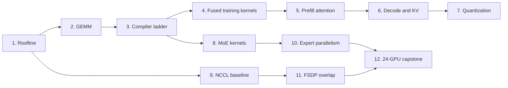

# CUDA/GPU kernel optimization for modern AI on A100

**State-of-the-art cutoff:** 2026-11-10  
**Target system:** 3 nodes × 8 NVIDIA A100-SXM4-80GB, SM80  
**Observed stack:** PyTorch 2.13.0+cu129, CUDA 12.9, Triton 3.7.1, Transformers 5.10.4, FlashAttention 2.8.3.post1

> **Evidence notation:** Performance numbers marked **†** are author- or vendor-reported and should be treated as hypotheses until reproduced on this cluster. Capability and API claims are based on official documentation or canonical repositories.

---

## Executive conclusions

1. **A100 remains a strong optimization-learning platform.** It exposes native TF32, BF16, FP16, INT8, INT4, 2:4 sparse Tensor Cores, `cp.async`, asynchronous barriers, CUDA Graphs, NVLink, and enough shared memory to teach nearly every enduring GPU optimization principle. It does **not** have native FP8 Tensor Core MMA, Hopper TMA/WGMMA, thread-block clusters, or Blackwell tensor-memory/2-CTA MMA features. [NVIDIA Ampere tuning guide](https://docs.nvidia.com/cuda/ampere-tuning-guide/index.html)

2. **The main divide is prefill/training versus decode.**
   - Large training and prefill GEMMs can become Tensor-Core compute-bound.
   - Autoregressive decode, norms, activations, optimizer updates, KV-cache reads, and small/ragged MoE GEMMs are usually bandwidth-, launch-, or latency-bound.

3. **Use this optimization ladder:**
   1. Correct shapes, layouts, batching, and precision.
   2. Vendor libraries and PyTorch SDPA.
   3. `torch.compile`/Inductor.
   4. Custom Triton.
   5. CUDA/CUTLASS only when the profiler proves the higher-level paths cannot express the needed schedule or fusion.

4. **FlashAttention-2 is the correct A100 generation.** FlashAttention-3 is Hopper-focused; FlashAttention-4 is primarily a Blackwell response to asymmetric hardware scaling. The canonical repository explicitly lists FA2 for A100, FA3 for Hopper, and FA4 for Hopper/Blackwell. [FA2 A100 support](https://github.com/Dao-AILab/flash-attention/blob/c055bdc6444a1a1984082a64b7fd62d6cb42a93d/README.md#L142-L147), [FA3](https://github.com/Dao-AILab/flash-attention/blob/c055bdc6444a1a1984082a64b7fd62d6cb42a93d/README.md#L29-L35), [FA4](https://github.com/Dao-AILab/flash-attention/blob/c055bdc6444a1a1984082a64b7fd62d6cb42a93d/README.md#L80-L86)

5. **For inference, memory-management and scheduling often dominate kernel choice.** GQA/MQA shrink KV traffic; paged KV caches reduce fragmentation; continuous batching raises utilization; Flash-Decoding exposes KV-length parallelism; CUDA Graphs remove launch gaps.

6. **INT4 speedup is not automatic.** GPTQ and AWQ determine quantized values; Marlin/CUTLASS/TensorRT-LLM-style kernels determine runtime speed. The best A100 use case is memory-bound W4A16 decode. W8A8 can be preferable for large-batch/prefill workloads that can exploit INT8 Tensor Cores.

7. **For the 3×8 topology, keep fine-grained tensor parallelism inside each eight-GPU NVLink domain.** Cross-node TP introduces collective latency at nearly every transformer layer. Prefer DP/FSDP across nodes, or pipeline stages across nodes with TP within each node.

8. **The highest-value curriculum is seven single-GPU kernel studies, followed by NCCL baselining, FSDP overlap, and topology-aware 24-GPU experiments.** Do not begin with a 24-GPU end-to-end model: it obscures the kernel and communication mechanisms you are trying to learn.

---

# 1. Version and ecosystem status

The observed environment is reproducible and suitable for A100 work, but it is not the newest software stack at the cutoff date.

| Component | Observed | Current at cutoff | Practical implication |
|---|---:|---:|---|
| PyTorch | 2.13.0+cu129 | [2.15.0, 2026-10-28](https://pytorch.org/blog/pytorch-2-15-release-blog/) | 2.13 already has Inductor’s CuTeDSL path, FlexAttention improvements, FSDP2 overlap, and the experimental CUPTI monitor. Keep it pinned for the initial curriculum. |
| CUDA Toolkit | 12.9 | [13.5, Nov. 2026](https://developer.nvidia.com/cuda-toolkit-archive) | CUDA 12.9 fully supports SM80. CUDA 13 is not required for the enduring A100 techniques. |
| Triton | 3.7.1 | [3.9.0, 2026-10-27](https://github.com/triton-lang/triton/releases/tag/v3.9.0) | 3.7.1 is a regression-fix patch with no new APIs. Upgrade only in a separate environment because PyTorch packages tightly couple Triton versions. [3.7.1 notes](https://github.com/triton-lang/triton/releases/tag/v3.7.1) |
| Transformers | 5.10.4 | [5.22.2, 2026-11-06](https://github.com/huggingface/transformers/releases/tag/v5.22.2) | Mostly an integration concern rather than a kernel concern. |
| FlashAttention | 2.8.3.post1 | [2.8.3.post2](https://github.com/Dao-AILab/flash-attention/releases/tag/v2.8.3.post2) | Post2 has no new kernel features, but fixes an FA2 backward `dq_accum` int32-overflow case and security issues. Test it in a cloned environment for very large `batch×sequence×heads×head_dim`. |
| CUTLASS | — | [4.8.1](https://github.com/NVIDIA/cutlass/releases/tag/v4.8.1) | Current releases increasingly emphasize CuTe DSL and Hopper/Blackwell, but SM80 CUTLASS kernels remain available. |
| NCCL | bundled with PyTorch | [2.32.6-1](https://github.com/NVIDIA/nccl/releases/tag/v2.32.6-1) | Do not replace PyTorch’s NCCL independently without verifying ABI and driver compatibility. |

A notable compatibility issue is that the latest vLLM release artifacts have moved to CUDA 13 and explicitly dropped CUDA 12.9 wheels. Do not expect a current `pip install vllm` to drop cleanly into this environment; use a compatible release, source build, or isolated container. [vLLM v0.33.0 release notes](https://github.com/vllm-project/vllm/releases/tag/v0.33.0rc3)

---

# 2. A100 execution and memory model

## 2.1 Relevant hardware facts

The A100-SXM4-80GB has:

- 108 SMs
- 32-thread warps and up to 64 resident warps per SM
- 164 KB configurable shared memory per SM
- 40 MB L2
- 80 GB HBM2e with a theoretical 2,039 GB/s
- Up to 600 GB/s bidirectional aggregate NVLink bandwidth per GPU, subject to the actual system topology
- Dense Tensor Core peaks of approximately 156 TFLOP/s TF32 and 312 TFLOP/s BF16/FP16; structured sparsity nominally doubles the effective math rate

Sources: [NVIDIA GPU performance background](https://docs.nvidia.com/deeplearning/performance/dl-performance-gpu-background/index.html), [Ampere tuning guide](https://docs.nvidia.com/cuda/ampere-tuning-guide/index.html), [A100 80GB datasheet](https://www.nvidia.com/content/dam/en-zz/Solutions/Data-Center/a100/pdf/a100-80gb-datasheet-update-nvidia-us-1521051-r2-web.pdf).

The hierarchy to reason about is:

```text
HBM2e → L2 → L1/shared memory → registers → Tensor/CUDA execution pipelines
```

A thread block is scheduled onto one SM. Threads exchange data through shared memory or warp shuffles; registers are private. Performance depends on:

- Enough blocks to occupy 108 SMs and avoid a short final “tail wave”
- Coalesced, vectorized global accesses
- Reuse in registers/shared/L2
- Avoiding shared-memory bank conflicts
- Balancing tile reuse against register/shared-memory pressure
- Overlapping data movement and Tensor Core execution

## 2.2 Roofline and arithmetic intensity

The Roofline model bounds performance by:

\[
P \le \min(P_\text{peak},\; BW_\text{memory}\times AI)
\]

where \(AI=\text{operations}/\text{bytes moved}\). The original model is from [Williams, Waterman, and Patterson, 2009](https://doi.org/10.1145/1498765.1498785).

Derived from the A100 datasheet peaks:

| Arithmetic path | Peak | HBM roof crossover |
|---|---:|---:|
| TF32 Tensor Core | 156 TFLOP/s | ~76.5 FLOP/byte |
| BF16/FP16 Tensor Core | 312 TFLOP/s | ~153 FLOP/byte |
| INT8 Tensor Core | 624 TOPS | ~306 ops/byte |
| INT4 Tensor Core | 1,248 TOPS | ~612 ops/byte |

These are theoretical roofs. Build a **measured roofline** using your sustained copy bandwidth and achieved GEMM rates.

For a BF16 GEMM \(C=A B\):

\[
AI \approx \frac{2MNK}{2(MK+KN+MN)}
\]

assuming one HBM read of each input and one write of the output. Real implementations add alignment, cache, epilogue, and non-matmul instruction effects.

Critical examples from NVIDIA’s performance guide:

- ReLU: roughly 0.25 FLOP/byte
- LayerNorm: generally below 10 FLOP/byte
- GEMV: arithmetic intensity below 1 FLOP/byte
- Large GEMM: often compute-bound

[NVIDIA GPU performance guide](https://docs.nvidia.com/deeplearning/performance/dl-performance-gpu-background/index.html), [matrix multiplication guide](https://docs.nvidia.com/deeplearning/performance/dl-performance-matrix-multiplication/index.html).

**Implication:** LLM training GEMMs should chase Tensor Core efficiency. Decode GEMVs, KV attention, normalizations, activations, and optimizers should primarily minimize bytes and launches.

## 2.3 Tile and wave quantization

A100 has 108 SMs. A GEMM that produces 108 tiles may execute as one full wave; 117 equally expensive tiles may require one full wave plus a nine-tile tail, potentially nearly doubling elapsed time. Misaligned matrix dimensions similarly produce partially useful tiles.

NVIDIA recommends alignment to 128-byte boundaries for best A100 Tensor Core efficiency; for BF16/FP16 this commonly means dimensions aligned to 64 elements. [NVIDIA GEMM guide](https://docs.nvidia.com/deeplearning/performance/dl-performance-matrix-multiplication/index.html)

---

# 3. A100 versus Hopper and Blackwell

| Feature or technique | A100 / SM80 | Hopper / SM90 | Blackwell / SM100+ |
|---|---|---|---|
| TF32/BF16/FP16 Tensor Core `mma.sync` | **Yes** | Yes | Yes |
| INT8/INT4 Tensor Cores | **Yes** | Yes | Yes |
| Native FP8 Tensor Core MMA | **No** | **Yes** | Yes |
| 2:4 sparse Tensor Cores | **Yes** | Yes | Yes |
| `cp.async` global→shared copy | **Yes** | Yes | Yes |
| Split arrive/wait barriers | **Yes** | Yes | Yes |
| Tensor Memory Accelerator, TMA | **No** | **Yes** | Yes |
| WGMMA / warp-group asynchronous MMA | **No** | **Yes** | Yes/evolved |
| Thread-block clusters and distributed shared memory | **No** | **Yes** | Yes |
| Tensor memory and 2-CTA MMA | **No** | No | **Yes** |
| MXFP8/MXFP4/NVFP4 native acceleration | **No** | Limited/non-native paths | **Yes** |
| FlashAttention-2 | **Primary FA generation** | Supported, but superseded | Supported, but superseded |
| FlashAttention-3 | No useful SM80 path | **Primary target** | Not primary |
| FlashAttention-4 | No | Supported implementation, not primary target | **Primary target** |
| Software persistent kernels | **Yes** | Yes | Yes |
| CUDA Graphs | **Yes** | Yes | Yes |

Official architectural distinctions are documented in the [Ampere](https://docs.nvidia.com/cuda/ampere-tuning-guide/index.html), [Hopper](https://docs.nvidia.com/cuda/hopper-tuning-guide/index.html), and [Blackwell](https://docs.nvidia.com/cuda/blackwell-tuning-guide/index.html) tuning guides.

NVIDIA Transformer Engine explicitly places FP8 training on Hopper/Ada/Blackwell while retaining FP16/BF16 optimizations for Ampere. [NVIDIA/TransformerEngine:README.rst:26-33](https://github.com/NVIDIA/TransformerEngine/blob/8b3436469a4c13a9b2719b365d76eda5c8554b3b/README.rst#L26-L33)

**Important FP8 caveat:** A100 software can store FP8-like data or use an FP8 KV cache and convert it in a kernel, but it cannot execute Hopper-style native FP8 Tensor Core GEMM. Do not report storage compression as native FP8 compute acceleration.

---

# 4. Major techniques

## 4.1 Tensor Core GEMM, layout, and tiling

**Problem solved:** Dense linear layers, QKV projections, attention output projections, and MLPs dominate transformer FLOPs.

**Core kernel idea:**

- Partition the output into CTA tiles.
- Step along K, staging A/B tiles from HBM through shared memory.
- Use warp-level Tensor Core MMA and FP32 accumulators.
- Double-buffer or multi-stage the main loop.
- Swizzle shared-memory layouts to avoid bank conflicts.
- Fuse bias, activation, scale, residual, or quantization into the epilogue.
- Reorder CTA traversal to improve L2 reuse.

CUTLASS maps GEMM through instruction-, warp-, CTA-, and grid-level tiling; its optimized main loops use software pipelining and double buffering. [CUTLASS GEMM API](https://docs.nvidia.com/cutlass/latest/media/docs/cpp/gemm_api.html), [efficient GEMM guide](https://docs.nvidia.com/cutlass/latest/media/docs/cpp/efficient_gemm.html)

Triton expresses the same blocked algorithm with program instances. Its grouped CTA ordering improves L2 reuse and, in the official tutorial, improves one A100 example from about 220 to 245 TFLOP/s†. [Triton matmul tutorial](https://triton-lang.org/main/getting-started/tutorials/03-matrix-multiplication.html)

**Expected bottleneck:**

- Large aligned GEMMs: Tensor Core throughput or instruction issue.
- Small M/N: insufficient parallelism and wave quantization.
- Large K with small M/N: split-K reduction overhead.
- Misaligned dimensions: wasted tiles and inefficient loads.
- Excessively large tiles: register/shared-memory pressure and low occupancy.
- Decode GEMV: HBM bandwidth, not Tensor Core peak.

**Applicability and maturity:**

- `cuBLAS`/`cuBLASLt`: first choice, production mature.
- CUTLASS: mature and low-level, good for fused or unusual layouts.
- Triton: highly productive, particularly for fused epilogues and shape-specific kernels.
- A100 supports the essential techniques; ignore TMA/WGMMA code paths.

**A100 experiment:**

Sweep representative shapes:

```text
Training/prefill:
M ∈ {512, 2048, 8192, 32768}
N,K ∈ {4096, 11008, 16384}

Decode:
M ∈ {1, 4, 8, 16, 32, 64}
N,K ∈ {4096, 8192, 11008}
```

Compare:

1. `torch.matmul`/cuBLAS
2. Triton blocked matmul
3. Triton grouped ordering
4. Triton persistent matmul
5. CUTLASS or cuBLASLt with fused epilogue

Measure:

- Median and p95 latency
- Useful TFLOP/s, not padded FLOP/s
- DRAM bytes and bandwidth
- Tensor-pipe utilization
- Achieved occupancy and registers/thread
- L2 hit rate
- Number of CTA waves
- Numerical error against FP64/FP32 reference

---

## 4.2 Precision: TF32, BF16, FP16, integer, and FP8 caveats

**Problem solved:** Higher Tensor Core throughput and lower memory traffic without unacceptable numerical degradation.

**Core idea:**

- **TF32:** FP32 dynamic range, reduced input mantissa, FP32 accumulation. Useful for FP32 model code that can accept reduced matmul precision.
- **BF16:** FP32-like exponent range with fewer mantissa bits. Usually the preferred A100 training format for transformers.
- **FP16:** More mantissa bits than BF16 but much smaller dynamic range; commonly needs loss scaling.
- **INT8/INT4:** Native A100 Tensor Core formats, but model quantization and packing must match the kernel.
- **FP8:** No native A100 FP8 Tensor Core path.

PyTorch 2.13 exposes explicit FP32 precision controls and documents a roughly 7× TF32-versus-strict-FP32 A100 matmul example†, with greater error. [PyTorch CUDA semantics](https://docs.pytorch.org/docs/2.13/notes/cuda.html#tensorfloat-32-tf32-on-ampere-and-later-devices)

**Expected bottleneck:**

- Large BF16/FP16/TF32 GEMM: Tensor Core compute.
- Small matrices: launch and scheduling.
- Integer/quantized kernels: dequantization, scale loads, and packing may replace HBM as the bottleneck.
- FP16 training: overflow/underflow and scaling overhead.

**Applicability and status:**

- BF16/FP16/TF32: fully mature on A100.
- INT8/INT4: mature at the hardware and CUTLASS/cuBLASLt level; model integration varies.
- FP8 training/GEMM: Hopper and newer. [FP8 formats paper](https://arxiv.org/abs/2209.05433)

**A100 experiment:**

For the same GEMM and a small transformer block, compare strict FP32, TF32, BF16, and FP16:

- Kernel and step time
- Achieved TFLOP/s
- HBM bytes
- Max/mean relative error
- Gradient overflow counts
- Loss-scaler changes
- Training loss divergence over 100–1,000 controlled steps

Explicitly record all precision flags; never rely on defaults.

---

## 4.3 2:4 structured sparsity

**Problem solved:** Skip half the multiplications in compatible GEMMs while retaining regular hardware-friendly structure.

**Core kernel idea:** In every group of four weights, retain two nonzeros. Store compressed values plus position metadata. Sparse Tensor Cores select the matching activations and skip zero products.

A100 provides nominal 2× effective Tensor Core math for this pattern. [cuSPARSELt documentation](https://docs.nvidia.com/cuda/cusparselt/index.html), [NVIDIA 2:4 explanation](https://developer.nvidia.com/blog/exploiting-ampere-structured-sparsity-with-cusparselt/)

**Expected bottleneck:**

- Large GEMMs: sparse Tensor Core throughput.
- Smaller shapes: compression metadata, setup, launch, or reduced parallelism.
- End-to-end model: non-GEMM operations and accuracy recovery.
- Changing weights: repeated pruning/compression may erase gains.

**Applicability and maturity:**

- Hardware and cuSPARSELt are mature.
- Training a model that maintains the pattern without quality loss is workload-dependent.
- NVIDIA reports roughly 1.3–1.6× sparse-GEMM speedups for selected BERT-Large shapes rather than a full 2׆. This is vendor evidence, not an independent end-to-end result.

**A100 experiment:**

Use BERT/LLM linear shapes and compare dense cuBLASLt with cuSPARSELt:

- Random 2:4 matrices first
- Then magnitude-pruned weights
- Optionally short sparse-aware fine-tuning

Measure:

- Setup/prune/compress time separately
- Repeated SpMM kernel time
- End-to-end transformer-layer time
- Effective and physical TFLOP/s
- Memory footprint
- Accuracy/perplexity before and after pruning

Do not claim a speedup until compression cost and model-quality cost are included.

---

## 4.4 Fusion for pointwise and reduction kernels

**Problem solved:** Low-arithmetic-intensity operators repeatedly read and write large tensors and launch many short kernels.

**Core kernel idea:**

- Keep intermediates in registers/shared memory.
- Read each input once and write the final result once.
- Fuse reductions with elementwise epilogues where legal.
- Use warp shuffles and block reductions.
- Vectorize loads/stores and assign adjacent lanes to adjacent addresses.

The Triton fused-softmax tutorial shows that a naïve decomposition reads approximately \(5MN+2M\) elements and writes \(3MN+2M\), while a fused implementation can approach one read and one write of the main tensor. [Triton fused softmax](https://triton-lang.org/main/getting-started/tutorials/02-fused-softmax.html)

**Expected bottleneck:**

- HBM bandwidth for large tensors.
- Launch latency for small tensors.
- Register/shared-memory capacity if the fused live set becomes too large.
- Reduction latency and synchronization for long rows.

**Applicability and maturity:**

- Excellent A100 target.
- Inductor handles many pointwise chains automatically.
- Triton is appropriate when reduction schedules or layouts need explicit control.
- Full CUDA is rarely necessary for ordinary pointwise fusion.

**A100 experiment:**

Implement:

```text
bias → GELU/SiLU → dropout → residual add
```

and:

```text
masked softmax → dropout
```

Compare eager, `torch.compile`, and custom Triton.

Measure:

- Kernel launches per call
- HBM bytes
- Effective GB/s
- Median latency across sizes
- Register count and occupancy
- Compile time versus steady-state time
- Correctness under irregular dimensions and masks

---

## 4.5 LayerNorm, RMSNorm, activations, optimizers, and loss kernels

### Norms

LayerNorm and RMSNorm are reductions followed by elementwise transforms. They are normally memory-bound; RMSNorm avoids mean subtraction but retains a reduction. [RMSNorm paper](https://arxiv.org/abs/1910.07467)

A typical Triton schedule assigns one row to a program, accumulates in FP32, reduces on chip, and writes once. Backward commonly uses a second-stage reduction for weight/bias gradients. [Triton LayerNorm tutorial](https://triton-lang.org/main/getting-started/tutorials/05-layer-norm.html)

### Activations and gated MLPs

SwiGLU/GeGLU can fuse:

```text
up projection result + gate projection result
→ activation(gate)
→ multiply by up
```

The best implementation may fuse activation into a GEMM epilogue or at least fuse activation and multiply into one bandwidth pass.

### Optimizers

Adam/AdamW update parameters and two moments, making them heavily memory-bound. PyTorch provides:

- Single-tensor loop
- `foreach` horizontal fusion
- `fused=True`, combining horizontal and vertical fusion
- `capturable=True` for CUDA Graph/compile compatibility

[PyTorch Adam documentation](https://docs.pytorch.org/docs/2.13/generated/torch.optim.Adam.html)

### Cross-entropy

PyTorch 2.13 introduced `nn.LinearCrossEntropyLoss`, which chunks and fuses the final projection and loss so the full vocabulary logits need not be materialized, with an official claim of up to 4× lower peak memory†. [PyTorch 2.13 release](https://pytorch.org/blog/pytorch-2-13-release-blog/)

Liger offers Triton implementations of RMSNorm, RoPE, SwiGLU, cross-entropy, and fused linear cross-entropy. Its reported 20% throughput and 60% memory improvements are project benchmarks†, not independent evidence. [linkedin/Liger-Kernel:README.md:61-65](https://github.com/linkedin/Liger-Kernel/blob/e1602a4d588f229205d435717d6280009f433fb6/README.md#L61-L65)

**A100 experiment:**

Compare native eager, compiled native, Triton tutorial/Liger, and Apex where compatible:

- LayerNorm and RMSNorm, forward and backward
- SwiGLU
- AdamW loop/foreach/fused
- Separate linear + cross-entropy versus fused linear cross-entropy

Measure:

- Forward/backward latency
- Achieved GB/s
- Launch count
- Peak allocated and reserved memory
- Numerical differences
- End-to-end transformer-block step time

---

## 4.6 PyTorch eager versus Inductor, Triton, and CUDA/CUTLASS

| Level | Strength | Main limitation | Recommended use |
|---|---|---|---|
| PyTorch eager | Fast development; calls cuBLAS/cuDNN/SDPA | Intermediate tensors and launch overhead | Correctness baseline |
| `torch.compile` + Inductor | Automatic graph capture, fusion, Triton/template GEMMs, CUDA Graph options | Compile latency, graph breaks, recompiles, variable shapes | First optimization attempt |
| Triton | Explicit tiling and fusion in Python; excellent for pointwise/reduction/custom matmul | Less low-level control; compiler quality varies by layout and version | Custom A100 learning and production kernels |
| CUDA C++ | Full control of streams, shared memory, PTX, barriers, and launch | High engineering and maintenance cost | Architecture-specific or unsupported schedules |
| CUTLASS/CuTe | Production-grade GEMM abstractions, layouts, epilogues, grouped GEMM | Template/DSL complexity and architecture specialization | GEMM-heavy custom operators |

PyTorch 2’s compiler stack combines Dynamo graph capture, AOTAutograd, and Inductor; its ASPLOS evaluation reported 2.27× inference and 1.41× training geometric-mean speedups on A100 across its benchmark suite†. [PyTorch 2 paper](https://doi.org/10.1145/3620665.3640366)

`torch.compile` 2.13 modes include:

- `default`
- `reduce-overhead`, using CUDA Graphs where applicable
- `max-autotune`
- `max-autotune-no-cudagraphs`

Options include epilogue fusion, shape padding, Triton CUDA Graphs, and trace output. [PyTorch 2.13 `torch.compile`](https://docs.pytorch.org/docs/2.13/generated/torch.compile.html)

PyTorch 2.13 also introduced an experimental CuTeDSL code path for selected GEMM and RMSNorm kernels. Treat it as an emerging backend and verify that it actually selects an SM80 path before attributing a speedup to it. [PyTorch 2.13 release](https://pytorch.org/blog/pytorch-2-13-release-blog/)

**A100 experiment:** Implement exactly one operation—RMSNorm, fused softmax, or matmul+bias+GELU—at all five levels. Compare implementation effort, compile time, steady-state time, generated launches, correctness, and profiler bottlenecks.

---

## 4.7 FlashAttention generations, SDPA, and FlexAttention

### FlashAttention-1

FA1 introduced IO-aware exact attention: tile Q/K/V, maintain an online softmax, and avoid writing the \(N\times N\) score matrix to HBM. It reduces intermediate memory from quadratic to linear while preserving exact softmax semantics. [FlashAttention paper, 2022](https://arxiv.org/abs/2205.14135)

### FlashAttention-2

FA2 improves:

- Work partitioning across CTAs and warps
- Parallelism across query sequence tiles
- Non-matmul operation count
- Shared-memory communication

The paper reports 50–73% of theoretical peak on A100 and around 2× over FA1†. [FlashAttention-2, 2023](https://arxiv.org/abs/2307.08691)

**This is the principal FlashAttention generation for A100.**

### FlashAttention-3 — Hopper only for practical purposes

FA3 uses Hopper TMA, warp specialization, asynchronous Tensor Core execution, and FP8. [FlashAttention-3, 2024](https://arxiv.org/abs/2407.08608)

### FlashAttention-4 — Blackwell frontier

FA4 responds to Blackwell’s Tensor Core throughput growing faster than shared-memory bandwidth and exponential units. It adds fully asynchronous MMA pipelines, larger tiles, software-emulated exponentials, conditional softmax rescaling, tensor memory, and 2-CTA MMA. [FlashAttention-4, 2026](https://arxiv.org/abs/2603.05451)

### PyTorch SDPA

PyTorch 2.13 SDPA can select among:

- FlashAttention-2
- Memory-efficient attention
- C++ math implementation

It provides an `sdpa_kernel` context manager to force and diagnose backends. GQA is still described as experimental. [PyTorch SDPA documentation](https://docs.pytorch.org/docs/2.13/generated/torch.nn.functional.scaled_dot_product_attention.html)

### FlexAttention

FlexAttention compiles Python `score_mod` and block-mask functions into fused kernels, allowing sliding windows, document masks, ALiBi, custom score transformations, and block sparsity. It is a prototype feature in PyTorch 2.13. [FlexAttention paper](https://arxiv.org/abs/2412.05496), [PyTorch FlexAttention API](https://docs.pytorch.org/docs/2.13/nn.attention.flex_attention.html)

**A100 experiment:**

Sweep:

```text
batch: 1, 4, 16
heads: 8, 32
head_dim: 64, 128
sequence: 512 → 32768
dtype: BF16 and FP16
mask: dense causal, sliding window, block sparse
```

Compare:

1. Explicit matmul-softmax-matmul
2. SDPA math
3. SDPA memory-efficient
4. SDPA Flash
5. `flash-attn` FA2
6. FlexAttention

Measure:

- Forward and forward+backward latency
- Peak memory
- HBM traffic
- Achieved TFLOP/s
- Backend actually selected
- Numerical error
- Deterministic backward overhead
- Compile/setup cost separately from steady state

---

## 4.8 Decode kernels, KV cache, GQA/MQA, paged attention, and continuous batching

### Why decode differs

At decode, query length is usually one. Attention must stream the entire prior KV cache but has little query parallelism. This creates a memory-bandwidth and occupancy problem.

Flash-Decoding partitions the KV sequence among CTAs, computes partial online-softmax outputs, and performs a final log-sum-exp-aware reduction. It reported up to 8× end-to-end gains on very long CodeLlama sequences and much larger isolated attention gains†. [Flash-Decoding technical post](https://crfm.stanford.edu/2023/10/12/flashdecoding.html)

### MQA and GQA

- MQA shares one K/V head across query heads, minimizing KV bytes. [MQA paper](https://arxiv.org/abs/1911.02150)
- GQA uses an intermediate number of K/V heads, preserving quality closer to MHA while retaining much of MQA’s speed. [GQA paper](https://arxiv.org/abs/2305.13245)

KV bytes per generated token are approximately:

\[
2 \times L \times H_{KV} \times D_{head} \times \text{bytes-per-element}
\]

For a 32-layer model, 32 query heads, head dimension 128, BF16:

- MHA with 32 KV heads: 512 KiB/token, about 16 GiB at 32K context per sequence
- GQA with 8 KV heads: 128 KiB/token, about 4 GiB at 32K
- MQA with 1 KV head: 16 KiB/token, about 0.5 GiB at 32K

### PagedAttention

PagedAttention divides KV storage into fixed-size blocks managed through logical-to-physical block tables, reducing fragmentation and enabling sharing. The SOSP paper reports 2–4× serving throughput over its contemporary systems†. [PagedAttention/vLLM paper](https://arxiv.org/abs/2309.06180)

The current vLLM documentation warns that its original custom CUDA PagedAttention kernel is historical: current vLLM performs attention through FlashAttention-, Triton-, or other backend implementations while the scheduler supplies block tables. [Current vLLM PagedAttention design note](https://docs.vllm.ai/en/latest/design/paged_attention/)

### Continuous batching

Iteration-level scheduling admits and retires requests at every decode iteration, avoiding batch stalls. Orca established the systems idea; modern frameworks call it continuous or in-flight batching. [Orca, OSDI 2022](https://www.usenix.org/conference/osdi22/presentation/yu)

### Current engines

- FlashInfer provides paged/ragged KV, decode/prefill/append kernels, CUDA Graph compatibility, and A100 support. [flashinfer-ai/flashinfer:README.md:24-35](https://github.com/flashinfer-ai/flashinfer/blob/119cf05beeb69ed7f66c576f81ed828702449314/README.md#L24-L35), [A100 support](https://github.com/flashinfer-ai/flashinfer/blob/119cf05beeb69ed7f66c576f81ed828702449314/README.md#L66-L73)
- TensorRT-LLM has fused context attention, masked/multi-block decode attention, XQA for GQA/MQA, packed inputs, paged KV, chunked context, and in-flight batching. [TensorRT-LLM GPT attention](https://nvidia.github.io/TensorRT-LLM/advanced/gpt-attention.html)
- vLLM exposes PagedAttention, continuous batching, chunked prefill, CUDA Graphs, and several attention backends. [vllm-project/vllm:README.md:29-36](https://github.com/vllm-project/vllm/blob/d6b696d60df12b034537a4f7aa014bba4fa4ab9b/README.md#L29-L36)
- SGLang adds RadixAttention for prefix reuse. [SGLang paper](https://arxiv.org/abs/2312.07104)

**A100 experiment:**

Use a fixed small decoder or isolated attention harness:

- MHA, GQA ratios 4 and 8, MQA
- Context 512–64K
- Batch 1–256
- Contiguous and paged KV
- Standard decode, split-KV/Flash-Decoding
- Eager versus CUDA Graph buckets
- Static batches versus continuous batching

Measure:

- TTFT
- Inter-token latency/TPOT p50 and p99
- Output tokens/s
- HBM bandwidth
- KV-cache bytes and fragmentation
- SM utilization
- Graph replay versus capture/setup time
- Throughput under a fixed latency SLO

---

## 4.9 Quantization kernels

### INT8

**LLM.int8** isolates rare activation-outlier dimensions into FP16 while performing more than 99.9% of values in INT8. [LLM.int8, NeurIPS 2022](https://arxiv.org/abs/2208.07339)

**SmoothQuant** moves quantization difficulty from activations to weights through an offline equivalent scaling transform, enabling W8A8 Tensor Core kernels. It reports up to 1.56× speedup and 2× memory reduction†. [SmoothQuant, ICML 2023](https://arxiv.org/abs/2211.10438)

W8A8 is particularly relevant to large-batch prefill where there is enough arithmetic intensity to use INT8 Tensor Cores.

### INT4 weight-only

**GPTQ** is an approximate second-order post-training weight quantizer. [GPTQ, ICLR 2023](https://arxiv.org/abs/2210.17323)

**AWQ** protects activation-salient channels using equivalent scaling while preserving a uniform low-bit kernel format. [AWQ, MLSys 2024](https://arxiv.org/abs/2306.00978)

Neither method itself guarantees speed: the packed runtime kernel does.

### Marlin

Marlin is an Ampere/Ada FP16×INT4 kernel that:

- Keeps activations in L2/registers
- Asynchronously streams weights
- Double-buffers shared-memory loads
- Interleaves dequantization and Tensor Core work
- Pre-packs weights/scales into kernel-native layouts
- Uses striped SM partitioning and L2-resident reductions

It claims near-ideal 4× speedups through batch 16–32† and explicitly supports compute capability 8.0+. [IST-DASLab/marlin:README.md:5-15](https://github.com/IST-DASLab/marlin/blob/1f25790bdd49fba53106164a24666dade68d7c90/README.md#L5-L15), [requirements](https://github.com/IST-DASLab/marlin/blob/1f25790bdd49fba53106164a24666dade68d7c90/README.md#L62-L66)

### A100 FP8 nuance

TensorRT-LLM’s current hardware matrix supports FP8 **KV cache** on Ampere but not FP8 weight/activation GEMM. It supports W4A16 AWQ and GPTQ on Ampere. [TensorRT-LLM quantization matrix](https://nvidia.github.io/TensorRT-LLM/features/quantization.html)

**A100 experiment:**

On a 7B/8B model:

1. BF16
2. W8A8 SmoothQuant
3. LLM.int8
4. W4A16 GPTQ + Marlin
5. W4A16 AWQ + Marlin/CUTLASS-compatible backend
6. Optional INT8 or FP8 KV cache

Measure prefill and decode separately:

- TTFT and TPOT
- Tokens/s at batch 1, 8, 32, 128
- Peak memory
- Weight and KV bandwidth
- Kernel launch count
- Perplexity and a small task-quality suite
- Quantization/calibration time
- Packed-checkpoint size

For a 70B model, repeat the best two options on eight GPUs, but do not assume the one-GPU ranking remains unchanged under TP communication.

---

## 4.10 MoE routing, grouped GEMM, and expert parallelism

**Problem solved:** MoE produces many small, differently sized expert GEMMs plus token routing and potentially all-to-all communication.

**Core kernel pipeline:**

1. Top-k expert selection
2. Histogram/prefix sum of tokens per expert
3. Permutation/scatter into expert-contiguous buffers
4. Grouped or block-sparse expert GEMMs
5. Weighted combination and inverse permutation
6. All-to-all dispatch/combine under expert parallelism

**Kernel ideas:**

- Persistent grouped-GEMM scheduler assigns multiple expert tiles to resident CTAs.
- Sort or bucket problems to improve load balance.
- Pad only to small alignment units, not full expert capacity.
- Fuse gating weights into expert output or combine.
- Overlap dispatch/combine communication with non-expert work.

CUTLASS grouped kernels launch fewer persistent CTAs than total tiles and have each CTA request additional work from the group scheduler. [CUTLASS grouped scheduler](https://docs.nvidia.com/cutlass/latest/media/docs/cpp/grouped_scheduler.html)

MegaBlocks reformulates dropless MoE as block-sparse operations, avoiding capacity-factor padding and token dropping; its paper reports up to 40% over Tutel and 2.4× over a dense Megatron baseline†. [MegaBlocks paper](https://arxiv.org/abs/2211.15841)

The project currently recommends its grouped-GEMM path specifically for Hopper-generation GPUs, so on A100 compare it with the block-sparse path rather than assuming it is superior. [databricks/megablocks:README.md:21-24](https://github.com/databricks/megablocks/blob/952db33d6eac334d22c61e47a0d5d41446298784/README.md#L21-L24)

The current DeepEP line is **not an A100 target**: its requirements specify Hopper or newer and CUDA 13.1+. [deepseek-ai/DeepEP:README.md:47-53](https://github.com/deepseek-ai/DeepEP/blob/f6aa38fe06cd4a0489e7730365d4e0114970a2f3/README.md#L47-L53)

**A100 experiment:**

Single GPU:

- 8, 32, and 64 experts
- 1–8 selected experts/token
- Uniform and Zipf-skewed routing
- Loop of GEMMs versus grouped GEMM versus block-sparse
- Batch/token counts from 32 to 16K

Then eight GPUs:

- Expert parallel all-to-all
- Different expert placements
- Communication overlap on/off

Measure:

- Useful expert TFLOP/s
- Tokens/s
- Padding and dropped-token rate
- Expert load coefficient of variation
- Route/permutation/GEMM/combine breakdown
- Dispatch/combine bandwidth
- Exposed versus overlapped communication
- p99 expert completion time

---

## 4.11 Distributed training kernels and parallelism

Start by measuring the network. The architecture is “3 nodes × 8 GPUs,” but the result depends on NVSwitch/NVLink wiring, NIC count, InfiniBand/Ethernet generation, GPUDirect RDMA, PCIe affinity, and rank placement.

### Communication primitives

NCCL provides AllReduce, AllGather, ReduceScatter, AllToAll, broadcast, and point-to-point operations. [NCCL collectives](https://docs.nvidia.com/deeplearning/nccl/user-guide/docs/usage/collectives.html)

| Parallelism | Main idea | Communication pattern | Topology advice |
|---|---|---|---|
| DDP | Replicate model, split batch | Gradient AllReduce | Good across nodes when model fits |
| ZeRO/FSDP | Shard optimizer, gradients, and optionally parameters | Param AllGather + gradient ReduceScatter | Strong candidate across all 24 GPUs |
| Tensor parallelism | Split each large GEMM/layer | Per-layer AllReduce/ReduceScatter/AllGather | Keep within one eight-GPU NVLink domain |
| Megatron sequence parallelism | Shard LayerNorm/dropout activations along sequence within TP | ReduceScatter/AllGather around TP regions | Enable with TP |
| Context parallelism | Split the entire sequence, including attention | KV ring/P2P or all-to-all | Start intra-node; cross-node only after measurement |
| Pipeline parallelism | Split layers by depth | Activation P2P between stages | Natural mapping: one stage or stage group per node |
| Expert parallelism | Split experts | AllToAll dispatch/combine | Highly sensitive to inter-node all-to-all |

### FSDP/ZeRO

ZeRO removes replicated optimizer, gradient, and parameter state by progressively sharding them. [ZeRO paper](https://arxiv.org/abs/1910.02054)

FSDP2 performs per-parameter DTensor sharding, all-gathers parameters before compute, and reduce-scatters gradients after backward. Applying `fully_shard` per transformer layer creates communication units that can overlap with adjacent layer compute; wrapping only the root produces large blocking collectives and is explicitly discouraged. [PyTorch 2.13 FSDP2 docs](https://docs.pytorch.org/docs/2.13/distributed.fsdp.fully_shard.html)

PyTorch 2.13 introduced an opt-in separate reduce-scatter process group so reduce-scatter can overlap with all-gather instead of serializing on one communicator. [PyTorch 2.13 release](https://pytorch.org/blog/pytorch-2-13-release-blog/)

### TP and sequence parallelism

Megatron TP divides column- and row-parallel linears and inserts collectives between them. [Original Megatron-LM paper](https://arxiv.org/abs/1909.08053)

Megatron sequence parallelism shards LayerNorm/dropout regions along sequence and reduces activation memory; it is distinct from full long-context parallelism. [Sequence-parallel paper](https://arxiv.org/abs/2205.05198)

### Context parallelism

Full CP shards all activations by sequence. Attention must see remote KV, so KV blocks are exchanged in a ring or transposed through all-to-all. MQA/GQA also reduce CP communication volume. [Megatron CP guide](https://docs.nvidia.com/megatron-core/developer-guide/latest/user-guide/features/context_parallel.html)

Related approaches include:

- [DeepSpeed-Ulysses](https://arxiv.org/abs/2309.14509): sequence/head all-to-all
- [Ring Attention](https://arxiv.org/abs/2310.01889): rotate KV blocks and overlap communication with blockwise attention

### Pipeline parallelism

Pipeline stages trade activation P2P traffic and bubbles for lower model memory per GPU. Interleaved schedules reduce bubbles but increase scheduling complexity. [Megatron scaling paper, SC 2021](https://arxiv.org/abs/2104.04473)

### Recommended mapping for 3×8 A100

Initial configurations to test:

```text
Dense model that fits one GPU:
DP/FSDP across 24

Large hidden dimension:
TP8 inside each node × PP3 across nodes

Long context:
TP4 × CP2 within each node, then DP or PP across nodes

Smaller model / SLM inference:
Three independent 8-GPU replicas, or even 24 independent replicas,
rather than TP24
```

**A100 experiment:**

- Baseline DDP at 8 and 24 GPUs
- FSDP2 layer wrapping versus root-only wrapping
- Separate reduce-scatter group off/on
- TP2/4/8 within a node
- TP crossing nodes as a negative control
- TP4×CP2 for 8K–64K sequences
- PP3 with one stage group per node
- Hybrid TP8×PP3 on 24 GPUs

Measure:

- Step time and tokens/s
- Scaling efficiency
- Peak memory/GPU
- Time in collectives
- Exposed communication after overlap
- Pipeline bubble fraction
- NCCL algorithmic and bus bandwidth
- MFU using a clearly documented FLOP model
- Rank-to-rank variance and p99 step time

---

## 4.12 CUDA Graphs, streams, asynchronous copies, persistent kernels, and autotuning

### CUDA Graphs

Graphs capture a fixed operation DAG once and replay it with very low host launch overhead. They are most valuable for short-kernel sequences, small models, decode, and strong-scaled training. [CUDA Graphs guide](https://docs.nvidia.com/cuda/cuda-programming-guide/04-special-topics/cuda-graphs.html)

Constraints include:

- Static or bucketed shapes
- Stable memory addresses
- Capture-safe operations
- No forbidden CPU synchronizations
- Warmup and library autotuning before capture

PyTorch’s `reduce-overhead` compile mode uses CUDA Graph mechanisms where possible. [PyTorch CUDA Graphs overview](https://pytorch.org/blog/accelerating-pytorch-with-cuda-graphs/)

### Streams

Independent streams may overlap:

- H2D copies with computation
- NCCL with compute
- Prefetch/all-gather with the current layer
- Separate independent kernels

But concurrency is not free: kernels compete for SMs, Tensor Cores, HBM, and copy engines. Use events and `wait_stream`; never assume that issuing work to two streams guarantees speedup. [PyTorch CUDA semantics](https://docs.pytorch.org/docs/2.13/notes/cuda.html#cuda-streams)

### `cp.async` on A100

Ampere hardware can copy global memory directly to shared memory asynchronously, avoid staging through registers, optionally bypass L1, and overlap transfer with compute. It combines with split arrive/wait barriers to construct multi-stage pipelines. [Ampere tuning guide](https://docs.nvidia.com/cuda/ampere-tuning-guide/index.html#asynchronous-data-copy-from-global-memory-to-shared-memory)

Do not confuse A100 `cp.async` with Hopper TMA.

### Persistent kernels

A persistent kernel launches approximately one CTA per SM or a small multiple, then has each CTA process multiple work tiles. Benefits include:

- Amortized launch/prologue cost
- Custom scheduling for ragged/grouped work
- Better load balancing in decode and MoE
- More explicit reuse across work items

Risks include poor fairness, excessive register residency, reduced overlap with other work, and fixed schedules that perform poorly for another shape. Triton’s persistent-matmul tutorial includes an A100-compatible pointer-based persistent kernel; the TMA/warp-specialized variants are Hopper+. [Triton persistent matmul](https://triton-lang.org/main/getting-started/tutorials/09-persistent-matmul.html)

### Autotuning

Tune:

- CTA tile M/N/K
- Warps
- Pipeline stages
- Split-K
- Persistent CTA count
- Grouped traversal
- Epilogue fusion
- Quantization group size and pack layout

Cache results by a shape class rather than exact dimensions if dynamic workloads would otherwise create unbounded compilation/tuning.

**A100 experiment:**

Choose a chain of 10–50 short kernels:

1. Eager
2. Multiple streams where dependencies permit
3. CUDA Graph capture
4. `torch.compile(mode="reduce-overhead")`
5. A persistent Triton version of the dominant short kernel

Measure CPU launch gaps, GPU idle time, graph replay time, capture/compile cost, memory-pool growth, throughput, and p99 latency.

---

# 5. Profiling methodology

## 5.1 Establish a reproducible fingerprint

Record for every run:

```text
GPU model and SM count
driver, CUDA runtime and toolkit
PyTorch, Triton, NCCL, cuDNN, FlashAttention versions
git SHA or wheel build
power limit, clocks, temperature, ECC and MIG state
nvidia-smi topo -m
NIC and RDMA topology
all precision/backend flags
input shapes, strides, masks and quantization group sizes
```

Compile CUDA extensions explicitly for SM80, for example through `TORCH_CUDA_ARCH_LIST=8.0`.

## 5.2 Correctness before speed

For every custom kernel:

- Compare against an FP32 or FP64 reference.
- Test irregular, zero-length where legal, and non-power-of-two shapes.
- Test NaNs, infinities, extreme logits, and masking.
- Run `compute-sanitizer` for CUDA/Triton kernels.
- Use `TRITON_INTERPRET=1` for small Triton debugging cases. [Triton debugging guide](https://triton-lang.org/main/programming-guide/chapter-3/debugging.html)

## 5.3 PyTorch Profiler

Use it to answer:

- Which operators dominate?
- What kernels do they launch?
- Are shapes or memory allocations changing?
- Are graph breaks/recompiles occurring?
- How much time belongs to CUDA versus CPU?

Use a wait/warmup/active schedule; shape and stack collection add overhead. [PyTorch profiler](https://docs.pytorch.org/docs/2.13/profiler.html)

## 5.4 Nsight Systems

Use Nsight Systems for the end-to-end critical path:

- CPU launch gaps
- Stream synchronization
- Memcpy overlap
- NCCL ordering and overlap
- Data-loader stalls
- CUDA Graph replay
- Rank skew

Annotate phases with NVTX and profile a small steady-state region rather than initialization. [Nsight Systems guide](https://docs.nvidia.com/nsight-systems/UserGuide/index.html)

Typical collection:

```bash
nsys profile \
  --trace=cuda,nvtx,osrt,cublas,cudnn,nccl \
  python benchmark.py
```

## 5.5 Nsight Compute

Profile one or a few representative kernels, not a full training run. Relevant sections include:

- SpeedOfLight
- ComputeWorkloadAnalysis
- MemoryWorkloadAnalysis
- LaunchStats
- Occupancy
- SchedulerStats
- InstructionStats
- SourceCounters
- NVLink

[Nsight Compute profiling guide](https://docs.nvidia.com/nsight-compute/ProfilingGuide/index.html)

Ask:

1. Is it compute-, memory-, or latency-limited?
2. Which memory level is saturated?
3. Is Tensor Core utilization high?
4. Are loads coalesced?
5. Are shared-memory bank conflicts present?
6. Is occupancy low because of registers or shared memory?
7. Are warps stalled on dependencies, memory, or barriers?
8. Is the tail wave large?

## 5.6 Compiler inspection

For Inductor:

- Capture graph breaks and recompiles.
- Inspect generated Triton/CUDA code.
- Separate first-call compile/autotune time from steady state.
- Compare `default`, `reduce-overhead`, and `max-autotune`.

For Triton:

- Inspect TTIR, TTGIR, LLVM IR, PTX, and generated cubin/SASS when a result is surprising.
- Use Proton where available, but corroborate with Nsight for hardware counters.

## 5.7 Distributed profiling

First run [NCCL tests](https://github.com/NVIDIA/nccl-tests):

- AllReduce
- AllGather
- ReduceScatter
- AllToAll
- Send/recv
- 8 GPUs intra-node
- 24 GPUs inter-node
- Sizes from kilobytes through hundreds of megabytes
- CUDA Graph capture off/on where relevant

Report both `algbw` and topology-normalized `busbw`, plus rank variance.

---

# 6. Benchmark pitfalls

1. **CUDA execution is asynchronous.** Use CUDA events or explicit synchronization. CPU wall-clock timing without synchronization is invalid. [PyTorch CUDA timing guidance](https://docs.pytorch.org/docs/2.13/notes/cuda.html#asynchronous-execution)

2. **Separate cold and warm performance.**
   - Import/JIT compilation
   - Triton autotuning
   - cuBLAS heuristic search
   - CUDA Graph capture
   - Allocator warmup  
   These are different metrics from steady-state latency.

3. **Use replicates and robust statistics.** Report median, IQR, and p95/p99 rather than only the mean. `torch.utils.benchmark.Timer` warms up, synchronizes accelerators, and emphasizes replicate distributions. [PyTorch benchmark utilities](https://docs.pytorch.org/docs/2.13/benchmark_utils.html)

4. **Benchmark realistic distributions, not one favorable shape.** Include real batch, context, head-dimension, vocabulary, and expert-load distributions.

5. **Verify the backend actually used.** SDPA, cuBLASLt, Inductor, quantization engines, and serving frameworks all use runtime dispatch and heuristics.

6. **Report useful work.** Padding and tile quantization can inflate nominal TFLOP/s. Report useful FLOPs and physical hardware work separately where possible.

7. **Do not compare unequal quality silently.** Quantized/sparse/approximate models require accuracy, loss, or perplexity alongside throughput.

8. **Profile overhead changes execution.** Nsight Compute may replay kernels; PyTorch shape/stack tracing can retain tensors and add copies. Do not quote profiled timing as production timing without validation.

9. **Control or log thermals and clocks.** If clock locking is unavailable, run long enough to reach thermal steady state and log frequency/power.

10. **Include allocator and workspace effects.** Fused and graph-captured paths may trade speed for cached workspace or private memory pools.

11. **Avoid cross-node background traffic.** Multi-node results are otherwise not reproducible.

12. **Check determinism separately from speed.** Atomics, cuDNN heuristics, reductions, and fused attention can change bitwise behavior.

---

# 7. Prioritized experimental curriculum

| # | Priority | Experiment | GPUs | Primary metrics |
|---:|---|---|---:|---|
| 1 | P0 | **Measured A100 roofline:** copy/triad, elementwise, reductions, GEMV, GEMM | 1 | Sustained GB/s, TFLOP/s, arithmetic intensity, roofline position |
| 2 | P0 | **Tensor Core GEMM:** alignment, tile/wave quantization, grouped ordering, split-K | 1 | TFLOP/s, occupancy, L2, registers, tail waves |
| 3 | P0 | **Compiler ladder:** eager → Inductor modes → Triton → CUDA/CUTLASS | 1 | Compile time, steady-state latency, launches, bytes, engineering complexity |
| 4 | P0 | **Memory-bound training kernels:** RMSNorm/LayerNorm, SwiGLU, fused Adam, fused linear-cross-entropy | 1 | GB/s, forward/backward time, peak memory, launch count |
| 5 | P0 | **Attention prefill and backward:** SDPA backends, FA2, FlexAttention | 1 | Latency, peak memory, TFLOP/s, HBM bytes, numerical error |
| 6 | P0 | **Decode attention:** MHA/GQA/MQA, Flash-Decoding, KV layout, graph buckets | 1 | TTFT, TPOT p50/p99, HBM bandwidth, KV bytes |
| 7 | P1 | **Quantization:** BF16, W8A8, GPTQ/AWQ W4A16, Marlin | 1; optional 8 | Prefill/decode throughput, VRAM, perplexity/accuracy |
| 8 | P1 | **MoE local kernels:** looped versus grouped versus block-sparse expert GEMM | 1 | Useful TFLOP/s, routing overhead, load imbalance, padding |
| 9 | P0 | **NCCL topology baseline:** all major collectives and message sizes | 8 and 24 | `algbw`, `busbw`, p99 latency, rank variance |
| 10 | P1 | **MoE expert parallelism:** dispatch/combine all-to-all and overlap | 8; optional 24 | Tokens/s, all-to-all bandwidth, exposed communication |
| 11 | P1 | **FSDP2/ZeRO overlap:** DDP, root-only FSDP, layerwise FSDP, separate RS group | 8 then 24 | Step time, memory, exposed AG/RS, scaling efficiency |
| 12 | P2 | **Topology-aware capstone:** TP8×PP3, TP4×CP2, or three 8-GPU serving replicas | 24 | MFU, bubble fraction, TTFT/TPOT, cross-node traffic, SLO throughput |

### Recommended order



Experiments 1–6 provide most of the kernel-learning value. Experiments 9–12 consume the scarce cluster allocation and should be run only after the single-GPU baselines are stable.

---

# 8. Current open-source ecosystem

| Project | Status at cutoff | A100 relevance |
|---|---|---|
| [PyTorch 2.15](https://github.com/pytorch/pytorch/releases/tag/v2.15.0) | Current framework release; observed stack is 2.13 | Inductor, SDPA, FlexAttention, FSDP2, profiler, graphs |
| [Triton 3.9](https://github.com/triton-lang/triton/releases/tag/v3.9.0) | Current DSL/compiler; observed 3.7.1 | Excellent SM80 learning platform |
| [CUTLASS 4.8.1](https://github.com/NVIDIA/cutlass/releases/tag/v4.8.1) | Current NVIDIA kernel library/DSL | SM80 kernels remain useful; newest work skews newer |
| [FlashAttention](https://github.com/Dao-AILab/flash-attention) | FA2 maintenance plus FA3/FA4 subprojects | FA2 is the A100 path |
| [xFormers 0.0.35](https://github.com/facebookresearch/xformers/releases/tag/v0.0.35) | Attention and fused-operator library | Useful dispatch/baseline ecosystem |
| [FlashInfer 0.7.3](https://github.com/flashinfer-ai/flashinfer/releases/tag/v0.7.3) | Current inference-kernel engine | Core attention supports A100; many newest kernels are Hopper+ |
| [vLLM v0.33.0rc3](https://github.com/vllm-project/vllm/releases/tag/v0.33.0rc3) | Leading serving system; latest artifacts CUDA 13 | Use a compatible release/build for cu129 |
| [TensorRT-LLM 1.2.1](https://github.com/NVIDIA/TensorRT-LLM/releases/tag/v1.2.1) | NVIDIA production inference stack | Strong A100 quantization/attention baseline |
| [SGLang 0.5.23](https://github.com/sgl-project/sglang/releases/tag/v0.5.23) | Serving/runtime with prefix caching | A100-capable core; 2026 megakernel frontier targets newer GPUs |
| [Liger Kernel 0.8.5](https://github.com/linkedin/Liger-Kernel/releases/tag/v0.8.5) | Fused LLM training kernels | Default Triton kernels are relevant; optional CuTe backend targets Hopper/Blackwell |
| [Marlin](https://github.com/IST-DASLab/marlin) | Canonical W4A16 Ampere kernel | Directly relevant |
| [GPTQModel 7.10](https://github.com/ModelCloud/GPTQModel/releases/tag/v7.10.0) | Actively maintained GPTQ ecosystem | More current than AutoGPTQ |
| [torchao 0.18](https://github.com/pytorch/ao/releases/tag/v0.18.0) | Quantization workflows; project is consolidating foundational pieces into core PyTorch and consumer repos | Useful, but track migration direction. [Project notice](https://github.com/pytorch/ao/blob/82c6889c4a33041a7023467746b6a91da3e691d1/README.md#L7-L13) |
| [Megatron-LM/Core 0.20](https://github.com/NVIDIA/Megatron-LM/releases/tag/core_v0.20.0) | Dense/MoE distributed training | Primary TP/SP/CP/PP reference |
| [DeepSpeed 0.19.9](https://github.com/deepspeedai/DeepSpeed/releases/tag/v0.19.9) | ZeRO, pipeline, Ulysses, MoE | Strong distributed comparison |
| [TorchTitan 0.4](https://github.com/pytorch/torchtitan/releases/tag/v0.4.0) | PyTorch-native large-model training reference | Good FSDP2/TP/CP experimental harness |
| [MegaBlocks 0.10](https://github.com/databricks/megablocks/releases/tag/v0.10.0) | Dropless MoE kernels | Block-sparse A100 study; grouped path now Hopper-oriented |
| [NCCL 2.32.6-1](https://github.com/NVIDIA/nccl/releases/tag/v2.32.6-1) | Current communication library | Core 8/24-GPU study target |
| [DeepEP](https://github.com/deepseek-ai/DeepEP) | Current MoE communication frontier | Current version requires Hopper+, not A100 |

---

# 9. Claims requiring independent verification

The following prominent claims are **not independently established for this exact stack and cluster**:

- FA2’s reported ~2× over FA1 and 50–73% A100 peak utilization
- Flash-Decoding’s up-to-8× end-to-end gain
- PagedAttention/vLLM’s 2–4× throughput improvement
- FlashInfer’s 13–69% improvements across scenarios
- Marlin’s near-ideal 4× W4A16 speedup through batch 16–32
- Liger’s 20% throughput and 60% memory claims
- MegaBlocks’ 40% over Tutel and 2.4× over dense Megatron
- PyTorch release-blog memory and speedup claims
- NVIDIA cuSPARSELt and TensorRT-LLM speedups
- Current vLLM/SGLang/FlashInfer release-note performance numbers on newer GPUs

Most are credible author or vendor measurements, and several appear in peer-reviewed systems papers, but they remain shape-, model-, software-, and topology-dependent. The proposed curriculum should be treated as the independent replication.

---

# 10. Source-quality assessment

**High confidence**

- NVIDIA CUDA, Ampere/Hopper/Blackwell, CUTLASS, cuBLAS, cuSPARSELt, NCCL, and Nsight documentation
- PyTorch and Triton versioned documentation and release notes
- Canonical repository compatibility statements
- Peer-reviewed papers for Roofline, PyTorch 2, FlashAttention-1, PagedAttention, Orca, GPTQ, AWQ, SmoothQuant, MegaBlocks, Megatron, and ZeRO

**Moderate confidence**

- Recent preprints: FlashAttention-2/3/4, FlexAttention, Ulysses, Ring Attention, Marlin
- Canonical author benchmarks and vendor release-blog measurements

**Main uncertainties**

- No benchmarks were executed on the 24-GPU cluster for this review.
- The inter-node NIC/RDMA topology and installed NCCL/driver versions were not provided.
- Several latest projects now optimize primarily for Hopper, Blackwell, or CUDA 13.
- Compiler and dispatcher behavior is shape-specific and must be confirmed in traces.

The evidence base is dominated by primary sources; no secondary article was used as the basis for a substantive technical recommendation.

---

## Selected primary sources

### Hardware, CUDA, and profiling

- [A100 80GB datasheet](https://www.nvidia.com/content/dam/en-zz/Solutions/Data-Center/a100/pdf/a100-80gb-datasheet-update-nvidia-us-1521051-r2-web.pdf)
- [Ampere tuning guide](https://docs.nvidia.com/cuda/ampere-tuning-guide/index.html)
- [CUDA Best Practices](https://docs.nvidia.com/cuda/cuda-c-best-practices-guide/index.html)
- [GPU performance background](https://docs.nvidia.com/deeplearning/performance/dl-performance-gpu-background/index.html)
- [GEMM performance guide](https://docs.nvidia.com/deeplearning/performance/dl-performance-matrix-multiplication/index.html)
- [CUDA Graphs](https://docs.nvidia.com/cuda/cuda-programming-guide/04-special-topics/cuda-graphs.html)
- [Nsight Systems](https://docs.nvidia.com/nsight-systems/UserGuide/index.html)
- [Nsight Compute](https://docs.nvidia.com/nsight-compute/ProfilingGuide/index.html)

### Compiler and kernel systems

- [PyTorch 2 paper](https://doi.org/10.1145/3620665.3640366)
- [Triton paper](https://doi.org/10.1145/3315508.3329973)
- [CUTLASS efficient GEMM](https://docs.nvidia.com/cutlass/latest/media/docs/cpp/efficient_gemm.html)
- [PyTorch 2.13 release](https://pytorch.org/blog/pytorch-2-13-release-blog/)
- [PyTorch `torch.compile`](https://docs.pytorch.org/docs/2.13/generated/torch.compile.html)

### Attention and serving

- [FlashAttention-1](https://arxiv.org/abs/2205.14135)
- [FlashAttention-2](https://arxiv.org/abs/2307.08691)
- [FlashAttention-3](https://arxiv.org/abs/2407.08608)
- [FlashAttention-4](https://arxiv.org/abs/2603.05451)
- [FlexAttention](https://arxiv.org/abs/2412.05496)
- [MQA](https://arxiv.org/abs/1911.02150)
- [GQA](https://arxiv.org/abs/2305.13245)
- [PagedAttention](https://arxiv.org/abs/2309.06180)
- [FlashInfer](https://arxiv.org/abs/2501.01005)
- [Orca](https://www.usenix.org/conference/osdi22/presentation/yu)
- [SGLang](https://arxiv.org/abs/2312.07104)

### Quantization, sparsity, and MoE

- [FP8 formats](https://arxiv.org/abs/2209.05433)
- [LLM.int8](https://arxiv.org/abs/2208.07339)
- [GPTQ](https://arxiv.org/abs/2210.17323)
- [SmoothQuant](https://arxiv.org/abs/2211.10438)
- [AWQ](https://arxiv.org/abs/2306.00978)
- [cuSPARSELt](https://docs.nvidia.com/cuda/cusparselt/index.html)
- [MegaBlocks](https://arxiv.org/abs/2211.15841)

### Distributed training

- [ZeRO](https://arxiv.org/abs/1910.02054)
- [PyTorch FSDP paper](https://arxiv.org/abs/2304.11277)
- [FSDP2 documentation](https://docs.pytorch.org/docs/2.13/distributed.fsdp.fully_shard.html)
- [Megatron-LM](https://arxiv.org/abs/1909.08053)
- [Megatron scaling and pipeline scheduling](https://arxiv.org/abs/2104.04473)
- [Sequence parallelism](https://arxiv.org/abs/2205.05198)
- [DeepSpeed-Ulysses](https://arxiv.org/abs/2309.14509)
- [Ring Attention](https://arxiv.org/abs/2310.01889)
- [Megatron parallelism guide](https://docs.nvidia.com/megatron-core/developer-guide/latest/user-guide/parallelism-guide.html)

No AML resources were used and no workspace files were modified.